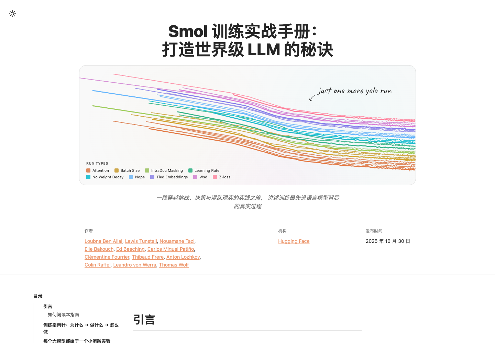

# Smol 训练实战手册（中文翻译版）

> **The Smol Training Playbook: The Secrets to Building World-Class LLMs** 的简体中文翻译版
>
> 一段穿越挑战、决策与混乱现实的实践之旅，讲述训练最先进语言模型背后的真实过程。



- 原文：[Hugging Face Spaces · HuggingFaceTB/smol-training-playbook](https://huggingface.co/spaces/HuggingFaceTB/smol-training-playbook)
- 在线阅读：[leonyuhe.github.io/smol-training-playbook_zh](https://leonyuhe.github.io/smol-training-playbook_zh/)
- 作者：Loubna Ben Allal 等 12 位 Hugging Face 成员
- 中文翻译维护：[leonyuhe](https://github.com/leonyuhe)

## 关于这本书

这是一本关于训练 3B 参数多语言推理模型 **SmolLM3** 的实战手记，也是一份从“有一个好数据集和一堆 GPU”走到“造出一个真正强大的模型”的完整指南。

全书分为四个部分：

- **训练指南针**：在烧掉算力预算之前，先回答“为什么训练”“训练什么”“怎么训练”。
- **预训练**：消融实验、评测、数据混合、模型架构、超参数与训练马拉松。
- **后训练**：SFT、DPO、GRPO、推理能力与模型合并。
- **基础设施**：GPU 集群、通信、存储、并行策略与性能瓶颈排查。

## 翻译说明

- 正文、章节标题、表格、图注和界面文案已翻译为简体中文。
- 代码、命令行参数、变量名、URL、模型名、论文名、数字与公式保持原文。
- 交互式图表由原站脚本渲染，**图内标签**与**脚注引用卡片**保留英文原文；正文对每张图的解释均已翻译。
- 本译文为社区翻译，**非 Hugging Face 官方中文版**。如发现术语或表述问题，欢迎提交 Issue / PR。

## 本地运行

需要 Node.js 20+。

```bash
cd app
npm install
npm run dev          # http://localhost:4321/smol-training-playbook_zh/
```

构建静态站点：

```bash
cd app
npm run build        # 输出到 app/dist
```

## 部署到 GitHub Pages

在线站点：<https://leonyuhe.github.io/smol-training-playbook_zh/>

仓库中的 `docs/` 是构建好的静态站点，`gh-pages` 分支与它保持同步，GitHub Pages 从该分支发布。

重新构建并发布：

```bash
cd app
npm run build:gh
cd ..
git add docs
git commit -m "rebuild site"
git subtree push --prefix docs origin gh-pages
```

`build:gh` 会执行 Astro 构建、把根路径资源改写成 `/smol-training-playbook_zh/` 前缀，并把产物复制到 `docs/`。

## 目录结构

```text
.
├── app/                 # Astro 源码与文章 MDX
│   ├── src/content/     # 中文 article.mdx、图片与交互图表数据
│   └── public/          # 静态资源
├── docs/                # 构建产物，GitHub Pages 站点
├── tools/               # 分块、校验、回填与路径修正脚本
├── LICENSE              # CC BY 4.0
└── NOTICE               # 原文署名与翻译说明
```

## 许可与署名

原文及图表由 Hugging Face 与原作者以 [CC BY 4.0](https://creativecommons.org/licenses/by/4.0/) 发布。本译文沿用同一许可，转载请注明原文与译者，并链接到本仓库。

详见 [LICENSE](LICENSE) 与 [NOTICE](NOTICE)。

## 致谢

感谢 Loubna Ben Allal、Lewis Tunstall、Nouamane Tazi、Elie Bakouch、Ed Beeching、Carlos Miguel Patiño、Clémentine Fourrier、Thibaud Frere、Anton Lozhkov、Colin Raffel、Leandro von Werra、Thomas Wolf 写下这本手册并开放全部图表与实验数据；感谢 Hugging Face 提供原文与交互式图表。
