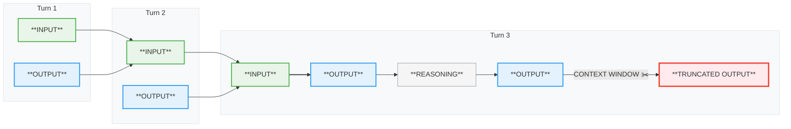
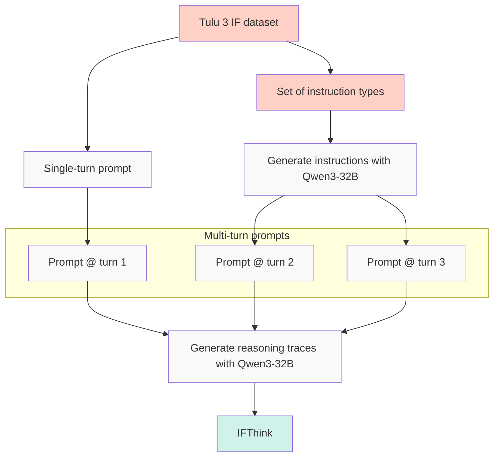
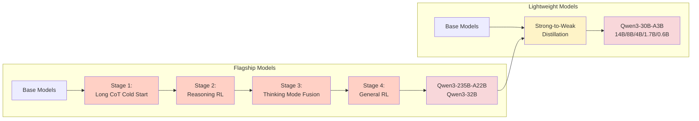

import Sidenote from '../components/Sidenote.astro';
import Image from '../components/Image.astro';
import HtmlEmbed from '../components/HtmlEmbed.astro';
import Note from '../components/Note.astro';
import Wide from '../components/Wide.astro';
import Quote from '../components/Quote.astro';
import Reference from '../components/Reference.astro';
import FullWidth from '../components/FullWidth.astro';
import image_27c1384e_bcac_807c_807b_fac08be1d884 from './assets/image/image_27c1384e-bcac-807c-807b-fac08be1d884.png';
import image_2931384e_bcac_80c4_ab02_f22c53e6fdee from './assets/image/image_2931384e-bcac-80c4-ab02-f22c53e6fdee.png';
import image_2931384e_bcac_8062_bc11_d1ee3706d996 from './assets/image/image_2931384e-bcac-8062-bc11-d1ee3706d996.png';
import Capture_decran_2025_10_20_a_13_25_47_2921384e_bcac_8087_83e5_fa7a40c1f342 from './assets/image/Capture_decran_2025-10-20_a_13_25_47_2921384e-bcac-8087-83e5-fa7a40c1f342.png';
import Capture_decran_2025_10_20_a_13_26_08_2921384e_bcac_80b5_ac36_fb73d6374208 from './assets/image/Capture_decran_2025-10-20_a_13_26_08_2921384e-bcac-80b5-ac36-fb73d6374208.png';
import img_75ae60ff_50be_48e1_aad2_a8fc56120d3d_2921384e_bcac_80c2_984b_d81404e4bb7c from './assets/image/75ae60ff-50be-48e1-aad2-a8fc56120d3d_2921384e-bcac-80c2-984b-d81404e4bb7c.png';
import Capture_decran_2025_10_21_a_11_11_38_2931384e_bcac_8008_ad8d_d5ab0c539d3a from './assets/image/Capture_decran_2025-10-21_a_11_11_38_2931384e-bcac-8008-ad8d-d5ab0c539d3a.png';
import Capture_decran_2025_10_21_a_15_34_27_2931384e_bcac_8066_834b_c485ae8d1fa5 from './assets/image/Capture_decran_2025-10-21_a_15_34_27_2931384e-bcac-8066-834b-c485ae8d1fa5.png';
import image_2471384e_bcac_8059_84a4_d4ce5ae3847c from './assets/image/image_2471384e-bcac-8059-84a4-d4ce5ae3847c.png';
import Capture_decran_2025_10_27_a_22_10_05_2991384e_bcac_802a_a6e6_dab0f9f410ec from './assets/image/Capture_decran_2025-10-27_a_22_10_05_2991384e-bcac-802a-a6e6-dab0f9f410ec.png';
import Screenshot_2025_10_24_at_09_37_24_2961384e_bcac_8055_9e8e_ffbd3a1aa368 from './assets/image/Screenshot_2025-10-24_at_09_37_24_2961384e-bcac-8055-9e8e-ffbd3a1aa368.png';
import Screenshot_2025_09_26_at_22_36_40_27a1384e_bcac_8063_94e0_f1c689e7d9b9 from './assets/image/Screenshot_2025-09-26_at_22_36_40_27a1384e-bcac-8063-94e0-f1c689e7d9b9.png';
import GtU8DnoWsAAruEG_28e1384e_bcac_8051_8122_ed6cacf8f632 from './assets/image/GtU8DnoWsAAruEG_28e1384e-bcac-8051-8122-ed6cacf8f632.png';
import Screenshot_2025_10_01_at_11_31_19_28e1384e_bcac_8005_8c5e_f0af3bf70372 from './assets/image/Screenshot_2025-10-01_at_11_31_19_28e1384e-bcac-8005-8c5e-f0af3bf70372.png';
import Screenshot_2025_10_30_at_13_02_36_29c1384e_bcac_80d6_a72d_ff34bc221b60 from './assets/image/Screenshot_2025-10-30_at_13_02_36_29c1384e-bcac-80d6-a72d-ff34bc221b60.png';
import image_2881384e_bcac_80d6_84fe_d705cb1eae0a from './assets/image/image_2881384e-bcac-80d6-84fe-d705cb1eae0a.png';
import image_2881384e_bcac_801d_9f3d_c875181b9dd1 from './assets/image/image_2881384e-bcac-801d-9f3d-c875181b9dd1.png';
import image_2881384e_bcac_80ed_9bdf_c077977d77b8 from './assets/image/image_2881384e-bcac-80ed-9bdf-c077977d77b8.png';
import lstopo_29c1384e_bcac_80c9_9715_cbfe9e73d86b from './assets/image/lstopo_29c1384e-bcac-80c9-9715-cbfe9e73d86b.jpg';
import image_2891384e_bcac_80e2_9cc5_c2c46c7ab39b from './assets/image/image_2891384e-bcac-80e2-9cc5-c2c46c7ab39b.png';
import image_27d1384e_bcac_80b1_9ffb_ec29d0021ccc from './assets/image/image_27d1384e-bcac-80b1-9ffb-ec29d0021ccc.png';


<a id="introduction"></a>

## 引言

如今，训练一个高性能 LLM 究竟需要付出什么？

<Sidenote>

阅读时间：2-4 天。
</Sidenote>

已发表的研究让这件事看起来很简单：有策略性的架构选择、精心整理的数据集，以及充足的算力。结果光鲜，消融实验结构清晰、干净利落。事后看来，每个决策都理所当然。但这些报告只展示了奏效的部分，还带着一点玫瑰色的后见之明——它们没有记录凌晨两点调试数据加载器的那些夜晚，没有记录损失尖峰，也没有记录那个悄悄毁掉你训练的隐蔽张量并行 bug（后文会讲！）。现实要混乱得多、迭代得多，充满那些最终没能写进论文里的决策。

我们带你走进 [SmolLM3](https://huggingface.co/HuggingFaceTB/SmolLM3-3B) 的训练幕后：这是一个 3B 参数的多语言推理模型，在 11T token 上训练而成。这不是一份普通的指南，而是把一张由决策、发现和死胡同织成的蛛网一点点解开——正是这些让我们深刻理解了构建世界级语言模型到底需要什么。

它也是我们长篇模型训练系列的收官之作。我们已相继讨论了大规模构建数据集（[FineWeb](https://huggingface.co/spaces/HuggingFaceFW/blogpost-fineweb-v1)）、调度数千块 GPU 齐声合唱（[The Ultra-Scale Playbook](https://huggingface.co/spaces/nanotron/ultrascale-playbook)），以及在流程的每一步挑选最佳评测（[The LLM Evaluation Guidebook](https://github.com/huggingface/evaluation-guidebook)）。现在我们把这一切整合起来，构建一个强大的 AI 模型。我们会带你走完整个旅程——不只是那套最终奏效的配方，还有那些失败、基础设施故障和调试过程，它们塑造了每一个决策。你会看到前景看好的小规模消融实验有时为何无法迁移到大规模；我们为何在训练了 1T token 之后重启训练；我们如何在多语言、数学和代码这些相互竞争的目标之间取得平衡，同时保持强劲的英语表现；以及最后，我们如何对一个混合推理模型进行后训练。

我们尽量避免只是罗列做过的每一件事，而是把这段冒险讲成一个有条理的故事。可以把它看作一份指南，面向所有想从“我们有一个很棒的数据集和一堆 GPU”走到“我们造出了一个真正强大的模型”的人。我们希望如此坦诚的分享能帮助缩小研究与生产之间的差距，也让你下一次训练少一点混乱。

<a id="how-to-read-this-guide"></a>

### 如何阅读本指南

你不需要从头到尾读完整个指南，而且事到如今，它已经长到没人能真的坐下来一口气读完。它由几个独立的部分组成，其中任何一部分都可以跳过，也可以单独阅读：

-  **训练指南针：**  关于你是否应该预训练自己的模型的高层讨论。我们会带你梳理在烧光 VC 的钱之前该问自己的那些根本问题，以及如何系统地思考整个决策过程。这一节偏高层；如果你想直接跳到技术内容，也没问题。
-  **预训练：**  训练指南针之后的各节涵盖了为你的预训练构建一套扎实配方所需的全部知识：如何做消融实验、选择评测、混合数据源、做架构选择、调超参数，以及最终熬过这场训练马拉松。如果你不打算从零开始预训练，而是对继续预训练（也就是中期训练）感兴趣，这一节同样适用。
-  **后训练：**  在指南的这一部分，你会学到充分挖掘预训练模型潜力所需的全部技巧。我们会覆盖后训练的整套字母表，从 SFT、DPO 和 GRPO 讲起，还有模型合并这门暗黑技艺与炼金术。让这些算法真正奏效的知识大多来自惨痛教训，我们在这里分享自己的经验，希望能帮你省掉其中一些。
-  **基础设施：**  如果预训练是蛋糕、后训练是糖霜和顶上的樱桃，那么基础设施就是那台工业级烤箱。没有它，什么都不会发生；而它一旦坏掉，你愉快的周日烘焙时光就变成了火灾隐患。关于如何理解、分析和调试 GPU 集群的知识散落在互联网上的各种库、文档和论坛里。这一节会依次讲解 GPU 布局、CPU/GPU/节点/存储之间的通信模式，以及如何识别并克服瓶颈。

那么，我们从哪里开始？挑一个你觉得最带劲的部分，出发吧！

<Sidenote>

如果有问题或想法，欢迎在 <a href="https://huggingface.co/spaces/HuggingFaceTB/smol-training-playbook/discussions">社区讨论区</a> 发起讨论！
</Sidenote>

<a id="training-compass-why--what--how"></a>

## 训练指南针：为什么 → 做什么 → 怎么做


<HtmlEmbed frameless src="/embeds/training-compass.html" />

机器学习领域对优化有一种执念般的关系。我们紧盯着损失曲线、模型架构和吞吐；毕竟，机器学习本质上就是在优化模型的损失函数。然而在深入这些技术细节之前，还有一个更根本的问题常常无人问起：  *我们到底该不该训练这个模型？*

正如下面的热力图所示，开源 AI 生态几乎每天都在发布世界级模型：Qwen、Gemma、DeepSeek、Kimi、Llama 🪦、OLMo，这个名单每个月都在变长。它们不是研究原型或玩具示例：这些是生产级模型，覆盖从多语言理解到代码生成与推理的惊人广泛用例。它们大多带有宽松的许可，并有活跃的社区随时准备帮你用好它们。

<iframe class="card card--p0" frameborder="0" width="100%" height="600px" src="https://cfahlgren1-model-release-heatmap.hf.space/"/>


这就引出一个令人不舒服的观点：也许  *你*  *并不需要训练自己的模型*  *。*

用这种方式开头一本“LLM 训练指南”似乎有点奇怪。但许多失败的训练项目并不是因为糟糕的超参数或有 bug 的代码而失败；它们失败是因为有人决定去训练一个并不需要的模型。所以，在你下定决心投入训练、并深入 *如何* 执行之前，你需要回答两个问题：你 *为什么* 要训练这个模型？你该训练 *什么* 模型？没有清晰的答案，你可能浪费数月的算力和工程时间，去造一个世界上已经有的东西，或者更糟，一个没人需要的东西。

先从 *为什么* 开始，因为不理解自己的目的，你就无法对后续任何事情做出一致的决策。

<Note title="About this section" emoji="📍" variant="info">

这部分与指南其余部分不同：它较少涉及实验和技术细节，
更多是战略规划。我们会带你判断 <b>你是否需要从零开始训练，以及该构建什么模型</b>。
如果你已经深入思考过自己的“为什么”和“做什么”，
可以直接跳到 [“每个大模型都始于一次小规模消融实验”](#every-big-model-starts-with-a-small-ablation) 看技术深入内容。
但如果你还不确定，在这里投入时间很可能为之后省下大量精力。
</Note>

<a id="why-the-question-nobody-wants-to-answer"></a>

###  **为什么：没人愿意回答的问题** 

直说吧，现实中发生的事情是这样的。某人（如果运气好）拿到了一个 GPU 集群的使用权，也许是靠研究经费，也许是靠公司的闲置算力，然后思路大致是这样的：“我们有 100 块 H100，能用三个月。训个模型吧！”模型规模随便定，数据集用手边能凑到的东西拼起来。训练开始。六个月后，算力预算和团队士气都烧光了，得到的模型却无人使用，因为从来没人问过 *为什么*。

以下是一些你不该训练模型的理由：

<HtmlEmbed frameless src="/embeds/wrong-reasons.html" />


“我们自己训了一个模型”的吸引力很强，但在投入大量时间和资源之前，先问一句是合理的： **我们为什么需要训练这个模型？** 

下面的流程图梳理了在启动一个大型预训练项目之前应当经历的思考过程。从技术角度看，你基本上首先应该弄清楚，是否存在一个现有模型，你可以通过提示或微调让它完成这项工作。

<HtmlEmbed frameless src="/embeds/train-model-decision-flowchart.html" />


<Sidenote>

我们这里讨论的“为什么”，针对的是从零训练。本指南不涉及蒸馏或剪枝。它们是通往高效模型的可行路径，但代表的工作流程与从零训练不同。我们推荐阅读 NVIDIA 的 <a href="https://arxiv.org/abs/2408.11796" target="_blank">Minitron 论文</a>，以了解这些主题的概览。
</Sidenote>

定制预训练基本上有三个常见场景是合理的：你想做新颖的研究，你的生产用例有非常具体的需求，或者你想填补开放模型生态中的空白。我们快速看看每一种。 

<a id="research-what-do-you-want-to-understand"></a>

####  **研究：你想理解什么？** 

在 LLM 领域可以做很多研究。LLM 研究项目的共同点在于，你通常从一个明确定义的问题出发：

- 我们能否把这种新优化器上的训练扩展到 10B+ 参数的模型？（参见["Muon 可扩展到 LLM 训练。"](https://huggingface.co/papers/2502.16982)）
- 仅靠强化学习、不用监督微调（SFT），能否产生推理能力？（参见["DeepSeek-R1：通过强化学习激励 LLM 的推理能力。"](https://huggingface.co/papers/2501.12948)
- 我们能否完全用合成的教科书数据训练出好的小模型？（参见["教科书就是你所需要的一切。"](https://huggingface.co/papers/2306.11644)）
- 我们能否只用在开放许可数据上进行的训练，就达到有竞争力的性能？（参见["The Common Pile v0.1：一个 8TB 的公有领域与开放许可文本数据集。"](https://huggingface.co/papers/2506.05209)）

把假设写得尽可能具体，并思考必要的实验规模，会提高成功的概率。

<a id="production-why-cant-you-use-an-existing-model"></a>

####  **生产：为什么你不能用现有模型？** 

公司无法为其用例使用现成模型，主要有三个原因。其中两个是技术性的，另一个源于治理。

训练自有模型的第一个原因是 **领域特异性**：当你的数据或任务涉及现有模型难以处理的高度专业化的词汇或结构时。例如，你可能想训练：

- 一个具有独特词表和长程依赖的 DNA 模型
- 一个需要对领域特定术语和逻辑有深入了解的法律或金融模型

第二个相关原因是 **部署约束**：当你需要一个针对硬件、延迟或隐私要求量身定制的模型时。这里的例子可能是运行在无人机上的 LLM，或者运行在 FPGA 等定制硬件上的本地部署系统。

这里有一个简单的测试：花几天时间在 Qwen3、Gemma 3 或其他当前最先进（SOTA）模型之上构建。你能通过提示、工具使用或后训练达到你的性能目标吗？如果不行，那大概就该训练自己的模型了。

即使满足需求所需的后训练预算巨大，它可能仍然比从零开始更便宜。把你的模型微调 1T 个 token，比为从零训练 10T+ 个 token 更经济。

<Sidenote>

到了这一步，LLM 训练者们会奇迹般地把这称作中期训练
而不是后训练。
</Sidenote>

自建内部语言模型的第三个原因是 **安全与治理**：你身处受监管行业或高风险应用，因此需要对训练数据、模型行为和更新周期拥有完全控制。你需要 *确切* 知道模型里装进了什么，并且能够向监管者证明这一点。在某些情况下，你可能别无选择，只能自建模型。

这些是公司训练内部模型的主要原因——但那些发布开放模型的公司或组织呢？

<a id="strategic-open-source-do-you-see-a-gap-you-can-fill"></a>

####  **战略性开源：你看到可以填补的空白了吗？** 

经验丰富的 AI 实验室发布新的开放模型，最常见的原因之一是它们发现了开源生态中某个特定的空白或新的 AI 用例。

这种模式通常是这样：你注意到一个尚未被充分探索的领域——也许还没有具备超长上下文的强大端侧模型，或者多语言模型虽然存在，但在低资源语言上表现薄弱，又或者领域正在转向像 [Genie 3](https://deepmind.google/discover/blog/genie-3-a-new-frontier-for-world-models/) 这样的交互式世界模型，而还没有好的开放权重模型。 

你有理由相信自己能做得更好；也许你整理了更好的训练数据、开发了更好的训练配方，或者拥有算力去做别人做不到的过度训练。你的目标是具体的：不是“有史以来最好的模型”，而是“最适合端侧使用的最佳 3B 模型”，或者“第一个拥有 1M token 上下文窗口的小模型”。

这是一个真实的目标，成功会创造价值：开发者采用你的模型，它成为别人的基础设施，或者它建立起技术信誉。但成功需要经验。你需要知道什么是真正可行的，以及如何在竞争激烈的领域可靠地执行。为把这一点说具体，来看看在 Hugging Face，我们是如何思考这个问题的。

<a id="hugging-faces-journey"></a>

####  **Hugging Face 的历程** 

那么 Hugging Face 为什么要训练开放模型？答案很简单：我们构建对开源生态有用的东西，填补很少有人填补的空白。

<Sidenote>

尽管有数百万个开放权重模型，但训练完全开放模型的组织非常少。除了 Hugging Face，还有 [Ai2](https://allenai.org/) 和 [Stanford 的 Marin 社区](https://marin.community/)。
</Sidenote>

这包括数据集、工具和训练模型。我们启动的每一个 LLM 训练项目，都始于注意到一个空白，并相信自己能贡献有意义的东西。

我们在 GPT-3 [[@gpt3](https://huggingface.co/papers/2005.14165)] 发布之后启动了第一个 LLM 项目。当时感觉没有其他人在构建开放替代方案，我们担心这些知识最终会被锁在少数几个行业实验室里。于是我们发起了 [BigScience 工作坊](https://bigscience.huggingface.co/)，训练一个 GPT-3 的开放版本。产出的模型是 [BLOOM](https://huggingface.co/bigscience/bloom)，由数十位贡献者用一年时间构建训练栈、分词器和预训练语料，预训练出一个 175B 参数的模型。

BLOOM 的继任者是 2022 年的 StarCoder [[@starcoder](https://huggingface.co/papers/2305.06161)]。OpenAI 为 GitHub Copilot 开发了 Codex [[@codex](https://huggingface.co/papers/2107.03374)]，但它是闭源的。构建一个开源替代方案显然会给生态带来价值。于是，我们与 ServiceNow 合作，在 [BigCode](https://huggingface.co/bigcode) 的旗帜下构建了 [The Stack](https://huggingface.co/datasets/bigcode/the-stack) 数据集，并训练了 [StarCoder 15B](https://huggingface.co/bigcode/starcoder) 来复现 Codex。[StarCoder2](https://huggingface.co/collections/bigcode/starcoder2-65de6da6e87db3383572be1a) [[@starcoder2](https://huggingface.co/papers/2402.19173)] 则来自两点认识：我们本可以训练更久，以及更小的模型训练更久可能比一个大模型更有价值。我们在数万亿 token 上训练了一个系列（3B/7B/15B），远远超出了当时任何人为开放代码模型所做过的规模。

[SmolLM 系列](https://huggingface.co/HuggingFaceTB)也遵循了类似的模式。我们注意到，当时强力的小模型寥寥无几，而我们刚刚构建了 [FineWeb-Edu](https://huggingface.co/datasets/HuggingFaceFW/fineweb-edu) [@fineweb]，那是一个很强的预训练数据集。[SmolLM](https://huggingface.co/collections/HuggingFaceTB/smollm-6695016cad7167254ce15966)（135M/360M/1.7B）是我们的第一个版本。[SmolLM2](https://huggingface.co/collections/HuggingFaceTB/smollm2-6723884218bcda64b34d7db9) [@smollm2] 专注于更好的数据和更长的训练，在多个方面都达到了 SOTA 性能。[SmolLM3](https://huggingface.co/HuggingFaceTB/SmolLM3-3B) 扩展到 3B 参数，同时加入了混合推理、多语言和长上下文——这些正是 2026 年社区所看重的特性。

这一模式也延伸到了预训练之外：我们训练 [Zephyr](https://huggingface.co/HuggingFaceH4/zephyr-7b-alpha) [@zephyr]，以证明直接偏好优化（DPO）在大规模下同样奏效；启动了 [Open-R1](https://github.com/huggingface/open-r1)，以复现 DeepSeek-R1 的蒸馏流程；并发布了 [OlympicCoder](https://huggingface.co/open-r1/OlympicCoder-7B) 用于竞赛编程，在国际信息学奥林匹克竞赛中取得了 SOTA 性能。我们还用 [SmolVLM](https://huggingface.co/collections/HuggingFaceTB/smolvlm-6740bd584b2dcbf51ecb1f39) [@smolvlm] 探索了视觉模态，用 [SmolVLA](https://huggingface.co/lerobot/smolvla_base) [@smolvla] 探索了机器人模态。

<Sidenote>

如果你对 Hugging Face 的科学项目感兴趣，
可以在这里找到一份概览 <a href="https://huggingface.co/science" target="_blank">https://huggingface.co/science</a>
</Sidenote>

希望这一节已经让你相信：认真思考自己为什么要训练一个模型，是有价值的。

在本指南的剩余部分，我们会假设你已经完成了这番自我拷问，并且有正当的理由去训练。

<a id="what-translating-goals-into-decisions"></a>

### 做什么：把目标转化为决策

既然你知道了 *为什么* 要训练，那么 *该训练什么*？这里的“什么”，指的是模型类型（稠密、混合专家、混合架构，或某种全新的东西）、模型规模、架构细节，以及数据混合。一旦确定了为什么，你就能推导出什么。例如：

- 面向端侧的快速模型 → 小而高效的模型
- 多语言模型 → 更大的分词器词表
- 超长上下文 → 混合架构

除了由用例驱动的决策之外，还有一些选择是为了优化训练本身：更稳定、样本效率更高，或者更快。这些决策并不总是那么泾渭分明，但你可以把决策过程大致划分为以下几个阶段：

-  **规划：**  在运行实验之前，把你的用例映射到需要做出决定的那些组件上。部署环境决定模型规模的约束。时间线决定你能承担哪些架构风险。目标能力决定数据集需求。这个阶段要做的，是把“为什么”中的每一项约束，连接到“什么”中的具体规格。
-  **验证：**  一旦有了起点和一份潜在修改的清单，就要系统地测试。由于测试成本高昂，应把精力集中在那些可能显著提升你的用例性能、或优化训练本身的改动上。消融实验正是在这里派上用场，详见[“每个大模型都始于一个小消融实验”](#every-big-model-starts-with-a-small-ablation)。

<Note title="学会辨别什么值得测试，而不只是知道怎么跑测试。" emoji="📍" variant="info">

在无关紧要的选择上做完美的消融实验，和在重要问题上做草率的消融实验，浪费的算力一样多。
</Note>

在接下来的章节中，你会了解定义模型时可用的全部选项，以及如何通过系统性实验缩小选择范围。在进入那部分之前，我们想分享几点关于如何组建团队和项目的经验——这些经验来自我们训练自己模型的实践，也来自对其他优秀团队的观察，他们同样在构建出色的 LLM。

<a id="superpower-speed-and-data"></a>

### 超能力：速度与数据

当然，通往罗马的道路有很多，但我们发现，让成功的 LLM 训练团队始终脱颖而出的，是 *迭代速度*。训练 LLM 本质上是一门边做边学的学科：训练得越频繁，团队进步得越快。因此，在每年训练一个模型的团队和每季度训练一个模型的团队之间，后者会进步得快得多。你可以看看 Qwen 和 DeepSeek 的团队。它们如今已是业内耳熟能详的名字，长期以来一直保持着快速、稳定地发布新模型的记录。

除了迭代速度，对 LLM 训练影响最大的方面迄今是 *数据整理*。人们有一种天然的倾向，就是一头扎进架构选择里去改进模型，但真正在 LLM 训练上出类拔萃的团队，是那些对高质量数据的执着超过其他一切的团队。

另一个与迭代速度紧密相关的方面是 *团队规模*。对于主要的预训练任务，你只需要少数几个人，配上足够的算力就能执行。今天要预训练一个像 Llama 3 这样的模型，你大概只需要两三个人。一旦你开始涉足更多样化的训练和下游任务（多模态、多语言、后训练等），就需要再增加几个人，才能让每个领域都做到出色。

所以，从一支规模不大、装备精良的团队开始，每两三个月构建一个新模型，用不了多久你就会攀到顶峰。本指南的其余部分将聚焦于这支团队日常的技术活动！

<a id="every-big-model-starts-with-a-small-ablation"></a>

## 每个大模型都始于一个小消融实验

在我们开始训练一个 LLM 之前，需要做出许多决定，这些决定会塑造模型的性能和训练效率。哪种架构最能服务于我们的用例？该用哪个优化器和学习率调度，又该混入哪些数据源？

这些决定是如何做出的，是一个常被问到的问题。人们有时会以为，它们需要深思熟虑。战略思考固然必不可少——正如我们在[上一节](#training-compass-why--what--how)中所讲的那样——但仅靠推理是不够的。LLM 中的事情并不总是符合直觉，关于什么应该奏效的假设，有时在实践中并不成立。

例如，使用看似“最高质量的数据”，并不总能得到更强的模型。以 [arXiv](https://arxiv.org/) 为例，它是人类科学知识的一座巨大宝库。直觉上，用如此丰富的 STEM 数据训练，应该能产出更优秀的模型，对吧？实践中并非如此，对小模型尤其如此，它甚至可能损害性能 [@grpo]。为什么？arXiv 论文固然充满知识，但它们高度专业化，用狭窄的学术文风写成，与模型最擅长学习的多样化通用文本相去甚远。

那么，如果长时间盯着问题苦思冥想也无济于事，我们怎么知道什么方法有效？我们做大量实验，就像优秀的经验主义者那样！机器学习不是纯数学，它实际上非常像一门实验科学。

<Sidenote>

在许多方面，机器学习类似于统计力学发现之前的热力学：我们拥有可靠的经验定律和设计原则，它们运作得极为出色，即便更深层的理论解释仍在浮现。
</Sidenote>

既然这些实验将指导我们的许多关键决策，把它们设计好就非常重要。我们本质上希望它们具备两个主要特性：

1.  **速度：** 它们应当尽可能快地运行，这样我们才能频繁迭代。我们能跑的消融实验越多，能检验的假设就越多。
1.  **可靠性：** 它们应当提供强大的区分能力。如果我们关注的指标在早期无法有意义地区分不同设置，我们的消融实验可能揭示不了什么（而如果指标带有噪声，我们就有追逐噪声的风险！）。更多细节，请查看我们关于将 FineWeb 扩展到 1000+ 种语言的[博客文章](https://huggingface.co/spaces/HuggingFaceFW/blogpost-fine-tasks)。


但在着手搭建消融实验之前，我们需要先就架构类型和模型规模做一些基础性选择。这些决策——由我们的指南针指引——会影响我们选用哪个训练框架、如何分配算力预算，以及从哪个基线出发。

对于 SmolLM3，我们选择了 30 亿参数的稠密 Llama 风格架构，因为我们的目标是设备端的小模型。不过正如你将在["设计模型架构，"](#designing-the-model-architecture)一节中看到的，混合专家模型（MoE）或混合架构可能更适合你的用例，而不同的模型规模也各有利弊。我们稍后会深入探讨这些选择，并展示如何做出这些决策。现在，先从最实际的第一步开始：选定你的基线。

<a id="choosing-your-baseline"></a>

###  **选择你的基线** 

每一个成功的模型都建立在一个经过验证的基础上，并针对自身需求加以改造。Qwen 训练他们的第一个模型系列 [@qwen1] 时，是从 Llama 的架构出发的。Meta 训练 Llama 3 时，是从 Llama 2 出发的。Kimi K2 则是从 DeepSeek-V3 的 MoE 架构出发的。这不仅适用于架构，也适用于训练超参数和优化器。

为什么？设计出好的架构和训练方案，需要许多组织历经多年的迭代。标准 transformer 以及 Adam 这类优化器，是经过成千上万次实验打磨出来的。人们找到了它们的失效模式，排查了不稳定的问题，优化了实现。从一个经过验证的基础出发，意味着继承这一切积累下来的知识。从零开始，则意味着你要亲自把每个问题再发现一遍。

要成为一个好的起点，一个架构应当：

-  **契合你的约束条件** ，与你的部署目标和用例保持一致
-  **已在大规模上得到验证** （在相近或更大规模上完成过多万亿 token 的训练）
-  **有充分的文档记录** ，其超参数已在开放模型中被证明有效
-  **有良好的框架支持** （理想情况下，你正在考虑的训练框架和你计划使用的推理框架都应支持它）

以下是一份非穷尽列表，列出截至撰写时（2026 年初）各种架构和模型规模下表现强劲的 2025 年基线选项：

| 架构类型 | 模型系列 | 规模 |
| --- | --- | --- |
| **稠密** | [Llama 3.1](https://huggingface.co/collections/meta-llama/llama-31-669fc079a0c406a149a5738f) | 8B, 70B |
| **稠密** | [Llama 3.2](https://huggingface.co/collections/meta-llama/llama-32-66f448ffc8c32f949b04c8cf) | 1B, 3B |
| **稠密** | [Qwen3](https://huggingface.co/collections/Qwen/qwen3-67dd247413f0e2e4f653967f) | 0.6B, 1.7B, 4B, 14B, 32B |
| **稠密** | [Gemma 3](https://huggingface.co/collections/google/gemma-3-release-67c6c6f89c4f76621268bb6d) | 12B, 27B |
| **稠密** | [SmolLM2](https://huggingface.co/collections/HuggingFaceTB/smollm2-6723884218bcda64b34d7db9), [SmolLM3](https://huggingface.co/HuggingFaceTB/SmolLM3-3B) | 135M, 360M, 1.7B, 3B |
| **MoE** | [Qwen3 MoE](https://huggingface.co/collections/Qwen/qwen3-67dd247413f0e2e4f653967f) | 30B-A3B, 235B-A122B |
| **MoE** | [gpt-oss](https://huggingface.co/collections/openai/gpt-oss-68911959590a1634ba11c7a4) | 21B-A3B, 117B-A5B |
| **MoE** | [Kimi Moonlight](https://huggingface.co/moonshotai/Moonlight-16B-A3B-Instruct) | 16B-A3B |
| **MoE** | [Kimi K2](https://huggingface.co/collections/moonshotai/kimi-k2-6871243b990f2af5ba60617d) | 1T-A32B |
| **MoE** | [DeepSeek-V3](https://huggingface.co/deepseek-ai/DeepSeek-V3) | 671B-A37B |
| **混合** | [Zamba2](https://huggingface.co/Zyphra/models?search=zamba2) | 1.2B, 2.7B, 7B |
| **混合** | [Falcon-H1](https://huggingface.co/collections/tiiuae/falcon-h1-6819f2795bc406da60fab8df) | 0.5B, 1.5B, 3B, 7B, 34B |
| **MoE + 混合** | [Qwen3-Next](https://huggingface.co/Qwen/Qwen3-Next-80B-A3B-Instruct) | 80B-A3B |
| **MoE + 混合** | [MiniMax-01](https://huggingface.co/MiniMaxAI/MiniMax-Text-01) | 456B-A46B |
| **MoE + 混合** | [MiMo-V2-Flash](https://huggingface.co/XiaomiMiMo/MiMo-V2-Flash) | 309B-A15B |

找到你的架构类型，然后挑一个参数量接近你期望模型规模的基线。不必想得太多，因为你起步所用的架构并非一成不变。在下一节中，你会看到如何从一个基线走到最适合你的最终架构。

<a id="modifying-your-baseline-the-discipline-of-derisking"></a>

####  **改造你的基线：去风险的纪律** 

现在你有了一个可用、且契合你用例的基线。你可以就此停手，把它训练出来，（假设你的数据混合配方不错）大概率能得到一个还不错的模型。许多成功的项目正是这么做的。但基线并不是为你的具体约束而优化的；它们是为构建它们的人所设想的用例和部署目标而设计的。这意味着，很可能有一些改造值得做，以更好地对齐你的目标。然而，每一次架构改动都伴随风险：它可能提升性能，可能把性能搞砸，也可能什么都没做，白白浪费你的消融算力。

让你不偏离正轨的纪律就是 *去风险* ：除非已经测试证明某项改动有帮助，否则绝不改动任何东西。

<Note title="什么算作已去风险？" emoji="📍" variant="info">

当测试表明，某项改动要么在你目标能力上提升了性能，
要么带来了有意义的收益
（例如更快的推理、更低的显存占用、更好的稳定性），且未把性能损害到
超出你可接受的程度，这项改动就算作已去风险。
</Note>

棘手之处在于，你的基线和训练方案中有许多组件都可以改：注意力机制、位置编码、激活函数、优化器、训练超参数、归一化方案、模型布局等等。每一项都代表一个潜在的实验，而这些组件之间往往以非线性的方式相互作用。你既没有时间也没有算力去测试所有东西，或探索每一种交互。

所以，先从针对当前基线测试有希望的改动开始。当某项改动奏效时，就把它并入，形成新的基线，再针对这个新基线测试下一项改动。如果你的算力预算允许，也可以逐项单独测试改动，并做一次留一分析。不要掉进那个陷阱：对每个超参数做穷举式网格搜索，或把每一个新出现的架构变体都测一遍。

<Sidenote>

关于这套方法论在实践中的例子，可以看看 ScaleRL 论文 [@scalerl]。
</Sidenote>

<Note title="有策略地做实验" emoji="🎯" variant="success">

光会跑实验还不够；你得知道哪些实验值得跑。
在测试任何改动之前，先问自己两个问题：
- 这会对我的具体用例有帮助吗？
- 这会优化我的训练吗？

如果某项改动不能清楚地服务于其中任一目标，就跳过它。
</Note>

既然你已经知道如何通过有策略的规划来识别哪些方向有前景，接下来就该转向实证验证了。在下面几节中，我们会展示如何在实践中真正测试这些改动。我们会讲如何搭建可靠的实验、如何解读结果，以及如何避开常见的坑。再往后的几章里，我们还会走一遍具体例子，覆盖热门的架构、数据、基础设施和训练决策的测试。

<a id="picking-a-training-framework"></a>

### 选择训练框架

我们需要做的第一个决定是：用哪个框架来训练模型，并因此也用它来跑我们所有的消融实验。

<Sidenote>

别逞英雄，在消融实验和最终训练之间切换训练框架。那是通往痛苦的道路。
</Sidenote>

这个选择需要在三项关键考量之间权衡：

1. 该框架必须支持我们的目标架构，或者能让我们轻松地扩展它。
1. 它需要稳定、达到生产可用状态，不会在训练中途莫名其妙地崩掉。
1. 它应当提供强劲的吞吐，这样我们才能快速迭代，并充分利用算力预算。

在实践中，这些要求可能彼此拉扯，形成取舍。我们来看看一些可选的方案：

<Wide>

| 框架 | 功能特性 | 久经实战检验 | 优化程度 | 代码行数（核心 / 总计） | 可扩展性与调试 |
| --- | --- | --- | --- | --- | --- |
| **Megatron-LM** | ✅ 功能丰富 | ✅ Kimi K2、Nemotron | ✅ 3D 并行的开创者 | 93k / 269k | ⚠️ 新手不易上手 |
| **DeepSpeed** | ✅ 功能丰富 | ✅ BLOOM、GLM | ✅ ZeRO 与 3D 并行的开创者 | 94k / 194k | ⚠️ 新手不易上手 |
| **TorchTitan** | ⚡ 功能集持续增长 | ⚠️ 较新，但经 PyTorch 团队测试 | ⚡ 针对稠密模型优化，MoE 改进进行中 | 7k / 9k | ⚡ 中等：需要并行方面的知识 |
| **Nanotron** | 🎯 极简，专为 HF 预训练定制 | ✅ 是（StarCoder、SmolLM） | ✅ 已优化（UltraScale Playbook） | 15k / 66k | ⚡ 中等：需要并行方面的知识 |
</Wide>

这张表总结了主流框架之间的关键权衡。前三个框架的代码行数来自 TorchTitan 技术报告 [@torchtitan]。下面逐一细说：

- NVIDIA 的 [Megatron-LM](https://github.com/NVIDIA/Megatron-LM) 已经存在多年，久经实战检验。Kimi 的 K2 [@kimik2] 这类模型就是用它训练的；它能提供扎实的吞吐，并具备我们想要的大部分生产特性。但这份成熟也伴随着复杂性：如果你刚上手，这套代码库可能很难摸清脉络、也很难修改。
- [DeepSpeed](https://github.com/deepspeedai/DeepSpeed) 属于同一类别。它是 ZeRO 优化的先驱，支撑过 BLOOM 和 GLM 等模型。与 Megatron-LM 一样，它经过了大量实战检验和优化，但也面临同样的复杂性挑战。庞大的代码库（总计 194k 行）在起步阶段会让人望而生畏，尤其是在实现自定义功能或调试意外行为时。
- 另一侧，PyTorch 近来推出的 [TorchTitan](https://github.com/pytorch/torchtitan) 库要轻量得多，也更容易读懂，这得益于它紧凑而模块化的代码库。它具备预训练所需的核心功能，非常适合快速实验。不过由于较新，它还没有经受那么多实战检验，而且仍在积极开发中，可能偶尔不太稳定。
- [Nanotron](https://github.com/huggingface/nanotron) 是我们从零搭建的框架。这给了我们完全的灵活性，也让我们对大规模预训练有了深入理解——这些洞见后来演化成了 [Ultra-Scale Playbook](https://huggingface.co/spaces/nanotron/ultrascale-playbook)。由于我们把该库开源了，也从社区获得了宝贵的反馈，不过在大多数情况下，我们还是得先自己把各项特性实战检验一遍。这个框架现在支持我们训练所需的全部生产特性，但像 MoE 支持这样的领域仍在建设中。

从零搭建在我们的场景里是合理的，但它要求团队在专业能力上做大量投入，也要花大量时间去调试问题和补齐缺失的功能。一个有力的替代方案是 fork 一个现成框架，再按自己的需求增强它。例如，Thinking Machines Lab 的内部预训练库就是 [TorchTitan 的一个 fork](https://x.com/cHHillee/status/1949470943291805832)。

归根结底，你的选择取决于团队的专业能力、你的目标特性，以及相比于直接采用最接近生产就绪的方案，你愿意在开发上投入多少时间。

如果有多个框架都能满足需求，就在你自己的硬件上比较它们的吞吐。对于快速实验和速度试跑，更简单的代码库往往胜出。

<a id="ablation-setup"></a>

### 消融实验设置

框架选定之后，接下来要设计消融设置。我们需要足够快、能迅速迭代的实验，同时又要足够大，让结果能给出信号、并能迁移到最终模型。

<a id="setting-up-our-ablation-framework"></a>

#### 搭建消融实验框架

消融实验的目标是在小规模上做实验，得到我们有信心外推到最终生产训练的结果。

有两条主要路径。第一，取目标模型规模，用更少的 token 训练它。在 SmolLM3 的消融中，我们用 100B token 训练完整的 3B 模型，而不是最终的 11T。第二，如果目标模型太大，我们可以训练一个更小的代理模型来做消融。例如，Kimi 在开发 1T 参数、32B 激活参数的 K2 模型时，如果所有消融都用完整规模，成本会高到无法承受，所以他们在 3B MoE（0.5B 激活参数）上跑了一部分消融 [@kimik2]。

一个关键问题是：这些小规模结论真的能迁移吗？根据我们的经验，如果某个改动在小规模上就损害性能，你可以放心地在大规模上排除它。但如果某个改动在小规模上有效，你就需要确保训练了足够多的 token，才能以较高概率断定这些结论会外推到更大规模。训练越久、消融模型越接近最终模型，结论就越好。

我们决定所有消融都使用一个基线原始 transformer。主设置是一个 1B transformer，遵循 [Llama 3.2 1B](https://huggingface.co/meta-llama/Llama-3.2-1B) 架构，在 45B token 上训练。使用[这份](https://huggingface.co/datasets/HuggingFaceTB/training-guide-nanotron-configs/blob/main/baseline_config_1B.yaml) Nanotron 配置，在八个 H100 组成的节点上训练约需一天半（每 GPU 每秒 42k token）。

<Sidenote>

我们训练 45B token 以确保获得稳定信号，不过对这个模型规模来说，约 35B 就已经是<a href="https://arxiv.org/abs/2203.15556" target="_blank">Chinchilla 最优</a>了。
</Sidenote>

我们的基线 1B 配置以结构化 YAML 格式记录了所有关键训练细节。以下是其中的关键部分：

```yaml
## Datasets and mixing weights
data_stages:
- data:

    dataset:
      dataset_folder:
      - fineweb-edu
      - stack-edu-python
      - finemath-3plus

      dataset_weights:
      - 0.7
      - 0.2
      - 0.1

## Model architecture, Llama 3.2 1B configuration
model:
  model_config:
    hidden_size: 2048
    num_hidden_layers: 16
    num_attention_heads: 32
    num_key_value_heads: 8  
    intermediate_size: 8192
    max_position_embeddings: 4096
    rope_theta: 50000.0
    tie_word_embeddings: true

## Training hyperparameters, AdamW with cosine schedule
optimizer:
  clip_grad: 1.0
  learning_rate_scheduler:
    learning_rate: 0.0005
    lr_decay_starting_step: 2000
    lr_decay_steps: 18000
    lr_decay_style: cosine
    lr_warmup_steps: 2000
    lr_warmup_style: linear
    min_decay_lr: 5.0e-05
  optimizer_factory:
    adam_beta1: 0.9
    adam_beta2: 0.95
    adam_eps: 1.0e-08
    name: adamW

## Parallelism, 1 node
parallelism:
  dp: 8  # Data parallel across 8 GPUs
  tp: 1  # No tensor or pipeline parallelism needed at 1B scale
  pp: 1 

## Tokenizer
tokenizer:
  tokenizer_max_length: 4096
  tokenizer_name_or_path: HuggingFaceTB/SmolLM3-3B

## Batch size, sequence length and total training for 30B tokens
tokens:
  batch_accumulation_per_replica: 16
  micro_batch_size: 3 # GBS (global batch size)=dp * batch_acc* MBS * sequence=1.5M tokens
  sequence_length: 4096
  train_steps: 20000 # GBS * 20000 = 30B
 
...
```
在消融中，我们会根据所测试的内容修改不同的部分，其余部分保持不变：`model` 部分对应[架构选择](#architecture-choices)，`optimizer` 部分对应[优化器与训练超参数](#optimiser-and-training-hyperparameters)，`data_stages` 部分对应[数据整理](#the-art-of-data-curation)。

<Note title="一次只改一个变量" emoji="☝️" variant="danger">

每次消融只改变一个变量，其余一切保持不变。
如果你同时改了好几处而性能提升了，你不会知道
是什么带来的提升。逐个测试改动，再把成功的改动组合起来重新评估。
</Note>

跑消融时，某些架构改动会显著改变参数量。例如，从绑定嵌入改成不绑定嵌入会让嵌入参数量翻倍，而用分组查询注意力或多查询注意力替代多头注意力，则会大幅减少注意力部分的参数（这些我们稍后会一一讲到）。

为了保证比较公平，我们需要跟踪参数量，并偶尔调整其他超参数（比如隐藏维度或层数），让模型规模大致保持不变。下面是我们用来估算不同配置参数量的一个简单函数：

```python
from transformers import LlamaConfig, LlamaForCausalLM

def count_parameters(
    tie_embeddings=True,
    num_key_value_heads=4,
    num_attention_heads=32,
    hidden_size=2048,
    num_hidden_layers=16,
    intermediate_size=8192,
    vocab_size=128256,
    sequence_length=4096,
):
    config = LlamaConfig(
        hidden_size=hidden_size,
        num_hidden_layers=num_hidden_layers,
        num_attention_heads=num_attention_heads,
        num_key_value_heads=num_key_value_heads,
        intermediate_size=intermediate_size,
        vocab_size=vocab_size,
        max_position_embeddings=sequence_length,
        tie_word_embeddings=tie_embeddings,
    )
    model = LlamaForCausalLM(config)  
    return f"{sum(p.numel() for p in model.parameters())/1e9:.2f}B"
```
我们还提供了一个交互式工具，用于可视化稠密 transformer 情形下 LLM 的参数分布。在做架构决策或为消融准备配置时，它会派上用场。

<HtmlEmbed src="/embeds/parameter-calculator.html" />


<Sidenote>

这个计算器假设采用标准架构选择：门控前馈网络、标准的注意力头维度（*hidden_size* / *num_heads*），以及每个 transformer 层两个层归一化。它不包含偏置项（如果使用的话）。
</Sidenote>

<a id="understanding-what-works-evaluation"></a>

####  **理解什么有效：评测** 

消融实验启动之后，我们怎么知道什么有效、什么无效？

训练模型的人脑子里的第一反应大概都是看损失，这当然重要。你会希望看到它平滑下降，没有剧烈的尖峰，也没有不稳定的抖动。对于许多架构选择来说，损失与下游性能的相关性很好，因此可能已经够用 [@chen2025]。不过，只看损失并不总是可靠。以数据消融实验为例，你会发现用 Wikipedia 训练得到的损失比用网页训练更低（因为下一个 token 更容易预测），但这并不意味着你会得到一个能力更强的模型。同样，如果我们在两次运行之间更换分词器，损失就不能直接比较了，因为文本的切分方式不同。有些改动还可能专门影响某些能力，比如推理和数学，但这些影响会被平均损失冲淡。最后但同样重要的是，即使预训练损失已经收敛，模型在下游任务上仍可能继续提升 [@liu2022]。

我们需要更细粒度的评测才能看到全貌，并理解这些细微的影响。一个自然的做法是使用下游评测，去检验知识、理解、推理以及对我们重要的其他各个领域。

对于这些消融实验，把重点放在能提供良好早期信号的任务上、避开噪声大的基准，会很有帮助。在 [FineTasks](https://huggingface.co/spaces/HuggingFaceFW/blogpost-fine-tasks) 和 [FineWeb2](https://arxiv.org/pdf/2506.20920) 中，可靠的评测任务由四条关键原则界定：

-  **单调性：**  随着模型训练更久，基准分数应当持续提升。
-  **低噪声：**  当我们用相同设置但不同随机种子训练模型时，基准分数不应剧烈波动。
-  **高于随机的表现：**  许多能力要到训练后期才会涌现，因此那些长时间只表现出随机水平的任务对消融实验没有用处。例如，多选题格式的 MMLU 就是这种情况，我们稍后会解释。
-  **排名一致性：**  如果某种方法在早期阶段优于另一种方法，那么随着训练继续，这个先后顺序应当保持稳定。

任务的质量还取决于任务形式（我们如何向模型提问）与指标选择（我们如何计算答案得分）。

三种常见的任务形式是 *多选题格式（MCF）* 、 *填空形式（CF）* 和 *自由生成（FG）* 。MCF 要求模型从提示中明确给出、并以 A/B/C/D 为前缀的若干选项中做出选择（例如 MMLU 就是这么做的）。在 CF 中，我们比较不同选项的似然，看哪一个更可能，而不把它们写进提示里。在 FG 中，我们看模型对给定提示做贪婪生成时的准确率。FG 需要模型具备大量潜藏知识，且通常难度过高，在完整训练之前所做的短期预训练消融实验里，它难以提供真正有用的信号。因此，在跑小规模消融实验时，我们聚焦于多选题形式（MCF 或 CF）。

<Note title="Heads‑up" emoji="📍" variant="info">

对于后训练模型，FG 成为主要形式，因为我们要评估的是模型能否真正生成有用的回答。我们会在 [“超越基础模型——2025 年的后训练”](#beyond-base-models--post-training-in-2025) 中讨论这类模型的评测。
</Note>

研究还表明，模型在训练早期难以应付 MCF，因此 CF 能给出更好的早期信号 [@olmes; @du2025; @datacomp]。于是我们对小规模消融实验使用 CF，而在主训练中引入 MCF（因为它在训练后期给出更好的信号）。在 CF 这类序列似然评测中为模型的答案打分时，我们以“正确答案的对数概率按字符数归一化后最高”的问题所占的百分比来计算准确率。这种归一化避免了对较短答案的偏向。

<Sidenote>

MMLU MCF 变为非随机的时点取决于模型规模与训练数据。对于 7B 的 transformer，OLMES 论文 [@olmes] 发现模型在 500B token 之后开始表现出非随机水平。对于 1.7B 模型，我们在 SmolLM2 中发现这发生在 6T token 之后 [@smollm2]。@du2025 认为，这从根本上取决于预训练损失达到某个阈值。
</Sidenote>

我们的消融评测套件包含 [FineWeb](https://huggingface.co/spaces/HuggingFaceFW/blogpost-fineweb-v1) 消融实验所用的基准，但去掉了 SIQA，因为我们发现它的噪声太大。我们加入了数学与代码基准，比如 GSM8K 和 HumanEval，以及用于长上下文消融实验的长上下文基准 RULER。这组汇总的任务覆盖了世界知识、推理与常识，形式也多种多样，如下表所示。为了加速评测、代价是增加一些噪声，我们对每个基准只评测 1,000 道题（GSM8K、HumanEval 和 RULER 除外——在 3B SmolLM3 的消融实验中我们完整使用它们，但在 1B 实验中将其省去）。如前所述，我们用 CF 来评测所有多选题基准。注意，对于多语言消融实验与实际训练，我们会加入更多基准来检验多语言能力，后文会详细说明。这些评测通过 [LightEval](https://github.com/huggingface/lighteval) 运行。下面是对每个基准关键特征的总结：

| 基准 | 领域 | 任务类型 | 题量 | 考察内容 |
| --- | --- | --- | --- | --- |
| MMLU | 知识 | 多选题 | 14k | 覆盖 57 个学科的广泛学术知识 |
| ARC | 科学与推理 | 多选题 | 7k | 小学水平的科学推理 |
| HellaSwag | 常识推理 | 多选题 | 10k | 关于日常情境的常识推理（叙事补全） |
| WinoGrande | 常识推理 | 二选一 | 1.7k | 需要世界知识的代词消解 |
| CommonSenseQA | 常识推理 | 多选题 | 1.1k | 关于日常概念的常识推理 |
| OpenBookQA | 科学 | 多选题 | 500 | 带推理的小学科学事实 |
| PIQA | 物理常识 | 二选一 | 1.8k | 关于日常物品的物理常识 |
| GSM8K | 数学 | 自由生成 | 1.3k | 小学水平的数学应用题 |
| HumanEval | 代码 | 自由生成 | 164 | 根据 docstring 合成 Python 函数 |

我们来看几个来自各基准的示例问题，具体感受一下这些评测实际考察的是什么：

<iframe src="https://huggingface.co/datasets/HuggingFaceTB/llm-benchmarks-viewer/embed/viewer/default/mmlu" class="card card--p0" frameborder="0" width="100%" height="450px"></iframe>


你可以在 [交互式版本](https://huggingface.co/datasets/HuggingFaceTB/llm-benchmarks-viewer/viewer) 中浏览这些示例，看看每个基准里的题目类型。注意 MMLU 和 ARC 用多选题考察事实性知识，GSM8K 要求算出数学题的数值答案，而 HumanEval 要求生成完整的 Python 代码。这种多样性确保我们在整个消融过程中检验模型能力的不同侧面。

 **消融实验用哪种数据混合？** 

对于 *架构消融实验* ，我们在一组固定的高质量数据集混合上训练，这些数据能在广泛的任务范围内提供早期信号。我们使用英语（[FineWeb-Edu](https://huggingface.co/datasets/HuggingFaceFW/fineweb-edu)）、数学（[FineMath](https://huggingface.co/datasets/HuggingFaceTB/finemath)）和代码（[Stack-Edu-Python](https://huggingface.co/datasets/HuggingFaceTB/stack-edu)）。架构层面的结论应当能很好地外推到其他数据集与领域（包括多语言数据），所以我们可以让数据混合保持简单。

对于 *数据消融实验* ，我们反其道而行之：固定架构，系统地改变数据混合，以理解不同数据源如何影响模型性能。

<Sidenote>

有时评测上的差异可能很小。如果你有足够的算力，不妨用不同的随机种子重跑同样的消融实验，看看结果波动有多大。
</Sidenote>

一套扎实的消融设置，其真正价值远不止于造出一个好模型。当主训练跑出问题时（无论我们准备得多充分，问题总会发生），我们希望对自己做过的每个决定都有信心，并能迅速找出哪些组件还没被验证过。这份准备能省下调试时间，也保护我们未来的心理健康。

<a id="estimating-ablation-cost"></a>

#### 估算消融实验成本

消融实验很棒，但它们要消耗 GPU 时间。值得先把这些实验的成本弄清楚。下表是我们 SmolLM3 预训练的完整算力拆分：主训练（已计入偶发的停机）、训练前与训练中的消融实验，以及一次意外的扩展性问题所消耗的算力——它迫使我们重启训练，还带来了一些调试工作（后文会细讲）。

| 阶段 | GPU 数 | 天数 | GPU 小时 |
| --- | --- | --- | --- |
| 主预训练 | 384 | 30 | 276,480 |
| 消融实验（预训练） | 192 | 15 | 69,120 |
| 消融实验（中期训练） | 192 | 10 | 46,080 |
| 训练重启 / 调试 | 384 / 192 | 3 / 4 | 46,080 |
| **总成本** | - | - | **437,760** |

<Sidenote>

我们估计评测成本略低于 10,000 GPU 小时。完整的评测套件（英语、多语言、数学与代码）每块 GPU 大约耗时 1.5 小时；在 11T token 的整个过程中，我们每 10B token 评测一次，此外还有大量消融实验。长上下文评测尤其昂贵，每次运行在 8 块 GPU 上要花约 1 小时。
</Sidenote>

这些数字揭示了一个重要事实：消融实验与调试合计消耗了 161,280 GPU 小时，**超过我们主训练成本的一半**（276,480 GPU 小时）。在 SmolLM3 的开发过程中，我们跑了 100 多次消融实验：20 天用于预训练阶段的消融，10 天用于中期训练阶段的消融，还有 7 天用来从前面提到的意外训练问题中恢复。

这凸显了为什么必须把消融成本计入算力预算：按训练成本 + 消融实验 + 应对意外的缓冲来规划。如果你的目标是 SOTA 性能、要实现新的架构改动，或者手上还没有一套经过验证的配方，那么消融实验就会成为一个相当可观的成本中心，而不是无关紧要的小实验。

<Sidenote>

[DeepSeek-V3](https://huggingface.co/deepseek-ai/DeepSeek-V3) 发布时，[全世界都盯着](https://www.forbes.com/sites/markminevich/2025/02/06/the-6-million-ai-bombshell-how-deepseek-shook-wall-street-and-ai-leadership/)它公布的那 560 万美元训练成本。很多人把这个数字理解成了完整的研发成本。实际上，它只反映了最后那一次训练运行。真正更大——而且通常看不见——的开销在于研究本身：那些通向最终配方的消融实验、失败的训练和调试。考虑到这个模型的规模和新颖程度，研究成本肯定更高。
</Sidenote>

在进入模型架构设计之前，我们先立下几条基本规则，每个跑实验的人都应该遵守。

<a id="rules-of-engagement"></a>

### 交战规则

<Quote>

TL;DR：保持偏执。
</Quote>

 **验证你的评测套件。** 在训练任何模型之前，先确认你的评测套件能复现你将要对比的那些模型已发布的结果。如果某个基准是生成式的（例如 GSM8k），就要格外偏执：手动检查几个样本，确认提示词格式正确，并且任何后处理都提取到了正确的信息。既然评测将指导每一个决定，把这一步做对，对项目的成功至关重要！

 **每一个改动都要测试，无论多小。** 不要低估一次看似无害的库升级、或那个“只改了两行”的提交所带来的影响。这些小改动可能引入隐蔽的 bug 或性能偏移，污染你的结果。你需要一个在你关心的用例上有强大测试套件的库，来避免性能回退。

<Sidenote>

在某些情况下，把库升级到最新版本就能解决一个 bug。想看一个漂亮的例子以及其中的侦探式调试过程，可以读 Elana Simon 的[博客文章](https://elanapearl.github.io/blog/2025/the-bug-that-taught-me-pytorch/?t=1)。
</Sidenote>

 **一次只改一个东西。** 实验之间保持其他一切完全一致。有些改动会以意想不到的方式相互作用，所以你要先评估每个改动单独的贡献，再尝试把它们组合起来，看整体影响。

 **用足够多的 token 训练，并做足够充分的评测。** 正如前面提到的，你需要确保评测套件有良好的覆盖度，并且训练足够久以获得可靠的信号。在这上面偷工减料，只会得到噪声很大的结果和糟糕的决策。

遵守这些规则可能显得过于谨慎，但另一种结局是花上好几天去调试莫名其妙的性能下降，最后发现是几天前一次看似无关的依赖更新造成的。黄金原则：一旦你有了一个好的设置，*任何改动都不能不经测试！*

<a id="designing-the-model-architecture"></a>

## 设计模型架构

实验框架既然已经就位，现在该做那些决定模型面貌的重大决策了。我们做的每一个选择——从模型规模到注意力机制再到分词器——都会带来约束与机会，影响模型的训练和使用。

记得[训练指南针](#training-compass-why--what--how)：在做任何技术选择之前，我们需要先想清楚 *为什么* 和 *做什么*。我们为什么要训练这个模型，它应该长成什么样？

这听起来显而易见，但正如我们前面解释的，在这里保持有意识，会塑造我们的决策，让我们不至于迷失在无穷无尽的可能实验空间里。我们是要做一个英语 SOTA 模型吗？长上下文是优先项吗？还是我们想验证一种新架构？在这些情况下，训练循环看起来可能差不多，但我们跑的实验、接受的取舍会截然不同。尽早回答这些问题，有助于我们决定如何在数据工作和架构工作之间分配时间，以及在开跑之前各自要创新到什么程度。

那么，我们就以身作则，梳理一下指导 SmolLM3 设计的目标。我们想要一个面向端侧应用的强模型，具备有竞争力的多语言表现、扎实的数学与代码能力，以及稳健的长上下文处理能力。如前所述，这把我们引向了一个 3B 参数的稠密模型：大到足以拥有强能力，又小到能舒舒服服地装进手机。考虑到边缘设备的显存约束和我们的项目周期（大约三个月），我们选择了稠密 Transformer，而不是 MoE 或混合架构。

我们在更小规模（1.7B 参数）上有一套来自 SmolLM2 的英语可用配方，但把规模放大意味着要重新验证一切，并应对新的挑战，比如多语言性和更长的上下文长度。明确的目标塑造了我们的方法。例如，在 SmolLM2 中，我们在预训练末期才去扩展上下文长度，过程很挣扎；所以在 SmolLM3 上，我们从一开始就做出相应的架构选择——比如使用 NoPE 和文档内掩码（后文会讲）——以最大化成功的几率，而它确实奏效了。

<Sidenote>

SmolLM2 是我们上一代小语言模型，有 135M、360M 和 1.7B 参数三个变体，面向端侧部署设计。它们只支持英语，上下文长度为 8k。
</Sidenote>

目标一旦清晰，我们就可以开始做那些把它们变成现实的技术决策。本章会讲我们对这些核心决策的系统化方法：架构、数据和超参数。把这当作战略规划阶段——把这些基础打对，能让你在真正的训练马拉松中免于代价高昂的错误。

<a id="architecture-choices"></a>

### 架构选择

看看 Qwen3、Gemma 3 或 DeepSeek-V3 这些近期的模型，你会发现，尽管它们各不相同，却共享同一个地基：2017 年提出的 transformer 架构 [@transformer]。多年来，它的基本结构没有太大变化，但核心组件经历了诸多改进。无论你构建的是稠密模型、混合专家模型（MoE）还是混合架构，用的都是同一套积木。

这些改进源于各团队对更强性能的追求，以及对具体挑战的应对：推理时的显存约束、大规模训练的不稳定、处理更长上下文的需求。有些改动已被广泛采用，比如从多头注意力转向分组查询注意力 [@gqa] 这类计算效率更高的注意力变体。另一些改动——例如不同的位置编码方案——至今仍在争论。最终，今天的实验会结晶为明天的基线。

那么，如今的 LLM 到底在用些什么？我们来看看领先的模型都收敛到了哪些选择上。遗憾的是，并非所有模型都会公开训练细节，但 DeepSeek、OLMo、Kimi 和 SmolLM 等模型系列提供了足够的透明度，足以让我们看清当前的图景：

<Wide>

<Reference id="llms-landscape-pretrain" caption="">

| 模型 | 架构 | 参数量 | 训练 token 数 | 注意力 | 上下文长度（最终） | 位置编码 | 精度 | 初始化（标准差） | 优化器 | 最大学习率 | 学习率调度 | 预热步数 | 批大小 |
| --- | --- | --- | --- | --- | --- | --- | --- | --- | --- | --- | --- | --- | --- |
| DeepSeek LLM 7B | 稠密 | 7B | 2T | GQA | 4k | RoPE | BF16 | 0.006 | AdamW | 4.2×10⁻⁴ | 多步 | 2k | 9.4M |
| DeepSeek LLM 67B | 稠密 | 67B | 2T | GQA | 4k | RoPE | BF16 | 0.006 | AdamW | 3.2×10⁻⁴ | 多步 | 2k | 18.9M |
| DeepSeek-V2 | MoE | 236B（激活 21B） | 8.1T | MLA | 128k | 部分 RoPE | - | 0.006 | AdamW | 2.4×10⁻⁴ | 多步 | 2k | 9.4M→37.7M（预热 225B） |
| DeepSeek-V3 | MoE | 671B（激活 37B） | 14.8T | MLA | 128k | 部分 RoPE | FP8 | 0.006 | AdamW | 2.2×10⁻⁴ | 多步 + 余弦 | 2k | 12.6M→62.9M（预热 469B） |
| MiniMax-01 | MoE + 混合 | 456B（激活 45.9B） | 11.4T | 线性注意力 + GQA | 4M | 部分 RoPE | - | Xavier 初始化配合 DeepNorm 缩放 | AdamW | 2×10⁻⁴ | 多步 | 500 | 16M→32M→64M→128M |
| Kimi K2 | MoE | 1T（激活 32B） | 15.5T | MLA | 128k | 部分 RoPE | BF16 | 可能为 0.006 | MuonClip | 2×10⁻⁴ | WSD | 500 | 67M |
| OLMo 2 7B | 稠密 | 7B | 5T | MHA | 4k | RoPE | BF16 | 0.02 | AdamW | 3×10⁻⁴ | 余弦 | 2k | 4.2M |
| SmolLM3 | 稠密 | 3B | 11T | GQA | 128k | NoPE | BF16 | 0.02 | AdamW | 2×10⁻⁴ | WSD | 2k | 2.3M |
</Reference>

</Wide>

如果你还不太理解其中某些术语，比如 MLA、NoPE 或 WSD，别担心；本节会逐一解释。眼下只需留意这种多样性：不同的注意力机制（MHA、GQA、MLA）、位置编码（RoPE、NoPE、部分 RoPE），以及学习率调度（余弦、多步、WSD）。

面对这一长串架构选择，光是弄清从哪里开始就够让人头大了。和大多数类似情形一样，我们会一步一步来，逐步搭起所需的全套知识。我们先聚焦最简单的基座架构（稠密模型），逐一细究每个架构层面。之后再深入 MoE 和混合模型，讨论在什么情况下选用它们是明智之举。最后，我们会探讨分词器——一个常被忽视、也被低估的组件。是用现成的，还是自己训一个？又该如何评估我们的分词器好不好？

<Note title="消融设置" emoji="📍" variant="info">

在本章余下的部分，我们通过消融实验验证了大多数架构选择，所用设置与上一章描述的相同：我们的 1B 基线模型（遵循 Llama 3.2 1B 架构），在由 FineWeb-Edu、FineMath 和 Python-Edu 混合而成的 45B token 上训练。每个实验我们都会同时给出训练损失曲线和下游评测分数，以评估每项改动的影响。所有运行的配置都可以在 [HuggingFaceTB/training-guide-nanotron-configs](https://huggingface.co/datasets/HuggingFaceTB/training-guide-nanotron-configs/tree/main) 找到。
</Note>

<Sidenote>

Sebastian Raschka 的[“Big LLM Architecture Comparison”](https://sebastianraschka.com/blog/2025/the-big-llm-architecture-comparison.html) 很好地概述了 2025 年的现代 LLM 架构。
</Sidenote>

我们从每个 LLM 的核心开始：注意力机制。

<a id="attention"></a>

####  **注意力** 

围绕 transformer 架构最活跃的研究领域之一，就是注意力机制。虽然预训练期间前馈层主导了算力消耗，但在推理时（尤其是长上下文场景），注意力会成为主要瓶颈，它推高了算力成本和 GPU 显存需求，拉低了吞吐。我们快速巡览一下主要的注意力机制，看看它们如何在容量与速度之间做权衡。

 **我的注意力该有多少个头？** 

 *多头注意力（MHA）* 是随原始 transformer 架构一同提出的标准注意力机制 [@transformer]。核心思路是让 *N* 个注意力头各自独立地完成同一项检索任务：把隐状态变换为查询、键和值，然后用当前查询在键（K）上做匹配，检索出最相关的 token，最后把匹配到的 token 所对应的值（V）传下去。推理时，我们无需为过去的 token 重新计算 KV 值，可以直接复用。用于存放过去 KV 值的内存就是 *KV 缓存*。随着上下文窗口增长，这份缓存会迅速成为推理瓶颈，并吃掉一大块 GPU 显存。下面用一个简单计算估算 Llama 3 架构在 MHA、序列长度为 8,192 时的 KV 缓存大小 $s_{KV}$：

$$
\begin{equation} 
\begin{aligned} 
s_{KV} &= 2 \times n_{bytes} \times seq \times n_{layers} \times n_{heads} \times dim_{heads} \\
&= 2 \times 2 \times8192 \times 32 \times 32 \times 128  =4 \text{ GB} \textit{ (Llama 3 8B)} \\
&= 2 \times 2 \times8192 \times 80 \times 64 \times 128  =20 \text{ GB} \textit{ (Llama 3 70B)}
\end{aligned} 
\end{equation}
$$

<Sidenote>

想快速复习一下，可以看看 [Jay Alamar 那篇著名的博客文章](https://jalammar.github.io/illustrated-transformer/)！
</Sidenote>

注意，最前面的系数 2 来自同时存储键缓存和值缓存。如你所见，缓存大小随序列长度线性增长——而上下文窗口却是指数级扩张，如今已达数百万 token。提升缓存的效率，会让推理阶段扩展上下文变得容易得多。

一个自然而然的疑问是：我们真的需要为每个头都准备新的 KV 值吗？大概不需要，*多查询注意力（MQA）* [@mqa] 和 *分组查询注意力（GQA）* [@gqa] 都在解决这个问题。最简单的做法是在所有头之间共享 KV 值，这样 KV 缓存的大小就除以 $n_{heads}$（对 Llama 3 70B 来说是缩小 64 倍！）。这就是 MQA 的思路，它曾被 StarCoder 等模型用作 MHA 的替代方案。不过这种做法交出的注意力容量，可能比我们愿意付出的要多一些。另一种做法是在若干组头之间共享 KV 值——比如让四个头共享同一份 KV 值。这就是 GQA 的做法，它在 MQA 与 MHA 之间取了一个折中。

更近一些，DeepSeek-V2 提出了*多头潜在注意力（MLA）* [@deepseekv2]，用另一种策略来压缩缓存（V3 也沿用了它）：它不减少 KV 值的数量，而是缩小每个值的体积，只存一个潜在变量，运行时再解压成 KV 值。借助这种方法，DeepSeek 把缓存降到了相当于 2.25 组的 GQA 的水平，性能却比 MHA 更强！为了让它与 RoPE（旋转位置嵌入）兼容，还需要一个额外的小潜在向量做点小调整。在 DeepSeek-V2 中，主潜在变量取 $4*dim_{head}$，RoPE 部分取 $1/2*dim_{head}$，合计 $4.5*dim_{head}$。这份表示由 K 和 V 共用，因此省掉了最前面的系数 2。

<Sidenote>

RoPE（旋转位置编码，Rotary Position Embeddings）是一种通过依据 token 在序列中的位置旋转 query 向量和 key 向量来编码位置信息的方法。它在如今的 LLM 中被普遍使用；本章后面讨论位置编码时，我们会进一步展开。
</Sidenote>

你可以在下图中看到对每种注意力机制的可视化说明：

<Wide>

<Reference caption="多头注意力（MHA）、分组查询注意力（GQA）、多查询注意力（MQA）和多头潜在注意力（MLA）的简化示意。MLA 通过把 key 和 value 联合压缩进一个潜在向量，显著降低了推理时的 KV 缓存大小。">

<HtmlEmbed src="embeds/attention-mechanisms.html"/>
</Reference>

</Wide>


下表比较了本节讨论的注意力机制。为简便起见，我们比较的是每个 token 所使用的参数量；如果你想计算总显存，只需再乘以每个参数的字节数（通常是 2）和序列长度。

| 注意力机制 | 每个 token 的 KV 缓存参数量 |
| --- | --- |
| MHA | $= 2 \times n_{heads} \times n_{layers} \times dim_{head}$ |
| MQA | $= 2 \times 1 \times n_{layers} \times dim_{head}$ |
| GQA | $= 2 \times g \times n_{layers} \times dim_{head} \text { (typically g=2,4,8 )}$ |
| MLA | $= 4.5 \times n_{layers} \times dim_{head}$ |

下面看看这些注意力机制在真实实验中表现如何！

 **消融实验——GQA 胜过 MHA** 

我们的[基线](https://huggingface.co/datasets/HuggingFaceTB/ablations-training-configs/blob/main/baseline_config_1B.yaml)模型使用 32 个 query 头和 8 个 KV 头，对应比例为 32 / 8 = 4 的 GQA。如果改用 MHA，或者减少 KV 头数量、提高 GQA 比例，性能会怎样变化？

<Sidenote>

有些库把这称为 GQA 比例：查询组数 = 查询头数 / KV 头数。
</Sidenote>

改变 KV 头数量会影响参数量，在 MHA 的情况下尤其明显。为保持一致，我们调整了 MHA 那次运行的层数，否则它会有 1 亿以上的参数差异；其余运行保持默认的 16 层。我们将比较 MHA、MQA，以及 GQA 的四种设置（比例 2、4、8、16）。你可以在[这里](https://huggingface.co/datasets/HuggingFaceTB/training-guide-nanotron-configs/tree/main/attention)找到 Nanotron 配置。

| 注意力类型 | Query 头数 | KV 头数 | 层数 | 参数量 | 备注 |
| --- | --- | --- | --- | --- | --- |
| MQA | 32 | 1 | 16 | 1.21B |
| GQA（比例 16） | 32 | 2 | 16 | 1.21B |
| GQA（比例 8） | 32 | 4 | 16 | 1.22B | **我们的基线** |
| GQA（比例 4） | 32 | 8 | 16 | 1.24B |
| GQA（比例 2） | 32 | 16 | 15 | 1.22B | 减少层数 |
| MHA | 32 | 32 | 14 | 1.20B | 减少层数 |
| GQA（比例 2） | 32 | 16 | 16 | 1.27B | 过大——未做消融 |
| MHA | 32 | 32 | 16 | 1.34B | 过大——未做消融 |

从消融结果看，MQA 和 16 组的 GQA（分别只用 1 个和 2 个 KV 头）明显不如 MHA。另一方面，2 组、4 组和 8 组的 GQA 配置大致与 MHA 表现相当：

<HtmlEmbed
src="embeds/d3-line-chart.html"
config={{
dataUrl: "./data/attention_loss.csv",
xDomain: [0, 45e9],
yDomain: [2.1, 2.7],
smoothing: true,
title: "Attention Loss"
}}
/>

<Wide>

<HtmlEmbed
src="embeds/d3-six-line-charts.html"
config={{
dataUrl: "./data/attention_evals.csv",
charts: [
{ title: "HellaSwag", metric: "hellaswag" },
{ title: "MMLU", metric: "mmlu" },
{ title: "ARC", metric: "arc" },
{ title: "PIQA", metric: "piqa" },
{ title: "OpenBookQA", metric: "openbookqa" },
{ title: "WinoGrande", metric: "winogrande" }
],
smoothing: true,
smoothingWindow: 15
}}
/>
</Wide>


损失曲线和下游评测的结果是一致的。我们在 HellaSwag、MMLU 和 ARC 这类基准上能清楚地看到这一点，而 OpenBookQA 和 WinoGrande 这类基准则表现出一些噪声。

基于这些消融，GQA 是 MHA 的一个可靠替代方案。它在保持性能的同时，推理效率更高。最近一些模型采用了 MLA，以获得更高的 KV 缓存压缩率，不过它的采用范围还没有那么广。我们没有对 MLA 做消融，因为做这些消融时 Nanotron 还没有实现它。对于 SmolLM3，我们使用了 4 组的 GQA。

除了注意力架构本身，我们在训练期间使用的注意力模式也同样重要。来看看。

 **文档掩码** 

我们在训练序列上如何施加注意力，既影响计算效率，也影响模型性能。这就引出了 *文档掩码*，以及一个更宽泛的问题：我们该如何在数据加载器中组织训练样本。

预训练时，我们用固定序列长度训练，但文档长度是可变的。一篇研究论文可能有 10k token，而一段短代码片段可能只有几百个 token。怎么把变长文档装进固定长度的训练序列？把较短的文档填充到目标长度，会在无意义的填充 token 上浪费算力。我们改用 *打包*：把文档打乱并用序列结束（EOS）token 拼接起来，再把结果切分成与序列大小匹配的固定长度块。

<Sidenote>

另一种做法是在文档开头加入序列开始（BOS）token。在这种情况下，你会注意到模型/分词器配置中会出现一个不同的 `bos_token_id`。
</Sidenote>

实际效果是这样的：

```markdown
File 1: "Recipe for granola bars..." (400 tokens) <EOS>
File 2: "def hello_world()..." (300 tokens) <EOS>  
File 3: "Climate change impacts..." (1000 tokens) <EOS>
File 4: "import numpy as np..." (3000 tokens) <EOS>
...

After concatenation and chunking into 4k sequences:
Sequence 1: [File 1] + [File 2] + [File 3] + [partial File 4]
Sequence 2: [rest of File 4] + [File 5] + [File 6] + ...
```
如果某个文件足够长、能填满我们 4k 的上下文，一条训练序列可能就只包含这一个完整文件；但大多数文件都比这短，所以序列通常由多个随机文件拼接而成。

在标准因果掩码下，token 可以关注打包序列中它之前的所有 token。在上面的例子里，文件 4 的 Python 脚本中的某个 token 可以关注到格兰诺拉麦片棒的食谱、函数定义，以及那篇气候变化文章。

来看看一条典型的 4k 预训练上下文里会包含什么。一项快速[分析](https://www.harmdevries.com/post/context-length/)显示，Common Crawl 和 GitHub 数据集中相当一部分（约 80–90%）文件都短于 2k token。下图考察了本指南中使用的较新数据集的 token 分布：

<HtmlEmbed src="embeds/token-distribution.html"/>


FineWeb-Edu、DCLM、FineMath 和 Python-Edu 中超过 80% 的文档同样少于 2k token。这意味着，在 2k 或 4k 的训练序列配合标准因果掩码时，绝大多数 token 都会把算力花在关注被打包在一起的无关文档上。

<Note title="PDF 中更长的文档" variant="info">

虽然大多数基于网页的数据集都由短文档构成，但基于 PDF 的数据集包含明显更长的内容。[FinePDFs](https://huggingface.co/datasets/HuggingFaceFW/fineweb-2) 的文档平均比网页文本长 2 倍，把它们与 FineWeb-Edu 和 DCLM 的文档混合能提升性能。
</Note>

除了计算效率的问题，@zhao2024 发现这种做法会引入来自无关内容的噪声，从而损害性能。他们建议使用 *文档内掩码*：修改注意力掩码，使 token 只能关注同一文档中位于它之前的 token。下面的可视化说明了二者的差异。

<Wide>

<HtmlEmbed src="/embeds/doc-masking.html" />
</Wide>


@skyladder 在 SkyLadder 中发现了文档内掩码带来的类似收益，但他们给出了不同的解释：他们发现更短的上下文长度更有利于训练，而文档内掩码实际上降低了平均上下文长度。

<Wide>

<Reference caption="这些来自 SkyLadder 的图表展示了多项发现：（a）更短的上下文在预训练中往往表现更好（验证困惑度更低）；（b）文档内掩码（IntraDoc）比随机打包（Random）和语义分组（BM25）都取得更低的困惑度；（c）即使没有位置编码，短上下文的优势依然成立；（d）IntraDoc 造就的分布偏向更短的有效上下文长度。">

<Image src={image_27c1384e_bcac_807c_807b_fac08be1d884} alt="Image" />
</Reference>

</Wide>

Meta 也用文档内掩码训练了 Llama 3 [@llama3]；他们发现在短上下文预训练期间影响有限，但对长上下文扩展有显著好处，此时注意力的开销变得更为可观。此外，ProLong 论文 [@prolong] 表明，在继续预训练中用文档掩码扩展 Llama 3 8B 的上下文，对长上下文和短上下文基准都有益。

我们决定在 1B 基线模型上做一次消融，检验文档掩码是否影响短上下文性能。你可以在[这里](https://huggingface.co/datasets/HuggingFaceTB/training-guide-nanotron-configs/blob/main/doc_masking/doc_masking.yaml)找到配置。要在 Nanotron 中启用文档掩码，只需把 `_use_doc_masking` 标志设为 `true`：

```diff
model_config:
  _attn_implementation: flash_attention_2
  _fused_rms_norm: true
  _fused_rotary_emb: true
- _use_doc_masking: false
+ _use_doc_masking: true

```
结果显示，与标准因果掩码相比，损失曲线和下游评测分数完全相同，如下图所示。

<HtmlEmbed
src="embeds/d3-line-chart.html"
config={{
dataUrl: "./data/doc-masking_loss.csv",
xDomain: [0, 45e9],
yDomain: [2.1, 2.7],
smoothing: true,
title: "Doc Masking Loss"
}}
/>

<Wide>

<HtmlEmbed
src="embeds/d3-six-line-charts.html"
config={{
dataUrl: "./data/doc-masking_evals.csv",
charts: [
{ title: "HellaSwag", metric: "hellaswag" },
{ title: "MMLU", metric: "mmlu" },
{ title: "ARC", metric: "arc" },
{ title: "PIQA", metric: "piqa" },
{ title: "OpenBookQA", metric: "openbookqa" },
{ title: "WinoGrande", metric: "winogrande" }
],
smoothing: true,
smoothingWindow: 15
}}
/>
</Wide>


与 Llama 3 的情况一样，除了 PIQA 上有一点点提升，我们没有观察到对短上下文任务的明显影响。然而，当扩展到长序列以加速训练时，文档掩码就变得至关重要。这对我们的长上下文扩展尤为重要——我们把上下文从 4k 扩展到 64k token（详见["训练马拉松"](#the-training-marathon)）。因此，我们在 SmolLM3 的整个训练过程中都采用了它。

本节我们介绍了注意力如何处理序列。现在来看 Transformer 中另一个主要的参数块：嵌入。

<a id="embedding-sharing"></a>

####  **嵌入共享** 

如果你看看我们基线消融模型的[配置](https://huggingface.co/datasets/HuggingFaceTB/training-guide-nanotron-configs/blob/main/baseline_config_1B.yaml)，会发现它与标准 Transformer 的一处不同：通过 `tie_word_embeddings` 标志启用的嵌入共享。

LLM 有两个嵌入组件：输入嵌入，充当 token 到向量的查找表（大小为 *vocab_size* × *hidden_dim*）；以及输出嵌入，即把隐藏状态映射到词表 logits 的最后一个线性层（*hidden_dim* × *vocab_size*）。在两者为独立矩阵的经典情形下，嵌入参数总量为 2 × *vocab_size* × *hidden_dim*。因此，在小语言模型中，嵌入可能占到总参数量的很大一部分，词表较大时尤其如此。这使得嵌入共享（在输出中复用输入嵌入）成为小模型的一项自然优化。

<HtmlEmbed src="/embeds/embedding-calculator.html" />


更大的模型通常不会采用这一技术，因为嵌入在其参数预算中所占的比例更小。例如，在不做共享的情况下，嵌入总量在 Llama 3.2 8B 中仅占参数的 13%，在 Llama 3.1 70B 中占 3%，如下图所示。

<HtmlEmbed src="/embeds/parameter-comparison.html" />


**消融实验——绑定嵌入的模型可媲美更大的非绑定变体**

我们来评估嵌入共享对消融模型的影响。关于这项技术，我们会借鉴 [MobileLLM](https://arxiv.org/abs/2402.14905) 在 125M 规模上所做的全面消融：它表明，共享使参数量减少 11.8%，而准确率下降极小。

由于非绑定嵌入会把参数量从 1.2B 增加到 1.46B，我们会另外训练一个采用非绑定嵌入但层数更少的模型，使其参数量与 1.2B 基线模型相当。随后，我们比较两个 1.2B 模型——采用绑定嵌入的基线（16 层）与 12 层的非绑定版本——并以 1.46B、层数与基线相同的非绑定模型作为额外参照点。Nanotron 配置见[此处](https://huggingface.co/datasets/HuggingFaceTB/training-guide-nanotron-configs/blob/main/baseline_config_1B.yaml)。

<HtmlEmbed
src="embeds/d3-line-chart.html"
config={{
dataUrl: "./data/tied-embeddings_loss.csv",
xDomain: [0, 45e9],
yDomain: [2.1, 2.7],
smoothing: true,
title: "Tied Embeddings Loss"
}}
/>

<Wide>

<HtmlEmbed
src="embeds/d3-six-line-charts.html"
config={{
dataUrl: "./data/tied-embeddings_evals.csv",
charts: [
{ title: "HellaSwag", metric: "hellaswag" },
{ title: "MMLU", metric: "mmlu" },
{ title: "ARC", metric: "arc" },
{ title: "PIQA", metric: "piqa" },
{ title: "OpenBookQA", metric: "openbookqa" },
{ title: "WinoGrande", metric: "winogrande" }
],
smoothing: true,
smoothingWindow: 5
}}
/>
</Wide>


损失与评测结果表明，采用绑定嵌入的 1.2B 基线模型在除 WinoGrande 之外的所有基准上都达到了与 1.46B 非绑定模型相当的性能，而参数量少了 18%。采用非绑定嵌入、层数减少（12 层对 16 层）的 1.2B 模型则不如这两种配置，损失更高，下游评测分数更低。这说明在相同的参数预算下，增加模型深度比解除嵌入绑定带来的收益更大。

基于这些结果，我们在 SmolLM3-3B 模型上保留了绑定嵌入。

然而，仅靠嵌入无法捕获序列中 token 的顺序；提供这一信息是位置编码的职责。下一节我们将考察位置编码策略是如何演进的，从标准的 RoPE 到 NoPE（No Positional Embedding，无位置嵌入）这类能为长上下文带来更有效建模的新方法。

<a id="positional-encoding-and-long-context"></a>

####  **位置编码与长上下文**

transformer 处理文本时面临一个根本性挑战：它们天然没有词序概念，因为它们通过并行注意力操作同时消费整个序列。这带来了高效的训练，却也造成一个问题。在没有显式位置信息的情况下，从模型的视角看，“Adam 击败 Muon”和“Muon 击败 Adam”看起来很相似。

解决方案是*位置嵌入*：用数学编码为每个 token 赋予序列中唯一的“地址”。但随着我们不断推向更长的上下文——从早期 BERT 的 512 个 token 到如今数百万 token 的模型——位置编码的选择对性能和计算效率都越来越关键。

**位置编码的演进**

早期 transformer 使用简单的*绝对位置嵌入*，本质上就是学习到的查找表，把每个位置（1、2、3……）映射到一个向量，再加到 token 嵌入上 **** [@transformer]。这在短序列上运作良好，但有一个重大局限：模型的最大输入序列长度受限于训练时的最大输入序列长度。它们不具备开箱即用、泛化到更长序列的能力。

于是该领域转向*相对位置嵌入*，它捕获的是 token 之间的距离，而非绝对位置。这符合直觉：两个词是否相隔 3 个位置，比它们究竟位于 (5,8) 还是 (105,108) 更重要。

<Sidenote>

若想更深入地了解位置编码，[这篇博客](https://huggingface.co/blog/designing-positional-encoding)逐步梳理了从基础位置编码到旋转编码的发展过程。
</Sidenote>

特别是 ALiBi（Attention with Linear Biases，带线性偏置的注意力）[@alibi]，它根据 token 距离修改注意力分数。两个 token 相距越远，通过施加在注意力权重上的简单线性偏置，它们的注意力被惩罚得就越多。你可以在 [labml.ai](http://labml.aihttps//nn.labml.ai/transformers/alibi/index.html) 找到 ALiBi 的详细实现。

然而，主导近期大语言模型的技术是 RoPE [@rope]。

**RoPE：以旋转表示位置**

RoPE 的核心洞见是把位置信息编码为高维空间中的旋转角度。RoPE 不向 token 嵌入添加位置向量，而是依据查询向量与键向量的绝对位置所决定的角度，对它们进行旋转。

直觉是这样的：我们把嵌入中每一对维度看作圆上的坐标，并按以下因素决定的角度对它们进行旋转：

- token 在序列中的位置
- 我们处理的是哪一对维度（不同的对以不同频率旋转，这些频率是某个基础/参考频率的指数）

```python
import torch

def apply_rope_simplified(x, pos, dim=64, base=10000):
    """
    Rotary Positional Embedding (RoPE)

    Idea:
    - Each token has a position index p (0, 1, 2, ...).
    - Each pair of vector dimensions has an index k (0 .. dim/2 - 1).
    - RoPE rotates every pair [x[2k], x[2k+1]] by an angle θ_{p,k}.

    
    Formula:
      θ_{p,k} = p * base^(-k / (dim/2))

    - Small k (early dimension pairs) → slow oscillations → capture long-range info.
    - Large k (later dimension pairs) → fast oscillations → capture fine detail.

    """
    rotated = []
    for i in range(0, dim, 2):
        k = i // 2  # index of this dimension pair

        # Frequency term: higher k → faster oscillation
        inv_freq = 1.0 / (base ** (k / (dim // 2)))
        theta = pos * inv_freq  # rotation angle for position p and pair k

        cos_t = torch.cos(torch.tensor(theta, dtype=x.dtype, device=x.device))
        sin_t = torch.sin(torch.tensor(theta, dtype=x.dtype, device=x.device))

        x1, x2 = x[i], x[i+1]

        # Apply 2D rotation
        rotated.extend([x1 * cos_t - x2 * sin_t,
                        x1 * sin_t + x2 * cos_t])

    return torch.stack(rotated)
    
    
## Q, K: [batch, heads, seq, d_head]
Q = torch.randn(1, 2, 4, 8)
K = torch.randn(1, 2, 4, 8)

## 👉 apply RoPE to Q and K *before* the dot product
Q_rope = torch.stack([apply_rope(Q[0,0,p], p) for p in range(Q.size(2))])
K_rope = torch.stack([apply_rope(K[0,0,p], p) for p in range(K.size(2))])

scores = (Q_rope @ K_rope.T) / math.sqrt(Q.size(-1))
attn_weights = torch.softmax(scores, dim=-1)
```
这段代码可能看起来复杂，我们用一个具体例子来拆解。考虑短语“The quick brown fox”中的单词“fox”。在我们的 1B 基线模型中，每个注意力头使用 64 维的查询/键向量。RoPE 把这个向量分成 32 对：(x₁, x₂)、(x₃, x₄)、(x₅, x₆)，以此类推。之所以按对处理，是因为我们在二维空间中绕圆旋转。为简单起见，我们只看第一对 (x₁, x₂)。单词“fox”出现在短语的第 3 个位置，因此 RoPE 会把这对维度旋转：

```python
rotation_angle = position × θ₀ 
                = 3 × (1/10000^(0/32))
                = 3 × 1.0 
                = 3.0 radians 
                = 172° degrees
```
我们的基础频率是 10,000，但对于第一对维度（*k*=0），指数为 0，所以基础频率不影响计算（任何数取 0 次幂）。下面的可视化展示了这一点。

<HtmlEmbed src="/embeds/rope-demo.html" />


接下来，当两个 token 通过注意力交互时，奇妙的事情发生了。它们旋转后表示之间的点积，通过二者旋转角之间的相位差，直接编码了它们的相对距离（其中 `m` 和 `n` 是 token 的位置）：

```python
dot_product(RoPE(x, m), RoPE(y, n)) = Σₖ [xₖ * yₖ * cos((m-n) * θₖ)]
```
注意力模式只取决于（`m-n`），因此相隔五个位置的 token 始终具有相同的角度关系，无论它们在序列中的绝对位置如何。于是，模型学到的基于距离的模式可在序列中任意绝对位置生效，并能外推到更长的序列。

**配置 RoPE 频率**

实践中，大多数 LLM 预训练都从相对较短的上下文长度（2–4k token）开始，使用 10k 或 50k 这样的 RoPE 基础频率。一开始就用很长的序列训练，在算力上代价高昂，因为注意力随序列长度呈二次方增长，而且长上下文数据（样本长度超过 4k）的可用量有限——正如我们此前讨论[文档掩码](#document_masking)时所见。研究还表明，这可能损害短上下文性能 [@skyladder]。模型通常先学习词与词之间的短程相关性，因此长序列帮助不大。典型做法是用较短的序列完成大部分预训练，然后做继续预训练，或把最后几千亿 token 用于更长的序列。然而，随着序列长度增长，与 token 位置成正比的旋转角度也随之增大，这可能导致远距离 token 的注意力分数衰减得过快 [@xiong2023effectivelongcontextscalingfoundation; @rozière2024codellamaopenfoundation]：

```python
θ = position x 1 / (base^(k/(dim/2)))
```
解决方案是随着序列长度增加而提高基础频率，以防止这种衰减，所用方法包括 ABF 和 YaRN。

 *RoPE ABF（RoPE with Adjusted Base Frequency，调整基础频率的 RoPE）*  [@ropeabf] 通过提高 RoPE 公式中的基础频率，解决长上下文中的注意力衰减问题。这一调整减缓了 token 位置之间旋转角度的变化速度，防止相距较远的 token 的注意力分数衰减过快。ABF 可以单阶段应用（直接提升频率），也可以多阶段应用（随上下文增长逐步提升）。该方法实现简单，并且以更细的粒度分布嵌入向量，使模型更容易区分相距较远的位置。

尽管简单有效，但 ABF 在所有维度上均匀缩放，对于极长上下文可能并非最优。 *YaRN（Yet another RoPE extensioN）*  [@yarn] 采取了更精细的做法：使用斜坡或缩放函数，在 RoPE 各维度上不均匀地插值频率。与 ABF 的均匀调整不同，YaRN 对不同频率分量施加不同的缩放因子，从而优化扩展后的上下文窗口。它还包含动态注意力缩放、调整注意力 logits 温度等额外技术，有助于在非常大的上下文规模下保持性能。YaRN 支持高效的“短训练、长测试”策略，实现稳健外推所需的 token 更少、微调也更少。虽然比 ABF 更复杂，但 YaRN 通过提供更平滑的缩放、缓解灾难性的注意力损失，在极长上下文上通常能取得更好的实测表现。它也可以仅在推理时使用，无需任何微调。

这些频率调整方法减缓了注意力分数的衰减效应，维持了相距较远 token 的贡献。例如，Qwen3 的训练在序列长度从 4k 扩展到 32k 上下文窗口时，使用 ABF 将频率从 10k 提升到 1M（团队随后应用 YaRN 达到 131k，即 4 倍外推）。目前对最优取值并没有强共识，通常的做法是在上下文扩展阶段试验不同的 RoPE 取值，找出最适合你的具体设置和评测基准的方案。

如今大多数主流模型都使用 RoPE：Llama、Qwen、Gemma 以及许多其他模型。事实证明，该技术在不同模型规模和架构（稠密、MoE、混合）上都很稳健。

 **混合位置编码方案** 

然而，随着模型向越来越大的上下文推进 [@qwen1Million; @llama4]，即便是 RoPE 也开始遇到性能挑战。在比 Needle in a Haystack（NIAH）[@niah] 更具挑战性的长上下文基准（如 RULER 和 HELMET [@ruler; @helmet]）上评测时，长上下文扩展期间提高 RoPE 频率的标准做法暴露出局限。为此出现了更新的技术。

我们在本节开头说，transformer 需要位置信息来理解 token 顺序，但近期研究对这一假设提出了质疑。如果显式位置编码终究并非必要呢？

 *NoPE*  [@nope] 在不使用任何显式位置编码的情况下训练 transformer，让模型通过因果掩码和注意力模式隐式地学习位置信息。作者表明，与 ALiBi 和 RoPE 相比，这种方法展现出更好的长度泛化能力。没有需要外推到训练长度之外的显式位置编码，NoPE 自然能处理更长的上下文。不过在实践中，NoPE 模型在短上下文推理和知识任务上的表现往往弱于 RoPE 模型 [@rnope]。这说明显式位置编码虽然可能限制外推，却为训练上下文长度内的任务提供了有用的归纳偏置。

鉴于这些权衡，@rnope 提出，把不同的位置编码策略组合起来可能很有意思。他们引入的混合方法 RNoPE 在模型中交替使用 RoPE 层和 NoPE 层。RoPE 层提供显式位置信息，并以近因偏置处理局部上下文；NoPE 层则改善长距离的信息检索。该技术最近被用于 Llama 4、Command A 和 SmolLM3。

<Note title="命名约定" emoji="📍" variant="info">

在本指南余下部分，为简单起见，我们把 RNoPE 称为“NoPE”。（在讨论长上下文模型时，你常会看到人们用“NoPE”来指“RNoPE”。）
</Note>

 **消融实验——NoPE 在短**上下文**  **文档上追平 RoPE** 

我们来测试这种混合 NoPE 方案。我们会比较一个纯 RoPE 的 1B 消融基线、一个每四层移除一次位置编码的 NoPE 变体，以及一个把 NoPE 与文档掩码结合的第三种配置，以检验这些技术之间的相互作用。我们的基本问题是：能否在保持强劲短上下文性能的同时获得长上下文能力？

<HtmlEmbed
src="embeds/d3-line-chart.html"
config={{
dataUrl: "./data/nope_loss.csv",
xDomain: [0, 45e9],
yDomain: [2.1, 2.7],
smoothing: true,
title: "NoPE Loss"
}}
/>

<Wide>

<HtmlEmbed
src="embeds/d3-six-line-charts.html"
config={{
dataUrl: "./data/nope_evals.csv",
charts: [
{ title: "HellaSwag", metric: "hellaswag" },
{ title: "MMLU", metric: "mmlu" },
{ title: "ARC", metric: "arc" },
{ title: "PIQA", metric: "piqa" },
{ title: "OpenBookQA", metric: "openbookqa" },
{ title: "WinoGrande", metric: "winogrande" }
],
smoothing: true,
smoothingWindow: 5
}}
/>
</Wide>


损失和评测结果显示，三种配置的性能相近，说明 NoPE 在保持强劲短上下文能力的同时，为更好的长上下文处理打下了基础。基于这些结果，我们在 SmolLM3 中采用了 NoPE + 文档掩码的组合。

另一个互补的思路是只在模型维度的一个子集上应用 RoPE。RNoPE 是在整层之间交替使用 RoPE 和 NoPE，而 *部分 RoPE* 则在同一层内混合两者。近期模型如 GLM‑4.5 [@glm45] 和 MiniMax-01 [@minimax01] 采用了这一策略，但较老的模型如 GPT-J [@gptj] 中也有。在使用 MLA 的每个模型中你也会看到部分 RoPE，因为若想把推理成本控制在合理范围内，它是必需的。

<Note title="技术解释：为什么部分 RoPE 对 MLA 必不可少" emoji="🔧" variant="info">

MLA 通过投影吸收让推理更高效：它不存储每个头的键  $k_i^{(h)}$ ，而是缓存一个小型共享潜变量  $c_i = x_i W_c \in \mathbb{R}^{d_c}$ ，并合并该头的查询/键映射，使每个分数都很廉价。设有  $q_t^{(h)} = x_t W_q^{(h)}$  和  $k_i^{(h)} = c_i E^{(h)}$ ，定义  $U^{(h)} = W_q^{(h)} E^{(h)}$ ，可得：

$$
s_{t,i}^{(h)} \;=\; \tfrac{1}{\sqrt{d_k}}\,\big(q_t^{(h)}\big)^\top k_i^{(h)}\;=\; \tfrac{1}{\sqrt{d_k}}\,\big(x_t U^{(h)}\big)^\top c_i
$$

随后用  $\tilde q_t^{(h)} = x_t U^{(h)} \in \mathbb{R}^{d_c}$  对极小的缓存  $c_i$  进行计算（不存储每个头的  $k$ ）。RoPE 会破坏这一点，因为它在两个映射之间插入了一个依赖于相对位置的旋转。在维度完整的 RoPE 下，

$$
s_{t,i}^{(h)} \;=\; \tfrac{1}{\sqrt{d_k}}\,\big(x_t W_q^{(h)}\big)^\top
\underbrace{R_{t-i}}_{\text{depends on } t-i}\,\big(c_i E^{(h)}\big)

$$

因此你无法把  $W_q^{(h)}$  和  $E^{(h)}$  预先合并成一个固定的  $U^{(h)}$ 。部分 RoPE 给出了解法：拆分子头维度  $d_k = d_{\text{nope}} + d_{\text{rope}}$ ，在大块上不施加旋转（像之前那样吸收： $(x_t U_{\text{nope}}^{(h)})^\top c_i$ ），只在一个小块上应用 RoPE。
</Note>

 

 **限制注意力范围以应对长上下文** 

到目前为止，我们探讨了如何处理长上下文中的位置信息：启用 RoPE、禁用它（NoPE）、只在某些层上部分应用（RNoPE）或只在某些隐藏维度上应用（部分 RoPE），以及调整其频率（ABF、YaRN）。这些方法改变了模型编码位置的方式，以处理比训练时更长的序列。但还有一种互补的策略：不去调整位置编码，而是限制哪些 token 之间可以相互注意。

要理解这件事为何重要，不妨设想一个用 8 个 token 的序列预训练出来的模型。推理时，我们想处理 16 个 token（超出训练长度）。位置 8–15 对模型的位置编码而言已属分布外。像 RoPE ABF 这样的技术通过调整位置频率来应对，而注意力范围方法则另辟蹊径：它们有策略地限制哪些 token 之间可以相互注意到，让注意力模式始终落在熟悉的范围内，同时仍能处理完整序列。这既降低了算力开销，也降低了显存需求。 

下图对比了在预训练窗口为 8 的前提下，处理这条 16 个 token 序列的五种策略。

<HtmlEmbed src="embeds/position-masking.html"/>


 *分块注意力* 把序列切成固定大小的块，token 只能在各自的块内做注意力。在我们的例子里，16 个 token 被分成两个各含 8 个 token 的块（0 到 7 和 8 到 15）。注意，token 8 到 15 完全无法回看前一个块。这造出了在块边界处重置的孤立注意力窗口。Llama 4 [@llama4] 在 RoPE 层（四分之三的解码器层）中使用块大小为 8,192 个 token 的分块注意力，而 NoPE 层则保持对完整上下文的访问。这种做法通过限制每层的 KV 缓存大小来降低显存需求，不过一个块里的 token 无法注意到之前的块，可能会影响某些长上下文任务。

 *滑动窗口注意力（SWA）*由 Mistral 7B [@jiang2023mistral7b; @child2019generating] 推广开来的，它基于“最近的 token 最相关”这一直觉，走了另一条路。它不设硬性的块边界，每个 token 只注意最近的 *N* 个 token。如图所示，每个 token 最多能回看 8 个位置，形成一个连续滑过序列的窗口。注意，token 15 可以注意到位置 8 到 15，而 token 10 注意到位置 3 到 10。窗口向前滑动，在整条序列上维持局部上下文，且没有分块带来的人为屏障。Gemma 3 在交替的层中把 SWA 与全注意力结合起来，类似于混合位置编码方案混合不同策略的做法。

 *双分块注意力（DCA）* [@dca] 是一种无需训练的方法，它在扩展分块注意力的同时保持跨块的信息流动。在我们的例子中，块大小取 *s* =4，把 16 个 token 分成 4 个块（想象沿对角线排布的 4×4 方块）。DCA 结合了三种机制：

1. 块内注意力，token 在自己的块内正常做注意力（即对角线模式）
1. 块间注意力，查询使用位置索引 *c* −1=7 去注意之前的块，从而把相对位置限制在 7 以内
1. 以局部窗口 *w* =3 的连续块注意力，保持相邻块之间的局部性

这让所有相对位置都落在训练分布之内（0 到 7），同时在块边界处保持平滑过渡。DCA 让 Qwen2.5 这类模型在推理时支持超长上下文窗口（最高 100 万 token），而不需要在百万 token 的序列上做继续训练。

<Note title="注意力汇点" emoji="📊" variant="info">

在长上下文的 transformer 模型里会出现一个有意思的现象：模型会给序列最开头的那些 token 分配异常高的注意力分数，即使它们在语义上并不重要。这些开头的 token 充当注意力分布的稳定机制，作为一个“汇点”让注意力得以积聚（<a href="https://arxiv.org/abs/2309.17453">Xiao et al., 2024</a>）。

实践上的启示是：当上下文超出缓存大小时，只保留最开头几个 token 的 KV 缓存，再加上最近 token 的滑动窗口，就能基本维持性能。这个简单的改动让模型无需微调、也不会性能下降，就能处理长得多的序列。

现代实现在以不同的方式利用注意力汇点。最初的研究建议在预训练时加入一个专门的占位 token，作为显式的注意力汇点。最近，像 gpt-oss 这样的模型把注意力汇点实现为<em>学习到的逐头偏置 logits</em>，把它们附加在注意力分数上，而不是作为输入序列中的真实 token。这种做法无需改动分词后的输入，就达到了同样的稳定效果。

有意思的是，gpt-oss 在注意力层本身也使用了偏置单元，这是自 GPT-2 以来罕见的设计选择。虽然这些偏置单元通常被认为对标准注意力运算是多余的（<a href="https://arxiv.org/pdf/2302.08626">Dehghani et al.</a> 的实证结果显示其对测试损失的影响极小），但它们可以承担实现注意力汇点的专门功能。关键洞见在于：无论是以特殊 token、学习到的偏置，还是逐头的 logits 来实现，注意力汇点都在长上下文场景中为注意力分布提供了一个稳定的“锚点”，让模型即便上下文任意增长，也能存储关于整条序列的通用有用信息。
</Note>

到这里，我们已经讲完了注意力的核心组件：在显存与算力之间做权衡的不同头配置（MHA、GQA、MLA），帮助模型理解 token 顺序的位置编码策略（RoPE、NoPE 及其变体），以及让长上下文变得可行的注意力范围技术（滑动窗口、分块和注意力汇点）。我们还考察了嵌入层应当如何配置与初始化。这些架构选择决定了你的模型如何处理和表示序列。

但拥有正确的架构只算赢了一半。即便是设计良好的模型，也可能遭遇训练不稳定，在规模扩大时尤其如此。我们来看看一些有助于保持训练稳定的技术。

<a id="improving-stability"></a>

#### 提升稳定性

接下来我们要转向 LLM 预训练中最大的挑战之一：不稳定。它通常表现为损失尖峰或训练损失突然跳升，这类问题在规模扩大时尤为常见。

关于尖峰的不同类型以及如何应对，我们会在[“训练马拉松”](#the-training-marathon)中深入探讨（那里会涉及浮点精度、优化器和学习率等话题）；不过，某些架构与训练技巧同样能帮我们减少不稳定，所以这里先花点时间研究一下。我们会介绍近期大规模训练（如 OLMo 2 [@olmo2] 和 Qwen3 [@qwen3]）中用来提升稳定性的几项简单技术：Z-loss、从嵌入层移除权重衰减，以及 QK-norm。

 **Z-loss** 

Z-loss [@palm] 是一种正则化技术，它通过在损失函数中加入惩罚项，防止最终输出的 logits 变得过大。该正则项促使 logits 上 softmax 的分母保持在合理范围内，从而在训练期间维持数值稳定性：

$$
\mathcal{L}_{\text{z-loss}} = \lambda \cdot \log^2(Z)
$$

在我们 1B 模型上的消融结果表明，加入 Z-loss 不会影响训练损失或下游性能。对 SmolLM3，我们最终没有采用它，因为我们的 Z-loss 实现带来了一些训练开销，而在开始训练时我们还没把这部分开销优化掉。

<HtmlEmbed
src="embeds/d3-line-chart.html"
config={{
dataUrl: "./data/zloss_comparison.csv",
xColumn: "tokens",
yColumn: "loss",
runColumn: "run_name",
xScaleType: "linear",
yScaleType: "linear",
xAxisLabel: "Consumed tokens",
yAxisLabel: "Training Loss",
xDomain: [0, 45e9],
yDomain: [1, 5],
}}
/>

<Wide>

<HtmlEmbed
src="embeds/d3-six-line-charts.html"
config={{
dataUrl: "./data/zloss_evals.csv",
charts: [
{ title: "HellaSwag", metric: "hellaswag" },
{ title: "MMLU", metric: "mmlu" },
{ title: "ARC", metric: "arc" },
{ title: "PIQA", metric: "piqa" },
{ title: "OpenBookQA", metric: "openbookqa" },
{ title: "WinoGrande", metric: "winogrande" }
],
smoothing: false,
smoothingWindow: 15
}}
/>
</Wide>


 **从嵌入层移除权重衰减** 

权重衰减通常作为一种正则化手段施加于所有模型参数，但 @olmo2 发现，把嵌入排除在权重衰减之外能提升训练稳定性。原因在于，权重衰减会使嵌入的范数在训练过程中逐渐减小，这可能导致前几层的梯度变大，因为层归一化的雅可比矩阵与输入范数成反比 [@takase2025spikemorestabilizingpretraining]。

我们训练了三种配置来检验这一做法：使用标准权重衰减的基线、对嵌入不做权重衰减的变体，以及把我们所采纳的全部改动组合起来的第三种配置（嵌入不做权重衰减 + NoPE + 文档掩码），以确保各项技术之间不存在负向交互。三种配置的损失曲线和评测结果几乎完全相同，于是我们在 SmolLM3 训练中采纳了这三项改动。

<HtmlEmbed 
  src="embeds/d3-line-chart.html" 
  config={{ 
    dataUrl: "./data/no_wd_comparison.csv",
    xColumn: "tokens",
    yColumn: "loss",
    runColumn: "run_name",
    xScaleType: "linear",
    yScaleType: "linear",
    xAxisLabel: "Consumed tokens",
    yAxisLabel: "Training Loss",
    xDomain: [0, 45e9],
    yDomain: [1, 5],
  }} 
/>

<Wide>

<HtmlEmbed
src="embeds/d3-six-line-charts.html"
config={{
dataUrl: "./data/no-wd_evals.csv",
charts: [
{ title: "HellaSwag", metric: "hellaswag" },
{ title: "MMLU", metric: "mmlu" },
{ title: "ARC", metric: "arc" },
{ title: "PIQA", metric: "piqa" },
{ title: "OpenBookQA", metric: "openbookqa" },
{ title: "WinoGrande", metric: "winogrande" }
],
smoothing: false,
smoothingWindow: 15
}}
/>
</Wide>


 **QK-norm** 

QK-norm [@dehghani2023scalingvisiontransformers22] 在计算注意力之前，对 query 和 key 向量都施加层归一化。这一技术有助于防止注意力 logits 变得过大，近期许多模型都用它来提升稳定性。

然而，@rnope 发现 QK-norm 会降低长上下文任务上的表现。其分析显示，QK-norm 会使相关 token（needles）分到的注意力权重更低，而无关上下文分到的注意力权重更高。他们认为，原因在于归一化操作移除了 query–key 点积中的幅值信息，使注意力 logits 在幅值上更接近。因此，我们在 SmolLM3 中没有使用 QK-norm。（此外，作为一个 3B 参数的小模型，它面临的训练不稳定风险低于那些 QK-norm 已被证明最有益的大型模型。）

<a id="additional-considerations"></a>

#### 其他考量

除了目前已经讨论过的组件之外，还有几项架构决策值得一提，以便叙述完整。

在参数初始化方面，现代模型通常使用截断正态初始化（mean=0，std=0.02 或 std=0.006），或类似 μP [@mup] 的初始化方案（例如 Cohere 的 Command A [@commandacohere]）。这也可以成为又一个消融实验的主题。

在激活函数方面，SwiGLU 已成为现代 LLM 事实上的标准（例外是使用 GeGLU 的 Gemma 2，以及使用 ReLU^2 的 NVIDIA [@nvidia2025nvidianemotronnano2; @nvidia2024nemotron4340btechnicalreport]），取代了 ReLU 或 GELU 等较早的选择。

在更宏观的层面上，架构布局的选择同样会影响模型行为。尽管总参数量在很大程度上决定了一个语言模型的容量，但这些参数如何在深度和宽度之间分配也很重要。@petty2024impactdepthcompositionalgeneralization 发现，在语言建模和组合性任务上，更深的模型优于同等规模的更宽模型，直到收益饱和。在 MobileLLM 的消融实验 [@mobilellm] 中，这种“深而窄”的策略对参数低于十亿的 LLM 效果很好，而更宽的模型由于并行度更高，往往能提供更快的推理速度。正如 Sebastian Raschka 在其 [LLM 架构对比](https://sebastianraschka.com/blog/2025/the-big-llm-architecture-comparison.html) 中所指出的，现代架构以不同方式体现了这一权衡。

至此，我们已经覆盖了稠密 transformer 架构中值得在训练过程中优化的最重要方面。然而，近来出现了其他涉及整个模型的架构改造，包括 MoE 和混合模型。下面看看它们能带来什么，先从 MoE 说起。

<a id="going-sparse-moe"></a>

#### 走向稀疏：MoE

混合专家模型的直觉是：我们不需要在预测每个 token 时都动用整个模型，这类似于大脑会根据当前任务激活不同区域（例如视觉皮层或运动皮层）。对 LLM 来说，这意味着当模型执行翻译任务时，那些学会了编码语法的部分不必被使用。如果我们能做好这一点，就能节省大量算力，因为这意味着推理时只需运行整个模型的一部分。

从技术层面看，MoE 的目标很简单：在不增加每个 token 的“活跃”参数数量的前提下扩大总参数量。简化地说，总参数量影响模型的总学习容量，而活跃参数决定训练成本和推理速度。这正是如今许多前沿系统（例如 DeepSeek-V3、Kimi K2，以及 Gemini、Grok 等闭源模型）采用 MoE 架构的原因。下图来自 Ling 1.5 论文 [@ling15]，比较了 MoE 与稠密模型的缩放定律。

<Image src={image_2931384e_bcac_80c4_ab02_f22c53e6fdee} alt="Image" />

 如果你是第一次接触 MoE，不必担心，其机制并不复杂。我们从标准的稠密架构开始，看看为了 MoE 需要做哪些改动（图由 [Sebastian Raschka](https://github.com/rasbt/LLMs-from-scratch/tree/main/ch04/07_moe) 提供）：

<Wide>

<Image src={image_2931384e_bcac_8062_bc11_d1ee3706d996} alt="Image" />
</Wide>

在 MoE 中，我们把单个多层感知机（MLP）替换为多个 MLP（“专家”），并在这些 MLP 之前加入一个可学习的路由器。对每个 token，路由器选择一小部分专家参与计算。总参数与活跃参数的区别正源于此：模型拥有许多专家，但任意一个 token 只用到其中少数几个。

设计一个 MoE 层会引出几个核心问题：

-  **专家形状与稀疏度：**  你应该使用许多小专家，还是少数几个大专家？每个 token 应该激活多少专家，总共需要多少专家（即稀疏度或“top- *k*”）？是否应有一些专家是通用的、因而始终激活？
-  **利用率与专业化：**  如何选择被路由的专家并让它们得到充分利用（即避免容量闲置），同时仍然鼓励它们专业化？实践中，这是一个负载均衡问题，对训练和推理效率有显著影响。

这里我们聚焦于一个目标：在固定算力预算下，如何选择使损失最小的 MoE 配置？这与纯粹的系统效率（吞吐/延迟）问题是两回事，我们稍后会回到这一点。

本节内容很大程度上沿用了蚂蚁集团 MoE 缩放定律论文 [@antgroup] 的分析。我们会采用他们的 *效率杠杆（efficiency leverage，EL）* 概念。简单来说，EL 衡量的是：要达到某个 MoE 设计所取得的损失，你需要投入多少稠密算力，计量单位是浮点运算次数（FLOPs）。EL 越高，意味着与稠密训练相比，该 MoE 配置在单位算力上带来的损失改善更多。

<HtmlEmbed src="embeds/efficiency-leverage.html"/>


下面我们仔细看看如何设置 MoE 的稀疏度来提升效率杠杆。

 **稀疏度/激活比例** 

<Quote>

TL;DR：稀疏度越高 → FLOPs 效率越好 → 稀疏度极高时收益递减 → 最佳平衡点取决于你的算力预算。
</Quote>

本节的目标是找出哪种 MoE 设置最好。从渐近角度看，很容易看出两个极端都不是理想设置。一方面，始终激活所有专家会让我们回到稠密设置，即所有参数始终被使用。另一方面，如果活跃参数数量非常少（极端情况下，设想只有一个参数处于活跃状态），那么显然即便在很窄的领域内也不足以解决任务。因此，我们需要找到某种折中。在深入寻找最优设置之前，先定义两个量会很有帮助：*激活比例（activation ratio）* 及其倒数 *稀疏度（sparsity）：*

$$
\text{activation ratio} \;=\; \frac{\#\text{activated experts}}{\#\text{total experts}}
$$

$$
\text{sparsity} \;=\; \frac{\#\text{total experts}}{\#\text{activated experts}} \;=\; \frac{1}{\text{activation ratio}}
$$

从算力角度看，成本只由活跃参数驱动。如果你保持激活专家的数量（和规模）不变，同时增加专家总数，那么推理/训练的 FLOPs 预算基本不变，但你增加了模型容量，因此只要训练得足够久，模型总体上应该更好。

纵观近期的 MoE 论文，可以得出一些有意思的经验性结论：在保持激活专家数量和规模不变的情况下，增加专家总数（即降低激活比例/提高稀疏度）能改善损失，但当稀疏度变得很高之后收益递减。

请看下面的图：

- Kimi K2 的图 [@kimik2] 同时显示了这两种效应：稀疏度更高会提升性能，但随着稀疏度提高，收益会逐渐变小。
- 蚂蚁集团的图 [@antgroup] 得出了相同结论，并给出了一个额外结果：稀疏度更高的 MoE 从增加算力中获益更多。

<Image src={Capture_decran_2025_10_20_a_13_25_47_2921384e_bcac_8087_83e5_fa7a40c1f342} alt="Image" />

<Wide>

<Image src={Capture_decran_2025_10_20_a_13_26_08_2921384e_bcac_80b5_ac36_fb73d6374208} alt="Image" />
</Wide>

下表列出了一些 MoE 模型的稀疏度：

<Wide>

| 模型 | 专家总数 | 每个 token 激活的专家数（含共享） | 稀疏度 |
| --- | --- | --- | --- |
| Mixtral-8×7B | 8 | 2 | 4.0 |
| Grok-1 | 8 | 2 | 4.0 |
| Grok-2 | 8 | 2 | 4.0 |
| OLMoE-1B-7B-0924 | 64 | 8 | 8.0 |
| gpt-oss 20b | 32 | 4 | 8 |
| Step-3 | 48 个路由专家 + 1 个共享专家 = 49 | 3 个路由专家 + 1 个共享专家 = 4 | 12.25 |
| GLM-4.5-Air | 128 个路由专家 + 1 个共享专家 = 129 | 8 个路由专家 + 1 个共享专家 = 9 | 14.3 |
| Qwen3-30B-A3B | 128 | 8 | 16.0 |
| Qwen3-235B-A22B | 128 | 8 | 16.0 |
| GLM-4.5 | 160 个路由专家 + 1 个共享专家 = 161 | 8 个路由专家 + 1 个共享专家 = 9 | 17.8 |
| DeepSeek-V2 | 160 个路由专家 + 2 个共享专家 = 162 | 6 个路由专家 + 2 个共享专家 = 8 | 20.25 |
| DeepSeek-V3 | 256 个路由专家 + 1 个共享专家 = 257 | 8 个路由专家 + 1 个共享专家 = 9 | 28.6 |
| gpt-oss 120b | 128 | 4 | 32 |
| Kimi K2 | 384 个路由专家 + 1 个共享专家 = 385 | 8 个路由专家 + 1 个共享专家 = 9 | 42.8 |
| Qwen3-Next-80B-A3B-Instruct | 512 个路由专家 + 1 个共享专家 = 513 | 总共激活 10 个 + 1 个共享专家 = 11 | 46.6 |
</Wide>

近期趋势很明确：MoE 模型正变得越来越稀疏。话虽如此，最优稀疏度仍取决于硬件和端到端效率。例如，Step-3 以峰值效率为目标，有意不把稀疏度拉到最高，以适配特定的硬件和带宽约束；而 gpt-oss-20b 由于端侧显存限制，稀疏度较低（未激活的专家仍会占用一些显存）。

 **粒度** 

除了稀疏度，我们还需要决定每个专家应该有多大。这体现在 *粒度* 这一指标上，它由蚂蚁集团提出。我们先明确这个术语在这里的含义，因为不同论文中的术语并不一致，有些论文使用的公式也略有不同。这里，我们采用与所引用图表相匹配的定义：

$$
G = \frac{\alpha*d_{\text{model}}}{d_{\text{expert}}} \text{ with } \alpha = 2 \text{ or } 4
$$

在参数总量固定的情况下，粒度值越高，意味着专家数量越多、每个专家的维度越小。该指标是专家维度（$d_{\text{expert}}$）与模型维度（$d_{\text{model}}$）之间的比值。

在稠密模型中，一个常见的经验法则是将 MLP 的维度设为 $d_{\text{intermediate}} = 4 * d_{\text{model}}$。如果取 $\alpha = 4$（沿用 @krajewski2024scalinglawsfinegrainedmixture 的做法），你可以粗略地把粒度理解为：要达到与稠密 MLP 相同的宽度，需要多少个专家（$4\, d_{\text{model}} = d_{\text{intermediate}} = G\, d_{\text{expert}}$）。

这种解释只是一个粗略的启发式判断：现代 MoE 设计通常会分配比单个稠密 MLP 大得多的总容量，因此这种一一对应关系在实践中并不成立。蚂蚁集团团队选择了 $\alpha = 2$，这只是一个不同的归一化选择。为保持一致性，我们将采用这一约定并坚持使用。

<Sidenote>

由于 $G$ 随 $d_{\text{model}}$ 缩放，当模型宽度不同时，跨模型比较可能会很棘手。
</Sidenote>

  

尽管如此，下表列出了近期一些 MoE 发布版本的不同取值：

| 模型 | $(d_\text{model})$ | $(d_\text{expert})$ | $(G = 2 d_\text{model} / d_\text{expert})$ | 年份 |
| --- | --- | --- | --- | --- |
| Mixtral-8x7B | 4,096 | 14,336 | 0.571 | 2023 |
| gpt-oss-120b | 2880 | 2880 | 2.0 | 2025 |
| gpt-oss-20b | 2880 | 2880 | 2.0 | 2025 |
| Grok 2 | 8,192 | 16,384 | 1.0 | 2024 |
| StepFun Step-3 | 7,168 | 5,120 | 2.8 | 2025 |
| OLMoE-1B-7B | 2,048 | 1,024 | 4.0 | 2025 |
| Qwen3-30B-A3B | 2,048 | 768 | 5.3 | 2025 |
| Qwen3-235B-A22B | 4,096 | 1,536 | 5.3 | 2025 |
| GLM-4.5-Air | 4,096 | 1,408 | 5.8 | 2025 |
| DeepSeek-V2 | 5,120 | 1,536 | 6.6 | 2024 |
| GLM-4.5 | 5,120 | 1,536 | 6.6 | 2025 |
| Kimi K2 | 7,168 | 2,048 | 7.0 | 2025 |
| DeepSeek-V3 | 7168 | 2048 | 7.0 | 2024 |
| Qwen3-Next-80B-A3B | 2048 | 512 | 8.0 | 2025 |

我们来谈谈粒度如何塑造模型行为。以下内容来自[蚂蚁集团的论文](https://arxiv.org/pdf/2507.17702)：

<Image src={img_75ae60ff_50be_48e1_aad2_a8fc56120d3d_2921384e_bcac_80c2_984b_d81404e4bb7c} alt="Image" />

粒度看起来并不是 EL 的主要驱动因素——它有帮助，尤其是在取值大于 2 时，但并不是决定损失的主导因素。而且存在一个最佳区间：把粒度推得更高在一定范围内有帮助，之后收益便会趋于平缓。因此，粒度是一个有用的调节旋钮，近期发布版本中也有明显的取值上升趋势，但不应该孤立地优化它。

另一种广泛用于改进 MoE 的方法是 *共享专家* 的概念。我们来看看！

 **共享专家** 

共享专家设置会将每个 token 路由到一小组始终启用的专家。这些共享专家吸收数据中基础的、反复出现的模式，从而让其余专家能够更激进地专注于自身专长。在实践中，通常不需要太多共享专家；模型设计者一般选择一个，最多两个。随着粒度提高（例如从 Qwen3 风格的设置转向更接近 Qwen3-Next 的设置），共享专家往往会变得更有用。观察下面这张来自 @antgroup 的图，整体影响并不大；它不会显著改变 EL。一条简单的经验法则在大多数情况下都很适用：只用一个共享专家即可。这与 DeepSeek-V3、Kimi K2 和 Qwen3-Next 等模型的选择一致，并且往往能在不增加不必要复杂度的前提下最大化效率。

<Wide>

<Image src={Capture_decran_2025_10_21_a_11_11_38_2931384e_bcac_8008_ad8d_d5ab0c539d3a} alt="Image" />
</Wide>

那么，共享专家就是始终有一部分 token 会路由经过的专家。其他专家呢？我们如何学会何时路由到各个专家，并确保不会只使用少数几个专家而让其他专家闲置？接下来我们将讨论负载均衡，它正是用来解决这个问题的。

 **负载均衡** 

负载均衡是 MoE 中的关键一环。如果设置不当，它可能削弱其他每一个设计选择。要理解糟糕的负载均衡为什么会给我们带来很多痛苦，设想一个非常简单的分布式训练设置：我们有 4 块 GPU，并把模型的 4 个专家均匀分布到这些 GPU 上。如果路由崩溃，所有 token 都被路由到专家 1，这就意味着我们只有四分之一的 GPU 得到利用，这对训练和推理效率非常不利。由于并非所有专家都被激活，模型的有效学习容量也会下降。

为了解决这个问题，我们可以给路由器增加一个额外的损失项。下面展示的是标准的基于辅助损失的负载均衡：

$$
\mathcal{L}_{\text{Bal}} \;=\; \alpha \sum_{i=1}^{N_{r}} f_{i}\, P_{i}
$$

这个简单的公式只用到三个因素：系数 $\alpha$ 决定损失的强度，$f_i$ 是流量占比（即经过专家 $i$ 的 token 比例），$P_i$ 是概率质量，也就是把经过该专家的 token 概率简单相加。两者都是必要的：$f_i$ 对应实际的负载均衡，而 $P_i$ 平滑且可微，使梯度得以流动。

如果实现了完美的负载均衡，就会得到 $f_i=P_i=1/N_r$。不过，我们需要谨慎调整 $\alpha$：如果它太小，我们对路由的引导就不够；如果它太大，路由的均匀性就会变得比主语言模型损失更重要。

<Note title="无损失项的负载均衡" emoji="💡" variant="info">

也可以在没有显式损失项的情况下实现均衡。DeepSeek-V3 [@deepseekv3] 引入了一个简单的偏置项，将其加到进入路由 softmax 的亲和度分数上。如果某个专家过载，分数会略微降低（减去一个常数 $\gamma$），从而使该专家更不容易被选中；如果该专家未被充分利用，分数则会增加 $\gamma$。这条简单的自适应规则实现了负载均衡。
</Note>


一个关键细节是计算路由统计量时的作用域：$f_i$ 和 $P_i$ 是按局部批（每个 worker 的微批）计算，还是按全局计算（跨 worker/设备聚合）？Qwen 团队的分析 [@qiu2025demonsdetailimplementingload] 表明，当每个局部批中的 token 多样性不足时，局部计算会同时损害专家专业化（衡量路由健康状况的良好代理指标）和模型的整体性能。专家专业化指的是这样一种现象：在某个特定领域上，一个或多个专家被激活的频率高于其他专家。换句话说，如果局部批的覆盖范围很窄，其路由统计量就会变得有噪声、有偏，无法带来良好的均衡。这意味着，只要可行，我们就应当使用全局统计量（或至少跨设备聚合）。这篇论文发表时，包括 Megatron 在内的许多框架默认都在本地计算这些统计量。

下图来自 Qwen 的论文，展示了微批聚合与全局批聚合的差异，以及它对性能和专家专业化的影响：

<Wide>

<Image src={Capture_decran_2025_10_21_a_15_34_27_2931384e_bcac_8066_834b_c485ae8d1fa5} alt="图像" />
</Wide>

一般来说，围绕 MoE 做架构选择的消融实验并不容易，因为它会与许多方面相互影响。例如，共享专家是否有用可能取决于模型的粒度。值得花些时间，确保你有一组合适的实验，从而真正得到你想要的洞见！

我们已经介绍了 MoE 的基础知识，但还有更多内容值得探索。下面是一份非详尽的清单，列出了你可能会想探索的方向：

- 零计算专家、MoE 层重缩放，以及训练监控（[LongCat-Flash 论文](https://arxiv.org/abs/2509.01322)）
- 正交损失负载均衡（如 [ERNIE 4.5](https://github.com/PaddlePaddle/ERNIE) 中所做）
- 在训练过程中调度负载均衡系数
- MoE 与架构/优化之间的相互作用，例如：
    - 对 MoE 而言，优化器的排序是否会改变
    - 如何把 μP 应用到 MoE
    - 如何为 MoE 调整学习率（因为专家在每个批中看到的 token 数量并不相同）

- 起始处的稠密层数量

接下来就交给热心的读者你，继续向兔子洞深处走；而我们则转向最后一个重大架构选择：混合模型！

<a id="excursion-hybrid-models"></a>

#### 插叙：混合模型

近期的一个趋势是，用状态空间模型（SSM）或线性注意力机制来增强标准的稠密或 MoE 架构 [@falconh1; @minimax01]。这些新的模型类别试图解决 Transformer 在处理超长上下文时效率低下的一些根本性弱点。它们在两类模型之间取中间路线：循环模型能以线性扩展处理任意长的上下文，但可能难以充分利用上下文信息；而 Transformer 在长上下文长度下代价非常高昂，却能很好地利用上下文中的模式。

已有一些研究试图理解 SSM 的优势与劣势。例如，@waleffe2024empiricalstudymambabasedlanguage 研究了 Mamba 模型（SSM 的一种形式），发现它们在许多基准上表现良好，但在 MMLU 和其他少数任务上表现不佳。他们假设，正是上下文学习能力的缺失造成了这一差距。将 SSM 与稠密或 MoE 模型中的模块组合起来，能得到两者的最佳之处，这也正是 *混合模型* 这一名称的由来。

这些线性注意力机制背后的核心思想是重新排列计算顺序，使注意力的开销不再是 $O(n^2d)$——在长上下文长度下这个开销会变得难以承受。它是怎么做到的？首先回顾推理时的注意力公式。为 token $t$ 生成输出看起来是：

$$
\mathbf{o}_{t} \;=\; \sum_{j=1}^{t} \frac{\exp\!\big(\mathbf{q}_{t}^{\top}\mathbf{k}_{j}\big) \mathbf{v}_{j}}{\sum_{l=1}^{t} \exp\!\big(\mathbf{q}_{t}^{\top}\mathbf{k}_{l}\big)} \,
$$

现在去掉 softmax：

$$
o_t = \sum_{j=1}^{t} (q_t^\top k_j)\, v_j
$$

重新排列后得到：

$$
\quad\sum_{j=1}^{t}(q_t^\top k_j)\,v_j = \Big(\sum_{j=1}^{t} v_j k_j^\top\Big) q_t.
$$

我们定义运行状态：

$$
S_t \triangleq \sum_{j=1}^{t} k_j v_j^\top = K_{1:t}^\top V_{1:t} \in \mathbb{R}^{d\times d}
$$

其更新很简单：

$$
S_t = S_{t-1} + k_t v_t^\top 
$$

于是可以写成：

$$
o_t = S_t q_t    = S_{t-1} q_t + v_t (k_t^\top q_t)
$$

为什么重新排列很重要？左边的形式 $\sum_{j\le t}(q_t^\top k_j)v_j$ 意味着“对每个历史 token $j$，取一个点积 $q_t^\top k_j$（一个标量），用它去缩放 $v_j$，再把这 $t$ 个向量加起来”——在第 $t$ 步这大约需要 $O(td)$ 的计算量。右边的形式把它改写为 $\big(\sum_{j\le t} v_j k_j^\top\big) q_t$。你维护一个运行状态矩阵 $S_t=\sum_{j\le t} v_j k_j^\top\in\mathbb{R}^{d\times d}$，它已经汇总了所有过去的 $(k_j,v_j)$。每个新 token 用一个外积 $v_t k_t^\top$ 更新它，代价是 $O(d^2)$；然后输出只是一次矩阵–向量乘法 $S_t q_t$（同样是 $O(d^2)$）。因此，用左边的形式从零生成 $T$ 个 token 是 $O(T^2 d)$，而维护 $S_t$ 并使用右边的形式是 $O(T d^2)$。直观地说：左边 =“每一步做许多小的点积–缩放–相加”；右边 =“用一个预先汇总好的矩阵乘以查询”，把对序列长度的依赖换成了对维度的依赖。这里我们关注的是推理与循环形式，但它在训练中同样更高效，其中的重排就像下面这个等式一样简单：

$$
\underset{n\times n}{(QK^\top)}\,V \;=\; Q\,\underset{d\times d}{(K^\top V)}
$$

这看起来已经非常像 RNN 式的结构了。问题解决了吧？差不多。在实践中，softmax 起着重要的稳定作用，而朴素的线性注意力在缺少归一化时可能不稳定。为了解决这个问题，研究者提出了几种实用的变体。

 **Lightning Attention** 

基于 NormAttention 的思路 [@qin2022devillineartransformer]——它用基于范数的缩放替代 softmax 归一化，以控制注意力的幅度并提升稳定性——[Lightning Attention 变体](https://arxiv.org/abs/2405.17381) 专注于让实现快速而高效，并做了几处重要的架构调整。以下是各自的公式：

 **NormAttention：** 

$$
\text{RMSNorm}(Q(K^TV))
$$

 **Lightning Attention：** 

步骤 1：QKV 投影 + SiLU

$$
Q = \text{SiLU}(Q), \; K = \text{SiLU}(K), \; V = \text{SiLU}(V), \; G = \sigma(G)
$$

步骤 2：衰减因子与（前文记号中的 $S_t = KV_t$）

$$
KV_t = \lambda \, KV_{t-1} + k_t^\top v_t
$$

$$
o_t = q_t \, KV_t
$$

步骤 3：RMSNorm + 门控

$$
Y = G \odot \text{RMSNorm}(O)
$$

根据 @minimax01，从经验上看，使用 Lightning Attention 的混合模型在大多数任务上都能与 softmax 注意力相当。

<Wide>

<HtmlEmbed src="embeds/benchmark-performance.html"/>
</Wide>


有意思的是，在 NIAH 这类检索任务上，它的表现可以比完整的 softmax 注意力好得多，这可能说明 softmax 与线性层之间存在某种协同效应。

<Note title="MiniMax M2" variant="info">

出乎意料的是，最近发布的 MiniMax-M2 并没有采用混合注意力或线性注意力。按照该团队<a href="[https://x.com/zpysky1125/status/1983383094607347992](https://x.com/zpysky1125/status/1983383094607347992)" target="_blank">预训练负责人</a>的说法，早期 MiniMax-M1 使用 Lightning Attention 的实验，在当时流行的基准（MMLU、BBH、MATH）上于较小规模下看起来颇有希望，但在更大规模下，他们发现它在“复杂的多跳推理任务上存在明显缺陷”。他们还将强化学习（RL）训练期间的数值精度问题，以及基础设施的成熟度，列为关键阻碍，并总结道：在大规模下设计新架构是一个多变量问题，由于对其他参数（数据分布、优化器等）敏感，既困难又耗费算力。不过，他们也承认，“随着 GPU 算力增长放缓而数据长度持续增加，线性注意力和稀疏注意力的优势将逐渐显现”。这既凸显了架构消融的复杂性，也凸显了研究与生产现实之间的差距。
</Note>

接下来看看其他一些注意力方法，以及如何在统一的框架下理解它们。

 **高级线性注意力** 

来自循环模型的一条有用经验是：让状态偶尔放下过去。在实践中，这意味着为前一状态引入一个门控 $\mathbf{G}_t$：

$$
\mathbf{S}_t \;=\; \mathbf{G}_t \odot \mathbf{S}_{t-1} \;+\; \mathbf{v}_t \mathbf{k}_t^{\top}
$$

几乎所有近期的线性注意力机制都带有这个门控组件，只是 $\mathbf{G}_t$ 的实现方式不同。下面是来自 [Yang et al., 2024](https://arxiv.org/abs/2312.06635) 的门控变体列表及对应架构。

<Wide>

<Reference caption="近期模型的门控线性注意力形式，它们在 $G_t$ 的参数化上有所不同。偏置项已省略。">

| 模型 | 参数化 | 可学习参数 |
| --- | --- | --- |
| Mamba [@mamba] | $\mathbf{G}_t = \exp(-(\mathbf{1}^\top \boldsymbol{\alpha}_t) \odot \exp(\mathbf{A})), \quad \boldsymbol{\alpha}t = \text{softplus}(\mathbf{x}t \mathbf{W}{\alpha_1} \mathbf{W}{\alpha_2})$ | $\mathbf{A} \in \mathbb{R}^{d_k \times d_v}, \quad \mathbf{W}{\alpha_1} \in \mathbb{R}^{d \times \frac{d}{16}}, \quad \mathbf{W}{\alpha_2} \in \mathbb{R}^{\frac{d}{16} \times d_v}$ |
| Mamba-2 [@mamba2] | $\mathbf{G}_t = \gamma_t \mathbf{1}^\top \mathbf{1}, \quad \gamma_t = \exp(-\text{softplus}(\mathbf{x}t \mathbf{W}{\gamma})\exp(a))$ | $\mathbf{W}_{\gamma} \in \mathbb{R}^{d \times 1}, \quad a \in \mathbb{R}$ |
| mLSTM [@beck2025tiledflashlinearattention,; @peng2021randomfeatureattention] | $\mathbf{G}_t = \gamma_t \mathbf{1}^\top \mathbf{1}, \quad \gamma_t = \sigma(\mathbf{x}t \mathbf{W}{\gamma})$ | $\mathbf{W}_{\gamma} \in \mathbb{R}^{d \times 1}$ |
| Gated Retention [@sun2024cacheoncedecoderdecoderarchitectures] | $\mathbf{G}_t = \gamma_t \mathbf{1}^\top \mathbf{1}, \quad \gamma_t = \sigma(\mathbf{x}t \mathbf{W}{\gamma})^{\frac{1}{\tau}}$ | $\mathbf{W}_{\gamma} \in \mathbb{R}^{d \times 1}$ |
| DFW ([Mao, 2022](https://arxiv.org/abs/2210.04243); [Pramanik et al., 2023](https://arxiv.org/abs/2310.15719)) | $\mathbf{G}_t = \boldsymbol{\alpha}_t^\top \boldsymbol{\beta}_t, \quad \boldsymbol{\alpha}_t = \sigma(\mathbf{x}t \mathbf{W}{\alpha}), \quad \boldsymbol{\beta}_t = \sigma(\mathbf{x}t \mathbf{W}{\beta})$ | $\mathbf{W}{\alpha} \in \mathbb{R}^{d \times d_k}, \quad \mathbf{W}{\beta} \in \mathbb{R}^{d \times d_v}$ |
| GateLoop [@katsch2024gateloopfullydatacontrolledlinear] | $\mathbf{G}_t = \boldsymbol{\alpha}_t^\top \mathbf{1}, \quad \boldsymbol{\alpha}_t = \sigma(\mathbf{x}t \mathbf{W}{\alpha_1})\exp(\mathbf{x}t \mathbf{W}{\alpha_2} \mathrm{i})$ | $\mathbf{W}{\alpha_1} \in \mathbb{R}^{d \times d_k}, \quad \mathbf{W}{\alpha_2} \in \mathbb{R}^{d \times d_k}$ |
| HGRN-2 [@qin2024hgrn2gatedlinearrnns] | $\mathbf{G}_t = \boldsymbol{\alpha}_t^\top \mathbf{1}, \quad \boldsymbol{\alpha}_t = \gamma + (1-\gamma)\sigma(\mathbf{x}t \mathbf{W}{\alpha})$ | $\mathbf{W}_{\alpha} \in \mathbb{R}^{d \times d_k}, \quad \gamma \in (0,1)^{d_k}$ |
| RWKV-6 [@peng2024eaglefinchrwkvmatrixvalued] | $\mathbf{G}_t = \boldsymbol{\alpha}_t^\top \mathbf{1}, \quad \boldsymbol{\alpha}_t = \exp(-\exp(\mathbf{x}t \mathbf{W}{\alpha}))$ | $\mathbf{W}_{\alpha} \in \mathbb{R}^{d \times d_k}$ |
| Gated Linear Attention (GLA) ([Yang et al., 2024](https://arxiv.org/abs/2312.06635)) | $\mathbf{G}_t = \boldsymbol{\alpha}_t^\top \mathbf{1}, \quad \boldsymbol{\alpha}t = \sigma(\mathbf{x}t \mathbf{W}{\alpha_1} \mathbf{W}{\alpha_2})^{\frac{1}{\tau}}$ | $\mathbf{W}{\alpha_1} \in \mathbb{R}^{d \times 16}, \quad \mathbf{W}{\alpha_2} \in \mathbb{R}^{16 \times d_k}$ |
</Reference>

</Wide>


一个值得注意的变体是 Mamba-2 [@mamba2]；它被用于几个混合模型，例如 Nemotron-H [@nemotronh]、Falcon H1 [@falconh1] 和 Granite-4.0-h [@granite4]。不过现在还为时尚早，在扩展到大型混合模型时，有一些重要的细微之处需要考虑。

这些注意力机制虽然前景可观，但 MiniMax 在 M2 上的经历说明，小规模上的收益并不总能迁移到大规模的生产系统。话虽如此，混合模型进展很快，仍是前沿训练中的一个稳妥选择。Qwen3-Next 引入了门控 DeltaNet 更新 [@qwen3next]，据其报告，它在长上下文下推理更快、训练更快，并且在标准基准上表现更好。我们也期待 Kimi 的下一个模型，它很可能会采用其新的 [Kimi Delta Attention](https://arxiv.org/abs/2510.26692)。此外还应当提到稀疏注意力，它通过只对选定的块或查询计算注意力，来解决长上下文的扩展问题。例子包括 Native Sparse Attention [@nsa]、DeepSeek Sparse Attention [@dsa] 和 InfLLM v2 [@minicpm4]。

现在你已经了解了有哪些架构选项，那么该如何在它们之间做选择？在转向分词器之前，先把这个问题解决掉。

<a id="to-moe-or-not-to-moe-choosing-a-base-architecture"></a>

####  **用 MoE 还是不用 MoE：选择基础架构** 

是否采用稠密模型、MoE 还是混合模型，通常取决于几个核心因素：模型的部署位置、团队的专业能力，以及你的时间线。下面简要过一遍每个选项的利弊，并为这个选择构建一棵简单的决策树。

 **稠密 transformer**  是标准的仅解码器 transformer 架构，每个 token 都会激活所有参数。数学细节参见 Harvard NLP 的博客文章 [“The Annotated Transformer”](https://nlp.seas.harvard.edu/2018/04/03/attention.html)，想建立直觉可看 Jay Alammar 的 [“The Illustrated Transformer”](https://jalammar.github.io/illustrated-transformer/)。

优点：支持广泛、理解透彻、训练稳定、每参数性能好。

缺点：算力随规模线性增长；70B 模型的开销约为 3B 的 23 倍。

<Note variant="success">

对于显存受限的用例，或者刚上手训练 LLM 的团队，这通常是默认选择。
</Note>

 **混合专家模型**  用多个“专家”替换 transformer 中的前馈层。一个门控网络把每个 token 只路由到少数几个专家。其结果是：以一小部分算力获得大型网络的容量。例如，[Kimi K2](https://huggingface.co/moonshotai/Kimi-K2-Instruct) 拥有 1T 总参数，但每个 token 只激活 32B。代价在于，所有专家都必须加载到显存中。若想要可视化指南，可查看 Maarten Grootendorst 的[博客文章](https://newsletter.maartengrootendorst.com/p/a-visual-guide-to-mixture-of-experts)。

优点：训练和推理时每单位算力性能更好。

缺点：显存需求高（必须加载所有专家），训练比稠密 transformer 更复杂。框架支持在改善，但不如稠密模型成熟；分布式训练也很复杂，要应对专家放置、负载均衡和全对全通信等挑战。

<Note variant="success">

当你不受显存限制、并希望每单位算力性能最大化时使用。
</Note>

 **混合模型**  把 transformer 与 Mamba 这类状态空间模型结合起来，部分操作具备线性复杂度，而注意力则是平方级扩展。这里有一些有用的资源：Sasha Rush 的[博客文章](https://srush.github.io/annotated-mamba/hard.html)，以及 Maarten Grootendorst 关于 Mamba 和 SSM 的[可视化指南](https://newsletter.maartengrootendorst.com/p/a-visual-guide-to-mamba-and-state)。 

优点：可能具有更好的长上下文处理能力。对超长序列更高效。

缺点：不如稠密和 MoE 架构成熟，经过验证的训练配方更少。框架支持有限。

<Note variant="success">

如果你想在扩展到超大上下文的同时降低标准 transformer 的推理开销，就用它。
</Note>

<Sidenote>

我们如今也看到一些团队在探索用于文本的扩散模型，但这些模型（以及其他实验性替代方案）目前仍处于非常早期的阶段，我们认为它们超出了本文档的讨论范围。
</Sidenote>

要做决定，先问你的模型将部署在哪里。然后考虑团队的专业能力和训练时间线，评估你能承担多少探索。

<HtmlEmbed frameless src="embeds/model-architecture-decision-flowchart.html"/>


对 SmolLM3 而言，我们想为端侧部署构建一个强小模型，时间线大约三个月，而且我们过去主要训练稠密模型。这排除了 MoE（受显存限制）和混合（探索时间线太短，且稠密模型足以支撑 128k token 的目标上下文长度）架构，于是我们选择了 Llama 风格的稠密模型。

架构定下来之后，接下来把注意力转向分词器，它构成了数据与模型之间的桥梁。

<a id="the-tokenizer"></a>

#### 分词器

分词方案很可能是任何语言模型中最被低估的组件之一。可以把它看作人类语言与模型所处的数学世界之间的翻译器。尽管架构创新往往占据聚光灯，但和任何翻译一样，翻译的质量至关重要。那么，我们该如何构建或选择适合自身需求的分词器？

 **分词基础** 

从根本上说，分词器把原始文本切分成一个个可处理的单元（称为 token），从而将文本转换为模型可以处理的数字序列。在深入技术细节之前，我们应先回答几个引导分词器设计的基础问题：

-  **我们要支持哪些语言？**  如果我们构建的是多语言模型，而分词器只见过英文，那么模型遇到非英文文本时效率会很低，这些文本会被切分成远超必要的 token。这直接影响性能、训练成本和推理速度。
-  **哪些领域对我们重要？**  除了语言，数学和代码等领域需要谨慎处理数字的表示。
-  **我们的目标数据混合是什么？**  如果我们打算从头训练分词器，理想情况下应在能反映最终训练混合的样本上训练它。

回答完这些问题，我们就可以审视主要的设计决策。

<Sidenote>

我们 LLM 评测指南中的[“分词”章节](https://github.com/huggingface/evaluation-guidebook/blob/main/contents/general-knowledge/tokenization.md)介绍了分词器，并给出了许多有用资源的链接。若想深入理解分词基础，Andrej Karpathy 的[“Let's Build the GPT Tokenizer”](https://www.youtube.com/watch?v=zduSFxRajkE)是一份极佳的动手教程。
</Sidenote>

 **词表大小** 

词表本质上是一个字典，列出了模型能识别的所有 token（最小文本单元，如单词、子词或符号）。

更大的词表通常能更高效地压缩文本，因为每句话生成的 token 更少，但存在计算上的权衡：词表大小直接影响嵌入矩阵的大小。若词表大小为 *V*、隐藏维度为 *h*，则输入嵌入有 *V* × *h* 个参数，输出层又有 *V* × *h* 个参数。对小模型来说，这可能占到总参数的相当大一部分（正如我们在[“嵌入共享”](#embedding-sharing)中看到的），但随着模型规模增大，这部分相对成本会缩小。

最佳取值取决于目标覆盖范围和模型规模。仅英文的模型通常 50k token 左右就够，但多语言模型往往需要 100k+ 才能高效处理多样的书写系统和语言。像 Llama 3 这样的当代顶尖模型已采用 128k+ 量级的词表，以提升跨多种语言的 token 效率。同一家族中较小的模型则应用嵌入共享，在享受更大词表的同时降低嵌入参数占比。

@dagan2024gettingtokenizerpretrainingdomain 分析了词表大小对压缩、推理和显存的影响。他们观察到，更大词表带来的压缩收益呈指数级递减，说明存在一个最优大小。在推理方面，更大的模型能从更大词表中获益，因为前向传播中压缩节省的开销超过 softmax 中额外嵌入 token 的成本。在显存方面，最优大小取决于序列长度和批大小：更长的上下文和大批大小受益于更大的词表，因为 token 更少可以节省 KV 缓存。

<Sidenote>

把词表大小设为 128 的倍数（例如用 50,304 而非 50,000）以优化吞吐。当维度能被 2 的更高次幂整除时，现代 GPU 的矩阵运算表现更好，因为这能保证高效的内存对齐，并减少未对齐内存访问带来的开销。Horace He 就此写过一篇很有用的[博客文章](https://www.thonking.ai/p/what-shapes-do-matrix-multiplications)。
</Sidenote>

 **分词**算法** 

现在我们已了解定义分词器的关键参数，接下来面临一个实际决策：是使用现有分词器，还是从头训练一个？答案取决于覆盖范围，也就是与我们目标词表大小相当的现有分词器能否很好地处理我们的语言和领域。

在现有分词器中，字节对编码（BPE）[@sennrich2016neuralmachinetranslationrare] 仍是最流行的选择。也存在其他算法，如 WordPiece 和 SentencePiece，但采用范围较小。（此外，直接在字节或字符上工作、可能彻底消除分词的无分词器方法，也日益受到研究关注。）

至于覆盖范围的问题，请看下图：它对比了 GPT-2 仅英文的 BPE 分词器 [@gpt2] 与 Gemma 3 的多语言 SentencePiece 分词器 [@gemma3] 如何切分同样的英文和阿拉伯语句子。

<Wide>

<HtmlEmbed frameless src="/embeds/tokenization-comparison.html" />
</Wide>


两个分词器在英文上的表现看似相近，但一到阿拉伯语，差异就变得惊人：GPT-2 把文本切成了一百多个片段，而 Gemma 3 凭借其多语言训练数据和更大、更包容的词表，产生的 token 少得多。

但要评估分词器的质量，我们不能只盯着几个分词示例就认为万事大吉，就像不能仅凭直觉做架构改动而不跑消融实验一样。我们需要具体的指标。

 **衡量分词器质量** 

为评估分词器的表现，我们可以采用 FineWeb2 [@fineweb2] 中使用的两个关键指标：

-  **Fertility**  衡量编码一个词平均需要多少 token（即 *词到 token 之比*）。fertility 越低意味着压缩越好，进而带来更快的训练和推理。
-  **续接词比例**  告诉我们有多少百分比的词被切分成多个片段。比例越低越好，因为这意味着被切碎的词更少，分词更高效。

fertility 指标是围绕词（word）这一概念定义的，因为在有合适的词分词器可用时（例如 [Spacy](https://spacy.io/) 或 [Stanza](https://stanfordnlp.github.io/stanza)），它能提供有意义的跨语言比较 [@fineweb2]。在比较单一语言的分词器时，你可以改用字符数或字节数，得到字符-token 比或字节-token 比 [@dagan2024gettingtokenizerpretrainingdomain]。不过，这些指标在跨语言比较上存在局限。字节数可能失真，因为不同文字系统的字符需要不同的字节表示（例如中文字符在 UTF-8 中占 3 个字节，而拉丁字符占 1 或 2 个字节）。同样，使用字符数也无法反映一个事实：词的长度在不同语言之间差异巨大。例如，中文词往往比德语复合词短得多。

我们可以按如下方式实现这些指标：

```python
import numpy as np

def compute_tokenizer_metrics(tokenizer, word_tokenizer, text):
    """
    Computes fertility and proportion of continued words.
    
    Returns:
        tuple: (fertility, proportion_continued_words)
            - fertility: average tokens per word (lower is better)
            - proportion_continued_words: percentage of words split into 2+ tokens (lower is better)

    """
    words = word_tokenizer.word_tokenize(text)
    tokens = tokenizer.batch_encode_plus(words, add_special_tokens=False)
    tokens_per_word = np.array(list(map(len, tokens["input_ids"])))
    
    fertility = np.mean(tokens_per_word).item()
    proportion_continued_words = (tokens_per_word >= 2).sum() / len(tokens_per_word)
    
    return fertility, proportion_continued_words
```
不过，对于代码和数学这类专门领域，除了 fertility 之外，我们还需要更深入地考察分词器处理领域特有模式的能力。多数现代分词器都会做单个数字的切分，于是 "123" 会变成 ["1", "2", "3"] [@palm; @deepseekv2]。把数字拆开看似反直觉，但这实际上有助于模型更有效地学习算术模式。如果 "342792" 被编码成一个不可分割的 token，模型就必须记住这个特定 token 与每一个其他数字 token 相加、相减或相乘时会发生什么；而一旦拆开，模型学到的就是数字位级别的运算如何工作。有些分词器，比如 Llama 3 的 [@llama3]，会把 1 到 999 的数字编码为独立的 token，其余数字则由这些 token 组合而成。

<Sidenote>

若想深入探究，<a href="https://huggingface.co/spaces/huggingface/number-tokenization-blog" target="_blank">"从数字到决策：分词如何影响 LLM 中的算术"</a> 在数学任务上比较了不同的分词方案。
</Sidenote>

 **评测分词器** 

为了跨语言比较分词器，我们采用 FineWeb2 分词器分析中的设置 [@fineweb2]，以维基百科文章作为评测语料。对每种语言，我们抽取 100 篇文章，以获得有意义的样本，同时让计算量保持在可控范围。

首先，我们安装依赖，并定义要比较的分词器和语言：

```bash
pip install transformers datasets sentencepiece 'datatrove[multilingual]'
## we need datatrove to load word tokenizers
```
```python
tokenizers = [
    ("Llama3", "meta-llama/Llama-3.2-1B"),
    ("Gemma3", "google/gemma-3-1b-pt"),
    ("Mistral (S)", "mistralai/Mistral-Small-24B-Instruct-2501"),
    ("Qwen3", "Qwen/Qwen3-4B")
]

languages = [
    ("English", "eng_Latn", "en"),
    ("Chinese", "cmn_Hani", "zh"),
    ("French", "fra_Latn", "fr"),
    ("Arabic", "arb_Arab", "ar"),
]
```
现在加载维基百科样本。我们使用流式加载，以避免下载整个数据集：

```python
from datasets import load_dataset

wikis = {}
for lang_name, lang_code, short_lang_code in languages:
	wiki_ds = load_dataset("wikimedia/wikipedia", f"20231101.{short_lang_code}", streaming=True, split="train")
	wiki_ds = wiki_ds.shuffle(seed=42, buffer_size=10_000)
	# Sample 100 articles per language
  ds_iter = iter(wiki_ds)
  wikis[lang_code] = "\n".join([next(ds_iter)["text"] for _ in range(100)])
```
数据就绪后，我们就可以在每种语言上评测每个分词器。对每个组合，我们从 [DataTrove](https://github.com/huggingface/datatrove) 加载相应的词分词器，并计算这两个指标：

```python
from transformers import AutoTokenizer
from datatrove.utils.word_tokenizers import load_word_tokenizer
import pandas as pd

results = []
	
for tokenizer_name, tokenizer_path in tokenizers:
    tokenizer = AutoTokenizer.from_pretrained(tokenizer_path, trust_remote_code=True)
    
    for lang_name, lang_code, short_lang_code in languages:
        word_tokenizer = load_word_tokenizer(lang_code)
        
        # Compute metrics on Wikipedia
        fertility, pcw = compute_tokenizer_metrics(tokenizer, word_tokenizer, wikis[lang_code])
        
        results.append({
            "tokenizer": tokenizer_name,
            "language": lang_name,
            "fertility": fertility,
            "pcw": pcw
        })

df = pd.DataFrame(results)
print(df)
```
```bash
      tokenizer    language  fertility       pcw
0        Llama3     English   1.481715  0.322058
1        Llama3     Chinese   1.601615  0.425918
2        Llama3      French   1.728040  0.482036
3        Llama3     Spanish   1.721480  0.463431
4        Llama3  Portuguese   1.865398  0.491938
5        Llama3     Italian   1.811955  0.541326
6        Llama3      Arabic   2.349994  0.718284
7        Gemma3     English   1.412533  0.260423
8        Gemma3     Chinese   1.470705  0.330617
9        Gemma3      French   1.562824  0.399101
10       Gemma3     Spanish   1.586070  0.407092
11       Gemma3  Portuguese   1.905458  0.460791
12       Gemma3     Italian   1.696459  0.484186
13       Gemma3      Arabic   2.253702  0.700607
14  Mistral (S)     English   1.590875  0.367867
15  Mistral (S)     Chinese   1.782379  0.471219
16  Mistral (S)      French   1.686307  0.465154
17  Mistral (S)     Spanish   1.702656  0.456864
18  Mistral (S)  Portuguese   2.013821  0.496445
19  Mistral (S)     Italian   1.816314  0.534061
20  Mistral (S)      Arabic   2.148934  0.659853
21        Qwen3     English   1.543511  0.328073
22        Qwen3     Chinese   1.454369  0.307489
23        Qwen3      French   1.749418  0.477866
24        Qwen3     Spanish   1.757938  0.468954
25        Qwen3  Portuguese   2.064296  0.500651
26        Qwen3     Italian   1.883456  0.549402
27        Qwen3      Arabic   2.255253  0.660318
```
结果揭示了一些赢家与取舍，取决于你的优先级。

<Wide>

<HtmlEmbed frameless src="embeds/tokenizer-comparison.html"/>
</Wide>


Gemma 3 的分词器在多种语言上取得了较低的 fertility 和词切分率——尤其是英语、法语和西班牙语——这可以由其多语言训练数据和非常大的词表规模来解释（262k 个 token，约为 Llama 3 的 128k 的两倍）。Qwen3 的分词器在中文上表现出色，但在英语、法语和西班牙语上落后于 Llama 3。Mistral Small 的分词器 [@mistralsmall] 在阿拉伯语上表现最好，但在英语和中文上不如其他分词器。

 **在现有分词器与自定义分词器之间做选择** 

目前可选的强力分词器相当多。许多近期模型都从 GPT-4 的分词器 [@gpt4] 这类方案出发，再用额外的多语言 token 加以扩充。Llama 3 的分词器在多语言文本和代码上的平均表现很好，而 Qwen2.5 的分词器在中文以及一些低资源语言上尤为出色。那么该如何决定是使用某个现有选项，还是训练自己的分词器？下面几条准则可以帮助你选择：

-  **何时使用现有分词器：**  如果你的目标用例与上面比较的分词器在语言或领域覆盖上相符，这些都是经过实战检验的稳妥选择。在 SmolLM3 的训练中，我们选择了 Llama 3 的分词器：它在我们的目标语言（英语、法语、西班牙语、葡萄牙语、德语和意大利语）上提供了有竞争力的分词质量，词表规模适中，对我们的小模型尺寸来说是合理的。对于更大的模型——其嵌入只占总参数的一小部分——Gemma3 的效率收益就变得更有吸引力。
-  **何时自行训练：**  如果你要面向低资源语言训练，或者有独特的数据混合配方，你很可能需要训练自己的分词器，以确保良好的覆盖。这种情况下，重要的是在与你认为的最终训练混合配方接近的数据集上训练分词器。这就造成了一点先有鸡还是先有蛋的问题：你需要分词器来跑数据消融、找到合适的配方，但你可以在启动最终训练前重新训练分词器，并验证下游性能有所提升、fertility 依然良好。

分词器的选择看似只是一个技术细节，但它会波及模型性能的方方面面。不要吝惜在这方面投入时间把它做对。

<a id="smollm3"></a>

#### SmolLM3

既然我们已经考察了架构版图并跑了一些消融实验，接下来看看这些在 SmolLM3 这样的模型上如何落到实践中。

SmolLM 系列志在拓展小模型的能力边界。SmolLM2 交出了 135M、360M 和 1.7B 参数三个能力不俗的模型，全部设计为可在设备端高效运行。对于 SmolLM3，我们希望在保持小到能装进手机的同时提升性能，并解决 SmolLM2 的短板：多语言能力、超长上下文处理和强大的推理能力。我们选择 3B 参数作为这一平衡的最佳落点。

由于我们是在放大一套已被验证的配方，自然倾向于稠密 transformer。当时 Nanotron 尚未实现 MoE，而我们已经具备训练强大的小型稠密模型所需的专长和基础设施。更重要的是，面向边缘设备部署时我们受显存约束；一个包含大量参数的 MoE，即便只有少数参数被激活，也会构成限制，因为我们仍然需要把所有专家加载进显存，因此稠密模型是更实际的选择。

我们以 SmolLM2 1.7B 的架构作为基础，然后采用 Qwen2.5-3B 的布局，在 100B token 上训练了一个 3B 的消融模型。这给了我们一个扎实的基线，用来逐项测试每一处修改。每一处架构改动要么需要改善英语基准上的损失和下游性能，要么需要带来可衡量的收益（例如推理速度），且不能导致质量下降。

以下是我们启动最终训练前测试过、并且成功入选的内容：

-  **分词器：** 在动手改架构之前，我们得先选好分词器。我们找到了一组不错的候选，覆盖了目标语言和领域。基于我们的 fertility 分析，Llama 3.2 的分词器在六种目标语言上给出了最好的折中：既保住了性能，又把词表控制在 128k——大到足以支撑多语言效率，又不至于大到让嵌入权重把我们的 3B 参数量撑得臃肿。
-  **分组查询注意力：** 我们再次确认了早先的发现：四组的 GQA 与 MHA 性能相当，只不过这次是在 3B 规模、100B token 上。KV 缓存的效率提升实在太划算，尤其是对内存寸土寸金的端侧部署而言。
-  **长上下文用 NoPE：** 我们实现了一种混合位置编码方案：每四层应用一次 NoPE，其余层使用 RoPE。我们的 3B 消融确认了此前的结论：NoPE 改善了长上下文处理，且没有牺牲短上下文性能。 
-  **文档内注意力掩码：** 训练时我们阻止了跨文档注意力，以便在超长序列上训练时提升速度与稳定性。同样，我们发现这没有影响下游性能。
-  **模型布局优化：** 我们比较了文献中近期 3B 模型的布局，有些偏重深度，有些偏重宽度。我们在自己的训练配置上测试了 Qwen2.5-3B（3.1B）、Llama 3.2-3B（3.2B）和 Falcon3-H1-3B（3.1B）的布局，其深度与宽度各不相同。结果很有意思：所有布局的损失和下游性能几乎完全一致，尽管 Qwen2.5-3B 的参数量实际上更少，而它更深的架构与“网络深度有益于泛化”的研究相符 [@petty2024impactdepthcompositionalgeneralization]。因此我们选择了更深的布局，赌它在训练推进过程中会带来回报。
-  **稳定性改进：** 我们保留了 SmolLM2 的绑定嵌入，但加入了一个受 OLMo 2 启发的新技巧：对嵌入去掉权重衰减。我们的消融显示这既没有损害性能，又降低了嵌入范数，而后者有助于防止训练发散。

系统性消融方法的美妙之处在于，我们可以放心地把所有这些修改组合起来，因为每一项都已经过验证。

<Note title="在消融中组合修改" emoji="💡" variant="info">

实践中，我们以增量方式测试改动：一旦某项特性得到验证，它就成为测试下一项特性时的基线。测试顺序很重要。先从最经得起实战检验的特性开始（绑定嵌入 → GQA → 文档掩码 → NoPE → 去掉权重衰减）。
</Note>

<a id="rules-of-engagement-1"></a>

#### 交战规则

<Quote>

TL;DR：你的用例决定你的选择。
</Quote>

 **让部署目标引导架构决策。** 在评估新的架构创新时，想想模型实际会以何种方式、在何处运行。

 **在创新与务实之间取得恰当平衡。** 我们不能无视重大的架构进步——在存在更好的替代方案（比如 GQA）时还用 MHA，是糟糕的技术选择。要持续关注最新研究，采纳那些在规模上能带来明确、经过验证收益的技术。但也要抵制追逐每一篇许诺边际收益的新论文的诱惑（除非你有相应的资源，或者你的目标就是做架构研究）。

 **系统化胜过直觉。** 每一项架构改动都要验证，无论它在纸面上看起来多有前途。在组合之前先逐项测试修改，以理解它们各自的影响。

 **规模效应是真实存在的——条件允许时在目标规模上重新做消融。** 不要假定你的小规模消融会在目标模型规模上完美成立。如果你有算力，尽量重新确认一遍。

 **在实际领域上验证分词器效率。** 目标语言和领域上的 fertility 指标，比照搬最新模型用了什么更重要。50k 的英文分词器撑不起严肃的多语言工作，但如果你并不覆盖那么多语言，也不需要 256k 的词表。

模型架构已经定了，接下来该处理驱动学习过程的优化器和超参数了。

$$

$$

$$

$$

$$

$$

<a id="optimizer-and-training-hyperparameters"></a>

### 优化器与训练超参数

各个部件正在就位。我们做完了消融，定下了架构，也选好了分词器。但在真正启动训练之前，还有几个关键决定要做：该用哪个优化器？学习率和批大小设多少？训练过程中学习率该如何调度？

这里最诱人的做法，是直接从文献里另一个强力模型那儿借用数值。毕竟，如果它对大实验室管用，对我们不也该管用吗？而很多情况下，只要我们是从相近的架构和模型规模上取值，这种做法确实没问题。

然而，不针对我们自己的配置去调这些值，就有把性能白白留在桌上的风险。文献里报告的超参数，都是针对特定数据和约束优化出来的，有时这些约束甚至与性能无关——也许学习率是开发早期定下的，之后就再没回头看过。即便作者做了彻底的超参数扫描，那些最优值也是在他们的架构、数据和训练方案的精确组合下找到的，而不是我们的。文献值永远是很好的起点，但值得在邻域里探一探，看能不能找到更好的值。

本节中，我们会考察最新的优化器（并看看老而可靠的 AdamW [@kingma2014adam] 是否仍能经受住[时间的考验](https://blog.iclr.cc/2025/04/14/announcing-the-test-of-time-award-winners-from-iclr-2015/)），深入探讨超越标准余弦衰减的学习率调度，并弄清在给定模型规模和数据规模时，该如何调学习率和批大小。 

先从优化器之战说起。

<a id="optimizers-adamw-and-beyond"></a>

#### 优化器：AdamW 及其之后

优化器是整个 LLM 训练作业的心脏。它根据过去的更新、当前的权重，以及由损失算出的梯度，为每个参数决定实际的更新步长。与此同时，它也是个[吃显存、吃算力的庞然大物](https://huggingface.co/spaces/nanotron/ultrascale-playbook?section=profiling_the_memory_usage)，因此会影响你需要多少块 GPU，以及训练跑得多快。

<Sidenote>

如果你不确定优化器是什么、有什么用，可以看看 Sebastian Ruder 的[梯度下降与优化器博客](https://www.ruder.io/optimizing-gradient-descent/)，其中尤为值得一提的是对各类酷炫优化器的比较。
</Sidenote>

我们费了不少功夫，梳理了当前 LLM 预训练所用优化器的格局：

| 模型 | 优化器 |
| --- | --- |
| Kimi K2、GLM 4.5 | Muon |
| 其他所有人 | AdamW |

那么你可能会问：为什么所有人都在用 AdamW？

写这部分指南的人认为是因为“大家都懒”（嗨，我是 [Elie](https://x.com/eliebakouch)），但其他人可能会更现实地说：很长一段时间以来，AdamW 在不同规模上的表现都很好、甚至优于竞争对手，而要动这样一个核心组件总是有点吓人——尤其是当你很难（也就是很贵）去测试它在超长训练里表现如何的时候。

此外，公平地比较优化器比看起来更难。规模会以难以在小规模消融中模拟的方式改变动力学，所以超参数调优很复杂。你可能会说：“没关系，我调 AdamW 调了好几周，直接复用同样的超参数来比较就行！” 我们多么希望这是真的。但不幸的是，对每个优化器你都得做一次像样的超参数搜索（1D？2D？3D？），这让优化器研究既困难又昂贵。

<Sidenote>

通常，基线并没有被调得很好，因此新优化器往往是在与偏弱的 AdamW 设置作比较。最近的一项研究 [@wen2025fantasticpretrainingoptimizers] 展示了仅这一点就会让所报告的收益产生多大偏差。
</Sidenote>

那么，就从经典开始吧，它也是 Durk Kingma 那令人生畏的 [Google Scholar](https://scholar.google.com/citations?user=yyIoQu4AAAAJ&hl=en) 统治地位的基石：AdamW。

 **AdamW** 

Adam（Adaptive Momentum Estimation，自适应动量估计）是一种一阶优化技术，这意味着它只看梯度。它利用由过往梯度导出的动量，为每个参数自适应地调整学习率。

细心的读者可能会想：嘿，你是不是漏了个 W？确实如此！我们特意加上 W（权重衰减），是因为在标准的随机梯度下降（SGD）中，我们可以简单地在损失里加一项 $\lambda \theta^2$（其中 $\theta$ 是权重）来施加 L2 正则化；但如果对 Adam 照做，自适应学习率也会影响 L2 正则化。这意味着正则化强度会变得依赖于梯度幅值，从而削弱其效果。这不是我们想要的；AdamW 将其与主优化循环解耦，以解决这个问题。

有意思的是，过去几年里 AdamW 的超参数几乎没有变过：

- β₁ = 0.9，β₂ = 0.95
- 梯度范数裁剪 = 1.0
- 权重衰减 = 0.1（Llama 3 405B 将其降至 0.01）

同样的三元组在 Llama 1、2、3 以及 DeepSeek-V1、V2 和 V3-671B 中原样复用，没有任何改动。是 Durk Kingma 一直都对，还是我们能做得更好？

 **一行看懂 Muon** 

Adam 是一阶方法，因为它只使用梯度。Muon 是一种二阶优化器，它作用在参数张量的  *矩阵视图*  上：

$$

\begin{aligned}
G_t &= \nabla_{\theta}\mathcal{L}_t(\theta_{t-1}) \\
B_t &= \mu\, B_{t-1} + G_t \\
O_t &= \mathrm{NewtonSchulz5}(B_t) \ \approx\ U V^\top \quad \text{if } B_t = U\Sigma V^\top \text{ (SVD)} \\
\theta_t &= \theta_{t-1} - \eta\, O_t
\end{aligned}
$$

看着这些方程，你可能会想：这为什么是二阶方法——我只看到梯度，没有高阶项！二阶优化其实发生在 Newton Schulz 步骤内部，但我们不在这里进一步展开。解释 Muon 的高质量资料有很多，所以我们只讲三个关键思想：

<Sidenote>

想进一步了解 Muon，我们推荐 [Keller Jordan](https://kellerjordan.github.io/posts/muon/) 和 [Jeremy Bernstein](https://jeremybernste.in/writing/deriving-muon) 的博客文章，以及 Jia-Bin Huang 的 [视频](https://www.youtube.com/watch?v=bO5nvE289ec)，这是一个很好的起点。
</Sidenote>

1.  **逐矩阵几何与逐参数更新：** AdamW 按 *每个参数* 做预条件（对角二阶矩）。Muon 把每个权重 *矩阵* 视为一个整体，沿 $G=UV^{\top}$ 更新，从而捕捉行/列子空间结构。
1.  **通过正交化实现各向同性步长：** 用奇异值分解（SVD）分解 $G=U\Sigma V^{\top}$，可以把幅值（$\Sigma$）与方向（左/右子空间 $U,V$）分开。用 $UV^{\top}$ 替换 $G$ 会丢弃奇异值，并使该步长在活跃子空间内 *各向同性*。这乍看有点反直觉，因为扔掉 $\Sigma$ 看起来像是在丢失信息，但它减少了轴对齐偏置，并鼓励探索那些原本会被极小奇异值压制的方向。这种探索是否会把仅看损失时并不明显的不同能力烙进模型，仍是一个开放问题。
1.  **对更大批大小的经验性容忍度：** 在实践中，Muon 往往能容忍更大的批大小。我们会在批大小一节更深入地讨论这一点，但这可能是采用 Muon 的一个关键动因！

多年来，社区大多停留在 AdamW 上，而前沿实验室的优化器配方往往秘而不宣（比如 Qwen 就不谈他们自己的），但最近 Muon 在一些高关注度的发布中得到了采用（例如 Kimi K2 和 GLM-4.5）。希望未来能看到更多开放、稳健的配方来使用它。

优化器有一个五花八门的动物园，而研究者们在给它们起名字这件事上，比在组合各种可能的动量和导数上更有创造力：Shampoo、SOAP、PSGD、CASPR、DION、Sophia、Lion…… 甚至 AdamW 也有自己的变体，比如 NAdamW、StableAdamW 等等。深入探讨所有这些优化器值得单独写一份指南，但我们留到以后再讲。与此同时，我们推荐 Stanford Marin 团队那篇出色的论文 [@wen2025fantasticpretrainingoptimizers]，他们基准测试了许多不同的优化器，说明在做比较时超参数调优有多么重要。

与几乎每一次优化器选择都相伴而来的一个问题是：权重更新的强度应该多大。这由学习率决定，它通常作为标量出现在优化器方程中。这看似是个简单的话题，但正如你将在下一节看到的，它有许多侧面。

<a id="learning-rate"></a>

#### 学习率

学习率（LR）是我们必须设置的最重要的超参数之一。在每一次训练步中，它控制我们依据计算出的梯度对模型权重调整多少。选择过低的学习率会让训练慢得令人痛苦，而且我们可能陷入糟糕的局部极小值。损失曲线会显得平坦，我们会烧掉算力预算却没有取得实质进展。另一方面，学习率设得太高会让优化器迈出巨大的步伐，越过最优解而永远无法收敛（或者发生难以想象的事：损失发散，一飞冲天）。

但最佳学习率甚至不是恒定的，因为学习动态在训练过程中会变化。高学习率在早期有效，那时我们离好的解还很远，但在接近收敛时会造成不稳定。这正是学习率调度登场的地方：从零预热以避免早期的混乱，然后衰减以稳定落入一个好的极小值。这些模式（例如预热 + 余弦衰减）已在多年的神经网络训练中得到验证。

<Note title="预热步数" emoji="💡" variant="info">

大多数现代 LLM 都使用固定数量的预热步数（例如 2,000），不论模型规模和训练长度如何，正如“架构选择”一节开头的 [表格](#llms-landscape-pretrain) 所示。对于非常短的训练运行，使用 1–5% 的训练步数很常见。对于更长的运行，我们发现增加预热步数通常不会影响性能。
</Note>

我们先看一些常见的调度，然后讨论如何选取峰值。

 **学习率调度：超越余弦衰减** 

多年前人们就已经知道，改变学习率有助于收敛 [@smith2018superconvergencefasttrainingneural]；而在很长一段时间里，余弦衰减 [@loshchilov2017sgdrstochasticgradientdescent] 都是训练 LLM 的首选调度：预热结束后从峰值学习率出发，再沿余弦曲线平滑下降。这种做法简单、效果也好，主要缺点是缺乏灵活性：我们必须提前知道总共要训练多少步，因为余弦周期的长度必须与总训练时长匹配。这在几种常见场景下会成为问题，比如模型还没进入平台期、而你拿到了更多算力想多训一会儿，或者你在跑缩放定律、需要在不同 token 数上训练同一个模型。余弦衰减会逼你从头重来。

<Sidenote>

有意思的是，这种不灵活性带偏了早期的缩放定律研究 [@kaplan2020scalinglawsneurallanguage]：作者在不同 token 数上训练模型时使用了固定长度的余弦调度，从而低估了数据量的影响。Chinchilla 研究 [@hoffmann2022trainingcomputeoptimallargelanguage] 纠正了这一点，让调度长度与每个模型的实际训练时长相匹配。
</Sidenote>

现在很多团队使用的调度，不要求在预热结束后立刻开始衰减。下图中的 *预热—稳定—衰减（WSD）* [@hu2024minicpmunveilingpotentialsmall] 和 *多步（multi-step）* [@deepseekai2024deepseekllmscalingopensource] 两种变体就属于这种情况：在训练的大部分时间里维持一个恒定的高学习率，然后在最后阶段要么急剧衰减（WSD 通常取最后 10–20% 的 token），要么做若干次离散的下降（step）来降低学习率。例如，DeepSeek LLM 采用多步学习率调度，在训练的 80% 和 90% 处各下降一次。

<HtmlEmbed 
  src="embeds/d3-line-chart.html" 
  config={{ 
    dataUrl: "./data/learning_rate_schedules.csv",
    xColumn: "steps",
    yColumn: "learning_rate",
    runColumn: "run_name",
    xScaleType: "linear",
    yScaleType: "linear",
    xAxisLabel: "Step",
    yAxisLabel: "Learning Rate",
    title: "Learning Rate Schedules"
  }} 
/>


相比余弦衰减，这些调度有实际优势。我们可以在训练中途延长训练而无需重启，可以提前衰减以便更清楚地观察训练进展，还可以在单次主训练中跨不同 token 数跑缩放定律实验。此外，研究表明 WSD 和多步调度都能达到与余弦衰减相当的性能 [@wsdhagele; @deepseekai2024deepseekllmscalingopensource]，同时对真实世界的训练场景更实用。

<Sidenote>

最近，GLM-4.5 [@glm45] 提到 WSD 在通用基准（SimpleQA、MMLU）上不如余弦衰减，但没有给出任何结果。
</Sidenote>

但你大概已经注意到，这些调度相比余弦衰减引入了新的超参数。WSD 中的衰减阶段应该持续多久？多步变体中每一步又该多长？

-  **对于 WSD：** 训练越久，追上余弦性能所需的冷却时长就越短。一般来说，建议把总 token 数的 10–20% 分配给衰减阶段 [@wsdhagele]。我们会在下一节的消融实验中确认这一设置与余弦相当。
-  **对于多步：** DeepSeek LLM 的消融实验显示，虽然他们的基线 80/10/10 划分（稳定到 80%，第一次下降在 80–90%，第二次下降在 90–100%）与余弦相当，但调整这些比例（例如用 70/15/15 和 60/20/20 的划分）有可能超过它。

在学习率调度上我们还可以更大胆一些。来看看其他一些 DeepSeek 模型使用的调度：

<HtmlEmbed 
  src="embeds/d3-line-chart.html" 
  config={{ 
    dataUrl: "./data/deepseek_schedules.csv",
    xColumn: "steps",
    yColumn: "learning_rate",
    runColumn: "run_name",
    xScaleType: "linear",
    yScaleType: "linear",
    xAxisLabel: "Step",
    yAxisLabel: "Learning Rate (×10⁻⁴)",
    title: "DeepSeek Multi-Step Learning Rate Schedule Comparison"
  }} 
/>


DeepSeek LLM 使用了基线多步调度（80/10/10）。DeepSeek V2 [@deepseekv2] 把比例调整为 60/30/10，给第一次衰减更多时间。DeepSeek V3 [@deepseekv3] 的做法最有创意：它没有先维持恒定学习率再两次急剧下降，而是从恒定阶段过渡到余弦衰减（从训练的 67% 到 97%），然后再经过一小段恒定阶段，最后做一次急剧下降。

<Note title="DeepSeek 的调度变更" variant="info">

DeepSeek-V2 和 V3 的技术报告没有包含针对这些调度变更的消融实验。就你的设置而言，先采用简单的 WSD 或多步调度，再考虑通过消融来调参。
</Note>

对奇特学习率调度的考察就到这里，接下来该烧掉一些 GPU 机时，看看实践中到底什么管用了！

 **消融实验—WSD 与余弦持平** 

该做消融了。我们来验证 WSD 是否真的能达到余弦的性能。这里不会展示多步调度的消融，但建议你去看看 DeepSeek LLM 的消融实验，其中显示多步调度在不同阶段划分下都能与余弦持平。

我们会把余弦衰减与两种衰减窗口的 WSD 做对比：10% 和 20%。

<HtmlEmbed
src="embeds/d3-line-chart.html"
config={{
dataUrl: "./data/wsd_loss.csv",
xDomain: [0, 46e9],
yDomain: [2.1, 2.7],
smoothing: true,
title: "WSD Loss"
}}
/>

<Wide>

<HtmlEmbed
src="embeds/d3-six-line-charts.html"
config={{
dataUrl: "./data/wsd_evals.csv",
charts: [
{ title: "HellaSwag", metric: "hellaswag" },
{ title: "MMLU", metric: "mmlu" },
{ title: "ARC", metric: "arc" },
{ title: "PIQA", metric: "piqa" },
{ title: "OpenBookQA", metric: "openbookqa" },
{ title: "WinoGrande", metric: "winogrande" }
],
smoothing: false,
smoothingWindow: 5
}}
/>
</Wide>


评测结果显示，三种配置的最终性能相近。看损失曲线和评测曲线（尤其是 HellaSwag），我们会发现一个有意思的模式：在稳定阶段（WSD 开始衰减之前），余弦的损失和评测分数更好。然而一旦 WSD 进入衰减阶段，损失和下游指标几乎呈线性改善，使 WSD 在训练结束时追上了余弦。

这证实了 WSD 的 10–20% 衰减窗口足以追平余弦的最终性能，同时保留了中途延长训练的灵活性。我们为 SmolLM3 选择了衰减 10% 的 WSD。

<Note title="中途比较使用不同调度器训练的模型" emoji="⚠️" variant="danger">

如果你在稳定阶段比较余弦和 WSD 的中间检查点，务必先对 WSD 的检查点做一次衰减，这样比较才公平。
</Note>

现在我们对流行的学习率调度已经有了整体认识，下一个问题是：学习率究竟该取多少？

 **寻找最优学习率** 

要为我们特定的调度和训练设置找到最优学习率，可以像为架构选择所做的那样，在短消融上跑学习率扫描。但最优学习率取决于训练时长：在短消融中收敛最快的学习率，未必适合完整的训练。而我们也不可能为了测试不同的学习率，把动辄数周的昂贵训练重复跑上好几遍。

先来看一些简单的扫描，它们能帮我们快速排除掉过高或过低的学习率。然后我们再讨论超参数的缩放定律。

 **消融实验—学习率扫描** 

为了说明学习率的影响，我们在 1B 消融模型上做一次扫描，该模型在 45B token 上训练。我们在相同设置下训练同一个模型，用四个不同的学习率：1e-4、5e-4、5e-3、5e-2。结果清楚地显示了两个极端的危险。

<HtmlEmbed
src="embeds/d3-line-chart.html"
config={{
dataUrl: "./data/lr_loss.csv",
xDomain: [0, 45e9],
yDomain: [2.1, 10],
smoothing: true,
title: "Learning Rate Loss"
}}
/>

<Wide>

<HtmlEmbed
src="embeds/d3-six-line-charts.html"
config={{
dataUrl: "./data/lr_evals.csv",
charts: [
{ title: "HellaSwag", metric: "hellaswag" },
{ title: "MMLU", metric: "mmlu" },
{ title: "ARC", metric: "arc" },
{ title: "PIQA", metric: "piqa" },
{ title: "OpenBookQA", metric: "openbookqa" },
{ title: "WinoGrande", metric: "winogrande" }
],
smoothing: true,
smoothingWindow: 15
}}
/>
</Wide>


学习率 5e-2 几乎立刻就发散了：损失很早就出现尖峰，再也没恢复，模型完全不可用。学习率 1e-4 过于保守：虽然训练稳定，但收敛速度比其他学习率慢得多。折中的选择——学习率 5e-4 和 5e-3——收敛更好，性能相当。

对 SmolLM3，我们用 AdamW 和 WSD 调度在 100B token 上训练了 3B 模型，比较了若干学习率。我们发现 2e-4 在损失和下游性能上都比 1e-4 收敛快得多，而 3e-4 只比 2e-4 略好。3e-4 带来的边际收益伴随着长训练中更高的不稳定风险，所以我们选择 2e-4 作为最佳平衡点。

这些扫描帮我们排除了明显过高（发散）或过低（收敛慢）的学习率——但为每个模型规模都跑扫描很快就会变得昂贵，更重要的是，这些较短训练的结果未必能精确迁移到完整训练中的表现。这正是缩放定律体现出巨大价值的地方。

不过在深入讨论超参数的缩放定律之前，我们先聊聊另一个与学习率相互作用的关键超参数：批大小。

<a id="batch-size"></a>

#### 批大小

批大小是指更新模型权重之前所处理的样本数量。它直接影响训练效率和最终的模型性能。如果你的硬件和训练栈能很好地跨设备扩展，那么增大批大小会提升吞吐。但超过某个点之后，更大的批就会开始损害数据效率：模型要达到相同的损失，需要更多的总 token。出现这种转折的位置被称为 *临界批大小* [@mccandlish2018empiricalmodellargebatchtraining]。

<Sidenote>

吞吐是指训练过程中每秒处理的 token 数量。
</Sidenote>

扩展批大小有两种方式：

-  **在低于临界的范围内增大批大小：**  增大批大小并重新调整学习率之后，你可以用与较小批大小相同的 token 数量达到相同的损失；没有数据被浪费。
-  **在高于临界的范围内增大批大小：**  更大的批开始牺牲数据效率；现在要达到相同的损失需要更多的总 token（因而需要更多的钱），即使实际耗时下降——因为更多芯片在忙着干活。

我们先来看看为什么必须重新调整学习率，以及如何估计临界批大小。

当批大小增大时，每个小批的梯度对真实梯度的估计会变得更准。这让你可以安全地迈出更大的一步（也就是提高学习率），并用更少的更新次数达到目标损失。问题在于如何缩放它。

对 $B$ 个样本取平均：

- 批梯度： $\tilde{g}_{B} \;=\; \frac{1}{B}\sum_{i=1}^{B} \tilde{g}^{(i)}$
- 均值保持不变： $\mathbb{E}\!\left[\tilde{g}_{B}\right] \;=\; g$
- 但协方差收缩： $\mathrm{Cov}\!\left(\tilde{g}_{B}\right) \;=\; \frac{\Sigma}{B}$

SGD 的参数更新为：

-  $\Delta w \;=\; -\,\eta \,\tilde{g}_{B}$

这次更新的方差正比于：

-  $\mathrm{Var}(\Delta w) \;\propto\; \eta^{2}\,\frac{\Sigma}{B}$

因此，若想让更新的方差大致保持不变，当你把批大小放大 $k$ 倍时，就应当把学习率放大 $\sqrt k$ 倍。假设你已经算出了最优批大小和学习率，并且发现增大到临界批大小是可行的、而且能提升吞吐。那么你也需要相应地调整最优学习率：

$$
B_{\text{critical}} \;\rightarrow\; kB_{\text{optimal}} \quad\Rightarrow\quad \eta_{\text{critical}} \;\rightarrow\; \sqrt{k}\eta_{\text{optimal}}
$$

<Sidenote>

关于这背后的更多数学，参见苏剑林的[精彩系列](https://kexue.fm/archives/11260)。
</Sidenote>

对于 AdamW 或 Muon 这类优化器，一条有用的经验法则是：随着批大小增大，采用*平方根* *学习率缩放*，但它具体如何生效取决于优化器。例如在使用 AdamW 时，它会与 `beta1` / `beta2` 相互作用，从而引入非常不同的行为。@merrill2025criticalbatchsizerevisited 提出了一个务实的替代方案：在短暂的一段时间内让训练分叉——让一个运行保持原始批大小，同时启动第二个运行，使用更大的批大小和重新缩放后的学习率，只有当两者在缩放后损失曲线对齐时，才采纳更大的批大小。他们在切换批大小时会预热学习率并重置优化器状态。他们还设定了一个容差和一个时间窗口来判断损失是否“匹配”，这两个参数都是凭经验选定的。他们的结果表明，$B_\text{simple}$ 估计——它本身也带噪声——低估了“实际”的临界批大小。这给了你一种快速、低风险的方式，来验证新的批大小/学习率组合是否保持了训练动力学。

临界批大小并非固定不变；它会随着训练推进而增大。训练早期，模型迈出的梯度步很大，因此 $\lVert g\rVert^2$ 很大。这意味着 $B_\text{simple}$ 很小，于是模型的临界批大小也较小。到后期，随着模型更新趋于稳定，更大的批会变得更有效。这就是为什么一些大规模训练运行不会让批大小保持恒定，而是采用我们所说的 *批大小预热*。例如，DeepSeek-V3 在最初的约 469B token 上使用 12.6M 的批，随后在剩余训练中增大到 62.9M。这样的批大小预热调度与学习率预热目的相同：随着梯度噪声尺度上升，让模型始终处在效率前沿上，从而在整个过程中维持稳定而高效的优化。

另一个有趣的做法是把损失当作临界批大小的代理指标。MiniMax-01 用了这个办法，在最后一个阶段他们用了 128M 的批大小！他们没有提高学习率，因此他们的批大小调度起到了类似学习率衰减调度的作用。

<Note title="调优批大小与学习率" variant="info">

在实践中，你可以这样选择批大小和学习率：
- 首先，选定你认为最优的批大小和学习率，可以依据缩放定律（见下一节），也可以取自文献。
- 然后调整批大小，看看能否提升训练吞吐。

关键洞见在于：在你的起始批大小与临界批大小之间，往往存在一个区间，你可以在不牺牲数据效率的前提下增大批大小来提升硬件利用率，但必须相应地重新调整学习率。
如果吞吐提升并不显著，或者用（重新缩放学习率后的）更大批大小测试后数据显示数据效率更差，那就沿用原来的取值。
</Note>

正如上面的提示框所提到的，一种为批大小和学习率选择起点的方法是通过缩放定律。我们来看看这些定律是如何运作的。

<a id="scaling-laws-for-hyperparameters"></a>

####  **超参数的缩放定律**

最优学习率和批大小不仅关乎模型架构与规模；它们还取决于算力预算，而算力预算由模型参数量和训练 token 数量决定。在实践中，这些因素相互作用，决定我们的更新应当激进还是保守。这正是缩放定律的用武之地。

缩放定律建立了一些经验关系，描述模型性能如何随着训练规模扩大而演变——无论是通过更大的模型，还是更多的训练数据（完整的历史见本章末尾一节）。但它们也能帮助我们预测：在扩大训练规模时，如何调整学习率和批大小这类关键超参数，正如 [DeepSeek LLM](https://arxiv.org/abs/2401.02954) 与 [Qwen2.5](https://arxiv.org/abs/2412.15115) 近期的工作所展示的那样。这让我们能够设定有原则的默认值，而不必完全依赖超参数扫描。

要在这个语境下应用缩放定律，我们需要一种量化训练规模的方式。标准指标是算力预算，记作 $C$，它可以近似为 $C\approx 6×N×D$，其中 $N$ 是模型参数量（例如 1B = 1e9），$D$ 是训练 token 数。这通常用 FLOPs 来衡量，它是一种与硬件无关的方式，用来量化实际完成了多少计算。如果 FLOPs 对你来说太抽象，可以这样想：在 100B token 上训练一个 1B 参数的模型，所消耗的 FLOPs 大约是在 100B token 上训练 2B 参数模型、或在 200B token 上训练 1B 参数模型的一半。

常数 6 来自对训练一个 Transformer 需要多少次浮点运算的经验估计：大约每个参数、每个 token 需要 6 FLOPs。

<Sidenote>

如果你想得到更精确的度量、把 MoE 层和混合层也考虑进去，可以看看 Megatron-LM 里的 [ `num_floating_point_operations` ](https://github.com/NVIDIA/Megatron-LM/blob/f34fa11af6f5dc65f5342f2a785c3227446cebfd/megatron/training/training.py#L158) 函数。
</Sidenote>

那么，这跟学习率有什么关系？我们可以推导出缩放定律，把最优学习率和批大小预测为总算力预算（$C$）的函数。它们有助于回答这类问题：

- 当我从 1B 参数扩展到 7B 参数时，学习率应该怎么变？
- 如果我把训练数据翻倍，需要调整学习率吗？

我们来看看 DeepSeek LLM 采用的做法是怎么运作的。首先选定学习率调度，理想情况下选 WSD，因为它足够灵活。然后我们在一系列算力预算（例如 1e17、5e17、1e18、5e18、1e19、2e19 FLOPs）上训练模型，配以不同组合的批大小和学习率。说得更直白些：我们对不同规模的模型训练不同数量的 token，同时测试不同的超参数配置。这正是 WSD 调度大放异彩的地方——我们能把同一次训练延续到不同的 token 数量上，而无需重新起跑。

对每一种设置，我们都对学习率和批大小做扫描，找出性能接近最优的配置，通常定义为与最佳验证损失（在独立验证集上计算，该验证集分布与训练集相近）相差不超过一个小幅度（例如 0.25%）。每个接近最优的配置给出一个数据点——一个（算力预算 $C$，最优学习率 $η$）或（$C$，最优批大小 $B$）的元组。画到双对数坐标上，这些关系通常呈幂律行为，表现为近似直线（如下图所示）。拟合这些数据点，我们就能提取出描述最优超参数如何随算力演化的缩放定律。

这一过程的一个重要发现是：在固定的模型规模和算力预算下，性能在很宽的超参数范围内都保持稳定。这意味着存在一片宽阔的最佳区间，而不是一个狭窄的最优点。我们不需要找到完美的取值，只要找到足够接近的取值，这让整个流程实用得多。

这里可以看到 DeepSeek LLM 推导出的缩放定律结果，每个点代表一个接近最优的设置：


<Image src={image_2471384e_bcac_8059_84a4_d4ce5ae3847c} alt="Image" />

这些结果背后的核心直觉是：随着训练变得更大、更长，我们需要 *更稳定的更新*（更小的学习率）和 *更高效的梯度估计*（更大的批大小）。

这些缩放定律给了我们学习率和批大小的起点。但目标并不是“每个梯度拿到最优样本数”，而是在我们的时间和 GPU 数量约束下“能够达到更低的损失”，同时仍然从每个 token 中提取完整的信号。

在实践中，你可以把批大小提高到超过预测的最优批大小，从而显著提升吞吐，而不会明显损害数据效率——上限是我们前面讨论过的临界批大小。


<a id="smollm3-1"></a>

#### SmolLM3

那么 SmolLM3 最终用了什么？在消融实验中，我们在一个 1B 模型上、用 100B token 训练，对比了 AdamW、AdEMAMix 和 Muon。Muon 在调好的情况下能够胜过 AdamW，但对学习率敏感，容易发散。AdeMAMix 达到了与 Muon 相近的损失，但没那么敏感。AdamW 最稳定，但最终损失高于调好的其他方案。

然而，当我们扩展到 3B 时，Muon 和 AdeMAMix 出现了更频繁的发散。这可能归因于我们在完成消融实验之后才发现的一个并行 bug（见 [“The Training Marathon”](@the-training-marathon)），不过我们尚未确认。最终我们决定使用 AdamW（beta1: 0.9，beta2: 0.95），权重衰减 0.1，梯度裁剪 1。说到底，是个非常朴素的配置。

学习率调度上，我们选了 WSD。我们在 SmolLM2 中已经成功用过它，事实证明，就易用性、对总训练时长的灵活性，以及能够开展中期训练衰减实验这几点而言，它是我们最好的决定之一。我们做了学习率扫描，最终定为 2e-4。全局批大小方面，我们测试了 2M 到 4M token 的取值，发现对损失或下游性能影响极小，于是选择了 2.36M token——这个规模给了我们最好的吞吐。

<a id="rules-of-engagement-2"></a>

#### 行动准则

<Quote>

<b>TL;DR：</b> 平衡探索与执行。完成胜过完美。
</Quote>

我们已经谈了很多“用什么”（优化器、学习率、批大小），但同样重要的是“怎么用”。我们怎么判断什么值得实验？怎么安排时间？什么时候停止探索、直接开训？

 **在探索与执行之间合理分配时间。**  花几周把一个新方法带来的微小改进打磨到极致，不如把同样的算力投入到更好的数据整理或更彻底的架构消融上。根据我们的经验，最大的性能收益通常来自数据整理——尽管这可能会让架构爱好者失望。

 **拿不准时，选择灵活和稳定，而不是峰值性能。**  如果两种方法表现相当，就选更灵活的那个，或者实现更成熟、更稳定的那个。像 WSD 这样能让你延长训练或开展中期训练实验的学习率调度，比一个可能收敛稍好一点的刚性调度更有价值。

 **知道什么时候停止调优、开始训练。**  永远还有一个超参数可以调，永远还有一个优化器可以试。给探索设定一个截止日期并坚持住——你真正训完的模型，永远胜过那个你从未开始训练的完美模型。

<Reference caption="再做一个消融实验也无妨！（剧透：并非无妨。）图片致谢 <a href='[https://x.com/sea_snell/status/1905163154596012238](https://x.com/sea_snell/status/1905163154596012238)'>

sea_snell</a>。">

<Image src={Capture_decran_2025_10_27_a_22_10_05_2991384e_bcac_802a_a6e6_dab0f9f410ec} alt="Image" />
</Reference>

完美是好的敌人，尤其是在面对有限的算力预算和截止日期时。

<a id="scaling-laws-how-many-parameters-how-much-data"></a>

### 缩放定律：多少参数，多少数据？

在深度学习的早期，语言模型（以及训练它们的集群）还不够“大”的时候，训练往往并不受算力的严重约束。训练一个模型时，你只需挑出能在硬件上放得下的最大模型和最大批大小，然后一直训练到模型开始过拟合，或者数据用尽。不过即便在那时，也已经有一种规模有益的直觉——例如，[Hestness 等](https://arxiv.org/abs/1712.00409)在 2017 年提供了一整套结果，表明用更多数据把更大的模型训练更久能带来可预测的收益。

到了大语言模型时代，我们 *始终* 受算力约束。为什么？早期的可扩展性直觉被 Kaplan 等人在 [“Scaling Laws for Neural Language Models”](https://arxiv.org/abs/2001.08361) 中的工作形式化了，他们表明语言模型的性能在跨越多个数量级的规模上都有着惊人的可预测性。这引发了语言模型规模与训练时长的爆发，因为它提供了一种 *准确预测* 增大规模能带来多少性能提升的方法。随之而来的是，打造更好语言模型的竞赛变成了用更大的算力预算在更多数据上训练更大模型的竞赛，语言模型的研发也迅速变成受算力约束的工作。

面对算力约束时，最重要的问题是：该训练一个更大的模型，还是在更多数据上训练。出人意料的是，Kaplan 等人的缩放定律表明，把多得多的算力分配给模型规模，要比以往的最佳实践更有利——例如，这促使人们在一个相对适中的 token 预算（300B token）上训练那个庞然大物般的 GPT-3（175B 参数）。重新审视之后，[Hoffman 等人（2022）](https://arxiv.org/abs/2203.15556) 发现 Kaplan 等人的方法存在一个方法论问题，并最终重新推导出缩放定律，指出应当把多得多的算力分配给训练时长——例如，这意味着 175B 参数的 GPT-3 若按算力最优方式训练，本应消耗 3.7T token！Hoffman 等人修订后的缩放定律后来被称为 Chinchilla 定律，得名于促成这次修订的 Chinchilla 模型。

这一进展把整个领域从“把模型做大”转向了“把模型训练得更久、更好”。然而，大多数现代训练运行仍然没有严格遵循 Chinchilla 定律，因为它们有一个缺陷：这些定律旨在预测在给定算力预算下能达到最佳性能的模型规模和训练时长，却没有考虑到一个事实——更大的模型在训练  *之后*  更昂贵。换个说法，我们实际上可能更愿意用给定的算力预算去训练一个更小的模型、训练更久，即便这算不上“算力最优”，因为这样会让推理成本更低（[Sardana 等人，2025](https://arxiv.org/abs/2401.00448)；[de Vries，2023](https://www.harmdevries.com/post/model-size-vs-compute-overhead/)）。如果我们预期某个模型会有大量推理用量（比如因为它被公开发布 🤗），情况就更是如此。近来，这种超出缩放定律所建议训练时长的“过度训练”做法已成为标准实践，这也是我们在开发 SmolLM3 时采取的方式。

缩放定律为特定算力预算下的模型规模和训练时长提供了建议，但选择过度训练，就意味着你得自己决定这些因素。对 SmolLM3，我们先选定 3B 参数作为目标模型规模。参照近期同等规模的模型，如 Qwen3-4B、Gemma 3 4B 和 Llama 3.2 3B，我们认为 3B 大到足以让模型具备有意义的能力（例如推理和工具调用），又小到能实现极快的推理和高效的本地使用。至于训练时长，我们首先注意到近期模型被 *极其* 过度训练——例如前述 Qwen3 系列声称训练了 36T token！因此，训练时长往往由可用算力决定。我们拿到了 384 块 H100、大约一个月的时间，这提供了训练 11T token 的预算（假设模型 FLOPs 利用率约 30%）。

<Note title="缩放定律的价值" variant="info">

尽管有这些偏离，缩放定律在实践中仍然有价值。
它们为实验设计提供基线，
人们常用 Chinchilla 最优设置来获取消融实验的信号，
它们也帮助预测某个给定模型规模能否达到目标性能。
正如 Harm de Vries 在<a href="[https://www.harmdevries.com/post/model-size-vs-compute-overhead/](https://www.harmdevries.com/post/model-size-vs-compute-overhead/)" target="_blank">“要么做小，要么回家”</a>一文中所指出的，
通过缩小模型规模，你可以触达一个临界模型规模：达到给定损失所需的最小容量，
低于它，收益就开始递减。
</Note>

既然我们已经确定了模型架构、训练设置、模型规模和训练时长，就需要准备两个关键部分：教会模型的数据混合，以及可靠训练它的基础设施。SmolLM3 的架构定为 3B 参数后，我们需要整理出一套能带来强劲多语言、数学和代码性能的数据混合，并搭建足以支撑 11T token 训练数据的基础设施。把这些基础做对至关重要——再好的架构选择，也救不了糟糕的数据整理或不稳定的训练系统。

<a id="the-art-of-data-curation"></a>

## 数据整理的艺术

设想一下：你花了几周时间打磨架构、调优超参数，并搭建了最稳健的训练基础设施。你的模型收敛得很漂亮，然后……它写不出连贯的代码，连基础数学都吃力，甚至可能说到一半就切换语言。是哪里出了问题？

答案通常藏在数据里。当我们痴迷于花哨的架构创新和超参数扫描时，数据整理往往决定了我们的模型是真正有用，还是又一个昂贵的实验。

如果模型架构定义了你的模型 *如何* 学习，那么数据就定义了它学到 *什么*，再多的算力或优化器调优，也无法弥补用错内容来训练。这正是随机网页抓取与精心整理的高质量数据集之间的差别——后者才真正教会模型我们想让它学会的技能。但把训练数据做对，并不只是拥有好数据集，而是组装出正确的  *混合* ：在相互冲突的目标之间取得平衡（例如强劲的英语能力 vs. 稳健的多语言能力），并调整数据配比以对齐我们的性能目标。这个过程与其说是在寻找一个通用的“最佳”混合，不如说是在提出正确的问题、并设计具体的方案去回答它们：

- 我们希望模型擅长什么？
- 每个领域最好的数据集是哪些，我们又该如何混合它们？
- 对于目标训练规模，我们是否有足够的高质量数据？

本章将帮助你梳理这些问题，用上一些有原则的方法、消融实验，外加一点点炼金术，把一堆出色的数据集变成一份出色的训练混合。

<a id="whats-a-good-data-mixture-and-why-does-it-matter-so-much"></a>

### 什么是好的数据混合，为什么它如此重要？

我们对语言模型期望很多。它们应当能帮我们写代码、给我们建议、回答几乎任何方面的问题、借助工具完成任务，等等。像网页这样充足的预训练数据源，并不覆盖这些任务所需的全部知识与能力。因此，近期模型还会额外依赖面向特定领域（如数学和代码）的更专门的预训练数据集。我们过去在数据整理上做了很多工作，但对 SmolLM3 而言，我们主要使用了已有的数据集。（想进一步了解数据整理，可以看看我们关于构建 [FineWeb 与 FineWeb-Edu](https://huggingface.co/spaces/HuggingFaceFW/blogpost-fineweb-v1)、[FineWeb2](https://arxiv.org/abs/2506.20920) 以及 [Stack-Edu 与 FineMath](https://arxiv.org/abs/2502.02737) 的报告。）

<a id="the-unintuitive-nature-of-data-mixtures"></a>

####  **数据混合的反直觉之处** 

如果你是训练语言模型的新手，找到一份好的数据混合似乎很直接：确定目标能力，为每个领域收集高质量数据集，然后把它们合并起来。现实要更复杂，因为某些领域可能会为你的训练预算相互竞争。当你专注于某项能力（比如编程）时，很容易想把任务相关数据（比如源代码）的权重调高。然而，给一个来源加权，就隐含地给所有其他来源降权，这可能损害语言模型在其他场景下的能力。因此，在一组不同来源上训练，意味着要在各项下游能力之间取得某种平衡。

此外，在所有这些来源和领域中，通常都存在一小部分“高质量”数据，对提升语言模型的能力尤其有帮助。那为什么不干脆丢掉所有低质量数据、只用最高质量的数据来训练？对于训练预算很大的模型，比如 SmolLM3 的 11T token，做这种极端过滤会导致数据被重复很多次。已有工作表明，这类重复可能带来损害 [@muennighoff2025scalingdataconstrainedlanguagemodels]，所以我们理想情况下应当既能利用较高质量的数据，也能利用较低质量的数据，同时仍然最大化模型性能。

为了在各来源之间平衡数据、并确保有足够的高质量数据，我们需要仔细设计 *混合配方*：来自每个来源的训练文档的相对比例。由于语言模型在任意给定任务或领域上的表现，很大程度上取决于它见过的与该任务相关的数据量，调节混合权重提供了一种直接手段，用来在多个领域之间平衡模型的能力。由于这些权衡依赖于具体模型且难以预测，消融实验必不可少。

另外，混合配方不必在整个训练过程中保持不变。通过随着训练推进调整配方——我们称之为 *多阶段* 或 *课程训练* ——我们就能更好地同时利用高质量数据和较低质量数据。

<a id="the-evolution-of-training-curricula"></a>

####  **训练课程的演进** 

在大语言模型训练的早期，标准做法是为整个训练过程固定单一的混合配方。GPT-3 和早期版本的 Llama 等模型，从训练开始到结束都使用静态配方。近来，这一领域转向了多阶段方法 [@smollm2]，数据混合配方会在训练过程中发生变化。主要动机在于，语言模型的最终行为受训练末期所见数据的强烈影响 [@chen2025scalinglawspredictingdownstream]。这一洞见支持了一种实用策略：在训练早期提高数据更充裕的来源的权重，在接近尾声时混入规模更小、质量更高的来源。

一个常见的问题是：如何决定何时更换配方？没有通用规则，但我们通常遵循以下原则：

1.  **性能驱动的干预：**  监控关键基准上的评测指标，并调整数据混合配方以解决特定的能力瓶颈。例如，如果数学性能停滞而其他能力仍在提升，这就是引入更高质量数学数据的信号。
1.  **为后期保留高质量数据：**  小规模、高质量的数学和代码数据集，在退火阶段（最后阶段，伴随学习率衰减）引入时效果最为显著。

既然已经明确了混合配方为何重要、课程训练如何运作，接下来就讨论如何调节这两者。

<a id="ablation-setup-how-to-systematically-test-data-recipes"></a>

### 消融设置：如何系统地测试数据配方

在测试数据混合配方时，我们的做法与运行架构消融类似，只有一点不同：我们尽量在目标模型规模上运行这些实验。小模型和大模型的能力不同。例如，非常小的模型可能难以处理多种语言，而更大的模型则能在不牺牲其他方面性能的情况下吸收它们。因此，在过小的规模上运行数据消融，可能会对最优配方得出错误结论。

针对 SmolLM3，我们直接在 3B 模型上运行了主要的数据消融，训练长度缩短为 50B 和 100B token。我们还使用了另一种消融设置：*退火实验*。我们不是用不同的混合配方从头训练，而是从主训练过程中取一个中间检查点（例如 7T token 处），用修改后的数据构成继续训练。这一方法在 SmolLM2、Llama 3 和 OLMo 2 等近期工作中都有使用，它让我们能够测试多阶段训练中的数据混合配方改动。在评测方面，我们扩展了基准套件，在标准英语评测之外加入多语言任务，确保能够恰当评估不同语言配比之间的权衡。

<Wide>

<HtmlEmbed src="embeds/ablation-study.html"/>
</Wide>


近期工作提出了自动寻找最优数据配比的方法。例如：

-  **DoReMi**  [@xie2023doremioptimizingdatamixtures] 使用一个小型代理模型来学习领域权重，使验证损失最小化。
-  **RHO-LOSS**  [@mindermann2022prioritizedtrainingpointslearnable] 基于留出损失挑选单个训练样本，优先选择可学习、与任务相关、且模型尚未学会的样本。
-  **RegMix**  [@liu2025regmixdatamixtureregression] 通过正则化回归确定最优数据混合配比，在多个评测目标和数据领域之间平衡性能。

我们在过去的项目中试验过 DoReMi 和 RHO-LOSS，但发现它们倾向于收敛到大致反映数据集规模自然分布的分布，本质上是在建议：哪种数据多，就多用哪种。这在理论上很有吸引力，但在我们的场景下并没有超过细致的人工消融。当前最先进的模型仍依赖通过系统消融和退火实验进行人工配方调优，这也是我们在 SmolLM3 上采用的做法。

<a id="smollm3-curating-the-data-mixture"></a>

### SmolLM3：整理数据混合配方

针对 SmolLM3，我们希望模型能处理英语和多语言内容，并在数学和代码上表现出色。这些内容类型在大多数 LLM 中都很常见，但这里描述的过程同样适用于为低资源语言或金融、医疗等特定领域训练模型。方法是一样的：找出好的候选数据集，运行消融，设计一个能平衡所有目标领域的混合配方。

这里不会介绍如何构建高质量数据集，因为我们在早前的工作中已经详细阐述过。本节聚焦于如何把这些数据集 *组合* 成有效的预训练混合配方。

<a id="building-on-proven-foundations"></a>

####  **建立在已验证的基础之上** 

说到预训练数据，好消息是我们很少需要从零开始。开源社区已经为大多数常见领域构建了强大的数据集。有时我们需要创造新东西，正如我们在 Fine 系列（FineWeb、FineMath 等）中所做的那样；但更多时候，挑战在于选择和组合已有的来源，而不是重新发明它们。

SmolLM3 的情况正是如此。SmolLM2 已经在 1.7B 参数规模上为英语网页数据建立了强有力的配方，并确定了我们所能获取的最好的数学和代码数据集。我们的目标是把这一成功扩展到 3B 参数，同时增加稳健的多语言能力、更强的数学推理和更好的代码生成等能力。

<a id="english-web-data-the-foundation-layer"></a>

####  **英语网页数据：基础层** 

网页文本是任何通用 LLM 的骨架，但质量与数量同样重要。

从 SmolLM2 的工作中我们已知，FineWeb-Edu 和 DCLM 是训练时最强的开放英语网页数据集。两者合计为我们提供了 5.1T token 的高质量英语网页数据。挑战在于确定最优混合比例：FineWeb-Edu 有助于教育和 STEM 基准，而 DCLM 改善常识推理。

沿用 SmolLM2 的方法，我们在 3B 模型上以 100B token 做了一轮扫描，测试 FineWeb-Edu/DCLM 比例为 20/80、40/60、50/50、60/40 和 80/20 的组合。我们发现，以 60/40 或 50/50 的比例混合能在各基准上取得最佳平衡，这与我们在 SmolLM2 上的发现一致。我们决定在第 1 阶段使用 50/50 的比例。我们还加入了一些其他数据集，比如 [pes2o](https://huggingface.co/datasets/allenai/dolmino-mix-1124/tree/main/data/pes2o)、[Wikipedia & Wikibooks](https://huggingface.co/datasets/allenai/dolmino-mix-1124/tree/main/data/wiki) 和 [StackExchange](https://huggingface.co/datasets/HuggingFaceTB/stackexchange_2025_md)。这对性能没有任何影响，我们加入它们是为了提升多样性。

<a id="multilingual-web-data"></a>

####  **多语言网页数据** 

在多语言能力方面，我们锁定了另外五种语言：法语、西班牙语、德语、意大利语和葡萄牙语。我们从 FineWeb2-HQ 中选取这些语言，总共得到 628B token。我们还以更小的比例纳入了另外 10 种语言，例如中文、阿拉伯语和俄语，目的并不是在这些语言上追求最先进的表现，而是让人们能够轻松地在这些语言上对 SmolLM3 做继续预训练。对于 FineWeb2-HQ 未覆盖的语言，我们使用了 FineWeb2。

关键问题在于：我们的网页数据中应该有多大比例是非英语的？我们知道，模型在某种语言或某个领域看到的数据越多，它在该语言或该领域上的表现就越好。然而，固定的算力预算意味着，增加某一门语言的数据就必须削减其他语言（包括英语）的数据。

通过在 3B 模型上做消融实验，我们发现 12% 的多语言内容（约占整体网页混合配方的 14%）达到了恰当的平衡，既提升了多语言表现，又没有拖累英语基准。这与 SmolLM3 的预期使用场景相符——英语仍将是主要语言。同样值得一提的是，非英语数据只有 628B token，而英语数据有 5.1T token，若要把比例提高很多，就需要对多语言数据做更多重复。

<a id="code-data"></a>

####  **代码数据** 

我们第 1 阶段的代码来源取自 [StarCoder2 与 The Stack v2](https://arxiv.org/abs/2402.19173) 训练语料。我们纳入了：

- [The Stack v2](https://huggingface.co/datasets/bigcode/the-stack-v2)（16 种语言）作为基础，按 StarCoder2Data 的方式过滤
- StarCoder2 的 GitHub 拉取请求，用于提供真实世界的代码审查推理
- Jupyter 和 [Kaggle notebooks](https://huggingface.co/datasets/HuggingFaceTB/issues-kaggle-notebooks)，用于提供可执行、分步骤的工作流
- [GitHub issues](https://huggingface.co/datasets/HuggingFaceTB/issues-kaggle-notebooks) 和 [Stack Exchange](https://huggingface.co/datasets/HuggingFaceTB/stackexchange_2025_md) 讨论帖，用于提供围绕代码的上下文讨论

@aryabumi2024codecodeexploringimpact 指出，代码能提升语言模型在编码之外的表现，例如在自然语言推理和世界知识上，并建议在训练混合配方中使用 25% 的代码。受此启发，我们从混合配方中 25% 的代码开始做消融实验。然而，我们观察到英语基准（HellaSwag、ARC-C、MMLU）出现明显下滑。把代码降到 10% 后，与 0% 代码相比，我们的英语基准套件并未看到提升，但我们还是把它纳入了，因为代码生成是模型必须具备的一项非常重要的能力。

我们把 Stack-Edu——我们对 StarCoder2Data 做过教育性过滤的子集——推迟到后续阶段才加入，遵循的原则是把高质量数据留到训练后期，以发挥最大影响。

<a id="math-data"></a>

####  **数学数据** 

我们在数学数据上遵循了与代码相似的思路。早期我们使用规模更大、更通用的 FineMath3+ 和 InfiWebMath3+。后来我们上调了 FineMath4+ 和 InfiWebMath4+ 的采样权重，并引入了一些新的高质量数据集：

- MegaMath [@zhou2025megamathpushinglimitsopen]
- 指令与推理数据集，如 OpenMathInstruct [@toshniwal2024openmathinstruct118millionmath] 和 OpenMathReasoning [@moshkov2025aimo2winningsolutionbuilding]

我们在第 1 阶段使用了 3% 的数学数据，在 FineMath3+ 和 InfiWebMath3+ 之间平均分配。可用数据只有 54B token，而第 1 阶段估计有 8T 至 9T token，若用得更多，就需要在该数据集上跑超过五个 epoch。

<a id="finding-the-right-mixture-for-new-stages"></a>

####  **为新阶段找到合适的混合配方** 

虽然我们从零开始跑消融实验来确定最佳的第 1 阶段混合配方，但要为后续阶段（在我们的案例中是两个阶段）测试新数据集，我们采用的是退火消融。我们在约 7T token 处（第 1 阶段后期）取了一个检查点，并以下述设置运行了 50B token 的退火实验：

-  **40% 基线混合配方：**  我们此前一直在训练所用的那个第 1 阶段混合配方。
-  **60% 新数据集：**  我们想要评估的候选数据集。

例如，为了测试 MegaMath 能否提升我们的数学表现，我们运行了一个退火混合配方：40% 的第 1 阶段数据（保持 75/12/10/3 的领域划分）加上 60% 的 MegaMath 数据。

你会在下一章找到全部三个阶段组成成分的细节。

数据经过精心整理，混合配方也通过消融实验得到验证，我们已准备好踏上真正的训练旅程。接下来讲述的是 SmolLM3 为期一个月的训练历程：准备工作、意料之外的挑战，以及一路走来的经验教训。

<a id="the-training-marathon"></a>

## 训练马拉松

能读到这里，干得不错——真正有趣的部分就要开始了！

此时，一切都已就位：经过验证的架构、定稿的数据混合配方，以及调好的超参数。剩下的只有搭好基础设施，然后按下“开始训练”。

SmolLM3 的训练用了 384 块 H100 GPU（48 个节点），持续近一个月，处理了 11 万亿 token。本节带你走一遍长时间训练中实际会发生什么：起飞前检查、不可避免的意外，以及我们如何让一切保持稳定。你会亲眼看到，为什么扎实的消融实践和可靠的基础设施都至关重要。GPU 硬件、存储系统以及吞吐优化这些技术基础设施细节，我们放在[最后一章](#infrastructure---the-unsung-hero)中讲述。

我们团队已经经历过很多次了：从 StarCoder 和 StarCoder2，到 SmolLM、SmolLM2，再到如今的 SmolLM3。每一次训练都不一样。即使你已经训练过十几个模型，每一次新的训练仍会以全新的方式给你惊喜。我们在此的目标，是展示如何把胜算堆到自己这一边，好让你为这些惊喜做好准备。

<a id="preflight-checklist-what-to-verify-before-training-starts"></a>

### 起飞前检查清单：训练开始前要验证什么

在按下“开始训练”之前，我们会过一遍检查清单，确保端到端一切正常。包括：

-  **基础设施就绪：**  
    - 如果你的集群支持 Slurm reservation，就用它。对 SmolLM3，我们在整个训练期间固定预留了 48 个节点。这意味着没有排队延迟、吞吐稳定，并且能够长期跟踪节点健康状况。 
    - 在启动前对 GPU 做压力测试（我们使用 [GPU Fryer](https://github.com/huggingface/gpu-fryer) 和 [DCGM Diagnostics](https://docs.nvidia.com/datacenter/dcgm/latest/user-guide/dcgm-diagnostics.html)），以发现降频或性能衰退。对 SmolLM3，我们发现两块 GPU 出现降频，并在训练开始前把它们换掉了。
    - 避免存储膨胀。我们的系统会把每个检查点上传到 S3，然后在保存下一个检查点之后立刻删除本地副本，因此我们在高速本地 SSD 上永远只保留一个检查点。

-  **评测设置：** 评测耗时之大会骗到你。手动运行评测、记录结果、绘制图表可能耗掉好几个小时。如果可能，请把它们完全自动化，并在训练开始前确保它们能正常运行并正确记录日志。对 SmolLM3，每个保存的检查点都会自动在集群上触发一个评测任务，结果记录到 Wandb 和 [Trackio](https://github.com/gradio-app/trackio)。
-  **检查点与自动恢复系统：** 确认检查点被正确保存，且训练任务能够从最新的检查点恢复而无需人工干预。在 Slurm 上，我们使用 `--requeue` 选项，这样失败的任务会自动重新启动，并从最近的检查点继续。
-  **指标记录：** 确认你记录了所有你关心的指标：评测分数、吞吐（token/秒）、训练损失、梯度范数、节点健康（GPU 利用率、温度、显存占用），以及任何针对你这次训练的定制调试指标。
-  **训练配置健全性检查：** 再次核对训练配置、启动脚本和 Slurm 提交命令。

<Note title="基础设施深入解析" variant="info">

关于 GPU 测试、存储基准测试、监控搭建以及构建有韧性的训练系统的详细指导，参见[基础设施一章](#infrastructure---the-unsung-hero)。
</Note>

<a id="scaling-surprises"></a>

### 扩展带来的意外 

为 SmolLM3 跑完大量消融实验之后，我们准备好开始全规模训练了。我们在 100B token 上做的 3B 消融看起来很有希望。相比 SmolLM2 的架构改动（详见 ["架构选择"](#architecture-choices)：GQA、NoPE、文档掩码、分词器）要么提升了性能，要么维持了性能，而且我们找到了一个不错的数据混合，能平衡英语、多语言、代码和数学上的表现（见 ["SmolLM3：整理数据混合"](#smollm3-curating-the-data-mixture)）。我们把配置优化到在 384 张 GPU（48 个节点）上约 30% 的模型算力利用率（MFU）。

<Sidenote>

在启动训练之前，我们在 48 个节点上跑了一些消融来验证吞吐。你可以在基础设施一章里找到更多细节。
</Sidenote>

我们准备好迎接这场大仗了：11T token。就在这时，现实开始抛出各种曲线球。

<a id="mystery-1the-vanishing-throughput"></a>

####  **谜团 #1——消失的吞吐**

启动之后几个小时内，吞吐就暴跌了。跌得很陡，还伴随着反复的急剧下坠。

<Note title="吞吐为什么重要" emoji="📍" variant="info">

吞吐衡量的是训练期间我们的系统每秒处理多少 token。它直接影响训练时长——吞吐下降 50%，我们为期一个月的训练就会变成两个月。在基础设施一章里，我们会展示在启动训练之前如何为 SmolLM3 优化吞吐。
</Note>

<HtmlEmbed
src="embeds/d3-line-chart.html"
config={{
dataUrl: "./data/throughput_weka_drops.csv",
xColumn: "step",
yColumn: "throughput",
runColumn: "run_name",
smoothing: false,
xAxisLabel: "Training Step",
yAxisLabel: "Tokens/sec/GPU",
title: "Throughput Weka Drops"
}}
/>


这在任何一次消融里都没发生过，那么变的是什么？三件事：

1. 训练数据集的大小。我们现在用的是完整的约 24 TB 训练数据集，而不是消融时用的小规模子集，尽管数据源本身是一样的。
1. 训练步数。我们按 11T token 设定真实的步数，而不是 100B token 的短消融周期。
1. 可能是硬件状态。在消融中运行正常的 GPU 可能出故障，网络连接可能在持续负载下降级。

其他一切都与吞吐消融时完全一致：节点数量、数据加载器配置、模型布局、并行设置……

直觉上，数据集大小和步数都不该导致吞吐下降，所以我们自然先怀疑硬件问题。我们查看了节点监控指标，结果显示吞吐的大幅下跌与磁盘读取延迟的尖峰相关。这把矛头直接指向了数据存储。

<Note title="我们集群里的存储选项" emoji="📍" variant="info">

我们的集群为训练数据设置了三层存储：

-  **FSx：**  使用 [Weka](https://www.weka.io/) 的网络附加存储，一种“保持热”的缓存模型：把频繁访问的文件存在本地，容量填满时把不活跃的“冷”文件驱逐到 S3。
-  **Scratch（本地 NVMe RAID）：**  每个节点上的快速本地存储（8 × 3.5 TB NVMe 盘组 RAID），比 FSx 快，但只限本地节点访问。
-  **S3：**  用于冷数据和备份的远程对象存储。

你可以在[基础设施一章](#infrastructure---the-unsung-hero)找到更多细节。
</Note>

对于 SmolLM3 的 24 TB 数据集，我们最初把数据存放在 FSx（Weka）里。但 24 TB 训练数据，再加上其他几个团队已经占用的存储，我们把 Weka 的存储推到了极限。它开始在训练中途驱逐数据集分片，这意味着我们得把它们重新取回来，造成停顿，这就解释了吞吐的大幅下跌。

 **修复 #1——更换数据存储**

我们找不到办法把数据集目录在 Weka 里固定为热数据以支撑整个训练，于是尝试更换存储方式。直接从 S3 流式读取太慢，所以我们决定把数据存到每个节点的本地 scratch 存储上。

这有个代价：如果某个节点宕机并被替换，新换上的 GPU 上没有数据。用  `s5cmd`  从 S3 下载 24 TB 需要 3 小时。我们改用 `fpsync` 从另一个健康节点拷贝、而不是走 S3，把时间缩短到了 1.5 小时。这更快是因为所有节点都在同一个数据中心里。

不过，每次节点故障都带来 1.5 小时的停机，加上必须立刻手动把数据拷到新节点上，还是很痛苦。最终让它变得可以忍受的变通做法是：在我们的 Slurm 预留里留一个预加载好数据的备用节点。如果某个节点死了，我们就立刻用备用节点替换它，恢复延迟为零。空闲时，备用节点跑评测或开发任务，所以没有浪费。

这就解决了谜团 #1……至少我们是这么以为的。

<a id="mystery-2the-persistent-throughput-drops"></a>

####  **谜团 #2——挥之不去的吞吐下跌**

即使把数据移到了 scratch，单次的吞吐下跌仍然在发生，尽管我们在硬件监控指标里没发现任何异常。下图把修复存储问题之后我们得到的吞吐（橙色）与消融期间我们得到的吞吐（蓝色）做了对比。如你所见，下跌实际上变得更陡了。

<HtmlEmbed
src="embeds/d3-line-chart.html"
config={{
dataUrl: "./data/throughput_drops_comparison.csv",
xColumn: "step",
yColumn: "throughput",
runColumn: "run_name",
smoothing: false,
xAxisLabel: "Training Step",
yAxisLabel: "Tokens/sec/GPU",
title: "Throughput Drops Comparison"
}}
/>


我们仍然怀疑硬件，于是决定在更少的节点上测试。384 张 GPU 里，出问题的概率很高。出乎意料的是，我们能在单个节点上复现完全相同的吞吐下跌，无论测的是哪个节点。这排除了硬件问题。

还记得相比消融我们变了哪三件事吗？我们已经通过迁移到本地节点存储解决了数据存储问题。硬件现在也被排除了。那就只剩一个变量：步数。我们回退到更小的步数（从 3M 到 32k）来测试这一点，结果吞吐下跌变小了！步数越大，下跌就越陡、越频繁。

以下是我们使用的确切配置，其他一切保持不变：

```diff
## Short run (32k steps)
- "lr_decay_starting_step": 2560000
- "lr_decay_steps": 640000
- "train_steps": 3200000

## Long run (3.2M steps)
+ "lr_decay_starting_step": 26000
+ "lr_decay_steps": 6000
+ "train_steps": 32000

```
结果如下图所示，很清楚：更短的训练产生的吞吐下跌很小，而步数越长，下跌越陡、越频繁。所以问题不在硬件，而在软件瓶颈——很可能是数据加载器，因为多数其他训练组件无论步数多少都以相同方式处理每个批。

<HtmlEmbed
src="embeds/d3-line-chart.html"
config={{
dataUrl: "./data/throughput_debug_1node_full.csv",
xColumn: "step",
yColumn: "throughput",
runColumn: "run_name",
smoothing: false,
xAxisLabel: "Training Step",
yAxisLabel: "Tokens/sec/GPU",
title: "Throughput Debug 1 Node"
}}
/>


这时我们才意识到，我们其实从来没有用 Nanotron 的数据加载器做过大规模预训练。SmolLM2 是通过套在 Nanotron 外面的一个内部封装，使用源自 Megatron-LM 的数据加载器（[ `TokenizedBytes` ](https://github.com/huggingface/nanotron/blob/7bc9923285a03069ebffe994379a311aceaea546/src/nanotron/data/tokenized_bytes.py#L80)）训练出来的，吞吐很稳定。到了 SmolLM3，我们换成了 Nanotron 内置的数据加载器（ `nanosets` ）。

深入看它的实现之后，我们发现它在天真地构建一个巨大的索引，而这个索引会随着每个训练步增长。对于非常大的步数，这造成更高的共享内存占用，从而触发吞吐下跌。

 **修复 #2——引入 TokenizedBytes 数据加载器**

为了确认数据加载器确实是元凶，我们用内部的 SmolLM2 框架配合 `TokenizedBytes` 数据加载器启动了同样的配置。在 48 个节点上使用相同的数据集，我们没有出现下跌。

最快的推进方式：把这个数据加载器拷进 Nanotron。下跌消失了，吞吐回到目标水平。

我们准备重新启动……直到下一个曲线球飞来。

<a id="mystery-3the-noisy-loss"></a>

####  **谜团 #3——抖动的损失**

换上新的数据加载器后，吞吐不再下跌，但损失曲线看起来更嘈杂了。

 `nanosets` 之前产生的损失更平滑，这个差异让我想起一场旧的调试战役：几年前，我们在预训练代码里发现过一个打乱 bug，文档被打乱了，但一个批内的序列没有，从而造成小的尖峰。

检查我们的新数据加载器证实了这一点：它按顺序从每个文档里读取序列。对短文件来说没问题，但对于代码这样的领域，一个很长的低质量文件就能填满整个批，造成损失尖峰。

 **修复 #3——在序列层面打乱**

我们有两个选择：

1. 修改数据加载器，改成随机访问（风险：内存占用更高）。
1. 离线预先打乱已 token 化的序列。

启动训练的时间压力摆在眼前，集群预留也在持续消耗，我们选择了方案 #2，把它当作更稳妥、更快的修法。分词后的数据已经放在每个节点上，因此本地重新打乱的成本很低（约 1 小时）。我们为每个 epoch 生成打乱后的序列，并各自使用不同的种子，避免各 epoch 之间重复同样的打乱模式。

<Note title="知道何时打补丁、何时彻底修复" variant="danger">

面对紧迫的截止日期，采用一套经过验证的方案或一个快速的临时变通，可能比调试自己那套有问题的实现更快。此前我们接入 `TokenizedBytes` 数据加载器，而不是去修 `nanosets` 里的索引实现。这一次，我们选择离线预打乱，而不是改动数据加载器。不过要小心别抄太多近路，否则最终会得到一个难以维护、难以优化的拼凑系统。
</Note>

<a id="launch-take-two"></a>

####  **启动，第二次尝试**

到这时，我们已经有：

-  **稳定的吞吐**（临时存储 + 备用节点策略）
-  **没有因步数导致的性能下降**（`TokenizedBytes` 数据加载器）
-  **干净、序列级的打乱**（每个 epoch 离线预打乱）

我们重新启动了。这一次，一切都稳住了。损失曲线平滑，吞吐稳定，我们终于可以把注意力放在训练本身，而不是四处救火。

<a id="mystery-4unsatisfactory-performance"></a>

####  **谜团 #4——表现不及预期**

头两天训练很顺利。日志里没有任何迹象表明存在问题。然而，到了 1T token 左右，评测揭示出一些意料之外的东西。

作为监控的一部分，我们会评测中间检查点，并把它们与历史训练对比。比如，我们手里有 SmolLM2（1.7B）的[中间检查点](https://huggingface.co/HuggingFaceTB/SmolLM2-1.7B-intermediate-checkpoints)，它是用相似的配方训练的，因此我们可以追踪两个模型在相同训练阶段各自进展如何。结果令人费解：尽管参数更多、数据混合也更好，3B 模型在相同训练进度上的表现却不如 1.7B 模型。损失仍在下降，基准分数仍在提升，但提升速率明显低于预期。

考虑到 SmolLM3 相对 SmolLM2 引入的每一处架构和数据改动，我们都做了充分测试，于是我们把注意力转向训练框架。两套训练设置之间，只剩少数几个差异还没有被测过。最明显的是张量并行（TP）：SmolLM2 能塞进单张 GPU，训练时不用 TP；而 SmolLM3 为了装进显存，必须用 TP=2。我们之前没想到要测它，因为 3B 消融实验里也用到了 TP，而它们的结果看起来是合理的。

**修复 #4——最终的修复**

为验证“TP 有 bug”这一假设，我们用与 SmolLM3 完全相同的设置训练了一个 1.7B 模型——相同的架构改动（文档掩码、NoPE）、相同的数据混合、相同的超参数——分别在有 TP 和无 TP 的情况下各跑一遍。差异立刻显现：TP 版本的损失始终更高，下游性能始终低于无 TP 版本。这确认了我们面对的是一个与 TP 相关的 bug。

随后我们仔细检查了 TP 的实现，对比了 TP 运行与非 TP 运行的权重。问题最后被证明很隐蔽，但影响不小：我们在所有 TP rank 上使用了相同的随机种子，而每个 rank 本应以不同的种子初始化。这导致各分片之间的权重初始化相互关联，进而影响了收敛。其影响并不算灾难性——模型仍在训练、仍在提升——但它引入的低效足以解释我们在规模化时观察到的差距。

下面是这个 bug 的修复：

```diff
diff --git a/src/nanotron/trainer.py b/src/nanotron/trainer.py
index 1234567..abcdefg 100644
--- a/src/nanotron/trainer.py
+++ b/src/nanotron/trainer.py
@@ -185,7 +185,10 @@ class DistributedTrainer:
     ):
         # Set random states
-        set_random_seed(self.config.general.seed)
+        # Set different random seed for each TP rank to ensure diversity
+        tp_rank = dist.get_rank(self.parallel_context.tp_pg)
+        set_random_seed(self.config.general.seed + tp_rank)

+
```

<HtmlEmbed
src="embeds/d3-line-chart.html"
config={{
dataUrl: "./data/tp_debug_fix_loss.csv",
xDomain: [0, 9e9],
yDomain: [2.7, 3.7],
smoothing: true,
title: "TP Debug Fix Loss"
}}
/>


在修好种子、让每个 TP rank 使用不同的种子之后，我们重做了消融实验，确认 TP 与非 TP 运行在损失曲线和下游性能上都已一致。为确保没有其他隐藏问题，我们又跑了几项额外的合理性检查：一个 3B 参数、SmolLM2 风格（架构与数据层面）的运行，以及一个独立的 3B 参数 SmolLM3 运行，并把两者都与 SmolLM2 的检查点做对比。结果如今符合预期：1.7B 的 SmolLM2 不如 3B 的 SmolLM2 版本，而 SmolLM3-3B 又优于后者。

<Wide>

<HtmlEmbed
src="embeds/d3-six-line-charts.html"
config={{
dataUrl: "./data/evals_tp_bug_fix_200B.csv",
charts: [
{ title: "HellaSwag", metric: "hellaswag" },
{ title: "MMLU", metric: "mmlu" },
{ title: "ARC", metric: "arc" },
{ title: "PIQA", metric: "piqa" },
{ title: "OpenBookQA", metric: "openbookqa" },
{ title: "WinoGrande", metric: "winogrande" }
],
smoothing: true,
smoothingWindow: 15
}}
/>
</Wide>


这段调试过程印证了我们早先提出的核心原则之一：“一套扎实的消融设置，其真正价值不止于训练出一个好模型。当主训练运行出问题时（无论我们准备得多充分，问题总会出），我们希望对自己做过的每一个决定都有信心，并且能迅速判断出哪些组件没有被恰当测试、可能是问题源头。这种准备能节省调试时间，也能保护我们日后心智的健全。”

没有什么比面对一次神秘的训练失败、却完全不知道 bug 藏在何处更糟糕的了。由于训练设置中的其他每个组件都已验证过，我们得以把 TP 锁定为唯一可能的原因，并在发现性能差距后的一天之内修好了这个 bug。

至此，自启动以来接连浮现的一系列意外问题，最后一个也解决了。第三次终于奏效：从那以后，剩余一个月的训练相对平淡——只是把数万亿 token 稳定地变成一个完成模型，偶尔因节点故障而重启。

<a id="staying-the-course"></a>

### 保持航向

如上一节所示，从消融扩展到完整预训练并不是“即插即用”。它带来了意料之外的挑战，但我们逐一成功定位并解决了每个问题。本节介绍大规模训练运行必需的监控设置与考量。我们会回答几个关键问题：遇到问题后，应该在什么时候重启训练？对于在运行深入阶段才浮现的问题，该怎么处理？哪些指标才真正重要？是否应该在训练全程保持固定的数据混合？

<a id="training-monitoring-beyond-loss-curves"></a>

#### 训练监控：不止于损失曲线

我们能抓到张量并行这个 bug，靠的不是损失曲线——它看起来很正常——而是下游评测落后于预期这一事实。此外，手里有 SmolLM2 中间检查点的评测结果至关重要，因为它们让我们很早就意识到 3B 模型没有走在正确的轨道上。所以，如果你在训练大模型，尽早上马下游评测；如果你要和一个开源模型对比，不妨问问作者能否提供中间检查点。作为参照点，它们可能价值极高。

在基础设施层面，最重要的指标是吞吐，以每秒 token 数衡量。对 SmolLM3，我们预期整个运行期间的吞吐稳定在 13,500–14,000 token/秒之间，任何持续偏离都是危险信号。但仅有吞吐还不够：你还需要持续监控硬件健康，以预判和发现硬件故障。我们追踪的关键指标包括 GPU 温度、显存占用和算力利用率。我们把它们记录到 Grafana 看板，并为硬件异常配置了 Slack 实时告警。

<a id="fix-and-restart-vs-fix-on-the-fly"></a>

#### 停下修复重启，还是边跑边修

既然我们在 1T token 之后重启了训练，一个重要问题就随之而来：出了问题就一定要重启吗？答案取决于问题的严重程度和根本原因。

在我们的例子里，TP 随机种子 bug 意味着我们一开始就走得不顺：有一半权重没有被正确初始化。模型表现出的性能和 SmolLM2 相近，并在相似的位置进入平台期，这意味着我们最终很可能得到一个性能相同、训练成本却几乎翻倍的模型。重启是合理的。不过，许多问题可以在训练中途纠偏，以避免浪费算力。最常见的问题涉及损失尖峰，也就是训练损失突然跳升，它可能只是小故障，也可能意味着发散。

正如 Stas Bekman 在 [Machine Learning Engineering Open Book, ](https://github.com/stas00/ml-engineering/blob/master/training/instabilities/training-loss-patterns.md)中贴切地写道："训练损失曲线图很像心电图——有好的、有坏的，还有你该担心的那种。"

<iframe 
  src="https://tfrere-loss-experiment.hf.space?project=spike-loss-comparison&metrics=loss&sidebar=hidden&navbar=hidden&smoothing=0&" 
  style="width:100%; height:350px; border:0;"
  title="Trackio 仪表盘 - 尖峰损失对比"
  loading="lazy">
</iframe>


损失尖峰分为两类：

-  **可恢复的尖峰：**  这类尖峰可能恢复得很快（尖峰之后立即恢复），也可能恢复得较慢（需要多走若干训练步才能回到尖峰前的轨迹）。通常你可以穿过它继续训练。如果恢复得非常慢，可以尝试回退到之前的检查点，跳过有问题的批次。
-  **不可恢复的尖峰：**  遇到这类尖峰，模型要么发散，要么在比尖峰前更差的性能上进入平台期。它们需要比单纯回退到之前的检查点更大幅度的干预。

我们尚未完全理解训练不稳定性，但知道它会随规模增大而变得更频繁。假设架构和优化器都足够保守，常见的原因包括：

-  **学习率过高：**  这会在训练早期造成不稳定，可以通过降低学习率来修正。
-  **数据质量差：**  这通常是可恢复尖峰的主要原因，尽管恢复可能很慢。问题也可能在训练进行到很深时才出现，此时模型遇到了低质量数据。
-  **数据与参数状态的交互：**  PaLM [@palm] 观察到，尖峰往往源自特定数据批次与模型参数状态的组合，而不只是"坏数据"。换一个检查点、在同样有问题的批次上训练，并不能复现这些尖峰。
-  **初始化不当：**  OLMo 2 [@olmo2] 最近的工作表明，把缩放初始化换成简单的正态分布（均值=0，标准差=0.02）能改善稳定性。
-  **精度问题：**  如今已经没有人用 FP16 训练了，但 [BLOOM](https://arxiv.org/abs/2211.05100) 发现它相比 BF16 极不稳定。

你能做什么？

 **在尖峰出现之前，先把稳定性内建进去** 

学习率保守、数据良好的小模型很少出现尖峰，但更大的模型需要主动的稳定性措施。随着越来越多团队在大规模上训练，我们已经积累了一套有助于防止训练不稳定的技术工具箱。这些技术包括：

-  **数据过滤与打乱：**  到这里，你应该已经注意到我们有多频繁地绕回数据这个话题。确保数据干净且充分打乱可以防止尖峰。例如，OLMo 2 发现，移除含有重复 *n* -gram 的文档（1 至 13 个 token 的片段重复达到 32 次以上）能显著降低尖峰频率。
-  **训练层面的改动：**  Z-loss 正则化能防止输出 logits 增长过大，同时不影响性能。把嵌入排除在权重衰减之外也有帮助。
-  **架构改动：**  QK-norm（在注意力之前对 query 和 key 投影做归一化）已被证明有效。OLMo2 和其他团队发现它有助于稳定性，有意思的是，[Marin 团队](https://wandb.ai/marin-community/marin/reports/Marin-32B-Work-In-Progress--VmlldzoxMzM1Mzk1NQ)发现它甚至可以在训练中途应用，用来修复发散问题。

 **当尖峰还是出现了——损害控制** 

即便有这些预防措施，尖峰仍然可能出现。以下是一些修复选项：

-  **跳过有问题的批次：**  回退到尖峰之前，跳过有问题的批次。这是最常见的尖峰修复方法。Falcon 团队 [@almazrouei2023falconseriesopenlanguage] 跳过了 1B token 才解决他们的尖峰，而 PaLM 团队 [@palm] 发现，跳过尖峰位置周围 200–500 个批次即可防止复发。
-  **收紧梯度裁剪：**  临时降低梯度范数的阈值。
-  **应用架构层面的修复：**  如上所述，QK-norm 可能有效。

我们梳理了遇到的扩展挑战（从吞吐下降到 TP bug）、用于及早发现问题的监控实践，以及预防和修复损失尖峰的策略。本章最后，我们讨论多阶段训练如何提升模型的最终性能。

<a id="mid-training"></a>

### 中期训练

现代 LLM 预训练通常包含多个阶段，各阶段使用不同的数据混合，之后往往还有一个扩展上下文长度的最终阶段。例如，Qwen3 [@qwen3] 采用三阶段方案：先在 4k 上下文长度上用 30T token 做通用阶段，再用 5T 更高质量、侧重 STEM 与编程的 token 做推理阶段，最后用数千亿 token 在 32k 上下文长度上做长上下文阶段。SmolLM3 遵循类似的理念，既有引入更高质量数据集、扩展上下文的计划性干预，也有基于性能监控的反应式调整。

如上一章所述，数据混合不必在训练全程保持不变。多阶段训练让我们可以随着训练推进，有策略地调整各数据集的占比。有些干预从一开始就规划好了：对 SmolLM3，我们知道会在第 2 阶段引入更高质量的 FineMath4+ 和 Stack-Edu，然后在最后的衰减阶段加入精选的问答与推理数据。另一些干预是反应式的，由训练期间的性能监控驱动。例如在 SmolLM2 中，当我们发现数学和代码性能落后于目标时，我们整理了全新的数据集（FineMath 和 Stack-Edu），并在中期训练中引入它们。这种灵活性——无论是遵循既定课程，还是针对新出现的短板做调整——正是我们最大化算力预算价值的方式。

<a id="stage-2-and-stage-3-mixtures"></a>

#### 第 2 阶段与第 3 阶段的混合配方

下图展示了我们的三个训练阶段，以及训练过程中网络/代码/数学比例的演进。各阶段的 SmolLM3 训练配置（含精确的数据权重）见 [SmolLM GitHub 仓库](https://github.com/huggingface/smollm/tree/main/text/pretraining/smollm3)。关于每个阶段配比背后的理由，更多细节请参考["数据整理的艺术"](#the-art-of-data-curation)。

<Wide>

<HtmlEmbed src="/embeds/data-mixture-stages.html" />
</Wide>


 **第 1 阶段——基础训练（8T token，4k 上下文）：**  基础阶段使用我们的核心预训练混合配方：网络数据（FineWeb-Edu、DCLM、FineWeb2、FineWeb2-HQ）、来自 The Stack v2 和 StarCoder2 的代码，以及来自 FineMath3+ 和 InfiWebMath3+ 的数学数据。所有训练都在 4k 上下文长度下进行。

 **第 2 阶段——高质量数据注入（2T token，4k 上下文）：**  在这一阶段，我们引入更高质量的过滤数据集，包括用于代码的 Stack-Edu、用于数学的 FineMath4+ 和 InfiWebMath4+，以及用于高级数学推理的 MegaMath（我们还加入了 Qwen 问答数据、合成改写，以及文本–代码交错块）。

 **第 3 阶段——带推理与问答数据的学习率衰减（1.1T token，4k 上下文）：**  在学习率衰减阶段，我们进一步上调高质量代码与数学数据集的采样比例，同时引入 OpenMathReasoning、OpenCodeReasoning、OpenMathInstruct 等指令与推理数据。问答样本直接拼接，用换行符分隔。

<a id="long-context-extension-from-4k-to-128k-tokens"></a>

#### 长上下文扩展：从 4k 到 128k token

上下文长度决定了模型能处理多少文本。对于分析长文档、维持连贯的多轮对话、处理整个代码库这类任务，它至关重要。SmolLM3 从 4k token 开始训练，但为了真实场景的应用，我们需要扩展到 128k。

 **为什么要在中期训练中扩展上下文？** 

从一开始就在长上下文上训练，算力开销很高，因为注意力机制随序列长度呈二次方增长。此外，研究表明，在训练接近尾声时、或在继续预训练期间，用几百亿到上千亿 token 去扩展上下文，就足以达到良好的长上下文性能 [@prolong]。

 **顺序扩展：4k → 32k → 64k** 

我们并没有直接跳到 128k。我们分阶段逐步扩展上下文，让模型在每一档长度上都有时间适应，然后再往上推。我们跑了两个长上下文阶段：先从 4k 提升到 32k，再从 32k 提升到 64k（128k 的能力来自推理时外推，而非训练）。我们发现，每个阶段在 50B token 上重新启动一套学习率调度，比在主衰减阶段的最后 100B token 里扩展上下文效果更好。在每个阶段，我们都做了消融实验，以找到合适的长上下文数据混合和 RoPE theta 值，并在 RULER 基准上评测。

<Note title="基座模型上的长上下文评测" emoji="💡" variant="info">

在长上下文消融过程中，我们发现 [HELMET](https://arxiv.org/abs/2410.02694) 基准在基座模型上噪声很大（同样的训练、不同的随机种子会给出不同的结果）。<a href="https://arxiv.org/abs/2410.02660">Gao et al. (2025)</a> 建议在其上做监督微调，以降低基准各项任务的方差。
我们转而选择了 RULER，我们发现它在基座模型层面能给出更可靠的信号。
</Note>

在这个阶段，常见做法是对长上下文文档（例如长篇网页和书籍）做上采样，以提升长上下文性能 [@prolong; qwen3]。我们做了若干消融实验，对书籍、文章，甚至为检索和 fill-in-the-middle 等任务合成生成的文档进行上采样，参照 Qwen2.5-1M 的做法 [@qwen1Million]，使用 FineWeb-Edu 和 Python-Edu。出乎意料的是，相比直接使用阶段 3 的基线混合，我们没有观察到任何提升——而该基线混合在 RULER 上已经能与 Llama 3.2 3B、Qwen2.5-3B 等其他最先进模型竞争。我们推测原因在于：基线混合本身就自然包含了来自网页数据和代码的长文档（估计占 token 的 10%），而使用 NoPE 也起到了作用。

<Sidenote>

如果想更深入地了解长上下文扩展，我们推荐阅读论文 <a href="https://arxiv.org/abs/2410.02660">“How to Train Long-Context Language Models (Effectively)”</a>。
</Sidenote>

 **采用调整后基频（ABF）的 RoPE** 

把上下文长度从 4k 扩展到 32k 时，我们把 RoPE 基频（theta）提高到 2M；从 32k 扩展到 64k 时，我们把它提高到 5M。我们发现，使用更大的值（比如 10M）会略微提升 RULER 分数，但会损害一些短上下文任务，例如 GSM8k，所以我们保持在 5M，这个值不会影响那些任务。

在这个上下文扩展阶段，我们还借机进一步上采样数学、代码和推理问答数据，并加入了数十万条 ChatML 格式的样本。

<Sidenote>

在 4k→32k 的扩展过程中，我们也试验了滑动窗口注意力（窗口大小为 4k、8k 和 16k），但发现它在 RULER 上的表现不如全注意力。
</Sidenote>

 **YARN 外推：达到 128k** 

我们希望 SmolLM3 在推理时能处理 128k，但在 128k 序列上训练的成本高得难以承受。于是我们改用 YARN（Yet Another RoPE extensioN method）[@yarn]，它让模型能够外推到超出训练长度的范围。

理论上，YARN 允许把序列长度扩展四倍。我们发现，在 128k 下使用 64k 检查点比使用 32k 检查点表现更好，这印证了让训练长度更接近目标推理长度是有益的。不过，推到 256k（4 × 64k）时 RULER 性能出现下降，因此我们建议该模型最多只用到 128k。

至此，我们走完了 SmolLM3 的完整预训练旅程：从规划与消融，到最终的正式训练，以及这一路上所有幕后挑战。

<a id="wrapping-up-pretraining"></a>

### 预训练收尾

我们覆盖了相当大的范围：从帮助决定为什么训练、训练什么的训练指南针，到验证每一个架构选择的战略规划与系统性消融，再到真正的训练马拉松——在我们的例子里，规模一大，意外就冒了出来（吞吐莫名其妙地崩塌、数据加载器瓶颈，以及一个隐蔽的张量并行 bug，它逼我们在 1T token 处重启）。

那些光鲜技术报告背后的混乱现实，如今清晰可见：*训练 LLM 既关乎有纪律的实验和快速调试，也关乎架构创新和数据整理。* 规划指出哪些东西值得测试。消融验证每一个决定。监控尽早发现问题。而当事情不可避免地崩掉时，系统性的去风险会准确告诉你该去哪里看。

具体到 SmolLM3，这个过程交付了我们最初想要构建的东西：一个在 11T token 上训练的 3B 模型，在数学、代码、多语言理解和长上下文任务上都有竞争力，处于 Qwen3 系列模型的帕累托前沿上。

<Wide>

<HtmlEmbed src="embeds/base-model-performance.html" caption="基座模型在 HellaSwag、ARC、WinoGrande、CommonsenseQA、MMLU-CF、MMLU Pro CF、PIQA、OpenBookQA、GSM8K、MATH、HumanEval+ 和 MBPP+ 上评测的胜率。" />
</Wide>

基座模型检查点已保存、训练已经完成，我们可能会忍不住宣布大功告成。毕竟，我们有了一个能很好地预测文本、取得漂亮基准分数、并展现出我们目标能力的模型。全搞定了，对吧？

并不尽然。因为今天人们想要的是助手和编码智能体，而不是原始的下一个 token 预测器。

这正是后训练登场的地方。而和预训练一样，现实比你想的要混乱得多。

<a id="beyond-base-modelspost-training-in-2025"></a>

## 超越基座模型——2025 年的后训练

<Quote source="—Lewis Tunstall，乐观的 LLM 专家">

预训练一结束，我们应该在一天之内就有一个 SFT 基线。
</Quote>

<HtmlEmbed src="embeds/post-training-adventure.html" caption="选择你自己的（后训练）冒险。" />


预训练赋予了 SmolLM3 原始能力，但还没等 GPU 冷却下来，我们就进入了模型能力的下一个前沿：*后训练*。它包括监督微调、强化学习、模型合并等等——全都为了弥合“一个能预测文本的模型”与“一个人真能用的模型”之间的差距。如果说预训练是把知识硬灌进权重，那么后训练就是把这份原始能力雕琢成可靠、可操控的东西。同样地，那些打磨精致的后训练论文并不会记录深夜的意外：GPU 过热宕机、挑剔的数据混合，或者一个看似次要的对话模板决定如何一路传导到下游基准。本章将展示我们如何在混乱的后训练世界里摸索，把 SmolLM3 从一个强大的基座模型变成最先进的混合推理模型。

<Note title="什么是混合推理模型？" emoji="📍" variant="info">

混合推理模型有两种不同的工作模式：一种用于简洁、直接的回答，另一种用于展开的逐步推理。通常，工作模式由用户在系统提示词中设定。沿用 Qwen3 的做法，我们用轻量命令把这一点显式化："/think" 触发展开推理，而 "/no_think" 强制给出简洁回答。这样，用户就能控制模型是优先深度还是速度。
</Note>

<a id="post-training-compass-why--what--how"></a>

### 后训练指南针：为什么 → 做什么 → 怎么做

和预训练一样，后训练也受益于一个清晰的指南针，以避免浪费研究和工程周期。可以这样来框定：

1.  **为什么要后训练？** 我们在[预训练指南针](#training-compass-why--what--how)中列出的三种训练动机，同样适用于后训练。比如，你可能在探索强化学习能否在既有模型上解锁新的推理能力（研究），或者出于延迟考虑需要把大模型蒸馏成更小的模型（生产），又或者你发现某个特定用例上还不存在足够强的开放模型（战略性开源）。区别在于，后训练是在已有能力之上继续构建，而不是从零开始创造能力。但在伸手去摸 GPU 之前，先问问自己：
    - 你真的需要后训练吗？如今许多开放权重模型在广泛任务上已可与专有模型匹敌，有些甚至能用量化和不算多的算力在本地跑起来。如果你想要的是一个通用助手，来自 [Hugging Face Hub](https://huggingface.co/models) 的现成模型可能已经满足需求。
    - 你能拿到高质量的领域数据吗？当你瞄准的是通用模型表现不佳的特定任务或领域时，后训练才最有意义。有了合适的数据，你可以把模型调得更准，让它在最在意的应用上给出更准确的输出。
    - 你能衡量成功吗？没有清晰的评测标准，你就无从知道后训练是否真的有帮助。

1.  **后训练要达成什么？**  这取决于你的优先级。你想要的是：
    - 一个干脆利落的指令遵循者，很少跑题？
    - 一个多面手助手，能按需切换语气和角色？
    - 一个推理引擎，能处理数学、代码或智能体问题？
    - 一个能用多种语言对话的模型？

1.  **怎么走到那里？**  这正是配方发挥作用的地方。我们会讲到：
    -  **监督微调（SFT）**  用来注入核心能力
    -  **偏好优化（PO）**  直接从人类或 AI 的偏好中学习
    -  **强化学习（RL）**  在监督数据之外打磨可靠性与推理能力
    -  **数据整理**  在多样性与质量之间取得恰当平衡
    -  **评测**  跟踪进展并及早发现性能回退

这个指南针让后训练的种种混乱始终落在实处。 *为什么* 给出方向， *做什么* 设定优先级， *怎么做* 则把雄心变成实际的训练循环。 

下面走一遍我们为 SmolLM3 回答这些问题的过程：

-  **为什么？** 对我们来说，“为什么”很直接：我们有一个基础模型，发布前需要做后训练。与此同时，像 Qwen3 这样的混合推理模型越来越流行，但公开的、展示如何训练这类模型的配方却很稀缺。SmolLM3 给了我们一个同时达成两个目标的机会：把一个模型准备好用于真实场景，并贡献一套完全开放的配方，与 Qwen3 的 1.7B 和 4B 模型一同站上帕累托前沿。
-  **做什么？**  我们打算训练一个贴合 SmolLM3 长处的混合推理模型，最主要的一点是推理质量在英语之外的语言上也要站得住。又因为真实场景越来越多地涉及工具调用和长上下文工作流，这两点成了我们后训练配方里的核心要求。
-  **怎么做？** 这就是本章余下部分要揭晓的内容！

和预训练一样，后训练也从事物的根本开始：评测与基线，因为每一个大模型都始于一次小规模消融。但我们在怎么做消融上有一个关键区别。在预训练里，“小”通常指更小的模型和数据集；在后训练里，“小”指的是更小的数据集和 *更简单的*   *算法*。我们几乎从不换一个基础模型来做消融，因为行为太依赖具体模型，而单次运行的时长足够短，可以直接在目标模型上迭代。

<Sidenote>

这条规则的主要例外，是你使用来自 Hugging Face Hub 的现成基础模型的时候。这种情况下，对基础模型做消融是合理的，因为一个在 1T token 上训练的模型和另一个在 10T token 上训练的模型之间有天壤之别，哪怕两者规模相同。
</Sidenote>

我们先从一个许多模型训练者直到项目后期才肯面对的话题开始：评测。

<a id="first-things-first-evals-before-everything-else"></a>

### 最先要做的事：评测先于一切

后训练的第一步——跟预训练一样——是确定合适的评测集。如今大多数 LLM 都被当作助手来使用，所以我们发现，瞄准一个“用起来好”的模型，比追逐像 [ARC-AGI](https://arcprize.org/arc-agi) 这类抽象的“智能”基准是更好的目标。那么，一个好助手需要做什么？至少，它应当能够：

- 处理含糊的指令
- 一步一步地规划
- 写代码
- 在合适的时候调用工具

这些行为综合了推理、长上下文处理，以及数学、代码和工具使用方面的技能。小到 3B 参数、甚至更小的模型也能当好助手，不过性能通常在 1B 以下会急剧下滑。

<Sidenote>

微型模型能否借助工具调用弥补自身有限的容量，从而成为可用的助手，仍是一个有趣但悬而未决的问题。这条方向上的近期工作可以看 [LiquidAI](https://huggingface.co/LiquidAI/LFM2-1.2B-Tool) 的模型。
</Sidenote>

在 Hugging Face，我们使用分层的评测套件，呼应我们在[消融实验一节](#every-big-model-starts-with-a-small-ablation)中详述的预训练原则（单调性、低噪声、高于随机的信号、排序一致性）。

<Note title="让评测保持最新" emoji="📍" variant="info">

需要考虑的评测清单会随着模型进步不断演化。这里讨论的清单反映了我们在 2025 年中的关注点。后训练评测的全景概览，见 <a href="https://github.com/huggingface/evaluation-guidebook/blob/main/yearly_dives/2025-evaluations-for-useful-models.md">LLM [评测指南](https://github.com/huggingface/evaluation-guidebook/blob/main/yearly_dives/2025-evaluations-for-useful-models.md)</a>。
</Note>

评测一个后训练模型的方式有很多，包括：

1.  **能力评测。** 这一类评测针对的是基础技能：
    -  **知识：**  我们目前用 GPQA Diamond [@gpqa] 作为科学知识的主要评测。这个基准由研究生水平的选择题组成。对小模型来说，它远未饱和，信号比 MMLU 以及同类基准更好，运行起来也快得多。另一个检验事实性的好测试是 SimpleQA [[@simpleqa](https://huggingface.co/papers/2411.04368)]，不过由于知识有限，小模型在这个基准上往往相当吃力。
    -  **数学：**  为了衡量数学能力，如今大多数模型都在最新版本的 AIME（目前是 2025 年版）上评测。MATH-500 [[@openaiprm](https://arxiv.org/abs/2305.20050)] 对小模型来说仍是一个有用的健全性检查，但对推理模型而言它基本已经饱和。想要更全面的数学评测集，我们推荐 [MathArena](https://matharena.ai/) 上的那些。
    -  **代码：**  我们用最新版本的 [LiveCodeBench](https://livecodebench.github.io/leaderboard.html) 跟踪编码能力。尽管它面向的是竞赛编程题目，但我们发现 LiveCodeBench 上的提升确实能转化为更好的编码模型，虽然仅限于 Python。[SWE-bench Verified](https://openai.com/index/introducing-swe-bench-verified/) 是更精细的编码能力度量，但往往对小模型太难，因此我们通常不考虑。
    -  **多语言：**  遗憾的是，测试模型多语言能力的选择并不多。我们目前依靠 Global MMLU [[@globalmmlu](https://arxiv.org/abs/2412.03304)] 来覆盖模型应当表现良好的主要语言，并把 MGSM [[@mgsm](/2421384ebcac800cb22cdf0bb34c69f7)] 作为多语言数学能力的测试。

1.  **综合性任务评测。** 这类评测考察的能力，与我们当时想要交付的能力相近：
    -  **长上下文使用：**  长上下文检索最常用的测试是“大海捞针”（Needle in a Haystack，NIAH）[[@niah](https://github.com/gkamradt/LLMTest_NeedleInAHaystack)]，做法是把一条随机事实（“针”）放在长文档（“草堆”）中的某个位置，让模型把它检索出来。但这个基准太过表面，无法区分长上下文理解能力的差异，因此社区又开发了更全面的评测，比如 RULER [[@ruler](https://arxiv.org/abs/2404.06654)] 和 HELMET [[@helmet](https://arxiv.org/abs/2410.02694)]。最近 OpenAI 发布了 [MRCR](https://huggingface.co/datasets/openai/mrcr) 和 [GraphWalks](https://huggingface.co/datasets/openai/graphwalks) 基准，进一步推高了长上下文评测的难度。

<Sidenote>

另请参阅这篇<a href="https://nrehiew.github.io/blog/long_context/">精彩的[博文](https://nrehiew.github.io/blog/long_context/)</a>，其中讨论了长上下文评测的局限，以及如何设计贴近真实的评测。
</Sidenote>

    -  **指令遵循：**  IFEval [[@ifeval](https://arxiv.org/abs/2311.07911)] 是目前最流行的指令遵循评测；它针对“可验证指令”进行自动评分。IFBench [[@ifbench](https://arxiv.org/abs/2507.02833)] 是 Ai2 的扩展版本，包含比 IFEval 更多样化的约束，并缓解了近期模型发布中出现的一些 benchmaxxing[^f1]。对于多轮指令遵循，我们推荐 Multi-IF [[@multiif](https://arxiv.org/abs/2410.15553)] 或 MultiChallenge [[@multichallenge](https://arxiv.org/abs/2501.17399)]。
    -  **对齐：** 衡量模型与用户意图的对齐程度，通常由人工标注员完成，或借助 [LMArena](https://lmarena.ai/) 这类公开排行榜。这是因为自由形式生成、风格和整体有用性等特质，很难用自动化指标定量衡量。然而这些评测的运行成本非常高，这也是社区转而用 LLM 作为人类偏好代理的原因。这类基准中最流行的包括 AlpacaEval [[@alpacaeval](https://arxiv.org/abs/2404.04475)]、ArenaHard [[@arenahard](https://arxiv.org/abs/2406.11939)] 和 MixEval [[@mixeval](https://arxiv.org/abs/2406.06565)]，其中最后一个与 LMArena 上人类 Elo 评分的相关性最强。
    -  **工具调用：**  [Berkeley Function Calling Leaderboard（BFCL）](https://gorilla.cs.berkeley.edu/leaderboard.html) 提供了对工具调用的全面测试，尽管它往往很快就被刷满。TAU-Bench [[@taubench](https://arxiv.org/abs/2506.07982)] 在模拟客服场景中测试模型使用工具、解决用户问题的能力，也已成为汇报结果时常用的基准。

1.  **防止过拟合的评测。**  为了检验模型是否对某项特定技能过拟合，我们在评测集中加入了一些鲁棒性或适应性评测，例如 GSMPlus [[@gsmplus](https://arxiv.org/abs/2402.19255)]，它通过对 GSM8k [[@gsm8k](https://arxiv.org/abs/2110.14168)] 中的题目做扰动，来检验模型是否仍能解决难度相近的问题。
1.  **内部评测。**  尽管公开基准在模型开发过程中能提供一些有用的信号，但它们无法替代针对特定能力自建内部评测，也无法替代请内部专家与模型交互。例如，对 SmolLM3，我们需要一个基准来评估模型是否具备多轮推理能力，于是实现了一个 Multi-IF 的变体来衡量这一点。

<Sidenote>

如果你在构建一款 AI 产品，这一点尤其重要。具体建议见 Hamel Husain 这篇精彩的<a href="https://hamel.dev/blog/posts/evals/">[博文](https://decodingml.substack.com/?utm_source=navbar&utm_medium=web)</a>。
</Sidenote>

1.  **氛围评测与竞技场。** 同样，我们发现对中间检查点做“氛围测试”（也就是与模型交互），对于发现评测分数捕捉不到的细微行为怪癖至关重要。后文会讲到，氛围测试发现了我们数据处理代码中的一个 bug：语料里所有系统消息都被删掉了！这也可以大规模开展以衡量人类偏好，比如在流行的 LMArena 上。不过，众包的人类评估往往很脆弱（更偏爱谄媚和华丽辞藻，而非实际有用性），所以要把它看作低信号反馈，这一点很重要。

<Note title="对训练数据进行去污染" emoji="☝️" variant="danger">

依赖公开基准的一个风险是模型很容易对它们过拟合，尤其是当合成数据被用来生成与目标基准相似的提示词和回答时。因此，必须针对你用来指导模型开发的评测，对训练数据做去污染处理。你可以借助 *n* -gram 匹配来完成，使用 <a href="https://github.com/huggingface/open-r1/blob/main/scripts/decontaminate.py">Open-R1</a> 中的脚本即可。
</Note>

对 SmolLM3，我们想要一个混合推理模型，既能可靠地遵循指令，又能在数学、代码等热门领域良好地推理。我们还想确保保留基座模型的多语言能力和长上下文检索能力。

这引导我们确定了下面这组评测：

| 基准 | 类别 | 提示词数量 | 指标 |
| --- | --- | --- | --- |
| AIME25 | 竞赛数学 | 30 | `avg@64` |
| LiveCodeBench v4（最终发布版用 v5） | 竞赛编程 | 100（268） | `avg@16` |
| GPQA Diamond | 研究生水平推理 | 198 | `avg@8` |
| IFEval | 指令遵循 | 541 | Accuracy |
| MixEval Hard | 对齐 | 1000 | Accuracy |
| BFCL v3 | 工具使用 | 4441 | 混合 |
| Global MMLU（验证用 lite 版） | 多语言问答 | 590,000（6,400） | Accuracy |
| GSMPlus（验证用 mini 版） | 鲁棒性 | 10,000（2,400） | Accuracy |
| RULER | 长上下文 | 6,500 | Accuracy |

下面看几个示例问题，具体感受一下这些评测究竟在考什么。

<iframe
  src="https://huggingface.co/datasets/HuggingFaceTB/post-training-benchmarks-viewer/embed/viewer/aime25/test"
  frameborder="0"
  width="100%"
  height="560px"
></iframe>


你可以在[交互式查看器](https://huggingface.co/datasets/HuggingFaceTB/post-training-benchmarks-viewer/embed/viewer)中浏览这些示例，看看每个基准包含哪类问题。注意领域的多样性如何确保我们在整个消融过程中考察到模型能力的不同侧面。

对于我们当时所处的 3B 模型规模来说，我们觉得这些评测的运行速度快于训练本身，能给出可据以行动的信号，并让我们确信任何改进都是真实的，而不只是采样带来的噪声。我们还跟踪了预训练阶段的评测（完整列表见[消融部分](#every-big-model-starts-with-a-small-ablation)），以确保我们不会在基座模型性能上出现太大回退。

<Note title="把评测放在优先位置" emoji="☝️" variant="danger">

上面这段叙述会让人觉得，我们当初是凑齐了团队、就一套评测达成共识，并在开始训练之前就把它们准备就绪的。现实要混乱得多：我们的截止日期很紧，在上述许多评测还没实现时，就匆忙开始了模型训练（比如 RULER 直到模型发布前几天才可用 🙈）。事后看来，这是个错误；我们本应与预训练团队讨论哪些核心评测应当贯穿后训练保留下来，并在基座模型训练完成之前很久就把它们的实现排到最前面。换句话说，把评测放在一切之前！
</Note>

<a id="rules-of-engagement-3"></a>

#### 行事准则

本节最后，用几条我们评测过数千个模型才艰难学到的教训来做个总结：

- 用**小规模子集**加快模型开发期间的评测。例如，LiveCodeBench v4 与 v5 高度相关，但耗时只有一半。或者采用 tinyBenchmarks [[@tinybenchmarks](https://arxiv.org/abs/2402.14992)] 那样的方法，它们试图找出能可靠匹配完整评测的最小提示词子集。
- 对于**推理模型**，把思维链从**计分**输出中剥离。这能消除假阳性，也会直接影响像 IFEval 这类基准——它们会惩罚违反"用少于 50 个词写一首诗"之类约束的回答。
- 如果评测使用 LLM 打分器，**固定打分器及其版本**，以便在不同时间做同类比较。更好的做法是使用开放权重模型，这样即便某个供应商下线了该打分器模型，评测仍可复现。
- 警惕基座模型里的**数据污染**。例如，大多数在 AIME 2025 之前发布的模型，在 AIME 2025 上的表现都明显差于 AIME 2024，说明其中有些"刷榜"成分。
- 尽可能把消融期间用到的一切当作**验证**，而不是**测试**。这意味着要为最终模型报告留出一组留出基准，类似 Tulu 3 的评测框架 [[@tulu3](https://arxiv.org/abs/2411.15124)]。
- 始终在你自己的数据和任务上保留一小组**"手感评测"（vibe evals）**，以捕捉对公开套件的过拟合。
- 对于题目数量较少（通常少于约 2k）的评测，采样 *`k`* 次并报告 `avg@` *`k`* 准确率。这对抑制噪声很重要，噪声可能导致开发期间做出错误决策。
- 实现一个新评测时，确保你能**复现若干模型的已发表结果**（在某个误差范围内）。做不到这一点，日后若需要修正实现并重新评测大量检查点，就会浪费大量时间。
- 拿不准时，始终**回到评测数据**，检查你到底在用什么提示词去问模型。

评测就绪，是时候训练模型了！但在动手之前，我们得先挑一个后训练框架。

<a id="tools-of-the-trade"></a>

### 常用工具

每套后训练配方背后，都有一箱让大规模实验得以运转的框架与库。每个框架都有自己支持的一套算法、微调方法和可扩展性特性。下表汇总了主要的能力覆盖范围，从监督微调到偏好优化与强化学习：

| 框架 | SFT | 偏好优化 | RL | 多模态 | 全量微调 | LoRA | 分布式 |
| --- | --- | --- | --- | --- | --- | --- | --- |
| [ **TRL** ](https://github.com/huggingface/trl) | ✅ | ✅ | ✅ | ✅ | ✅ | ✅ | ✅ |
| [ **Axolotl** ](https://github.com/axolotl-ai-cloud/axolotl) | ✅ | ✅ | ✅ | ✅ | ✅ | ✅ | ✅ |
| [ **OpenInstruct** ](https://github.com/allenai/open-instruct) | ✅ | ✅ | ✅ | ❌ | ✅ | ✅ | ✅ |
| [ **Unsloth** ](https://github.com/unslothai/unsloth) | ✅ | ✅ | ✅ | ✅ | ✅ | ✅ | ✅ |
| [ **vERL** ](https://github.com/volcengine/verl) | ✅ | ❌ | ✅ | ✅ | ✅ | ✅ | ✅ |
| [ **Prime RL** ](https://github.com/PrimeIntellect-ai/prime-rl) | ✅ | ❌ | ✅ | ❌ | ✅ | ✅ | ✅ |
| [ **PipelineRL** ](https://github.com/ServiceNow/PipelineRL) | ❌ | ❌ | ✅ | ❌ | ✅ | ✅ | ✅ |
| [ **ART** ](https://github.com/OpenPipe/ART/tree/main) | ❌ | ❌ | ✅ | ❌ | ❌ | ✅ | ❌ |
| [ **TorchForge** ](https://github.com/meta-pytorch/torchforge) | ✅ | ❌ | ✅ | ❌ | ✅ | ❌ | ✅ |
| [ **NemoRL** ](https://github.com/NVIDIA-NeMo/RL) | ✅ | ✅ | ✅ | ❌ | ✅ | ❌ | ✅ |
| [ **OpenRLHF** ](https://github.com/OpenRLHF/OpenRLHF) | ✅ | ✅ | ✅ | ❌ | ✅ | ✅ | ✅ |

这里，*FullFT* 指的是**全量微调**，即在训练中更新模型的全部参数。*LoRA* 代表**低秩适配**（Low-Rank Adaptation），一种参数高效的方法，只更新小规模的低秩矩阵，同时保持基座模型冻结。*Multi-modal* 指的是是否支持在文本之外的模态（例如图像）上训练，*Distributed* 则表示能否在多张 GPU 上训练模型。

在 Hugging Face，我们开发并维护 TRL，所以它是我们的首选框架，也是我们用来后训练 SmolLM3 的那个框架。

<Note title="把你的框架 fork 一份" emoji="📍" variant="info">

考虑到这个领域变化之快，我们发现把实验跑在 TRL 的内部 fork 上相当有效。这让我们能很快加入新特性，之后再上游合入主库。如果你能自在地摆弄框架内部，采用类似的工作流会是快速迭代的有力手段。
</Note>

<a id="why-bother-with-frameworks-at-all"></a>

#### 那为什么还要用框架？

有一类研究者特别喜欢哀叹训练框架的使用，主张你应当永远从零实现一切。这背后的隐含主张是：只有重新实现每一个 RL 算法、手写每一个分布式训练原语，或者拼凑一个一次性的评测工具，才算得上"真正"理解。

但这一立场无视了现代研究与生产的现实。以 RL 为例。PPO 和 GRPO 这类算法出了名地难以正确实现 [[@ndetailsrlhf](https://arxiv.org/abs/2403.17031)]，归一化或 Kullback–Leibler（KL）惩罚里的小错，就可能浪费掉数天的算力和精力。

同样，虽然写一个单文件版的某个算法很诱人，但同一个脚本能从 1B 扩到 100B+ 参数吗？

框架之所以存在，恰恰是因为那些基础已被充分理解，无休止地重造它们是对时间的糟糕用法。这并不是说底层折腾没有价值。从零实现一次 PPO 是极好的学习练习。不用框架写一个玩具 transformer，能让你明白注意力到底怎么运作。但在大多数情况下，你不如挑一个自己喜欢的框架，为了自己的目的去改它。

牢骚发完，我们来看看训练通常从哪里起步。

<a id="why-almost-every-post-training-pipeline-starts-with-sft"></a>

### 为什么（几乎）每条后训练流水线都从 SFT 开始

这些日子只要你在 X 上待上一会儿，大概就会觉得强化学习是唯一值得做的事。每天都有新缩写、[算法微调](https://x.com/agarwl_/status/1981518825007853891)，以及关于 RL 究竟能否激发出新能力的激烈争论 [[@chu2025](https://huggingface.co/papers/2501.17161); [@yue2025](https://huggingface.co/papers/2504.13837)]。

<Sidenote>

本章后面会看到，RL 确实有效，但它伴随着实际的取舍。
</Sidenote>

当然，RL 并不新鲜。OpenAI 和其他实验室在早期模型的对齐上大量依赖人类反馈强化学习（RLHF）[[@rlhf](https://huggingface.co/blog/rlhf)]，但直到 DeepSeek-R1 [[@deepseekr1](https://huggingface.co/papers/2501.12948)] 发布，基于 RL 的后训练才真正在开源生态里流行起来。

不过有一件事没变：几乎所有有效的后训练流水线仍然从监督微调开始。原因很直接：

- **便宜：** SFT 相比 RL 只需要适度的算力。通常不必烧起一座硅的篝火，就能在 RL 所需时间的一小部分里拿到有意义的提升。
- **稳定：** RL 出了名地对奖励设计和超参数敏感，SFT 则"就是能用"。
- **它是对的基线：** 一个好的 SFT 检查点通常能带来你想要的大部分提升，并且让 DPO 或 RLHF 之类后续方法有效得多。

在实践中，这意味着 SFT 之所以是第一步，并不只是因为它简单；它是那个能稳定提升性能的步骤，也是在尝试任何更复杂的方法之前最合理的一步。当你处理的是基座模型时尤其如此——除少数例外，它们都太粗糙，无法从高级后训练方法中受益。

<Note title="那 DeepSeek-R1-Zero 呢？" emoji="📍" variant="info">

在前沿，从 SFT 开始的那些常见理由并不总是成立。没有更强的模型可供蒸馏，而对于长思维链推理这类复杂行为，人工标注又太嘈杂。这就是 DeepSeek 跳过 SFT、直接用 R1-Zero 做 RL 的原因：去*发现*那些无法用标准监督教出来的推理行为。

如果你身处那个区间，从 RL 开始是说得通的。但如果你真在那个区间运作，你大概也不会读这篇东西了。
</Note>

所以，如果 SFT 是大多数流程的起点，下一个问题就是：*应该* 微调什么？这要从挑选合适的基座模型开始。

<a id="picking-a-base-model"></a>

#### 挑选基座模型

为后训练挑选基座模型时，有几个实际维度最为重要：

-  **模型规模：**  尽管 smol 模型在这些年里有了显著提升，但直到今天，更大的模型泛化能力仍然更好，而且往往需要的样本更少。选择与训练之后使用或部署方式相匹配的模型规模。在 [Hugging Face Hub](https://huggingface.co/models?pipeline_tag=text-generation&num_parameters=min%3A0%2Cmax%3A32B&sort=trending) 上，你可以按模态和规模筛选模型，找到合适的候选。

<Image src={Screenshot_2025_10_24_at_09_37_24_2961384e_bcac_8055_9e8e_ffbd3a1aa368} alt="Image" />

-  **架构（MoE 与稠密）：**  MoE 模型每个 token 只激活一部分参数，单位算力下的容量更高。据我们的经验，它们非常适合大规模推理服务，但微调起来更麻烦。相比之下，稠密模型训练更简单，在较小规模下往往优于 MoE。
-  **后训练方面的历史记录：**  基准很有用，但如果该基座模型已经衍生出一批在社区中反响良好的强力后训练模型，那就更好了。这能间接说明该模型是否易于训练。

<Sidenote>

<a href="https://www.reddit.com/r/LocalLLaMA/">LocalLLaMa subreddit</a> 是了解新模型整体风评的好地方。<a href="https://artificialanalysis.ai">Artificial Analysis</a> 和 <a href="https://lmarena.ai">LMArena</a> 也提供对新模型的独立评测，不过这些平台有时会[被模型厂商刷榜](https://huggingface.co/papers/2504.20879)。
</Sidenote>

据我们的经验，Qwen、Mistral 和 DeepSeek 的基座模型最适合后训练，其中 Qwen 是明显的心头好，因为每个模型系列通常覆盖很大的参数范围（Qwen3 模型的规模从 0.6B 到 235B！）。这一特性让规模扩展容易得多。

选定与部署需求匹配的基座模型之后，下一步是建立一个简单、快速的 SFT 基线，用来探查模型的核心能力。

<a id="training-simple-baselines"></a>

#### 训练简单基线

对于 SFT，好的基线应当训练快、聚焦模型的核心能力，并且在某项能力不达标时易于用更多数据扩展。为初始基线挑选数据集，需要一些品味，也需要熟悉那些可能质量很高的数据集。总体上，避免过度依赖在学术基准上报告高分数的公开数据集，而应把重点放在那些曾用于训练优秀模型的数据集上，比如 [OpenHermes](https://huggingface.co/datasets/teknium/OpenHermes-2.5)。例如，在 SmolLM 的开发中，我们最初在 [WebInstruct](https://huggingface.co/datasets/TIGER-Lab/WebInstructFull) 上跑 SFT，从纸面上看它是个很棒的数据集。然而在 vibe 测试中，我们发现它过于偏重科学——对于像“你好吗？”这样的简单问候，模型也会用方程式来回应。

<Sidenote>

用 vibe 测试来发现训练数据中的怪癖，是本章反复出现的主题——不要低估只是和你的模型聊一聊的力量！
</Sidenote>

这促使我们创建了 [Everyday Conversations](/2421384ebcac800cb22cdf0bb34c69f7) 数据集，事实证明，它对于向小模型灌输基础聊天能力至关重要。 

对于 SmolLM3，我们打算训练一个混合推理模型，最初挑选了一小组数据集，分别针对推理、指令遵循和可控性。下表展示了各数据集的统计信息：[^f3]

<Wide>

<Reference id="sft-datasets" caption="混合推理基线的数据混合">

| 数据集 | 推理模式 | 样本数 | 样本占比 | token 数（M） | token 占比 | 每样本平均 token 数 | 上下文中平均 token 数 | 回复中平均 token 数 | 平均轮数 |
| --- | --- | --- | --- | --- | --- | --- | --- | --- | --- |
| Everyday Conversations | `/no_think` | 2,260 | 2.3 | 0.6 | 0.8 | 260.2 | 222.3 | 94.0 | 7.8 |
| SystemChats 30k | `/no_think` | 33,997 | 35.2 | 21.5 | 28.2 | 631.9 | 422.8 | 267.7 | 6.3 |
| Tulu 3 SFT Personas IF | `/no_think` | 29,970 | 31.0 | 13.3 | 17.5 | 444.5 | 119.8 | 380.7 | 2 |
| Everyday Conversations (Qwen3-32B) | `/think` | 2,057 | 2.1 | 3.1 | 4.1 | 1,522.4 | 376.8 | 1,385.6 | 4 |
| SystemChats 30k (Qwen3-32B) | `/think` | 27,436 | 28.4 | 29.4 | 38.6 | 1070.8 | 84.6 | 1,042.7 | 2 |
| s1k-1.1 | `/think` | 835 | 0.9 | 8.2 | 10.8 | 8,859.3 | 370.9 | 9,728.5 | 2 |
| 总计 | - | 96,555 | 100.0 | 76.1 | 100.0 | 2,131.5 | 266.2 | 2,149.9 | 4.0 |
</Reference>

</Wide>

在 SmolLM3 的开发过程中我们了解到，训练混合推理模型比标准 SFT 更棘手，因为你不能只是把数据集混在一起；你需要在不同模式之间 *配对* 数据。每个样本都必须清楚表明模型应该展开长推理还是给出简洁回答，理想情况下你还需要成对的样本，教会它何时切换模式。从这张表还能注意到另一点：数据混合应当按 *token* 而非 *样本* 来平衡：例如，s1k-1.1 数据集约占总样本数的 1%，但由于推理回复很长，它约占总 token 数的 11%。

这让我们在最为关心的各项能力上获得了基础覆盖，但也带来了新挑战：每个数据集都必须根据是否应启用扩展思考而采用不同的格式。为了统一这些格式，我们需要一个一致的对话模板。

<a id="picking-a-good-chat-template"></a>

#### 选择合适的对话模板

在挑选或设计对话模板时，并不存在放之四海而皆准的方案。在实践中，我们发现有几个问题值得事先一问：

-  **用户能否自定义 system 角色？**  如果用户应能定义自己的系统提示词（例如“像海盗一样说话”），模板就需要干净地处理这一点。
-  **模型是否需要工具？**  如果你的模型需要调用 API，模板就需要容纳工具调用与工具响应的结构化输出。
-  **它是不是推理模型？** 推理模型使用 `<think> ... </think>` 这类模板把模型的“思考”与最终答案分开。有些模型会在对话的多轮之间丢弃推理 token，对话模板需要处理这一逻辑。 
-  **它能否与推理引擎配合？**  vLLM 和 SGLang 等推理引擎有专门针对推理和工具的解析器。[^f2] 与这些解析器兼容，能在之后省去很多麻烦，尤其是在工具调用一致性至关重要的复杂智能体基准中。[^f4]

下表列出了几个流行的对话模板，并比较它们在关键考量维度上的表现：

<Wide>

| **对话模板** | **system 角色自定义** | **工具** | **推理** | **推理引擎兼容性** | **备注** |
| --- | --- | --- | --- | --- | --- |
| ChatML | ✅ | ✅ | ❌ | ✅ | 简单，适用于大多数用例 |
| Qwen3 | ✅ | ✅ | <u>✅</u> | ✅ | 混合推理模板 |
| DeepSeek-R1 | ❌ | ❌ | ✅ | ✅ | 用 `<think>` 预填充推理内容 |
| Llama 3 | ✅ | ✅ | ❌ | ✅ | 内置 Python 代码解释器等工具 |
| Gemma 3 | ✅ | ❌ | ❌ | ❌ | system 角色自定义在首个用户轮次定义 |
| Command A Reasoning | ✅ | ✅ | ✅ | ❌ | 每个模型有多个对话模板 |
| gpt-oss | ✅ | ✅ | ✅ | ✅ | 基于 [Harmony 响应格式](https://cookbook.openai.com/articles/openai-harmony)；复杂，但通用 |
</Wide>

在大多数情况下，我们发现 ChatML 或 Qwen 的对话模板是极好的起点。对于 SmolLM3，我们需要一个用于混合推理的模板，并发现 Qwen3 是少数在我们关心的各个维度上取得良好平衡的模板之一。不过，它有一个我们并不完全满意的怪癖：除对话的最后一轮外，所有轮次的推理内容都会被丢弃。如下图所示，这与 [OpenAI 的推理模型](https://platform.openai.com/docs/guides/reasoning/how-reasoning-works) 的工作方式类似：

<Wide>


</Wide>

尽管这对*推理*来说合理（避免把上下文撑爆），但我们得出的结论是：对*训练*而言，重要的是在所有轮次中保留推理 token，以便恰当地为模型提供条件。

于是我们决定打造自己的对话模板，具备以下特性：

- 结构化的系统提示词，类似 [Llama 3 的](https://huggingface.co/spaces/huggingfacejs/chat-template-playground?modelId=meta-llama%2FLlama-3.1-8B-Instruct)那种，以及那些[从专有模型越狱提取出来的](https://github.com/elder-plinius/CL4R1T4S)。我们还想保留完全覆盖系统提示词的灵活性。
- 支持[代码智能体](https://huggingface.co/learn/agents-course/en/unit2/smolagents/code_agents)，它们执行任意 Python 代码，而不是发起 JSON 工具调用。
- 通过系统消息显式控制推理模式。

为了迭代对话模板的设计，我们使用了 [Chat Template Playground](https://huggingface.co/spaces/huggingfacejs/chat-template-playground)。这个顺手的应用由我们在 Hugging Face 的同事开发，可以方便地预览消息如何被渲染、调试格式问题。它长这样：

<Wide>

<iframe
	src="https://huggingfacejs-chat-template-playground.hf.space?modelId=HuggingFaceTB%2FSmolLM3-3B&example=hello-world"
	frameborder="0"
	width="100%"
	height="650"
></iframe>
</Wide>


你可以[亲自试一试](https://huggingfacejs-chat-template-playground.hf.space/)。从下拉菜单中选择不同的示例，看看对话模板在多轮对话、推理或工具使用场景下如何工作。你甚至可以手动修改 JSON 输入来启用不同行为。例如，看看提供 `enable_thinking: false` 或在系统消息后追加 `/no_think` 会发生什么。

一旦确定了初始的若干数据集和对话模板，就该训练一些基线了！

<a id="baby-baselines"></a>

#### 婴儿版基线

在我们深入优化、把每一点性能都榨出来之前，需要先建立一些“婴儿版基线”。这些基线并不追求（暂时还不追求）达到最先进水平，而是要验证对话模板确实做到了我们想要的效果，以及初始那套超参数能带来稳定的训练。只有打好这个基础，我们才会开始大力调超参数和训练数据混合配方。

训练 SFT 基线时，主要需要考虑以下几点：

- 你会用全参数微调，还是 LoRA、QLoRA（Quantized LoRA）这类参数高效方法？正如 Thinking Machines 那篇精彩的[博客文章](https://thinkingmachines.ai/blog/lora/)所述，在某些条件下（通常由数据集规模决定），LoRA 可以追平 FullFT。
- 你需要哪种并行？对小型模型或用 LoRA 训练的模型，通常数据并行就够了。对更大的模型，则需要 [FSDP2](https://huggingface.co/docs/accelerate/en/concept_guides/fsdp1_vs_fsdp2) 或 [DeepSpeed ZeRO-3](https://huggingface.co/docs/accelerate/v0.11.0/en/deepspeed) 来分片模型权重和优化器状态。对使用长上下文训练的模型，采用[上下文并行](https://huggingface.co/docs/trl/v0.23.0/en/reducing_memory_usage#context-parallelism)之类的方法。
- 如果你的硬件支持，就使用 FlashAttention 和 Liger 之类的内核。这些内核很多托管在 [Hugging Face Hub](https://huggingface.co/models?other=kernel) 上，可以通过 TRL 中的一个[简单参数](https://huggingface.co/docs/trl/kernels_hub)启用，从而大幅降低显存占用。
- 对损失做掩码，[只在助手 token 上训练](https://huggingface.co/docs/trl/sft_trainer#train-on-assistant-messages-only)。正如我们后面会讨论的，这可以通过用特殊的 `` 关键字包裹对话模板中的助手轮次来实现。
- 调整学习率。除了数据之外，这是决定你的模型是“还行”还是“很棒”的最重要因素。
- [打包训练样本](https://huggingface.co/docs/trl/v0.23.0/en/reducing_memory_usage#packing)，并调整序列长度以匹配你的数据分布。这会大幅加速训练。TRL 有一个顺手的[应用](https://huggingface.co/docs/trl/v0.23.0/en/reducing_memory_usage#how-to-choose-the-maxlength-value)可以帮你做这件事。

下面看看其中一些选择在 SmolLM3 上的结果。在最初的基线实验中，我们想做一个简单的合理性检查：对话模板真的能引出混合推理吗？为验证这点，我们比较了[表格](#sft-datasets)中的三种数据混合：

-  **Instruct：** 在非推理样本上训练。
-  **Thinking：** 在推理样本上训练。
-  **Hybrid：** 在所有样本上训练。

对每种混合，我们都在 [SmolLM3-3B-Base](https://huggingface.co/HuggingFaceTB/SmolLM3-3B-Base) 上用 FullFT 跑 SFT，学习率 1e-5、有效批大小 128，训练 1 个 epoch。

<Sidenote>

我们发现，对大多数模型和数据集来说，这组超参数作为基线都表现良好。
</Sidenote>

由于这些数据集规模都不大，我们没有使用打包，把 Instruct 子集的序列上限设到 8,192 token，其余子集设到 32,768 token。在 8 张 H100 的单节点上，这些实验跑得很快，视子集不同耗时在 30–90 分钟之间。下面的图比较了各子集在对应推理模式下的表现。

<HtmlEmbed src="embeds/d3-sft-baby-baseline.html" />


这些结果很快让我们看到，混合模型表现出一种“裂脑”现象：一种推理模式的数据混合对另一种模式几乎没影响。这一点很明显——大多数评测在 Instruct、Thinking 和 Hybrid 三个子集上得分相近，例外是 LiveCodeBench v4 和 IFEval，在这些评测上混合数据提升了整体表现。

<a id="vibe-test-your-baselines"></a>

#### **给你的基线来一次“体感测试”**

虽然评测看起来还行，但当我们试着让混合模型扮演不同人设（比如像海盗那样）时，它总是忽略我们放在系统消息里的任何内容。稍加排查后，我们发现原因出在数据的格式化方式上：

<Image src={Screenshot_2025_09_26_at_22_36_40_27a1384e_bcac_8063_94e0_f1c689e7d9b9} alt="Image" />

在设计对话模板时，我们暴露了一个 `custom_instructions` 参数来存放系统提示词。例如，下面是我们在一段对话里设置人设的方式：

```python
from transformers import AutoTokenizer

tok = AutoTokenizer.from_pretrained("HuggingFaceTB/SmolLM3-3B")

messages = [
    {
        "content": "I'm trying to set up my iPhone, can you help?",
        "role": "user",
    },
    {
        "content": "Of course, even as a vampire, technology can be a bit of a challenge sometimes [TRUNCATED]",
        "role": "assistant",
    },
]
chat_template_kwargs = {
    "custom_instructions": "You are a vampire technologist",
    "enable_thinking": False,
}
rendered_input = tok.apply_chat_template(
    messages, tokenize=False, **chat_template_kwargs
)
print(rendered_input)
## <|im_start|>system
### Metadata

## Knowledge Cutoff Date: June 2025
## Today Date: 28 October 2025
## Reasoning Mode: /no_think

### Custom Instructions

## You are a vampire technologist

## <|im_start|>user
## I'm trying to set up my iPhone, can you help?<|im_end|>
## <|im_start|>assistant
## <think>

## </think>
## Of course, even as a vampire, technology can be a bit of a challenge sometimes # [TRUNCATED]<|im_end|>
```
问题在于，我们的数据样本长这样：

```python
{
    "messages": [
        {
            "content": "I'm trying to set up my iPhone, can you help?",
            "role": "user",
        },
        {
            "content": "Of course, even as a vampire, technology can be a bit of a challenge sometimes [TRUNCATED]",
            "role": "assistant",
        },
    ],
    "chat_template_kwargs": {
        "custom_instructions": None,
        "enable_thinking": False,
        "python_tools": None,
        "xml_tools": None,
    },
}
```
我们处理代码里的一个 bug 把 `custom_instructions` 设成了 `None`，这实际上把系统消息从*每一个训练样本*里都删掉了 🙈！于是这些训练样本非但没有得到想要的人设，反而全都套上了 SmolLM3 的默认系统提示词：

```python
chat_template_kwargs = {"custom_instructions": None, "enable_thinking": False}
rendered_input = tok.apply_chat_template(messages, tokenize=False, **chat_template_kwargs)
print(rendered_input)
## <|im_start|>system
#### Metadata

## Knowledge Cutoff Date: June 2025
## Today Date: 28 October 2025
## Reasoning Mode: /no_think

#### Custom Instructions

## You are a helpful AI assistant named SmolLM, trained by Hugging Face.

## <|im_start|>user
## I'm trying to set up my iPhone, can you help?<|im_end|>
## <|im_start|>assistant
## <think>

## </think>
## Of course, even as a vampire, technology can be a bit of a challenge sometimes [TRUNCATED]<|im_end|>
```
这对 SystemChats 子集尤其麻烦：该子集里所有人设都是通过 `custom_instructions` 定义的，因此模型倾向于在对话中途随机切换角色。这就引出了下面这条规则：

<Note title="规则" emoji="☝️" variant="info">

始终要对模型做体感测试，即使评测结果看起来一切正常。多数情况下，你都会在训练数据里挖出一些隐蔽的 bug。
</Note>

修复这个 bug 对评测结果没有任何影响，但我们终于可以确信，对话模板和数据格式化都在正常工作。

一旦你的设置稳定下来、数据管线也通过了检查，下一步就是专注于培养具体的能力。

<a id="targeting-specific-capabilities"></a>

#### 针对性培养具体能力

在开发 [Open-R1](https://github.com/huggingface/open-r1) 的过程中，我们注意到，如果一个基座模型完全用单轮推理数据训练，它将无法泛化到多轮推理。这并不意外；缺少这类样本时，模型实际上是在其训练分布之外接受测试。

为了对 SmolLM3 定量衡量这一点，我们从 Qwen3 团队那里取了经：他们开发了一个名为 *ThinkFollow* 的内部评测，随机插入 `/think` 或 `/no_think` 标签，用来检验模型能否稳定地在推理模式之间切换。在我们的实现中，我们取来 Multi-IF 的提示词，然后检查模型生成的是空的还是非空的、由 `<think>` 和 `</think>` 标签包裹的 think 块。不出所料，我们的混合基线结果显示，模型在首轮之后启用推理模式时惨不忍睹地失败了：

<HtmlEmbed src="embeds/d3-sft-think-follow-0.html" />


为修复这一能力，我们构建了一个名为 IFThink 的新数据集。基于 Multi-IF 管线，我们使用 [Tulu 3 的指令遵循子集](https://huggingface.co/datasets/allenai/tulu-3-sft-personas-instruction-following)中的单轮指令，并用 Qwen3-32B 把它们扩展成多轮对话，同时生成可验证的指令和推理轨迹。

<Sidenote>

我们考虑过滤掉相互冲突的指令，但初始结果已经足够好，于是跳过了这一步。
</Sidenote>

该方法如下图所示：


把这份数据加入基线混合配方后，效果有了显著提升：

<HtmlEmbed src="embeds/d3-sft-think-follow-1.html" />


用 IFThink 修好多轮推理问题之后，我们的基线终于表现得符合预期：跨轮次保持一致、遵循指令，并正确使用对话模板。基础打牢之后，我们回到最基本的问题：调整训练设置本身。

<a id="which-hyperparameters-actually-matter"></a>

#### 哪些超参数真正重要？

在 SFT 中，真正重要的超参数只有几个。学习率、批大小和打包几乎决定了模型训练效率以及泛化效果的全部。在婴儿版基线里，我们只是挑了合理的默认值，用来验证数据和对话模板。现在设置稳定了，我们重新审视这些选择，看看它们对基线有多大影响。

 **对用户轮次掩码** 

对话模板中一个微妙的设计选择是：训练时是否对用户轮次做掩码。在大多数对话式数据集中，每个训练样本由交替的用户消息和助手消息组成（可能夹杂工具调用）。如果我们训练模型预测所有 token，它实际上学到的是补全用户查询，而不是专注于生成高质量的助手回复。

如下图所示，对用户轮次做掩码可以避免这一点：它确保模型的损失只在助手输出上计算，而不在用户消息上计算：

<HtmlEmbed src="/embeds/input-labels-training.html" />


在 TRL 中，只有那些能返回 assistant token 掩码的对话模板才会应用掩码。实践上，这需要在模板中加入 `` 关键字，如下所示：

```javascript

  
    {{ "<|im_start|>" + message.role + "\n" + message.content + "<|im_end|>\n" }}
  

{{ "<|im_start|>assistant" + "\n" + message.content + "<|im_end|>\n" }}

  


  {{ "<|im_start|>assistant\n" }}

```
然后，当 `apply_chat_template()` 配合 `return_assistant_tokens_mask=True` 使用时，对话模板会指明对话中哪些部分应当被掩码。下面是一个简单示例，展示了 assistant token 如何被赋予 ID 1，而 user token 被掩码为 ID 0：

```python
chat_template = '''

  
    {{ "<|im_start|>" + message.role + "\n" + message.content + "<|im_end|>\n" }}
  
    
    {{ "<|im_start|>assistant" + "\n" + message.content + "<|im_end|>\n" }}
    
  


  {{ "<|im_start|>assistant\n" }}

'''
rendered_input = tok.apply_chat_template(messages, chat_template=chat_template, return_assistant_tokens_mask=True, return_dict=True)
print(rendered_input)
## {'input_ids': [128011, 882, 198, 40, 2846, 4560, 311, 743, 709, 856, 12443, 11, 649, 499, 1520, 30, 128012, 198, 257, 128011, 78191, 198, 2173, 3388, 11, 1524, 439, 264, 51587, 11, 5557, 649, 387, 264, 2766, 315, 264, 8815, 7170, 510, 2434, 12921, 9182, 60, 128012, 271], 'attention_mask': [1, 1, 1, 1, 1, 1, 1, 1, 1, 1, 1, 1, 1, 1, 1, 1, 1, 1, 1, 1, 1, 1, 1, 1, 1, 1, 1, 1, 1, 1, 1, 1, 1, 1, 1, 1, 1, 1, 1, 1, 1, 1, 1, 1, 1, 1], 'assistant_masks': [0, 0, 0, 0, 0, 0, 0, 0, 0, 0, 0, 0, 0, 0, 0, 0, 0, 0, 1, 1, 1, 1, 1, 1, 1, 1, 1, 1, 1, 1, 1, 1, 1, 1, 1, 1, 1, 1, 1, 1, 1, 1, 1, 1, 1, 1]}
```
实践中，在大多数情况下掩码对下游评测的影响并不大，只能带来几个点的提升。对 SmolLM3 而言，我们发现它影响最大的是 IFEval，原因可能是模型不太倾向于复述提示词，从而更严格地遵循各种约束。下面的图展示了用户掩码对各个评测和推理模式的影响。

<HtmlEmbed src="/embeds/d3-sft-mask-turns.html" />


 **打包还是不打包？** 

序列打包是那些对训练效率影响巨大的训练细节之一。在 SFT 中，大多数数据集的样本长度不一，这意味着每个批次里都包含大量填充 token，既浪费算力又拖慢收敛。

打包通过把多条序列拼接在一起、直到达到期望的最大 token 长度来解决这个问题。拼接方式有多种，TRL 采用“最佳适应递减”（best-fit decreasing）策略 [[@bfd](https://huggingface.co/papers/2404.10830)]，即按长度决定待打包序列的顺序。如下所示，该策略在减少跨批次边界的文档截断的同时，也减少了填充 token 的数量：

<Wide>

<HtmlEmbed frameless src="/embeds/data-packing.html" />
</Wide>


<Note title="后训练与预训练中的打包" variant="info">

在预训练中，这基本不是个问题。训练数万亿 token 时，打包是必须的，否则会在填充上浪费大量算力。Megatron-LM 和 Nanotron 这类预训练框架默认就实现了打包。后训练则不同。由于训练轮次更短，权衡关系也变了。
</Note>

为了解打包对训练究竟有多高效，我们来比较在一个 epoch 的基线数据集上，打包与不打包的运行时间：

<HtmlEmbed src="/embeds/d3-sft-packing-runtime.html" />


<Sidenote>

运行时间在有效批大小为 32 之后趋于平缓，原因是这是不启用梯度累积时所能达到的最大批大小。
</Sidenote>

可以看到，视批大小不同，打包能把吞吐提升 3–5×！那么，是否应该 *总是* 使用打包？某种程度上，答案取决于你的数据集有多大，因为打包把更多 token 塞进每一步，从而减少了每个 epoch 的优化步数。你可以在下图中看到这一点，我们画出了每个批次的平均非填充 token 数：

<HtmlEmbed src="/embeds/d3-sft-packing-tokens.html" />


使用打包时，每批的 token 数随批大小线性增长，与不打包训练相比，每个优化步可以包含多达 33× 的 token！不过，打包会轻微改变训练动态：虽然总体上处理的数据更多，但梯度更新的次数更少，这可能影响最终性能。在小数据集上尤其如此，因为每个样本都更重要。例如，在相同的有效批大小 128 下比较打包与不打包，可以看到 IFEval 等评测出现了明显的性能下降：

<HtmlEmbed src="/embeds/d3-sft-packing-vs-no-packing.html" />


更一般地，我们发现一旦有效批大小超过 32，在这个特定模型和数据集上就会出现平均性能下降：

<HtmlEmbed src="/embeds/d3-sft-packing-vs-bs.html" />


实践中，对于数据集规模庞大的大规模 SFT，打包几乎总是有益的，因为节省的算力远超梯度更新频率上的细微差异。但对于更小或更多样的数据集——比如领域特定微调，或在有限的人工整理数据上做指令微调——可能值得关闭打包，以保留样本粒度，确保每个样本都干净地参与优化。

归根结底，最佳策略是实证式的：先开启打包，同时监控吞吐和下游评测，再根据速度收益是否转化为相当或更好的模型质量来调整。

 **调整学习率** 

现在我们来到最后一个重要的超参数：学习率。设得太高，训练可能发散；设得太低，收敛会慢得让人难受。

在 SFT 中，最优学习率通常比预训练时小一个数量级（甚至更多）。这是因为我们是从一个具有丰富表征的模型出发，激进的更新会导致灾难性遗忘。

<Note title="后训练 vs. 预训练中的学习率调优" variant="info">

与预训练不同——在预训练中，对整个训练跑做超参数扫描的成本高得难以承受——后训练的运行时间足够短，我们实际上可以完整地做学习率扫描。
</Note>

在我们的实验中，我们发现“最佳”学习率会随模型家族、规模和是否使用打包而变化。由于高学习率可能导致梯度爆炸，我们发现在启用打包时稍微降低学习率往往更安全。我们的结果显示，使用 3e-6 或 1e-5 这样的小学习率，比大值能带来更好的整体表现：

<HtmlEmbed src="/embeds/d3-sft-lr-scan.html" />


<Sidenote>

在选择学习率扫描区间时，我们发现先选一个像 [1e-6, 3e-6, 1e-5, 3e-5, 1e-4] 这样的初始范围很有用。这覆盖了两个数量级，并让我们能够锁定一个可以再做额外调优的区域。
</Sidenote>

平均分上的几个点看起来也许不算什么，但如果你看 AIME25 这样的单个基准，就会发现当学习率大于 1e-5 时，性能会急剧下降。

 **扩展 epoch 数** 

在我们的消融实验中，为了快速迭代，我们通常只训练一个 epoch。一旦你确定了好的数据混合配方、并调好了学习率等关键参数，下一步就是在最终训练中增加 epoch 数。

例如，如果我们拿基线数据混合配方训练五个 epoch，会看到平均表现有可能再挤出几个百分点：

<HtmlEmbed src="/embeds/d3-sft-epoch-scan.html" />


正如我们在学习率扫描中看到的，平均表现掩盖了扩展 epoch 数对单个评测的影响：在启用扩展思考的 LiveCodeBench v4 上，我们的表现相比单个 epoch 几乎翻倍！

一旦你对 SFT 数据混合配方完成了迭代，模型达到了合理的表现水平，下一步通常是探索更高级的方法，比如 [偏好优化](#from-sft-to-preference-optimization-teaching-models-what- *better-* means) 或 [强化学习](#going-online-and-beyond-supervised-labels)。不过，在深入这些之前，值得考虑的是：多出来的算力是否更适合用来通过 *继续预训练* 强化基座模型。

<Note title="后训练中的优化器" emoji="📍" variant="info">

我们在预训练部分提到的另一个重要组件是优化器。AdamW 依然是后训练的默认选择。一个悬而未决的问题是：用 Muon 这类替代优化器预训练的模型，是否应该用 *同一个* 优化器来做后训练。Kimi 团队发现，对预训练和后训练使用相同的优化器，为他们的 [Moonlight](https://arxiv.org/abs/2502.16982) 模型带来了最佳表现。
</Note>

<a id="boosting-reasoning-through-continued-pretraining"></a>

#### 通过继续预训练提升推理能力

继续预训练——或者如果你想说得花哨点，叫它 *中期训练* ——指的是拿一个基座模型，在做 SFT 之前用大量领域特定的 token 继续训练它。当你 SFT 的目标能力共享一个共同的核心技能时，比如编程或推理，中期训练就很有用。在实践中，这会把模型推向一个更能支撑推理、某种特定语言或你关心的其他能力的分布。从一个已经内化了该核心技能的模型开始 SFT，能让你的模型更专注于 SFT 数据中的具体主题，而不是把算力花在从零学习核心技能上。

中期训练这条路可以追溯到 ULMFit [[@ulmfit](https://arxiv.org/abs/1801.06146)]，它开创了通用预训练 → 中期训练 → 后训练的三阶段流水线，如今这在 FAIR 的 Code World Model [[@cwm](https://huggingface.co/papers/2510.02387)] 等现代 LLM 中已很常见：

<Wide>

<HtmlEmbed frameless src="embeds/training-pipeline.html"/>
</Wide>


Phi-4-Mini-Reasoning [[@phi4reasoning](https://huggingface.co/papers/2504.21233)] 的训练也用了这一方法，但有个转折：作者没有在网页数据上做继续预训练，而是用从 DeepSeek-R1 蒸馏出的推理 token 充当中期训练语料。结果很有说服力，多阶段训练带来了一致且大幅的提升：

| 模型 | AIME24 | MATH-500 | GPQA Diamond |
| --- | --- | --- | --- |
| **Phi-4-Mini** | 10.0 | 71.8 | 36.9 |
| + 蒸馏中期训练 | 30.0 | 82.9 | 42.6 |
| + 蒸馏微调 | 43.3 | 89.3 | 48.3 |
| + Rollout DPO | 50.0 | 93.6 | 49.0 |
| + RL（Phi-4-Mini-Reasoning） | **57.5** | **94.6** | **52.0** |

这些结果促使我们尝试类似的做法。基于我们此前在 Open-R1 中创建和评测推理数据集的经验，我们手上有三类主要候选：

- [ **Mixture of Thoughts** ](https://huggingface.co/datasets/open-r1/Mixture-of-Thoughts) **：** 从 DeepSeek-R1 蒸馏出的 35 万条推理样本，覆盖数学、代码和科学。
- [ **Llama-Nemotron-Post-Training-Dataset：** ](https://huggingface.co/datasets/nvidia/Llama-Nemotron-Post-Training-Dataset) NVIDIA 的大规模数据集，从 Llama 3 和 DeepSeek-R1 等各式模型蒸馏而来。我们筛出其中 DeepSeek-R1 的输出，得到约 3.64M 条样本，即 18.7B token。
- [ **OpenThoughts3-1.2M：** ](https://huggingface.co/datasets/open-thoughts/OpenThoughts3-1.2M) 质量最高的推理数据集之一，包含从 QwQ-32B 蒸馏出的 120 万条样本，共 16.5B token。

由于我们计划在最终的 SFT 混合配方里加入推理数据，我们决定把 Mixture of Thoughts 留到那个阶段，其余两个用于中期训练。我们使用 ChatML 作为对话模板，以免过早把 SmolLM3 的模板“烧”进去。我们训练了五个 epoch，学习率 2e-5，用八个节点加速训练，有效批大小为 128。

<Note title="什么时候做中期训练？" emoji="📍" variant="info">

你可能会奇怪，为什么我们在做了一些 SFT 实验 *之后* 才讨论中期训练。从时间顺序看，中期训练发生在基座模型 SFT 之前，但它是否有益，往往只有在你跑过初步 SFT 实验、识别出性能差距之后才会明朗。实践中你常常要反复迭代：跑 SFT 找出薄弱之处，然后做有针对性的中期训练，再跑一次 SFT。可以把这一节理解为 <b>“当 SFT 单独不够时该做什么”</b>。
</Note>

 **GPU 熔化之谜** 

这些实验在我们的集群上成了出乎意料的挑战：老化的 GPU 会在不同时点被降频，进而导致硬件故障，每次运行都被迫重启。为了让你体会一下当时的情形，下面是其中一次运行的日志，每一处颜色变化代表一次重启：

<Image src={GtU8DnoWsAAruEG_28e1384e_bcac_8051_8122_ed6cacf8f632} alt="Image" />

我们起初怀疑 DeepSpeed 是元凶，因为这个加速器为吞吐做了高度优化。为了验证，我们切到了数据并行，这有些帮助，但随后 loss 变得截然不同！

<Sidenote>

半夜在代码里找 bug 比你想象的更常见。事后看，这种规模的长跑，用 Nanotron 会更合理，因为它久经考验，吞吐也更快。
</Sidenote>

<Image src={Screenshot_2025_10_01_at_11_31_19_28e1384e_bcac_8005_8c5e_f0af3bf70372} alt="Image" />

后来我们发现，Hugging Face Accelerate 中数据并行的一个 bug 导致权重和梯度以模型的原生精度（这里是 BF16）存储，从而在累积和优化过程中造成数值不稳定和梯度精度损失。

<Sidenote>

为避免这一点，大多数加速器用 FP32 保存“主权重”和优化器状态，只在正向和反向传播时才转回 BF16。
</Sidenote>

于是我们切回 DeepSpeed，并加入了激进的检查点保存，以尽量减少 GPU 过热、“掉总线”带来的时间损失。这一策略被证明行之有效，我们也更普遍地推荐它：

<Note title="规则" emoji="☝️" variant="danger">

正如我们在预训练部分强调的，训练过程中要频繁保存模型检查点，并把它们推送到远程存储（例如 Hugging Face Hub），以避免意外覆盖。同时，让你的训练框架对故障有鲁棒性，并能自动重启。这两种做法都能为你省下时间，对中期训练这样的长任务尤其如此。
</Note>

像看孩子一样盯了这些训练任务一周左右，我们终于拿到了结果：

<HtmlEmbed src="/embeds/d3-sft-mid-train.html" />


总体来看，我们发现 NVIDIA 的后训练数据集表现优于 OpenThoughts，但把两者结合起来整体效果最好。

现在我们来看看，取其中一个检查点、套用我们同一套基线数据混合，会有什么效果：

<HtmlEmbed src="/embeds/d3-sft-base-vs-mid.html" />


用一个经过中期训练的推理模型替代预训练模型，效果相当显著：在扩展思考（extended thinking）下，我们在 AIME25 和 LiveCodeBench v4 上的表现几乎提升到原来的三倍，而 GPQA-D 则整整提升了 10 个点。有点出乎意料的是，推理内核也部分迁移到了 `/no_think` 推理模式上，在各项推理基准上带来约 4 到 6 个点的提升。这些结果给了我们明确的证据：对于推理模型，如果你的基座模型在预训练阶段还没有见过大量推理数据，那么做一定量的中期训练几乎总是有意义的。

<Note title="什么时候不该做中期训练" emoji="📍" variant="info">

当模型必须学习一项全新的核心技能时，中期训练最能发挥作用。如果基座模型已经具备这项技能，或者你想引出的是风格、闲聊这类浅层能力，它的用处就没那么大。在这些情况下，我们建议跳过中期训练，把算力分配到其他方法上，比如偏好优化或强化学习。
</Note>

一旦你对 SFT 数据混合和模型的整体能力有了信心，关注点自然就会从学习技能转向打磨技能。多数情况下，最有效的推进方式是 *偏好优化。*

<a id="from-sft-to-preference-optimization-teaching-models-what-better-means"></a>

### 从 SFT 到偏好优化：教模型理解什么才算 *更好*

尽管你可以继续用更多数据来扩展 SFT，但到某个节点你就会看到收益递减，或者出现失败模式，比如模型无法修好自己写出的 bug 代码。为什么？因为 SFT 是一种 *模仿学习* ，模型只学会了复现训练数据中的模式。如果数据里本来就不包含好的修复，或者期望的行为很难通过蒸馏引出，模型就没有明确的信号来判断什么算作“更好”。

<Sidenote>

即使你的数据集里两类轨迹各占一半（即有些轨迹直接得到正确解法，另一些则是模型先犯错、再纠正），这个问题依然存在。在这种情况下，模型可能只是学到“一开始先犯个错”也是期望模式的一部分。而我们真正想要的，当然是一个从一开始就能给出正确解的模型。
</Sidenote>

这正是偏好优化登场的地方。我们不再只是复制示范，而是给模型“回答 A 比回答 B 更好”这类比较式反馈。这些偏好为质量提供了更直接的训练信号，也让模型性能得以突破单靠 SFT 的上限。

偏好优化的另一个好处是，它通常需要的数据量远少于 SFT——因为起点已经是一个相当不错的模型，能够遵循指令，并且带着前几个训练阶段积累的知识。

我们来看看这些数据集是怎么构建的。

<a id="creating-preference-datasets"></a>

#### 构建偏好数据集

从历史上看，偏好数据集的做法是：把成对的模型回答交给人类标注员，请他们打分判断哪一个更好（可能是按量表打分）。LLM 厂商至今仍用这种方式收集 *人类偏好* 标签，但它极其昂贵，且难以规模化。近来，LLM 已经能够产出高质量的回答，而且往往成本可控。这些进展让用 LLM 为众多应用生成偏好数据变得可行。实践中，有两种常见做法。

 **强模型 vs. 弱模型** 

1. 取一组固定的提示词 $x$（通常会针对覆盖面和难度做筛选）。
1. 用一个较弱的模型或基线模型生成一条回答，再用一个高性能模型生成另一条。
1. 把较强模型的输出标注为被选中的回答 $y_c$，把较弱模型的输出标注为被拒绝的回答 $y_r$。

这样就得到了一份“强模型 vs. 弱模型”的比较数据集 $(\lbrace{x,y_c,y_r\rbrace})$，构建起来很简单，因为我们假定较强模型的输出稳定地更好。

下面是 Intel 给出的一个热门例子：他们拿了一份包含 GPT-3.5 和 GPT-4 回答的 SFT 数据集，把 GPT-4 的回答选为被选中项、GPT-3.5 的回答选为被拒绝项，从而把它转成了偏好数据集：

<iframe
  src="https://huggingface.co/datasets/Intel/orca_dpo_pairs/embed/viewer/default/train"
  frameborder="0"
  width="100%"
  height="560px"
></iframe>
 **在线策略 + 评分** 

1. 用你将要训练的 *同一个模型* 针对同一个提示词生成多条候选回答。这样得到的数据是“在线策略”的，因为它反映了模型自己会自然产出的输出分布。
1. 不再依赖更强的模型作为参照，而是引入一个 *外部评分器* ：要么是验证器，要么是奖励模型，沿着一个或多个质量维度（例如有用性、事实准确性）给回答打分。
1. 评分器随后在候选回答之间分配偏好标签，产出一份更细致、更灵活的偏好数据集。

这种方法可以在模型变强的过程中持续自举地产生偏好数据，但它的质量在很大程度上取决于评估器的可靠性和校准。

SnorkelAI 提供了这类数据集的一个不错的例子。他们取用了热门偏好数据集 [UltraFeedback](https://huggingface.co/datasets/openbmb/UltraFeedback) 里的提示词，把它们划分成三个集合，然后迭代地套用上面这套配方来改进自己的模型：

<iframe
  src="https://huggingface.co/datasets/snorkelai/Snorkel-Mistral-PairRM-DPO-Dataset/embed/viewer/default/train_iteration_1"
  frameborder="0"
  width="100%"
  height="560px"
></iframe>
在 SmolLM3 开发期间，还不存在任何带有推理轨迹的偏好数据，于是我们决定用“强模型 vs. 弱模型”的方法自己生成一些。我们用 Ai2 的 Tulu 3 偏好混合数据中的提示词，让 Qwen3-0.6B 和 Qwen3-32B 在 `/think` 模式下生成回答。结果是一份 [包含 25 万条以上 LLM 生成偏好的大规模数据集](https://huggingface.co/datasets/HuggingFaceTB/smoltalk2/viewer/Preference/tulu_3_8b_pref_mix_Qwen3_32B_Qwen3_0.6B_think)，可以直接用偏好优化算法同时在多个维度上改进我们的 SFT 检查点。

<a id="which-algorithm-should-you-use"></a>

#### 该用哪个算法？

 **直接偏好优化（DPO）**  [[@dpo](https://arxiv.org/abs/2305.18290)] 是第一个在开源社区获得广泛采用的偏好优化算法。

<Sidenote>

2023 年年中 DPO 论文发表时，网上曾激烈争论它能否与 RL 方法匹敌，而且当时没有任何配方能证明它在工业场景中的有效性。为了回应这一点，我们在几个月后发布了 [Zephyr 7B](https://huggingface.co/HuggingFaceH4/zephyr-7b-beta)，整个模型都用合成数据训练，并展示了 DPO 带来的显著性能提升。
</Sidenote>

它的吸引力在于实现简单、实践中稳定，而且即便偏好数据量不大也有效。因此，在动用 RL 这类更复杂的技术之前，DPO 已成为改进 SFT 模型的默认方法。

但研究者很快发现，改进 DPO 的方式有很多，如今可供探索的替代方案也相当丰富。下面是我们觉得最有效的几种：

-  **Kahneman–Tversky 优化（KTO）**  [[@kto](https://huggingface.co/papers/2402.01306)]：KTO 不依赖成对的偏好数据，而是借鉴人类决策中的一些思想，对单个回复是否“可取”建模。如果你拿不到成对的偏好数据（例如从终端用户那里收集到的 👍 或 👎 这类原始反馈），这是一个好选择。
-  **优势比偏好优化（ORPO）**  [[@orpo](https://huggingface.co/papers/2403.07691)]：它通过往交叉熵损失里加入优势比（odds ratio），把偏好优化直接整合进 SFT。因此不再需要参考模型或 SFT 阶段，这让该方法在算力上更高效。
-  **锚定偏好优化（APO）**  [[@apo](https://huggingface.co/papers/2408.06266)]：这是一个更可控的目标，它显式地约束模型对“选中”与“拒绝”输出的似然应移动多少，而不只是优化二者之间的差值。它有两个变体（APO-zero 和 APO-down）。用哪个取决于你的模型与偏好数据之间的关系，即选中的输出是优于还是差于模型自身的输出。

幸运的是，我们只需在 TRL 的 `DPOTrainer` 中改一行，就能在许多方法之间切换，因此我们的初始基线是这样做的：

1. 使用 Ai2 的 [Tulu 3 Preference Personas IF 数据集](https://huggingface.co/datasets/allenai/tulu-3-pref-personas-instruction-following)中的提示词与补全，在 `/no_think` 推理模式下衡量 IFEval 上指令遵循的提升。
1. 复用上述数据集中的提示词，但这次用 Qwen3-32B 和 Qwen3-0.6B 生成“强 vs. 弱”偏好对。这给了我们 `/think` 推理模式下的偏好数据。
1. 训练一个 epoch，衡量 IFEval 上的 *域内* 提升，以及在 AIME25 等其他评测上的 *域外* 影响——后者与指令遵循直接相关。

如下图所示，两种推理模式的域内提升都很显著：在 IFEval 上，APO-zero 相比 SFT 检查点提升了 15–20 个百分点！

<HtmlEmbed src="/embeds/d3-po-loss-ablations.html" />


由于 APO-zero 在域外表现上同样是整体最佳的，我们在余下的消融实验中确定使用它。

<Note title="偏好优化对推理是有效的" emoji="📍" variant="info">

正如我们的结果所示，偏好优化不只是让模型更有帮助或更对齐；它教会模型 *更好地推理*。如果你需要一种快速提升推理模型的办法，试着生成“强 vs. 弱”偏好，并消融不同的损失函数。相比原始 DPO，你可能会发现显著收益！
</Note>

<a id="which-hyperparameters-matter-most-for-preference-optimization"></a>

#### 哪些超参数对偏好优化最重要？

对于偏好优化，通常只有三个超参数会影响训练动态：

- 学习率，通常比 SFT 所用的学习率小 10–100×
- β 参数，它通常控制偏好对之间间隔的大小
- 批大小

我们来看看这些超参数在 SmolLM3 上的表现如何，起点是我们在整个 `smoltalk2` 上训练出的 [SFT 检查点](https://huggingface.co/HuggingFaceTB/SmolLM3-3B-checkpoints/tree/it-SFT)。

 **使用较小的学习率以获得最佳性能** 

我们跑的第一次消融是检验学习率对模型性能的影响。我们做了一系列实验，考察比 SFT 学习率（2e-5）小约 200×（1e-7）到小约 2×（1e-5）之间的学习率带来的影响。此前的项目，如 Zephyr 7B，让我们知道偏好优化方法的最佳学习率大约是 SFT 所用学习率的 1/10，而我们为 SmolLM3 做的消融证实了这一经验法则。

如下图所示，小约 10× 的学习率在两种推理模式下都提升了 SFT 模型的性能，但所有超出这一 10× 界限的学习率都导致扩展思考模式的性能变差：

<HtmlEmbed src="/embeds/d3-po-lr-ablation.html" />


 `/no_think` 推理模式的趋势更稳定，最佳学习率在 5e-6。这主要由单个基准（LiveCodeBench v4）驱动，所以我们在 SmolLM3 的训练中选了 1e-6。

我们对你的训练跑的建议是：在比你的 SFT 学习率小 5× 到 20× 的范围内做学习率扫描。你很有可能在这个区间内找到最佳性能！

 **调整你的 β** 

我们在很宽的值域（从 0.01 到 0.99）上对 β 参数做了实验，以探索对参考模型不同程度的对齐。提醒一下，较低的值促使模型贴近参考模型，较高的值则允许模型更紧密地拟合偏好数据。在没有扩展思考的情况下，性能在多个 β 值上保持稳定。β=0.1 时模型在两种推理模式下的性能都是最高的，并且相比 SFT 检查点的指标有所提升。使用更低的 β 值损害了模型性能，得到的模型比 SFT 检查点还差。

这些结果表明，对于偏好优化，大于 0.1 的值更可取，并且让模型与偏好数据对齐比贴近参考模型更有益。不过，我们建议在 0.01–0.5 范围内探索 β 值。更高的值可能会抹掉 SFT 检查点中的一些能力，而这些能力或许并未被图中展示的评测捕捉到。

<HtmlEmbed src="/embeds/d3-po-beta-ablation.html" />


 **扩展偏好数据规模** 

我们还做了实验，确定数据集规模如何影响结果，测试了从 2k 到 340k 个偏好对的范围。在这个范围内，性能保持稳定。在扩展思考模式下，超过 100k 偏好对的数据集会出现性能下降，但降幅不如我们在不同学习率取值下看到的那么明显。我们用于 SmolLM3 训练的数据集是 169k 个偏好对，但结果显示更小的数据集同样能带来相比 SFT 检查点的提升。对于未来的项目，我们知道可以在迭代阶段尝试更小的数据集——那时重要的是尝试多个想法并快速找出最有希望的配置。

<HtmlEmbed src="/embeds/d3-po-size-ablation.html" />


 **把所有线索汇到一起** 

把这些线索全部汇到一起，就有了最终的 SmolLM3-3B 模型：同规模下同类最佳，并与 Qwen 自家的混合推理模型一同站在帕累托前沿上。

<Wide>

<HtmlEmbed src="embeds/instruct-models-without-reasoning.html" title="不含推理的 instruct 模型"/>
</Wide>


几周的工作做出这样的结果，不算差！

<a id="rules-of-engagement-4"></a>

#### 交战规则

把我们关于偏好优化的发现总结如下，它们对你未来的项目可能有用：

- 不要害怕自己造偏好数据！随着推理变得“便宜到无需计量”，如今从各类[推理服务商](https://huggingface.co/docs/inference-providers/en/index)生成 LLM 偏好既简单又划算。
- 把 DPO 作为初始基线，再由此迭代。我们发现，视偏好数据的类型而定，ORPO、KTO 或 APO 等其他算法相比 DPO 能带来显著收益。
- 使用比 SFT 小约 10× 的学习率。
- 在 β 上做扫描，通常在 0.01 到 0.5 的范围内
- 由于多数偏好算法在一个 epoch 后就会过拟合，请划分你的数据并迭代训练，以获得最佳性能。

偏好优化常常是简洁与性能之间的甜点，但它继承了一个关键局限：它的效果上限取决于你能收集到的离线偏好数据。到某个时点，静态数据集会耗尽信号，你需要能够在模型与提示词及环境交互的过程中在线生成新鲜训练反馈的方法。这正是偏好优化与更广泛的一类 on-policy 和基于 RL 的方法交汇之处。

<a id="going-on-policy-and-beyond-supervised-labels"></a>

### 转向 on-policy，超越监督标签

如果你希望模型能稳定地解出数学题、生成可执行代码，或者跨多个步骤做规划，那么你往往需要一个 *奖励信号*，而不只是“A 比 B 更好”这样的判断。

这正是 RL 开始说得通的地方。你不再用偏好去监督模型，而是让它与环境交互（环境可以是数学验证器、代码执行器，甚至真实的用户反馈），并直接从结果中学习。RL 大放异彩的场景是：

-  **你能自动检验正确性**，例如通过单元测试、数学证明或 API 调用，或者能接入高质量的验证器或奖励模型。
-  **任务需要多步推理或规划**，此时局部偏好可能无法刻画长期的成功。
-  **你想优化的目标超出了偏好标签的范畴**，比如让代码通过单元测试，或最大化某个目标。

具体到 LLM，RL 主要有两种形态：

-  **基于人类反馈的强化学习（RLHF）：**  这一方法因 OpenAI 的 InstructGPT 论文 [[@instructgpt](https://huggingface.co/papers/2203.02155)] 而流行，是 GPT-3.5 以及许多现代 LLM 的基础。在这类方法中，人类标注员比较模型输出（例如“A 比 B 更好”），再训练一个奖励模型来预测这些偏好，随后用 RL 微调策略，以最大化学到的奖励。

<Sidenote>

由于奖励模型只是对人类偏好的近似，它有时会助长奖励黑客：策略输出像“the the the the”这样分布之外的序列，被赋予一个虚假的高奖励，随后又通过 RL 循环被固化进模型里。
</Sidenote>

-  **基于可验证奖励的强化学习（RLVR）：** 这一方法由 DeepSeek-R1 带火，它使用验证器来检查模型输出是否满足某些明确定义的正确性标准（例如代码能否编译并通过全部测试，或者数学答案是否正确）。随后用 RL 微调策略，以产出更多可验证为正确的结果。

RLHF 和 RLVR 都只定义了模型在 *优化什么*，却没有告诉我们这种优化应当 *如何* 执行。在实践中，RL 训练的效率与稳定性在很大程度上取决于学习算法是 *on-policy* 还是 *off-policy*。

诸如 GRPO 这类方法通常属于 on-policy 优化算法：生成补全的那个模型（策略）就是被优化的那个模型。尽管 GRPO 大体上确实是 on-policy 算法，但仍有几点需要说明。第一，为了优化生成这一步，可能会先采样若干批生成结果，然后对模型做 $k$ 次更新，其中第一批是 on-policy 的，而后几批则略有 off-policy。

为了补偿生成所用模型与当前被优化模型之间的策略滞后，训练中使用重要性采样和裁剪来重新加权 token 概率，并限制更新的幅度。

<Sidenote>

这里不会讨论 off-policy RL，但确实存在若干真正 off-policy 的 RL 算法，比如 Q-learning，其用于生成轨迹的策略可以与正在优化的策略完全不同。当 GRPO 被用于 LLM 时，用于生成的策略可能落后于用于优化的策略，但两者通常相差不到 16 步。
</Sidenote>

由于 LLM 的自回归生成很慢，许多框架（如 [verl](https://github.com/volcengine/verl) 和 [PipelineRL](https://github.com/ServiceNow/PipelineRL)）加入了异步生成补全和模型权重的“在途”更新，以最大化训练吞吐。这些方法需要更复杂、更细致的实现，但能达到比同步训练方法高 4–5× 的训练速度。后文会看到，这类训练效率的提升对推理模型尤为明显，因为它们的 token 分布是长尾的。

对于 SmolLM3，我们完全跳过了 RL，主要原因是时间紧张，而且靠离线偏好优化就已经拿到了同类最佳的表现。不过自发布以来，我们重新审视了这个话题，下一节将分享一些我们得到的经验。

<a id="applying-rlvr-to-hybrid-reasoning-models"></a>

#### 将 RLVR 应用于混合推理模型

混合推理模型给 RLVR 带来了额外的复杂性，因为生成长度会随推理模式大幅变化。举例来说，下图绘制了 SmolLM3 的[最终 APO 检查点](https://huggingface.co/HuggingFaceTB/SmolLM3-3B-checkpoints/tree/it-soup-APO)在 AIME25 上的 token 长度分布：

<HtmlEmbed src="/embeds/d3-rl-token-histogram.html" />


可以看到，`/no_think` 模式生成的解答中位长度约为 2k 个 token，而 `/think` 模式的中位长度要大得多（16k 个 token），并且呈现厚尾分布。理想情况下，我们希望用 RLVR 提升两种模式的整体表现，同时又不要过于剧烈地改变它们各自的长度分布。

为了探索这一点，我们先聚焦于优化 `/no_think` 模式，使用的提示词子集来自 [Big-Math](https://huggingface.co/datasets/SynthLabsAI/Big-Math-RL-Verified)，这是一个包含 25 万多道带验证答案的数学题的数据集。

出乎我们意料的是，朴素地套用 GRPO 竟导致了一种奖励黑客：尽管从未被提示要输出长思维链（CoT），模型还是学会了利用它原有的推理能力来抬高奖励。如下图所示，不仅奖励上升了，补全的长度也一并上升：

<HtmlEmbed src="embeds/d3-rl-full-length.html" caption="对 SmolLM3 朴素地应用 RLVR 能拿到高奖励并改善下游表现，代价是补全长度爆炸。"/>


换句话说，用 GRPO 做 RLVR，把我们推理模型的 `/no_think` 模式变成了一个看起来和 `/think` 模式极为相似的模式！

当我们检视模型的补全内容时，发现它现在会生成很长的 CoT，甚至包含了一些与推理模型相关的认知行为 [@cognitivebehaviours]，比如“Wait, …”。下面是一个例子：

```
However, since the jogger and the train are moving in the same direction, the relative speed between them is the difference of their speeds:
\\( v_{\\text{rel}} = v_t - v_j = 12.7778 - 2.7778 = 10 \\) m/s

 **Wait,**  let me double-check the calculation:

 **Wait,**  46 km/hr to m/s:
46 * 1000 m / 3600 s = (46 * 10)/36 = 460/36 ≈ 12.7778 m/s (correct)
10 km/hr is:
10 * 1000 / 3600 = 10000 / 3600 ≈ 2.7778 m/s (correct)
Difference: 12.7778 - 2.7778 = 10 m/s (exact, since 46-10=36 km/hr → 36*(1000/3600)=10 m/s exactly)

The jogger is 340 meters ahead of the train's engine. When the train passes the jogger, the distance the train needs to cover relative to the jogger is 340 meters plus the length of the train? Wait, actually, let me think about the problem again.

 **Wait,**  actually, when the problem says the train takes 46 seconds to pass the jogger, that usually means the time from the front of the train to the end passing the jogger. The length of the train would then be equal to the relative speed multiplied by the time.

But first, the initial position: the jogger is 340 meters ahead of the engine. So the engine is 340 meters ahead of the jogger. Wait no, the wording says "340 m ahead of the engine", so the jogger is ahead by 340 meters. So when the jogger is running alongside, the engine of the train is 340 m away behind the jogger? Wait, maybe I need to clarify.

 **Wait**  the problem says: "A jogger running at 10 km/hr alongside a railway track is 340 m ahead of the engine of a train running at 46 km/hr in the same direction. The train takes 46 seconds to pass the jogger. How long is the train in meters?"

Hmm, so the jogger is 340 m ahead of the engine along the track. Since they're moving in the same direction, the train is behind the jogger by 340 meters. To pass the jogger, the train has to cover that 340 meters plus the length of the train itself?
```
 **用超长惩罚缓解奖励黑客** 

这个问题可以通过引入 *超长补全惩罚* 来缓解，它对超过某一长度的补全施加惩罚。该惩罚由两个参数决定：最大补全长度 $L_{\text{max}}$，以及软惩罚缓存 $L_{\text{cache}}$。这项惩罚是 DAPO 论文 [[@dapo](https://huggingface.co/papers/2503.14476)] 提出的改进之一，等价于施加如下奖励函数：

$$

R_{\text{length}}(y) = \begin{cases}
0, & |y| \le L_{\text{max}} - L_{\text{cache}} \\
\frac{(L_{\text{max}} - L_{\text{cache}} - |y|)}{L_{\text{cache}}}, & L_{\text{max}} - L_{\text{cache}} < |y| \le L_{\text{max}} \\
-1, & L_{\text{max}} < |y|
\end{cases}

$$

借助这项惩罚，我们可以直接控制模型的输出分布，并衡量回复长度增加与性能之间的取舍。下图给出了一个例子，其中我们把超长惩罚从 1.5k 逐步调到 4k，步长为 512 个 token：

<HtmlEmbed src="/embeds/d3-rl-reward-curves.html" caption="施加超长惩罚会约束每个 rollout 的长度，同时也会降低平均奖励。" />


当我们考察 AIME25 上的提升时，回复长度与性能之间的取舍就更清楚了：

<HtmlEmbed src="/embeds/d3-rl-aime25.html" caption="SmolLM3 在 AIME25 上使用 RLVR 后的下游表现。" />


现在可以清楚地看到超长惩罚如何影响下游表现：2–4k 区间的惩罚既能带来显著提升，又能把 token 分布控制在合理范围内。如下图所示，取第 400 步的检查点，我们可以在多种不同惩罚设置下比较初始策略与最终模型的输出 token 分布：

<HtmlEmbed src="/embeds/d3-rl-token-comparison.html" />


 **把所有线索串起来** 

我们发现，在 2.5–3k 区间内施加长度惩罚，能在性能与回复长度之间取得最佳权衡；下图显示，在 AIME 2025 上，GRPO 的效果几乎是 APO 这类离线方法的两倍：

<HtmlEmbed src="/embeds/d3-rl-aime25-comparisons.html" />


现在我们已经知道如何在 `/no_think` 推理模式下提升性能，RL 训练流程的下一步自然是对模型在两种推理模式下做*联合训练*。然而，我们发现这块骨头相当难啃：每种模式都需要各自的长度惩罚，而两者之间的相互作用迄今都会导致训练不稳定。这凸显出把 RL 用在混合推理模型上的主要挑战，我们也能从 Qwen 等模型开发者分别发布 [instruct](https://huggingface.co/Qwen/Qwen3-4B-Instruct-2507) 与 [reasoning](https://huggingface.co/Qwen/Qwen3-4B-Thinking-2507) 变体的新趋势中看到它的影子。

我们的实验表明，RLVR 能有效地引导推理行为，但前提是精心设计奖励塑形与稳定性机制。既然复杂到这个程度，就值得一问：强化学习真的是唯一可行的前进路径吗？事实上，近期文献已提出若干更轻量的同策略优化策略，只是开源社区对它们的探索少得令人意外。本章结尾，我们来看看其中几种。

<a id="is-rl-the-only-game-in-town"></a>

#### RL 是唯一的选择吗？

其他同策略学习方法把偏好优化与蒸馏扩展成迭代循环，随着模型演进不断刷新训练信号。这些方法包括：

- **在线 DPO：** 模型不再在固定的偏好数据集上训练一次，而是持续采样新的回复、收集新的偏好标签（来自奖励模型或 LLM 评分器），并据此更新自身。这让优化始终保持同策略，并减小训练数据与模型当前行为之间的漂移 [@onlinedpo]。
- **同策略蒸馏：** 信号不来自偏好，而来自更强的教师模型。学生在每个训练步采样回复，这些样本上学生与教师 logits 之间的 KL 散度即构成学习信号。这样一来，学生无需显式的偏好标签或验证器，就能持续吸收教师的能力 [@gkd]。

这些方法模糊了静态偏好优化与完整 RL 之间的界线：你依然能获得适应模型当前分布的好处，却不必承担设计与稳定一个强化学习循环的全部复杂度。

<a id="which-method-should-you-use"></a>

#### 该用哪种方法？

尽管关于哪种同策略方法“最好”的研究论文多到数不清，实践中这一决定取决于下表所列的几个因素：

<Wide>

| 算法 | 适用场景 | 权衡 | 模型规模 |
| --- | --- | --- | --- |
| **在线 DPO** | 能廉价地获得偏好标签。最适合让行为对齐不断演变的分布。 | 易于迭代扩展，比 RL 更稳定，但依赖标签的质量与覆盖面。支持它的训练框架很少。 | 适用于任何规模，只要偏好能捕捉到模仿之外的改进。 |
| **同策略蒸馏** | 你有更强的教师模型可用，并希望高效迁移能力。 | 实现简单、运行便宜，但会继承教师的偏差，上限受限于教师。仅在 TRL 与 NemoRL 中支持。 | 对中小规模模型（&lt;30B）最有效。 |
| **强化学习** | 你有可验证的奖励，或需要多步推理/规划的任务。也可配合奖励模型使用，但存在挑战（例如奖励黑客，即模型利用奖励模型的弱点）。 | 灵活而强大，但成本高、更难稳定；需要精心的奖励塑形。大多数后训练框架都支持。 | 最适合中大规模模型（20B+），额外的容量让它们能利用结构化的奖励信号。 |
</Wide>

在开源生态中，GRPO 与 REINFORCE 这类强化学习方法往往使用最广，不过 Qwen3 技术报告 [[@qwen3](https://arxiv.org/abs/2505.09388)] 强调了用同策略蒸馏来训练 32B 参数以下的模型：

<Wide>


</Wide>

用小模型做同策略蒸馏有一个有趣的性质：它通常能以一小部分算力成本超过基于 RL 的方法。这是因为我们不再为每个提示生成多个 rollout，而只采样一个，然后由教师在一次前向/反向传播中评分。正如 Qwen3 技术报告所示，相对 GRPO 的提升可以相当显著：

<Wide>

| 方法 | AIME24 | AIME25 | MATH500 | LiveCodeBench v5 | MMLU-Redux | GPQ Diamond | GPU 小时 |
| --- | --- | --- | --- | --- | --- | --- | --- |
| 离策略蒸馏 | 55.0 | 42.8 | 92.4 | 42.0 | 86.4 | 55.6 | - |
| + 强化学习 | 67.6 | 55.5 | 94.8 | 52.9 | 86.9 | 61.3 | 17,920 |
| + 同策略蒸馏 | **74.4** | **65.5** | **97.0** | **60.3** | **88.3** | **63.3** | 1,800 |
</Wide>

更近一些，[Thinking Machines](https://thinkingmachines.ai/blog/on-policy-distillation/) 展示了同策略蒸馏在缓解*灾难性遗忘*上同样有效——即一个经过后训练的模型在新领域上继续训练后，原有性能出现退化。在下表中，他们显示 Qwen3-8b 的对话性能（IFEval）在内部数据上微调后会大幅下滑，但用廉价的蒸馏就能恢复其行为：

<Image src={Screenshot_2025_10_30_at_13_02_36_29c1384e_bcac_80d6_a72d_ff34bc221b60} alt="Image" />

我们对同策略蒸馏相当兴奋，因为现在有大量能力出众的开放权重 LLM，可以被蒸馏进更小的任务专用模型。然而，所有同策略蒸馏方法都有一个弱点：教师与学生必须共享同一个分词器。为解决这一点，我们开发了一种新方法，名为*通用同策略 Logit 蒸馏（General On-Policy Logit Distillation，GOLD）*，它允许把任意教师蒸馏进任意学生。如果你对这些话题感兴趣，推荐看看我们的[技术说明](https://huggingface.co/spaces/HuggingFaceH4/on-policy-distillation)。

类似地，FAIR 的研究者对比了 DPO 完全离策略与同策略两种设置的效果，并表明用少得多的算力就有可能追平 GRPO 的性能 [[@online-offline](https://huggingface.co/papers/2506.21495)]：

<Wide>

<HtmlEmbed frameless src="embeds/rl-training-sync.html"/>
</Wide>


如他们的论文所示，在线 DPO 在数学任务上效果良好，即便是半同策略变体，在偏离策略许多步的情况下也能取得相当的性能：

| 训练方法 | Math500 | NuminaMath | AMC23 |
| --- | --- | --- | --- |
| 种子模型（Llama-3.1-8B-Instruct） | 47.4 | 33.9 | 23.7 |
| 离线 DPO（s = ∞） | 53.7 | 36.4 | 28.8 |
| 半在线 DPO（s = 100） | **58.9** | 39.3 | **35.1** |
| 半在线 DPO（s = 10） | 57.2 | 39.4 | 31.4 |
| 在线 DPO（s = 1） | 58.7 | **39.6** | 32.9 |
| GRPO | 58.1 | 38.8 | 33.6 |

总体而言，我们觉得无论是在有效扩展 RL [@scalerl] 方面，还是在探索其他更具计算效率的方法方面，都还有很多事情要做。确实是激动人心的时刻！

<a id="wrapping-up-post-training"></a>

### 后训练收尾

如果你读到了这里，恭喜：你现在已经掌握后训练取得成功所需的全部核心要素。你已准备好跑实验、测试不同算法，去拿到 SOTA 结果。

但你可能已经意识到，懂得如何训练出好模型只是故事的一半。要真正让这些模型落地，你还需要合适的基础设施。就用 LLM 训练中那位默默无闻的英雄来为这部大作收尾吧。

[^f1]: Benchmaxxing 指这样一种做法：训练模型在一小部分公开基准上表现出色，代价是在真实世界任务上表现良好。

[^f2]: 计算这些统计量的想法来自 Llama 3 技术报告 [[@llama3](https://arxiv.org/abs/2407.21783)]。

[^f3]: 关于 vLLM，参见：[推理解析器](https://docs.vllm.ai/en/v0.10.1.1/features/reasoning_outputs.html)、[工具解析器](https://docs.vllm.ai/en/v0.10.1.1/features/tool_calling.html)。关于 SGLang，参见：[推理解析器](https://docs.sglang.io/advanced_features/separate_reasoning.html)、[工具解析器](https://docs.sglang.ai/advanced_features/tool_parser.html)。

[^f4]: Transformers 团队最近新增了用于提取工具调用与推理输出的[解析器](https://huggingface.co/docs/transformers/main/en/chat_response_parsing)。如果 vLLM 这类引擎采纳了这些解析器，那么兼容性这条标准在未来可能就不那么重要了。

<a id="infrastructurethe-unsung-hero"></a>

## 基础设施——无名英雄

既然你已经了解了我们在模型构建与训练方面所知的一切，接下来就谈谈那个关键却常被低估、足以决定项目成败（以及你的银行账户）的环节：基础设施。无论你关注的是框架、架构还是数据整理，理解基础设施的基本原理都有助于识别训练瓶颈、优化并行策略、排查吞吐问题。（至少，它能让你和基础设施团队的沟通更顺畅！）

大多数训练模型的人非常在意架构和数据，但很少有人了解基础设施层面的细节。基础设施方面的专业知识通常掌握在框架开发者和集群工程师手里，其他人则把它当成一个已经解决的问题：租些 GPU，装上 PyTorch，就可以开跑了。我们在 384 张 H100 上训练 SmolLM3 将近一个月，总共处理了 11 万亿个 token……这段旅程可一点也不顺利！在那段时间里，我们处理了节点故障、存储问题以及训练重启（如[“训练马拉松”](#the-training-marathon)一节所述）。你需要有完善的应急预案和策略，才能为这类问题做好准备，并让训练保持平稳、低维护。

本章旨在弥合这一知识鸿沟。可以把它看作一份面向硬件层的实用指南，聚焦于训练中真正重要的问题。（注：每个小节都以 TL;DR 开头，方便你自行选择深入程度。）

前两节讨论硬件运作的基本原理：一块 GPU 究竟由哪些部分组成？存储层级是如何工作的？CPU 与 GPU 之间如何通信？我们还会谈到采购 GPU 时需要考虑什么，以及如何在投入长时间训练之前对它们进行测试。最重要的是，我们会逐步展示如何自己动手测量和诊断这些系统。后续几节更偏应用：你会看到如何让基础设施具备容错能力，以及如何最大程度地优化训练吞吐。

本章的关键就在于：找到并修复瓶颈！

把这看作是在培养你的直觉，去理解为什么某些设计决策如此重要。当你明白模型的激活值需要穿过层层缓存，而每一层的带宽和延迟特性都各不相同，你自然会开始思考如何组织训练以减少数据搬运。当你看到节点间通信比节点内通信慢上几个数量级，你就会理解为什么并行策略如此关键。

我们就从拆开一块 GPU、看看里面有什么开始。

<a id="inside-a-gpu-internal-architecture"></a>

### 走进 GPU：内部架构

从根本上说，GPU 是一台为吞吐而非延迟优化的大规模并行处理器。CPU 擅长快速执行少数几条复杂的指令流，GPU 则不同：它通过同时执行数千个简单运算来获得性能。

理解 GPU 性能的关键，在于认识到它不只关乎原始算力，更关乎计算与数据搬运之间的相互作用。一块 GPU 可能拥有数万亿次浮点运算的理论算力，但如果数据无法足够快地抵达计算单元，这份潜力就闲置了。这正是我们需要同时理解存储层级（数据如何流动）和计算流水线（工作如何完成）的原因。

简单来说，在最抽象的层面上，GPU 执行两项核心任务：

1.  **搬运和存储数据**（存储系统）。
1.  **用这些数据做有用的工作**（计算流水线）。

在接下来的小节里，我们会分别探讨这个等式的两边：GPU 如何计算（FLOPs、Tensor 核心、精度），以及如何搬运数据（也就是存储层级，从高带宽内存 [HBM] 一直到寄存器）。

<a id="compute-units-and-flops"></a>

#### 计算单元与 FLOPs

<Note>

<b>TL;DR:</b> GPU 以 FLOPs（每秒浮点运算次数）衡量性能。像 H100 这样的现代 GPU 在更低精度下能提供高得多的吞吐：BF16 下为 990 TFLOPs，而 FP32 下只有 67 TFLOPs。不过，由于显存瓶颈，实际性能只有理论峰值的 70–77%。SOTA 训练能达到 20–41% 的端到端效率，也就是模型 FLOPs 利用率（MFU）。规划训练任务时，请使用贴近现实的数字，而不是营销规格。
</Note>

GPU 的计算性能以每秒浮点运算次数（FLOPs）来衡量。一次 FLOP 就是一次算术运算，比如 `a + b`，而现代 GPU 每秒能执行数万亿次这样的运算（TFLOPs）。

GPU 计算的基本构件是 *流式多处理器（SM）*，即独立执行指令的并行处理单元。每个 SM 包含两类 *核心*：用于标准浮点运算的 *CUDA 核心*，以及专为矩阵乘法优化的 *Tensor 核心*——矩阵乘法是深度学习的主力运算（对 Transformer 的性能至关重要）。

现代 GPU 会在整块芯片上组织数百个这样的 SM。例如，[H100](https://developer.nvidia.com/blog/nvidia-hopper-architecture-in-depth/) 的 SXM5 版本（也就是我们集群所用的 GPU）包含 132 个 SM。每个 SM 独立运作，以锁步方式执行由 32 个线程组成、称为 *warp* 的线程组。为了做到这一点，SM 还依赖另一个组件——*warp 调度器* **：** 它们把指令分配到不同的 warp 上，当一个 warp 受阻时就切换到其他 warp，从而让 SM 得以“隐藏”延迟。这种 *SIMT*（单指令多线程）执行模型意味着，一个 warp 中的所有线程会同时对不同的数据执行同一条指令。

<Sidenote>

warp 的命名取自纺织，按 [Lindholm 等，2008](https://www.cs.cmu.edu/afs/cs/academic/class/15869-f11/www/readings/lindholm08_tesla.pdf) 的说法，纺织是“最早的并行线程技术”。在其他 GPU 编程模型中，与 warp 对应的概念包括 WebGPU 的[子组](https://github.com/gpuweb/gpuweb/pull/4368)、DirectX 的 [waves](https://microsoft.github.io/DirectX-Specs/d3d/HLSL_SM_6_6_WaveSize.html) 以及 Metal 的 [simdgroups](https://developer.apple.com/documentation/metal/compute_passes/creating_threads_and_threadgroups#2928931)。
</Sidenote>

<HtmlEmbed frameless src="embeds/gpu-sm-architecture.html" caption="Multiple SMs within a single GPU (source: <a href='https://www.youtube.com/watch?v=ZQKMZIP3Fzg'>

https://www.youtube.com/watch?v=ZQKMZIP3Fzg</a>)."/>


数百个 SM 各自并发执行多个 warp，单块 GPU 因此能同时运行数万个线程。正是这种大规模并行，让 GPU 在深度学习负载中占主导地位的矩阵运算上表现出色。

讨论 FLOPs 时，**精度很重要**。Tensor 核心可以在[不同精度](https://en.wikipedia.org/wiki/Floating-point_arithmetic#Other_notable_floating-point_formats)下工作（FP64、FP32、FP16/BF16、FP8、FP4）。因此，可达到的吞吐会随数据类型的不同而剧烈变化，常常相差几个数量级。低精度格式能带来更高吞吐，因为它们需要搬运的数据更少，并且能在同样的硅片面积内塞进更多运算。过去人们因为训练不稳定的问题而回避它们，但如今借助一系列新技术，训练和推理都在不断向更低精度推进，已经抵达 FP8 和 FP4。

<Sidenote>

如果你想进一步了解我们在 FP8 混合精度训练方面的经验，请查看 [Ultra-Scale Playbook](https://huggingface.co/spaces/nanotron/ultrascale-playbook)。
</Sidenote>

下表展示了不同 NVIDIA GPU 世代与精度下的理论峰值性能（TFLOPs）：

| 精度/GPU 类型 | A100 | H100 | H200 | B100 | B200 |
| --- | --- | --- | --- | --- | --- |
| **FP64** | 9.7 | 34 | 34 | 40 | 40 |
| **FP32** | 19.5 | 67 | 67 | 80 | 80 |
| **FP16/BF16** | 312 | 990 | 990 | 1.750 | 2,250 |
| **FP8** | - | 3,960 | 3,960 | 4,500 | 5,000 |
| **FP4** | - | - | - | 9,000 | 10,000 |

 *来源：NVIDIA、SemiAnalysis* 

在更低精度下吞吐的急剧攀升，并不只是关于原始速度；它反映了我们对数值计算理解方式的一次根本转变。FP8 和 FP4 让模型每 *瓦特*、每 *秒* 能完成更多运算，这使得它们在大规模训练和推理中都不可或缺。H100 在 FP8 下的 3,960 TFLOPs 相比 FP16/BF16 是 4 倍提升，而 B200 在 FP4 下的 10,000 TFLOPs 则把这一点推得更远。

要注意，这些理论峰值 FLOPs 代表的是 *理想条件下可达到的最大计算吞吐*：所有计算单元都被充分利用、数据随手可得。在实践中，实际性能在很大程度上取决于你的工作负载能否持续给计算单元喂上数据，以及你的算子能否被高效映射到可用的硬件上。

对 SmolLM3，我们准备在 NVIDIA H100 80GB HBM3 GPU 上训练，因此先想用真实环境中的性能来检验 H100 的理论 TFLOPs 规格。为此我们使用了 [SemiAnalysis GEMM 基准](https://www.ray.so/#theme=prisma&darkMode=false&code=IyBBTUQgVklQIGltYWdlCmFsaWFzIGRydW49InN1ZG8gZG9ja2VyIHJ1biAtLXByaXZpbGVnZWQgLS1uZXR3b3JrPWhvc3QgLS1kZXZpY2U9L2Rldi9rZmQgLS1kZXZpY2U9L2Rldi9kcmkgLS1ncm91cC1hZGQgdmlkZW8gLS1jYXAtYWRkPVNZU19QVFJBQ0UgLS1zZWN1cml0eS1vcHQgc2VjY29tcD11bmNvbmZpbmVkIC0taXBjPWhvc3QgLS1zaG0tc2l6ZT0xOTI2IC0tcm0gLWl0IgpkcnVuIHNlbWlhbmFseXNpc3dvcmsvYW1kLW1hdG11bDpsYXRlc3QKRElTQUJMRV9BREROX0hJUF9MVD0wIFBZVE9SQ0hfVFVOQUJMRV9PUF9FTkFCTEVEPTEgcHl0aG9uIG1hdG11bC5weQoKI0FNRCBweXBpIG5pZ2h0bHkKZHJ1biBhbWQtbGF0ZXN0LXB5cGktbmlnaHRseS1tYXRtdWwKUFlUT1JDSF9UVU5BQkxFX09QX0VOQUJMRUQ9MSBweXRob24gbWF0bXVsLnB5CgojIEFNRCBweXBpIHN0YWJsZSBQeVRvcmNoIDIuNS4xCmRydW4gc2VtaWFuYWx5c2lzd29yay9hbWQtbGF0ZXN0LXB5cGktc3RhYmxlLW1hdG11bApQWVRPUkNIX1RVTkFCTEVfT1BfRU5BQkxFRD0xIHB5dGhvbiBtYXRtdWwucHkKCiMgTnZpZGlhIHN0YWJsZSAyNC4wOQphbGlhcyBkcnVuPSJkb2NrZXIgcnVuIC0tcm0gLWl0IC0tZ3B1cyBhbGwgLS1pcGM9aG9zdCAtLW5ldD1ob3N0IC0tc2htLXNpemU9MTkyNiIKZHJ1biBzZW1pYW5hbHlzaXN3b3JrL252aWRpYS1tYXRtdWw6bGF0ZXN0CnB5dGhvbiBtYXRtdWwucHkKCg&language=shell)，它基于 Meta Llama 70B 训练中的[真实矩阵乘法形状](https://newsletter.semianalysis.com/p/mi300x-vs-h100-vs-h200-benchmark-part-1-training#general-matrix-multiply-gemm-performance)来测试吞吐。

下表展示了 H100 80GB GPU 在 Llama 70B 训练工作负载下，不同精度与矩阵形状所达到的 TFLOPs：

<Wide>

| 形状（M, N, K） | FP64 torch.matmul | FP32 torch.matmul | FP16 torch.matmul | BF16 torch.matmul | FP8 TE.Linear (autocast, bias=False) | FP8 torch._scaled_mm (e5m2/e4m3fn) | FP8 torch._scaled_mm (e4m3) |
| --- | --- | --- | --- | --- | --- | --- | --- |
| (16384, 8192, 1280) | 51.5 TFLOPs | 364.5 TFLOPs | 686.5 TFLOPs | 714.5 TFLOPs | 837.6 TFLOPs | 1226.7 TFLOPs | 1209.7 TFLOPs |
| (16384, 1024, 8192) | 56.1 TFLOPs | 396.1 TFLOPs | 720.0 TFLOPs | 757.7 TFLOPs | 547.3 TFLOPs | 1366.2 TFLOPs | 1329.7 TFLOPs |
| (16384, 8192, 7168) | 49.5 TFLOPs | 356.5 TFLOPs | 727.1 TFLOPs | 752.9 TFLOPs | 1120.8 TFLOPs | 1464.6 TFLOPs | 1456.6 TFLOPs |
| (16384, 3584, 8192) | 51.0 TFLOPs | 373.3 TFLOPs | 732.2 TFLOPs | 733.0 TFLOPs | 952.9 TFLOPs | 1445.7 TFLOPs | 1370.3 TFLOPs |
| (8192, 8192, 8192) | 51.4 TFLOPs | 372.7 TFLOPs | 724.9 TFLOPs | 729.4 TFLOPs | 1029.1 TFLOPs | 1404.4 TFLOPs | 1397.5 TFLOPs |
</Wide>

 **验证理论性能** 

我们的实验揭示了理论峰值与可达性能之间的差距。对于 **FP64 Tensor Core** 运算，我们达到了 49–56 TFLOPs，相当于理论峰值（67 TFLOPs）的 74–84%。对于 **TF32**（TensorFloat-32，PyTorch 在 Tensor Core 上对 FP32 张量默认使用的格式），我们达到了 356–396 TFLOPs，相当于理论峰值（稠密约 495 TFLOPs）的 72–80%。这些结果说明硬件利用率相当出色，但这两个精度在现代深度学习训练中很少被使用：FP64 是因为计算成本，TF32 则是因为 BF16、FP8 等更低精度能带来更好的性能。

<Sidenote>

[NVIDIA 的规格表](https://www.nvidia.com/en-us/data-center/h100/)常常列出稀疏性能（TF32 为 989 TFLOPs），它假设了 2:4 结构化稀疏模式。而我们的基准测试的是稠密运算，大约只能达到稀疏峰值的一半（约 495 TFLOPs）。
</Sidenote>

对于 **BF16** 运算，我们在不同矩阵形状下稳定达到 714–758 TFLOPs，约为 H100 理论峰值 990 TFLOPs 的 72–77%。在实践中，这对真实工作负载来说已经是极佳的利用率了！

<Note title="模型 FLOPs 利用率" emoji="📊" variant="info">

<p>内核基准测的是原始 TFLOPs，而端到端训练效率由模型 FLOPs 利用率（MFU）来刻画：即模型的有效计算量与硬件理论峰值性能之比。</p>

<p>我们的 BF16 矩阵乘法基准显示，我们达到了 H100 理论峰值的 72–77%。这代表了在我们的设置下，内核层面所能达到的上界。由于存在更复杂的非矩阵乘运算、通信开销以及其他辅助计算，端到端训练的 MFU 必然会低一些。</p>

<p><b>训练中的顶尖 MFU</b>：Meta 在训练 Llama 3 405B 时达到 38–41%，而 DeepSeek-V3 在受 MoE 架构影响、通信瓶颈更紧的 GPU 上达到约 20–30%。SmolLM3 则达到约 30% 的 MFU，后面你会看到。差距的很大一部分来自分布式训练中的节点间通信开销。鉴于我们内核层面的上限约为 77%，这些端到端数字相对于可达的矩阵乘性能大约相当于 50–55% 的效率。推理工作负载可以达到更高的 MFU（>70%，更接近原始矩阵乘性能），不过来自生产部署的公开结果很少。</p>
</Note>

**FP8** 的结果就更微妙了。我们来看看三种不同矩阵乘法方法/内核上的结果。

<Sidenote>

一个<a href="https://modal.com/gpu-glossary/device-software/kernel">内核</a>是 CUDA 代码的单位。
</Sidenote>

用 PyTorch 的 `torch._scaled_mm` 内核搭配 e4m3 精度，我们在不同矩阵形状下达到 1,210–1,457 TFLOPs，约为理论峰值 3,960 TFLOPs 的 31–37%。为什么？这个偏低的利用率百分比（在 FP8 下）其实并不说明性能差；它反映的是，随着计算吞吐增长，这些运算越来越受显存带宽限制。Tensor Core 处理 FP8 数据的速度快于显存系统供给数据的速度，于是显存带宽成了限制因素。

[Transformer Engine](https://github.com/NVIDIA/TransformerEngine) 的 `TE.Linear` 在不同形状下达到 547–1,121 TFLOPs，而 `torch._scaled_mm` 始终提供更高的吞吐。这凸显了一个重要教训：*内核实现很关键，即使面向相同的硬件能力，API 的选择也可能让性能相差 2–3 倍。*

对 SmolLM3 的训练来说，这些实测数据帮助我们设定了符合实际的吞吐预期。在为你的训练任务做规划时，务必使用可达的数字，而不是理论峰值。

<Note title="计算能力" emoji="🔧" variant="info">

<p>除了选对内核 API，我们还需要确保这些内核是针对正确的硬件世代编译的。*计算能力（CC）* 是 NVIDIA 的版本号体系，它把物理 GPU 的细节从 PTX 指令集中抽象出来。它决定了你的 GPU 支持哪些指令和特性。</p>

<p><b>为什么这很重要：</b>针对特定计算能力编译的内核可能无法在旧硬件上运行；而如果你的代码没有针对目标 GPU 的 CC 编译，你就可能错过一些优化。更糟的是，框架可能悄无声息地选中次优内核——我们曾发现 PyTorch 在我们的 H100 上选择 sm_75 内核（计算能力 7.5，为 Turing GPU 设计），造成了莫名其妙的变慢。PyTorch 社区里有<a href="https://discuss.pytorch.org/t/performance-issue-torch-matmul-selecting-cutlass-sm75-kernel-for-a100/220682/3" target="_blank">类似问题</a>的记录：框架往往默认选用更旧、兼容性更强而非最优的内核。这个看似不起眼的细节，可能决定了同一块硬件给你 720 TFLOPs 还是 500 TFLOPs。</p>

<p>使用预编译库或自定义内核时，始终要确认它们是为你的硬件的计算能力构建的，以保证兼容性和最佳性能。例如，`sm90_xmma_gemm_..._cublas` 表示该内核是为 SM 9.0（计算能力 9.0，H100 使用）编译的。</p>

<p>你可以用 `nvidia-smi --query-gpu=compute_cap` 查询 GPU 的计算能力，也可以在 NVIDIA CUDA C Programming Guide 的<a href="https://docs.nvidia.com/cuda/cuda-c-programming-guide/index.html#compute-capabilities" target="_blank">计算能力章节</a>里找到技术规格。</p>
</Note>

如我们所见，当低精度下的计算变得太快时，GPU 显存似乎就成了瓶颈。接下来仔细看看 GPU 显存如何工作，以及瓶颈因何产生。

<a id="gpu-memory-hierarchy-from-registers-to-hbm"></a>

#### GPU 显存层级：从寄存器到 HBM

<Note>

<b>TL;DR：</b> GPU 按层次结构组织显存，从快而小（寄存器、共享内存）到慢而大（HBM 主存）。理解这一层次结构至关重要，因为现代 AI 往往是显存受限的：瓶颈在于搬运数据，而不在于对数据做计算。算子融合（例如 Flash Attention）通过把中间结果留在快速的片上显存、而不是写回缓慢的 HBM，实现了 2–4× 的加速。基准测试显示，H100 的 HBM3 在实际中可达到约 3 TB/s，在大块传输时与理论规格相符。
</Note>

理解 GPU 的存储层次结构，对于编写高性能内核至关重要。GPU 要做计算，就得读写显存，所以弄清楚这些传输以多快的速度发生很重要。

为了直观地看到显存操作在实践中如何流经 GPU，我们先来看 [NVIDIA Nsight Compute 的 Memory Chart](https://docs.nvidia.com/nsight-compute/ProfilingGuide/index.html#memory-chart)——这是一张性能分析图，以图形化方式呈现你所选定的任意内核在不同存储单元之间的数据流动：

<Reference caption="在 H100 上执行 FP64 矩阵乘法时，数据流经 GPU 存储层次结构的 Memory Chart。">

<Image src={image_2881384e_bcac_80d6_84fe_d705cb1eae0a} alt="图片" />
</Reference>

总体而言，Memory Chart 会同时展示 *逻辑单元*（绿色），例如 Global、Local、Texture、Surface 和 Shared，以及 *物理单元*（蓝色），例如 L1/TEX Cache、Shared Memory、L2 Cache 和 Device Memory。单元之间的连线表示两个单元之间发生的指令数（Inst）或请求数（Req），颜色则表示峰值利用率的百分比：从完全未使用（0%）到满负荷运转（100%）。

你可以借助 [NVIDIA Nsight Compute](https://docs.nvidia.com/nsight-compute/ProfilingGuide/index.html) 为任意内核生成这张 Memory Chart：

```bash
## Profile a specific kernel with memory workload analysis
ncu --set full --kernel-name "your_kernel_name" --launch-skip 0 --launch-count 1 python your_script.py
## Once profiling is complete, open the results in the Nsight Compute GUI to view the Memory Chart
```
它能给出几项关键洞察：

-  **瓶颈识别：**  饱和的链路（显示为红色/橙色）标出了数据搬运受限的位置。
-  **缓存效率：**  L1/TEX 与 L2 缓存的命中率，揭示了内核利用存储层次结构的程度。
-  **访存模式：**  逻辑单元与物理单元之间的流动，显示内核是否具备良好的空间/时间局部性。
-  **端口利用率：**  即便总带宽看起来未被充分利用，单个存储端口也可能已经饱和。

在我们的具体场景里，可以看到内核指令如何流经存储层次结构（在我们的硬件上执行 FP64 矩阵乘法）：Global load 指令向 L1/TEX 缓存发出请求，这些请求可能命中也可能未命中，未命中时便进一步向 L2 发出请求，最终由 L2 访问设备显存（HBM）。单元内部的彩色矩形显示端口利用率；即使单条链路运行在峰值以下，共享的数据端口也可能已经饱和。

我们来探究让这张图得以成立的底层存储层次结构。现代 GPU 用一套在速度、容量与成本之间取得平衡的层次结构来组织显存，这一设计由基本的物理规律与电路约束决定。

<Note title="优化存储层次访问" emoji="💡" variant="tip">

为获得最佳性能，应尽量减少对较慢存储层级（HBM）的访问流量，同时最大化对较快层级（共享内存、寄存器）的利用。
</Note>

<Reference caption="H100（SXM5）GPU 的存储层次结构（来源：<a href='https://www.aleksagordic.com/blog/matmul'>Inside NVIDIA GPUs</a>，作者 Aleksa Gordić）。">

<Image src={image_2881384e_bcac_801d_9f3d_c875181b9dd1} alt="图片" />
</Reference>

这套层次结构的最底层是 **HBM（High Bandwidth Memory，高带宽显存）**：GPU 的主存，也被称为 *全局显存* 或 *设备显存*。H100 搭载 HBM3，理论带宽为 3.35 TB/s。HBM 是存储层次结构中容量最大、速度最慢的一层。

沿着层次结构向计算单元上移，我们会遇到速度逐级变快、容量逐级变小的存储层级：

-  **L2 缓存：**  一块全 GPU 共享的、基于 SRAM 的大容量缓存，通常有几十 MB。在 H100 上为 50 MB，带宽约 13 TB/s。
-  **L1 缓存与共享内存（SMEM）：**  每个流式多处理器都有自己的 L1 缓存和由程序员管理的共享内存，二者共用同一块物理 SRAM 存储。在 H100 上，每个 SM 的这块合并空间为 256 KB，带宽约 31 TB/s 每 SM。
-  **寄存器内存（RMEM）：**  位于层次结构顶端，寄存器是最快的存储，紧邻计算单元。寄存器为单个线程私有，可提供每 SM 约 100 TB/s 量级的有效带宽。

这套层次结构之所以存在，是因为 SRAM（用于缓存和寄存器）速度快，但物理面积大、成本高；而 DRAM（用于 HBM）密度高、价格便宜，但速度更慢。结果就是：快速的显存以小容量紧贴计算单元，其背后是逐级增大、位置更远的慢速显存池。

 **为什么这很重要** 

理解这套层次结构对内核优化至关重要。关键洞察在于：显存受限的操作受制于数据搬运的速度，而不是计算的速度。正如 [Horace He](https://upload.wikimedia.org/wikipedia/commons/b/b2/Hausziege_04.jpg) 在[《Making Deep Learning Go Brrrr from First Principles》](https://horace.io/brrr_intro.html)中所解释的，*从显存加载 → 自乘两次 → 写入显存* 所花的时间，与 *从显存加载 → 自乘一次 → 写入显存* 基本相同。相比访存，计算是“免费”的。

这正是 *算子融合* 如此强大的原因：把多个操作合并进单个内核，就能让中间结果留在快速的 SRAM 中，而不必在操作之间把它们写回缓慢的 HBM。Flash Attention 就是这一原理在实际中发挥作用的绝佳范例。

<Note title="Flash Attention：存储层次优化的案例研究" emoji="⚡" variant="info">

<p>标准的注意力实现是显存受限的，因为它们会把完整的注意力矩阵实际写进 HBM：</p>

<ol>
  <li>计算 <code>Q @ K^T</code> → 把 *N* × *N* 的注意力分数写入 HBM</li>
  <li>应用 softmax → 从 HBM 读取、计算、再写回 HBM</li>
  <li>乘以 V → 再次从 HBM 读取注意力分数</li>
</ol>

<p>Flash Attention 之所以能实现 2–4× 的加速，是因为它 *把这些操作融合在一起*，并让中间结果留在 SRAM 中：</p>

<ul>
  <li>它不计算完整的注意力矩阵，而是按能放进 SRAM 的分块来处理注意力。</li>
  <li>中间的注意力分数从不离开快速的片上显存。</li>
  <li>只有最终输出会写回 HBM。</li>
</ul>

<p><b>结果：</b> Flash Attention 把 HBM 访问量从 *O*（*N*²）降到 *O*（*N*），将一次显存受限的操作转变为更能发挥 GPU 算力的操作。这就是高效内核设计的本质：*让慢速显存搬运最少，让快速计算最多*。</p>
</Note>

 **示例：在实践中验证我们的 HBM3 带宽** 

既然已经理解了存储层次结构，现在就把理论付诸实践，验证我们 H100 GPU 上的实际带宽！这正是基准测试工具不可或缺的地方。

 **NVBandwidth**  是 NVIDIA 开源的基准测试工具，专为测量 GPU 系统中的带宽与延迟而设计。它针对多种显存拷贝模式——主机到设备、设备到主机、设备到设备——分别评估数据传输速率，既用拷贝引擎，也用基于内核的方法。该工具在评估 GPU 间通信（例如经 [NVLink](https://en.wikipedia.org/wiki/NVLink) 与 [PCIe](https://fr.wikipedia.org/wiki/PCI_Express)）以及验证多 GPU 环境下的系统性能时尤其有用。

你可以从 [NVIDIA 的 GitHub 仓库](https://github.com/NVIDIA/nvbandwidth) 安装 NVBandwidth。它会输出详细的带宽矩阵，展示数据在不同设备之间传输的效率，因此非常适合诊断性能瓶颈、验证 GPU 互连是否健康。

我们可以用这个工具，通过 `device_local_copy` 测试来测量 H100 的本地显存带宽——该测试测量 GPU 本地设备缓冲区之间 `cuMemcpyAsync` 在不同消息大小下的带宽：

<Sidenote>

`cuMemcpyAsync` 是 CUDA 驱动 API 的一个函数，它在两个显存指针之间异步拷贝数据，并自行推断传输类型（主机到主机、主机到设备、设备到设备或设备到主机）。
</Sidenote>

  

```
$ ./nvbandwidth -t device_local_copy -b 2048
memcpy local GPU(column) bandwidth (GB/s)
           0         1         2         3         4         5         6         7
 0   1519.07   1518.93   1519.07   1519.60   1519.13   1518.86   1519.13   1519.33
```

<HtmlEmbed 
  src="embeds/d3-line-chart.html" 
  config={{ 
    dataUrl: "./data/device_local_copy_bandwidth.csv",
    xColumn: "message_size",
    yColumn: "bandwidth",
    runColumn: "run_name",
    xScaleType: "log",
    xAxisLabel: "Message size (bytes)",
    yAxisLabel: "Bandwidth (GB/s)",
    referenceLine: { value: 1975, label: "Max" },
    xFormatAsFileSize: true
  }}
  title="Measured H100 local memory bandwidth"
/>


结果揭示了显存系统的一个重要特性：**对于较小的消息大小（< 1 MB），我们受延迟限制**，而不是受带宽限制。启动显存传输的开销主导了性能，使我们无法达到峰值带宽。然而，**对于较大的消息大小（≥ 1 MB），我们的读操作和写操作都能达到约 1,500 GB/s 的持续带宽**。

由于 HBM 带宽同时计入并行发生的读取与写入，我们把两者相加，得到**总计 3 TB/s 的双向带宽**（1,519 读 + 1,519 写），这很好地验证了 H100 理论上的 3.35 TB/s HBM3 规格。

<a id="roofline-model"></a>

#### Roofline 模型

判断你的内核是受算力限制还是受显存限制，决定了哪些优化手段会有帮助。有两种情形：

- 如果你是**显存受限**（大部分时间都花在搬运数据上），提高算力吞吐不会有帮助：你需要通过算子融合之类的手段来减少显存流量。
- 如果你是**算力受限**（大部分时间都花在 FLOPs 上），优化访存模式不会有帮助：你需要更强的算力或更好的算法。

*Roofline 模型* 提供了一个可视化框架，用来理解这些性能特征并找出优化机会。我们前面提到的 Nsight Compute 性能分析工具中就提供了 Roofline 视图。下面是把它应用到我们的内核上得到的结果：

<Reference caption="展示内核性能边界的 Roofline 图（来源：<a href='https://docs.nvidia.com/nsight-compute/ProfilingGuide/index.html'>

NVIDIA Nsight Compute Profiling Guide</a>）。">

<Image src={image_2881384e_bcac_80ed_9bdf_c077977d77b8} alt="图片" />
</Reference>

我们来看看如何读懂这张图。它有两个轴：

- 纵轴（**性能**）表示达到的 FLOPs 数量，采用对数刻度以容纳跨度很大的数值范围。
- 横轴（**算术强度**）表示计算量与访存流量的比值，以每字节的 FLOPs 度量。它同样采用对数刻度。

Roofline 本身由两条边界构成：

- **显存带宽边界**（那条斜线）由 GPU 的显存传输速率（HBM 带宽）决定。沿这条线的性能受限于数据能被搬运的速度。
- **峰值性能边界**（那条水平线）由 GPU 的最大算力吞吐决定。沿这条线的性能受限于计算能被执行的速度。

这两条边界相交处的**屋脊点（ridge point）**，代表了显存受限与算力受限两种状态之间的转折。

我们可以通过观察图中划分出的两个区域来解读性能：

- 位于**显存受限**区域（斜边界下方）的内核受显存带宽限制。GPU 在等待数据；提高算力不会有所帮助。优化应聚焦于减少显存流量，例如算子融合、更好的访存模式，或提高算术强度。
- 位于**算力受限**区域（水平边界下方）的内核受算力吞吐限制。GPU 有足够的数据，但处理得不够快。优化应聚焦于算法改进，或利用 Tensor Cores 之类的专用硬件。

**实测值**（图中标出的那个点）显示了你的内核当前所处的位置。从这个点到 Roofline 边界的距离代表了你的优化空间：越靠近边界，内核性能就越接近最优。

在我们的例子里，内核位于显存受限区域，说明通过优化显存流量仍有改进空间。

<Sidenote>

若想深入了解 GPU 内部机制，包括 CUDA Cores、Tensor Cores、显存层级以及底层优化技术的详细讲解，请参阅 [Ultra-Scale Playbook](https://huggingface.co/spaces/nanotron/ultrascale-playbook)。
</Sidenote>

 

现在我们已经理解了 GPU *内部*发生的事，接下来把视角拉远，看看 GPU 如何与外部世界通信。

<a id="outside-a-gpu-how-gpus-talk-to-the-world"></a>

### GPU 外部：GPU 如何与外部世界对话

我们已经介绍了 GPU 如何利用其内部显存层级完成计算，但到这里我们需要面对一个关键现实：GPU 并非孤立运行。任何计算发生之前，数据都必须先加载进 GPU 的显存。CPU 需要调度内核并协调工作。而在分布式训练中，GPU 之间必须不断交换激活、梯度与模型权重。


这意味着外部通信基础设施至关重要。无论 GPU 的计算单元多么强大，如果数据无法足够快地抵达它们——无论来自 CPU、存储还是其他 GPU——你这套昂贵的硬件都会闲置。理解这些通信通路及其带宽特征，对于最大化硬件利用率和最小化瓶颈至关重要。

在本节中，我们将考察把 GPU 与外部世界连接起来的四条关键通信链路：

- **CPU–GPU**（CPU 如何调度工作并把数据传输给 GPU）
- **GPU–GPU 节点内**（同一台机器上的 GPU 之间如何通信）
- **GPU–GPU 节点间**（不同机器上的 GPU 如何通过网络通信）
- **GPU–存储**（数据如何从存储流向 GPU 显存）

这些链路各自具有不同的带宽与延迟特征，理解它们能帮你找出训练流水线可能在哪里出现瓶颈。为了便于理解，我们画了一张简化示意图，突出其中最重要的组件与通信链路：

<Wide>

<Reference caption="我们的 AWS P5 实例配置中关键组件与通信链路的简化示意图。">

<HtmlEmbed src="/embeds/aws-bandwidth-bottleneck.html" />
</Reference>

</Wide>


如果这张图看起来让人眼花缭乱，别担心。我们会逐一深入讲解这些连接，并测量它们的实际带宽，以理解每条链路的性能特征。

<a id="cpu-to-gpu-communication"></a>

#### CPU 到 GPU 的通信

<Note>

<b>TL;DR：</b> CPU 通过 PCIe 连接来编排 GPU 的工作；在我们的 P5 实例中，CPU 到 GPU 的传输瓶颈约为 14.2 GB/s（PCIe Gen4 x8）。CPU–GPU 延迟约为 1.4 微秒（μs），这会带来内核启动开销，对包含大量小内核的工作负载来说是个问题。CUDA Graphs 可以通过把操作批量打包来降低这一开销。在多插槽系统上，NUMA 亲和性至关重要；在错误的 CPU 插槽上运行 GPU 进程会显著增加延迟。像 Grace Hopper 这样的现代架构用 NVLink-C2C（900 GB/s 对 128 GB/s）消除了 PCIe 瓶颈。
</Note>

CPU 是 GPU 计算的编排者。它负责启动内核、管理显存分配，并协调数据传输。但 CPU 究竟能以多快的速度与 GPU 通信？这取决于两者之间的 **PCIe（Peripheral Component Interconnect Express，外围组件互连快速通道）** 连接。

理解这条链路至关重要，因为它影响：

- **内核启动延迟**（CPU 能以多快的速度在 GPU 上调度工作）
- **数据传输速度**（我们能在 CPU 显存与 GPU 显存之间多快地搬运数据）
- **同步开销**（CPU–GPU 协调点的代价）

在现代 GPU 服务器中，CPU–GPU 连接已经发生了显著演进。早期的系统使用直连的 PCIe 连接，而像 DGX H100 这样的现代高性能系统则采用更复杂的拓扑，通过 PCIe *交换机* 来高效管理多块 GPU。而借助最新的 [GB200 架构](https://newsletter.semianalysis.com/p/nvidias-blackwell-reworked-shipment)，NVIDIA 更进一步，把 CPU 与 GPU 放在同一块印刷电路板上，彻底省去了外部交换机。

我们先用 `lstopo` 考察 P5 实例的物理拓扑，然后测量这条关键链路的实际性能，以找出潜在的瓶颈：

```
$ lstopo -v
...
HostBridge L#1 (buses=0000:[44-54])
    PCIBridge L#2 (busid=0000:44:00.0 id=1d0f:0200 class=0604(PCIBridge) link=15.75GB/s buses=0000:[45-54] PCISlot=64)
        PCIBridge L#3 (busid=0000:45:00.0 id=1d0f:0200 class=0604(PCIBridge) link=15.75GB/s buses=0000:[46-54] PCISlot=1-1)
            ...
            PCIBridge L#12 (busid=0000:46:01.4 id=1d0f:0200 class=0604(PCIBridge) link=63.02GB/s buses=0000:[53-53])
                PCI L#11 (busid=0000:53:00.0 id=10de:2330 class=0302(3D) link=63.02GB/s PCISlot=86-1)
                    Co-Processor(CUDA) L#8 (Backend=CUDA GPUVendor="NVIDIA Corporation" GPUModel="NVIDIA H100 80GB HBM3" CUDAGlobalMemorySize=83295872 CUDAL2CacheSize=51200 CUDAMultiProcessors=132 CUDACoresPerMP=128 CUDASharedMemorySizePerMP=48) "cuda0"
                    GPU(NVML) L#9 (Backend=NVML GPUVendor="NVIDIA Corporation" GPUModel="NVIDIA H100 80GB HBM3" NVIDIASerial=1654922006536 NVIDIAUUID=GPU-ba136838-6443-7991-9143-1bf4e48b2994) "nvml0"
            ...
...
```
从 `lstopo` 的输出中，我们可以看到系统中两个关键的 PCIe 带宽数值：

- **15.75GB/s：** 对应 PCIe Gen4 x8 链路（CPU 到 PCIe 交换机）
- **63.02GB/s：** 对应 PCIe Gen5 x16 链路（PCIe 交换机到 GPU）

为了更好地理解整个拓扑，我们可以用下面的命令把它可视化：

```
$ lstopo --whole-system lstopo-diagram.png
```

<Image src={lstopo_29c1384e_bcac_80c9_9715_cbfe9e73d86b} alt="图片" />

这张图展示了我们系统的层次结构。目前需要注意的关键点有：

- 它包含两个 **NUMA（非统一内存访问）** 节点（每个 CPU 插槽一个内存区域）。
- 每个 **CPU 插槽** 通过 **PCIe Gen4 x8** 链路（15.75 GB/s）连接四个 **PCIe 交换机**。
- 每个 **PCIe 交换机** 通过 **PCIe Gen5 x16** 链路（63.02 GB/s）连接一块 **H100 GPU**。

我们将在后续章节探讨其他组件，例如 NVSwitch、EFA 网卡和 NVMe 硬盘。

PCIe 规范在不同代际之间存在差异，每一代都把每通道的传输速率翻倍，如下表所示。注意，传输速率以 GT/s（gigatransfers per second，每秒千兆次传输）计量，它表示原始信号速率；而吞吐以 GB/s（gigabytes per second，每秒千兆字节）计量，它计入了编码开销，表示实际可用的带宽：

<Reference caption="理论 PCIe 带宽。来源：https://en.wikipedia.org/wiki/PCI_Express。">

| PCIe 版本 | 传输速率（每通道） | 吞吐（GB/s） |
| --- | --- | --- |
| ×1 | ×2 | ×4 | ×8 | ×16 |
| 1.0 | 2.5 GT/s | 0.25 | 0.5 | 1 | 2 | 4 |
| 2.0 | 5.0 GT/s | 0.5 | 1 | 2 | 4 | 8 |
| 3.0 | 8.0 GT/s | 0.985 | 1.969 | 3.938 | 7.877 | 15.754 |
| 4.0 | 16.0 GT/s | 1.969 | 3.938 | 7.877 | **15.754** | 31.508 |
| 5.0 | 32.0 GT/s | 3.938 | 7.877 | 15.754 | 31.508 | **63.015** |
| 6.0 | 64.0 GT/s | 7.563 | 15.125 | 30.25 | 60.5 | 121 |
| 7.0 | 128.0 GT/s | 15.125 | 30.25 | 60.5 | 121 | 242 |
</Reference>

<HtmlEmbed
src="/embeds/aws-bandwidth-bottleneck.html"
config={{ initialFilter: 'cpu-gpu' }}
caption="CPU-to-GPU communication path."
/>

从拓扑图和 PCIe 带宽表可以看出，CPU 到 GPU 的路径要经过两跳 PCIe：先经由 PCIe Gen4 x8（15.754 GB/s）从 CPU 到 PCIe 交换机，再经由 PCIe Gen5 x16（63.015 GB/s）从 PCIe 交换机到 GPU。这意味着 **CPU–GPU 通信的瓶颈在第一跳**，即 15.754 GB/s。我们用另一个工具 `nvbandwidth` 来验证这一点。

`host_to_device_memcpy_ce` 命令使用 GPU 的拷贝引擎，测量从主机（CPU）内存到设备（GPU）内存的 `cuMemcpyAsync` 带宽：

```markdown
$ ./nvbandwidth -t host_to_device_memcpy_ce -b <message_size> -i 5
```

<HtmlEmbed 
src="embeds/d3-line-chart.html"
title="CPU-to-GPU measured bandwidth" caption="CPU-to-GPU bandwidth measured with nvbandwidth's host_to_device test, showing the PCIe Gen4 x8 bottleneck at ~14.2 GB/s for large transfers."
config={{
dataUrl: "./data/host_device_memcpy_bandwidth.csv",
xColumn: "message_size",
yColumn: "bandwidth",
runColumn: "run_name",
xScaleType: "log",
xAxisLabel: "Message size (bytes)",
yAxisLabel: "Bandwidth (GB/s)",
referenceLine: { value: 14.2, label: "Max" },
xFormatAsFileSize: true
}}
/>


结果确实表明，在较小的消息尺寸下我们受延迟限制，而在较大的消息尺寸下我们达到了约 14.2 GB/s，约为 PCIe Gen4 x8 理论带宽 15.754 GB/s 的 90%。这证实了在 CPU–GPU 通信中，CPU 到 PCIe 交换机的链路就是我们的瓶颈。

除带宽之外，**延迟**对 CPU–GPU 通信同样重要，因为它决定了我们调度内核的速度。为测量延迟，我们使用 `host_device_latency_sm` 测试：它在主机（CPU）上分配一块缓冲区，并由 GPU 通过指针追逐（pointer-chase）内核访问它，从而测量往返延迟。这模拟了 CPU–GPU 通信在真实场景中的延迟：

```markdown
$ ./nvbandwidth -t host_device_latency_sm -i 5
```

<HtmlEmbed
src="embeds/d3-line-chart.html"
config={{
dataUrl: "./data/host_device_latency.csv",
xColumn: "message_size",
yColumn: "latency",
runColumn: "run_name",
xScaleType: "log",
xAxisLabel: "Message size (bytes)",
yAxisLabel: "Latency (μs)",
referenceLine: { value: 1440, label: "Max" },
xFormatAsFileSize: true
}}
title="CPU-to-GPU measured latency" 
caption="CPU-to-GPU latency measured with nvbandwidth's host_device_latency_sm test (adapted to make buffer size variable), showing approximately 1.4 microseconds round-trip latency."
/>


结果显示，延迟约为 1.4 μs。这解释了我们在 ML 工作负载中经常观察到的几微秒内核启动开销。对于会启动大量小内核的工作负载，这种额外延迟可能成为瓶颈；否则，这部分开销会被重叠执行所掩盖。

<Sidenote>

在处理小模型或小批大小时，我们更可能看到推理因为内核启动而在 GPU 上达到饱和。FlashFormer 通过融合整个层来解决这一问题，从而获得加速 [@nrusimha2025flashformerwholemodelkernelsefficient]。
</Sidenote>

<Note title="用 CUDA Graphs 降低启动开销" emoji="🚀" variant="info">

CUDA Graphs 可以捕获一串操作，并把它们作为单个单元重放，从而消除每次内核启动数微秒的 CPU–GPU 往返延迟，显著降低这种开销。这对于包含大量小内核或频繁 CPU–GPU 同步的工作负载尤其有益。关于理解和优化启动开销的更多细节，请参阅 NVIDIA 技术博客上的 <a href="https://developer.nvidia.com/blog/understanding-the-visualization-of-overhead-and-latency-in-nsight-systems/">"Understanding the Visualization of Overhead and Latency in NVIDIA Nsight Systems"</a>。
</Note>

<Note title="MoE 模型与 CPU–GPU 同步开销" emoji="⚠️" variant="warning">

有些混合专家模型的实现需要在每次迭代中做 CPU–GPU 同步，以便为选中的专家调度合适的内核。这会引入内核启动开销，可能显著影响吞吐，尤其当 CPU–GPU 连接较慢时。例如，在 <a href="https://www.mako.ai/blog/mako-generate-achieves-1-83x-performance-over-torch-compile-on-deepseek-moe-kernels">MakoGenerate 对 DeepSeek MoE 内核的优化</a>中，参考实现在每次前向传播中派发了 1,043 个内核，包含 67 个 CPU–GPU 同步点。通过重构专家路由机制，他们将其减少到 533 次内核启动和仅 3 个同步点，实现了同步开销下降 97%、端到端延迟下降 44%。注意，并非所有 MoE 实现都需要 CPU–GPU 同步（现代实现通常把路由完全放在 GPU 上），但对于确实需要同步的实现，高效的 CPU–GPU 通信对性能至关重要。
</Note>

<Note title="Grace Hopper 超级芯片：CPU–GPU 通信的另一条路径" emoji="🔗" variant="info">

与传统的 x86+Hopper 系统相比，NVIDIA 的 Grace Hopper 超级芯片在 CPU–GPU 通信上采取了根本不同的路径。关键改进包括：
<ul>
  <li><b>1:1 的 GPU 与 CPU 配比</b>（x86+Hopper 为 4:1），每块 GPU 可用的 CPU 内存带宽高出 3.5 倍</li>
  <li><b>NVLink-C2C</b> 取代 PCIe Gen5 通道，提供 900 GB/s 而非 128 GB/s（GPU–CPU 链路带宽高出 7 倍）</li>
  <li><b>NVLink Switch System</b> 提供的 GPU–GPU 链路带宽，比通过 PCIe Gen4 连接的 InfiniBand NDR400 网卡高出 9 倍</li>
</ul>
更多细节见 <a href="https://download.deltacomputer.com/NVIDIA%20Grace%20Hopper%20Superchip%20Architecture%20Whitepaper.pdf">"NVIDIA Grace Hopper Superchip Architecture" 白皮书</a>（第 11 页）。
</Note>

 **NUMA 亲和性：多路性能的关键** 

在像我们的 AMD EPYC 7R13 节点（2 个插槽，每插槽 48 核）这样的多路系统上，*NUMA 亲和性* *对 GPU 性能至关重要*。NUMA 亲和性指的是让进程运行在与目标设备（例如 GPU）属于同一插槽的 CPU 核心上。当你的 GPU 进程运行在与其 GPU 所属 NUMA 节点不同的 CPU 上时，操作必须穿过 CPU 互连（AMD Infinity Fabric），从而增加显著的延迟并带来带宽约束。

查看 NUMA 拓扑和节点距离，能让你更好地理解其性能影响：

```bash
$ numactl --hardware
node distances:
node   0   1 
  0:  10  32 
  1:  32  10 
```
访问同一 NUMA 节点上的内存（距离 10）要比跨到另一个 NUMA 节点（距离 32）快得多。当进程被绑定到错误的 NUMA 节点时，这 3.2 倍的内存访问延迟差异会显著影响 GPU 性能。

关于诊断和解决 NUMA 相关性能问题的详细步骤，请参阅本章后面的 ["Troubleshooting Interconnect"](#troubleshooting-interconnect) 一节。

<a id="gpu-to-gpu-intranode-communication"></a>

#### GPU 间节点内通信

<Note>

<b>TL;DR：</b> 节点内的 GPU 可以通过三种方式通信：经由 CPU（最慢，约 3 GB/s，受 PCIe 瓶颈限制）、通过 EFA 网卡上的 GPUDirect RDMA（约 38 GB/s），或通过 NVLink 上的 GPUDirect RDMA（双向约 786 GB/s）。NVLink 快 9–112 倍，且完全绕过 CPU/PCIe。只要 NVLink 可用，NCCL 就会自动优先使用它。NVLink SHARP（NVLS）提供硬件加速的集合通信，把全规约性能提升 1.3 倍，达到 480 GB/s。不过，全对全通信（340 GB/s）并不能从 NVLS 加速中获益。
</Note>

在分布式训练中，GPU 必须频繁交换梯度、权重和激活，每次迭代往往涉及数 GB 的数据。传输如此海量的数据，需要谨慎处理通信。H100 内部的 HBM 读取速度约为 3 TB/s，但一个不小心设错的标志就可能彻底拖垮你的 GPU 间通信带宽。

我们通过考察同一节点上 GPU 之间所有可能的通信方式（以及所有你应当——或不应当！——设置的标志），来看看原因何在。

 **经由 CPU** 

最朴素的做法是使用主机内存（SHM）：数据从 GPU1 出发，经 PCIe 交换机到达 CPU，进入主机内存，再穿回 CPU、又一次经过 PCIe 交换机，最终到达 GPU2。这可以通过在 NCCL 的环境变量中设置 `NCCL_P2P_DISABLE=1` 和 `FI_PROVIDER=tcp` 来实现（虽然并不推荐）。启用该模式后，你可以通过设置 `NCCL_DEBUG=INFO` 来验证它确实生效，它会显示类似下面的消息：

```
NCCL INFO Channel 00 : 1[1] -> 0[0] via SHM/direct/direct
```

<HtmlEmbed
src="/embeds/aws-bandwidth-bottleneck.html"
config={{ initialFilter: 'gpu-gpu-cpu' }}
caption="GPU-to-GPU communication path through CPU and main memory, showing the inefficient round trip through the PCIe switch and CPU."
/>


这条迂回路径涉及多次内存拷贝，会把 PCIe 和 CPU 内存总线同时占满，造成拥塞。在我们的拓扑中，四块 H100 共享同一组 CPU 内存总线，当多块 GPU 试图同时通信时，它们会争抢同样有限的 CPU 内存带宽，这种拥塞会变得更加严重。

采用这种经由 CPU 的方式，我们从根本上受限于 CPU 与 PCIe 交换机之间那条约 16 GB/s 的 PCIe Gen4 x8 链路。幸运的是，还有一种更好的方式能让 GPU 在不牵涉 CPU 的情况下通信：GPUDirect RDMA。

 **经由 libfabric EFA** 

[**GPUDirect RDMA**](https://developer.nvidia.com/gpudirect)（Remote Direct Memory Access，远程直接内存访问），或称 **GDRDMA**，是一项让 NVIDIA GPU 之间直接访问显存、从而实现直接通信的技术。它免去了数据经由系统 CPU 转发的需要，也避免了通过系统内存的缓冲区拷贝，相比传统的 CPU 中转传输，性能最高可提升 10 倍。GPUDirect RDMA 基于 PCIe 工作，既支持节点内的快速 GPU 间通信（如本文所述），也支持借助具备 RDMA 能力的网卡（NIC）实现跨节点通信——这一点我们将在后续章节看到。

回看我们的拓扑图，可以看到每个 PCIe 交换机都有四个 **EFA**（Elastic Fabric Adapter）网卡，也就是说每块 GPU 可以访问四个 EFA 适配器。EFA 是 AWS 为云实例定制的高性能网络接口，旨在提供低延迟、高吞吐的实例间通信。在 P5 实例上，EFA 暴露 **libfabric** 接口（面向高性能应用的通信 API），从而提供类 RDMA 能力，例如用于跨节点 GPU 间直接通信的 GPUDirect RDMA。

<Sidenote>

EFA 使用一种基于以太网的可靠传输协议，称为[可扩展可靠数据报（Scalable Reliable Datagram，SRD）](https://ieeexplore.ieee.org/document/9167399)，其设计目标是利用商用数据中心网络（拥有大量网络路径）。在 [AWS HPC 博客](https://aws.amazon.com/blogs/hpc/in-the-search-for-performance-theres-more-than-one-way-to-build-a-network/) 上了解其重要性。
</Sidenote>

  

下面仔细看看系统拓扑中的相关部分以及 EFA 链路细节：

```
$ lstopo -v
...
## We can see 4 such EFA devices per each PCIe switch
PCIBridge L#8 (busid=0000:46:01.0 id=1d0f:0200 class=0604(PCIBridge) link=15.75GB/s buses=0000:[4f-4f] PCIVendor="Amazon.com, Inc.")
PCI L#6 (busid=0000:4f:00.0 id=1d0f:efa1 class=0200(Ethernet) link=15.75GB/s PCISlot=82-1 PCIVendor="Amazon.com, Inc.")
    OpenFabrics L#4 (NodeGUID=cd77:f833:0000:1001 SysImageGUID=0000:0000:0000:0000 Port1State=4 Port1LID=0x0 Port1LMC=1 Port1GID0=fe80:0000:0000:0000:14b0:33ff:fef8:77cd) "rdmap79s0"
...

$ fi_info --verbose
        fi_link_attr:
            address: EFA-fe80::14b0:33ff:fef8:77cd
            mtu: 8760            # maximum packet size is 8760 bytes
            speed: 100000000000  # each EFA link provides 100 Gbps of bandwidth
            state: FI_LINK_UP
            network_type: Ethernet
```
每条 EFA 链路提供 100 Gbps（12.5 GB/s）的带宽。每块 GPU 配 4 张 EFA 网卡、每个节点 8 块 GPU，合计带宽为 100 × 4 × 8 = 3,200 Gbps（400 GB/s）。

<Sidenote>

关于如何用 libfabric 和 EFA 充分驾驭这 3,200 Gbps 带宽的详细探讨，参见 Lequn Chen 的精彩博客系列：[驾驭 3200 Gbps 网络：一段与 RDMA、EFA 和 libfabric 的旅程](https://le.qun.ch/en/blog/2024/12/25/libfabric-efa-0-intro/)。
</Sidenote>

  

要确保你启用的是基于 EFA 的 GPUDirect RDMA，应当设置 `FI_PROVIDER=efa` 和 `NCCL_P2P_DISABLE=1` 这两个环境变量。启用该模式后，可以通过设置 `NCCL_DEBUG=INFO` 验证其是否生效，届时会显示如下消息：

```
NCCL INFO Channel 01/1 : 1[1] -> 0[0] [receive] via NET/Libfabric/0/GDRDMA/Shared
```

<Wide>

<HtmlEmbed
src="/embeds/aws-bandwidth-bottleneck.html"
config={{ initialFilter: 'gpu-gpu-efa-intranode' }}
caption="经由 libfabric EFA 的 GPU 间通信路径。注意，对于节点内通信，这比使用 NVLink 效率更低。"
/>
</Wide>


虽然基于 EFA 的 GPUDirect RDMA 相比 CPU 中转传输有显著提升——每块 GPU 配四张 EFA 卡时可达约 50 GB/s——但还能不能更快？这正是 NVLink 的用武之地。

**通过 NVLink**

**NVLink** 是 NVIDIA 的高速、直接的 GPU 间互连技术，支持服务器内的快速多 GPU 通信。下表对比了各代 NVLink 的带宽（给出的是理论规格）。H100 采用 NVLink 4.0，通过 18 条链路（每条双向 50 GB/s）为每块 GPU 提供 900 GB/s 的双向带宽。

| NVLink 2.0（Volta） | NVLink 3.0（Ampere） | NVLink 4.0（Hopper） | NVLink 5.0（Blackwell） |
| --- | --- | --- | --- |
| 带宽 | 300 GB/s | 600 GB/s | 900 GB/s | 1800 GB/s |

在 DGX H100 架构中，四颗第三代 NVSwitch 以分层拓扑连接八块 GPU，每块 GPU 通过 5 + 4 + 4 + 5 条链路分别连到各交换机。这种配置确保任意一对 GPU 之间都有多条直连路径，且跳数恒为一个 NVSwitch，从而带来 3.6 TB/s 的 NVLink 网络总双向带宽。

默认情况下，NVLink 可用时 NCCL 会优先将其用于节点内 GPU 通信，因为它是同一台机器上 GPU 之间延迟最低、带宽最高的路径。要确保它被用上，就不要通过 NCCL 环境变量禁用 NVLink 支持——你可不会想因为标志位没设对而无意中让它失效！

NVLink 支持 GPU 之间的直接显存访问，无需经过 CPU 或系统内存。当 NVLink 不可用时，NCCL 会回退到基于 PCIe 的 GPUDirect P2P；而当跨 socket 的 PCIe 传输效果不佳时，则改用共享内存（SHM）传输。

要确认 NVLink 确实被使用，可设置 `NCCL_DEBUG=INFO`，并留意如下消息：

```
NCCL INFO Channel 00/1 : 0[0] -> 1[1] via P2P/CUMEM
```

<Sidenote>

`CUMEM` 表明点对点操作使用的是 CUDA 显存句柄（cuMem API）**。** 详见 [NCCL 文档](https://docs.nvidia.com/deeplearning/nccl/user-guide/docs/troubleshooting.html#cumem-host-allocations)。
</Sidenote>

  

下图展示了使用 NVLink 时数据所走的直接路径。

<HtmlEmbed
src="/embeds/aws-bandwidth-bottleneck.html"
config={{ initialFilter: 'gpu-gpu-nvswitch' }}
caption="GPU-to-GPU communication path through NVLink."
/>


NVLink 4.0 的理论带宽为 900 GB/s，而 EFA 约为 50 GB/s，因此我们预计节点内通信有 18 倍的优势。为在实践中验证这一点，我们运行了 [NCCL 的 SendRecv 性能测试](https://github.com/NVIDIA/nccl-tests/blob/master/src/sendrecv.cu) 来测量不同通信路径上的实际带宽：

```markdown
$ FI_PROVIDER=XXX NCCL_P2P_DISABLE=X sendrecv_perf -b 8 -e 8G -f 2 -g 1 -c 1 -n 100
```

<HtmlEmbed
  src="embeds/d3-line-chart.html"
  config={{
    dataUrl: "./data/nccl_sendrecv_p2p_comparison.csv",
    xColumn: "message_size",
    yColumn: "bandwidth",
    runColumn: "run_name",
    xScaleType: "log",
    xAxisLabel: "Message size (bytes)",
    yAxisLabel: "Bandwidth (GB/s)"
  }}
  title="GPU-to-GPU measured bandwidth with NCCL's SendRecv test (H100 GPUs, 1 Node, 2 GPUs)"
/>


这毫无疑问地表明 NVLink 的效率高得多：它达到 364.93 GB/s，而 EFA 为 38.16 GB/s（快 9 倍，双向则为 18 倍），CPU 基线为 3.24 GB/s（快 112.6 倍）。这些测量结果印证了 NCCL 为何在节点内 GPU 通信中优先使用 NVLink。不过还有一项测试：我们用 `nvbandwidth` 在双向同时拷贝的情况下，测量所有 GPU 对之间的双向带宽：

```
$ ./nvbandwidth -t device_to_device_bidirectional_memcpy_write_ce -b <message_size> -i 5
memcpy CE GPU(row) <-> GPU(column) Total bandwidth (GB/s)
           0         1         2         3         4         5         6         7
 0       N/A    785.81    785.92    785.90    785.92    785.78    785.92    785.90
 1    785.83       N/A    785.87    785.83    785.98    785.90    786.05    785.94
 2    785.87    785.89       N/A    785.83    785.96    785.83    785.96    786.03
 3    785.89    785.85    785.90       N/A    785.96    785.89    785.90    785.96
 4    785.87    785.96    785.92    786.01       N/A    785.98    786.14    786.08
 5    785.81    785.92    785.85    785.89    785.89       N/A    786.10    786.03
 6    785.94    785.92    785.99    785.99    786.10    786.05       N/A    786.07
 7    785.94    786.07    785.99    786.01    786.05    786.05    786.14       N/A

SUM device_to_device_bidirectional_memcpy_write_ce_total 44013.06
```
实测双向带宽为 786 GB/s，相当于 NVLink 4.0 理论规格 900 GB/s 的 85%。用 NVLink 进行 GPU 间通信，彻底绕开了 CPU 瓶颈！

但这如何体现在集合通信模式上？我们用 NCCL Tests 中的 `all_reduce_perf` [基准](https://github.com/NVIDIA/nccl-tests/blob/master/src/all_reduce.cu) 来测量单节点内的全规约性能：

```
$ ./all_reduce_perf -b 8 -e 16G -f 2 -g 1 -c 1 -n 100
```

<HtmlEmbed src="/embeds/nccl-all-reduce-singlenode-bandwidth-plot.html" title="NCCL 的全规约性能测试（节点内）" />


<Sidenote>

关于集合通信模式的快速回顾，参见 [Ultra-Scale Playbook 的附录](https://huggingface.co/spaces/nanotron/ultrascale-playbook?section=ring_allreduce)。完整的基准测试脚本与配置，参见 [awsome-distributed-training 仓库](https://github.com/aws-samples/awsome-distributed-training/tree/main/micro-benchmarks/nccl-tests) 中出色的合集。
</Sidenote>

等等……我们达到了 480 GB/s，超过了 NVLink 4.0 理论单向带宽 450 GB/s。这是什么魔法，怎么可能？

翻查文档后，答案似乎在于 NVLink SHARP（NVLS），也就是 NVIDIA 的硬件加速集合操作技术。它能在 H100 GPU 的单节点全规约操作上带来约 1.3 倍的加速！

<Image src={image_2891384e_bcac_80e2_9cc5_c2c46c7ab39b} alt="Image" />

关于 NVSwitch 如何实现这些硬件加速集合操作的技术细节，参见 [NVSwitch 架构演示](https://hc34.hotchips.org/assets/program/conference/day2/Network%20and%20Switches/NVSwitch%20HotChips%202022%20r5.pdf)。

它们在其他地方也能帮上忙吗？来看看 [全对全通信性能](https://github.com/NVIDIA/nccl-tests/blob/master/src/alltoall.cu)：

```
$ ./all_to_all_perf -b 8 -e 16G -f 2 -g 1 -c 1 -n 100
```

<HtmlEmbed src="/embeds/nccl-alltoall-singlenode-bandwidth-plot.html" title="NCCL 的全对全通信性能测试（节点内）" />


全对全通信达到 **340 GB/s**，与[已发表的基准](https://juser.fz-juelich.de/record/1019178/files/02-NCCL_NVSHMEM.pdf)一致，后者显示配备 NVLink 4.0 的 H100 系统具有相似的性能特征。与全规约不同，全对全通信无法从 NVLS 硬件加速中获益，这解释了为什么这里是 340 GB/s，而全规约能达到 480 GB/s。全对全模式需要在所有 GPU 对之间进行更复杂的点对点数据交换，纯粹依赖 NVLink 的基础带宽，而非 NVSwitch 的集合通信加速特性。

<Sidenote>

对于自定义的 NVLink 通信模式，请关注 PyTorch 的 [SymmetricMemory API](https://dev-discuss.pytorch.org/t/pytorch-symmetricmemory-harnessing-nvlink-programmability-with-ease/2798)，它让你能细粒度地控制 NVLink 与 NVLS 操作。
</Sidenote>

<Note title="高级内核优化" emoji="⚡" variant="info">

一些优化过的内核对 NVLink 通信与计算做了分离，把专用 warp 分配去处理传输。例如，ThunderKittens 采用 warp 级设计，由特定 warp 发起 NVLink 传输并等待完成，其他 warp 则继续执行计算。这种 SM 计算与 NVLink 通信的细粒度重叠可以掩盖大部分 GPU 间通信延迟。实现细节参见<a href="https://hazyresearch.stanford.edu/blog/2025-09-22-pgl#fine-grained-overlap-of-sm-compute-and-nvlink-communication-with-thunderkittens" target="_blank">关于多 GPU 内核的 ThunderKittens 博客文章</a>。
</Note>

NVLink 在单个节点内提供了出色的带宽，但训练前沿模型需要在多个节点上扩展。

这就引入了新的潜在瓶颈：节点间网络互连，其带宽远低于 NVLink。

<a id="gpu-to-gpu-internode-communication"></a>

#### GPU 间的节点间通信

<Note>

<b>TL;DR:</b> 多节点 GPU 通信使用 InfiniBand（400 Gbps）或 RoCE（100 Gbps）之类的高速网络。全规约扩展性很好（320–350 GB/s，跨节点保持稳定），让超大规模训练集群成为可能。全对全通信则因算法复杂度更高而衰减得更厉害：延迟从节点内约 13 μs 跳到跨节点 55 μs 以上。对于需要频繁全对全通信的 MoE 工作负载，NVSHMEM 提供由 GPU 发起的异步通信，性能显著优于由 CPU 编排的数据传输。
</Note>

当模型规模超出单个节点所能容纳的限度，训练就需要把计算分散到多个由高速网络连接的节点上。在深入基准测试之前，先看看在多节点 GPU 集群中会遇到的三种关键组网技术：

-  **以太网（Ethernet）** 已从 1 Gbps 演进到 100+ Gbps，至今仍广泛用于 HPC 和数据中心集群。
-  **RoCE（RDMA over Converged Ethernet）** 把 RDMA 能力引入以太网，用显式拥塞通知（ECN）而非传统 TCP 机制来做拥塞控制。
-  **InfiniBand** 是 NVIDIA 的行业标准交换网络，提供高达 400 Gbps 的带宽和亚微秒级延迟，并支持 RDMA，可绕过主机 CPU、通过 GPUDirect RDMA 直接访问 GPU 显存。

[Li 等人（2022）](https://www.sciencedirect.com/science/article/pii/S2772485922000618) 给出了更多细节，这里做个总结：

| 技术 | 以太网（25–100 Gbps） | 以太网（200–400 Gbps） | RoCE | InfiniBand |
| --- | --- | --- | --- | --- |
| **厂商** | 多家 | 多家 | 多家 | NVIDIA/Mellanox |
| **单向带宽（Gbps）** | 25–100 | 200–400 | 100 | 400 |
| **端到端延迟（μs）** | 10–30 | N/A | ~1 | \&lt;1 |
| **RDMA** | 否 | 否 | 是 | 是 |

在 AWS P5 实例上，[Elastic Fabric Adapter（EFA）](https://docs.aws.amazon.com/AWSEC2/latest/UserGuide/efa.html) 充当网络接口卡（NIC）。每块 GPU 通过 PCIe Gen5 x16 链路连接四块 100 Gbps 的 EFA NIC，这一点我们前面已经看到。

<Wide>

<HtmlEmbed src="/embeds/aws-bandwidth-bottleneck.html" config={{ initialFilter: 'gpu-gpu-efa-internode' }} caption="经由 libfabric EFA 的跨节点 GPU 间通信路径。" />
</Wide>


当 GPU 和网卡连接到同一个 PCIe switch 上时，就像这里展示的那样，**GPUDirect RDMA** 让它们的通信只经过这个 switch 完成。这种配置可以充分利用 PCIe Gen5 x16 带宽，同时避免牵扯其他 PCIe switch 或 CPU 内存总线。

理论上，每节点 8 个 PCIe switch × 每 switch 4 块 EFA NIC × 每块 EFA NIC 100 Gbps，得到 **3,200 Gbps**（400 GB/s）** 的带宽，这正是 [AWS P5 规格](https://aws.amazon.com/ec2/instance-types/p5/) 里给出的数值。但实践中是否成立？我们跑一遍和前面相同的基准，只是换成跨节点，来看看结果。

 **带宽分析** 

<Wide>

<HtmlEmbed src="/embeds/nccl-bandwidth-comparison.html" caption="在我们的 AWS P5 实例上，集合通信操作随节点数变化的带宽扩展情况，配置参照 <a href='https://github.com/aws-samples/awsome-distributed-training/blob/main/micro-benchmarks/nccl-tests/slurm/nccl-tests-container.sbatch'>

aws-samples/awsome-distributed-training</a> 的建议。"/>
</Wide>


点对点收发操作在 2–4 个节点时能达到约 42–43 GB/s，但在 5 个以上节点时降到约 21 GB/s。这种性能衰减是因为 NCCL 在扩展到超过 4 个节点时，会自动把每个对端的点对点通道数从 2 降到 1，相当于把可用带宽利用率砍掉一半，而理论上限仍约为 50 GB/s（4 块 EFA NIC × 每块 12.5 GB/s）。我们通过设置 `NCCL_NCHANNELS_PER_NET_PEER=2`，成功在 5 个以上节点上恢复了该测试的完整吞吐，不过这个 flag 要谨慎使用，因为它可能会降低全对全通信的性能（细节见 [GitHub issue #1272](https://github.com/NVIDIA/nccl/issues/1272)）。

全规约在单节点内表现出色，达到 480 GB/s 的总线带宽。扩展到 2 个节点时，带宽几乎不变，为 479 GB/s，之后在 3–16 个节点间稳定在 320–350 GB/s 左右。这一规律揭示了一个重要特征：跨过节点边界时，由于从 NVLink 切换到节点间网络结构，带宽会出现一次初始下降，*但此后随着节点增加，带宽几乎保持不变。*

<Note title="跨节点扩展全规约" emoji="💡" variant="tip">

<p>超过两个节点后这种近乎恒定的扩展行为，对大规模训练来说其实相当令人鼓舞。在 3–16 个节点间保持相对稳定的 320–350 GB/s，说明依赖全规约的并行策略（例如数据并行）可以扩展到数百甚至数千块 GPU，而每块 GPU 的带宽不会明显退化。这种对数级的扩展特性，是设计良好的多层网络拓扑的典型表现——采用 8-rail 优化的 fat tree，8 块 GPU 各自连接到独立的 switch rail，以最大化对分带宽。现代前沿训练集群常常运行在 10 万块以上 GPU 的规模，正是这种稳定的扩展行为让如此庞大的部署成为可能。</p>

<p>面对不同带宽的链路（节点内的 NVLink 与节点间网络）时，可以考虑针对每个带宽层级调整并行策略，以充分利用所有可用带宽。关于针对异构网络拓扑优化并行配置的详细指导，参见 <a href="[https://huggingface.co/spaces/nanotron/ultrascale-playbook](https://huggingface.co/spaces/nanotron/ultrascale-playbook)">Ultra-Scale Playbook</a>。</p>
</Note>

全对全操作的扩展挑战要剧烈得多：单节点时起步为 344 GB/s，两个节点时降到 81 GB/s，在更大的集群中继续下降到约 45–58 GB/s。这种更陡的衰减反映了全对全模式对网络的密集需求——每块 GPU 都必须与跨节点的其他所有 GPU 通信，造成的网络拥塞远多于全规约操作。

 **延迟分析** 

<Wide>

<HtmlEmbed src="/embeds/nccl-latency-comparison.html" caption="在我们的 AWS P5 实例上，集合通信操作随节点数变化的延迟扩展情况，配置参照 <a href='https://github.com/aws-samples/awsome-distributed-training/blob/main/micro-benchmarks/nccl-tests/slurm/nccl-tests-container.sbatch'>

[aws-samples/awsome-distributed-training](https://github.com/aws-samples/awsome-distributed-training/blob/main/micro-benchmarks/nccl-tests/slurm/nccl-tests-container.sbatch)</a> 的建议。" />
</Wide>


延迟测量揭示了跨节点边界的根本代价。收发操作在所有多节点配置下都保持 40–53 μs 的相对稳定延迟，说明点对点通信延迟主要取决于网络的基础往返时间，而非集群规模，尽管一些波动表明网络拓扑和路由仍然会产生影响。

全规约在单节点内的延迟很低，为 12.9 μs，但到 2 个节点时跳到 55.5 μs，并随集群规模近乎线性增长，16 个节点时达到 235 μs。这一变化既反映了通信距离的增加，也反映了更多节点上规约树复杂度的上升。

全对全操作呈现类似趋势：单节点通信从 7.6 μs 起步，2 个节点时攀升到 60 μs，16 个节点时达到 621 μs。全对全延迟的超线性增长表明，随着参与集合通信的节点增多，网络拥塞和协调开销会叠加放大。

<Note title="用 NVSHMEM 优化 GPU 通信" emoji="🚀" variant="info">

<p>
随着 MoE 架构兴起——它需要为专家路由进行频繁的全对全通信——经过优化的 GPU 通信库变得越来越关键。
</p>
<p>
<a href="https://developer.nvidia.com/nvshmem" target="_blank">NVSHMEM</a> 正获得大量关注，这个高性能通信库把多块 GPU 的显存合并成一个分区全局地址空间（PGAS）。与依赖 CPU 编排数据传输的传统 MPI 方案不同，NVSHMEM 支持异步的、由 GPU 发起的操作，从而消除了 CPU–GPU 同步开销。
</p>
<p>
NVSHMEM 为 GPU 通信带来几项关键优势：借助 GPUDirect Async 等技术，GPU 在发起跨节点通信时可以完全绕过 CPU，小消息（\&lt;1 KiB）的吞吐最高可提升 9.5 倍。对于需要密集网络通信模式的集合操作，这一点尤其有利。
</p>
<p>
该库目前支持 Mellanox 网卡（CX-4 或更新）上的 InfiniBand/RoCE、Slingshot-11（libfabric CXI）以及 Amazon EFA（libfabric EFA）。对于需要强扩展能力和细粒度通信的应用，相比传统的 CPU 代理方式，NVSHMEM 低开销的单边通信原语可以显著提升性能。
</p>
<p>
更多内容见 <a href="https://developer.nvidia.com/nvshmem" target="_blank">NVSHMEM 文档</a>，以及这篇关于 GPUDirect Async 的 <a href="https://developer.nvidia.com/blog/improving-network-performance-of-hpc-systems-using-nvidia-magnum-io-nvshmem-and-gpudirect-async/" target="_blank">NVIDIA 博客文章</a>。
</p>
</Note>

当带宽测量结果低于预期时，可能有多种因素在限制性能。理解这些潜在的瓶颈，对于充分发挥互连性能至关重要。

<a id="troubleshooting-interconnect"></a>

#### 互连故障排查

如果带宽低于预期，请系统地检查以下几个方面。

 **库版本** 

过时的 NCCL、EFA 或 CUDA 库可能缺少关键的性能优化或缺陷修复。务必确认你运行的是较新且相互兼容的所有通信库版本。例如，AWS 会定期更新 Deep Learning AMI，加入针对其硬件优化的库版本。对于重要实验，也建议记录这些库的版本。

 **CPU 亲和性配置** 

不当的 CPU 亲和性设置会引发不必要的跨 NUMA 流量，从而显著拖累 NCCL 性能。每块 GPU 都应绑定到同一 NUMA 节点上的 CPU，以尽可能降低内存访问延迟。[GitHub issue #1017](https://github.com/NVIDIA/nccl/issues/1017#issuecomment-1751385723) 展示了在实践中使用 `NCCL_IGNORE_CPU_AFFINITY=1` 和 `--cpu-bind none` 如何显著降低容器延迟。你可以在 [Enterprise Support Portal](https://enterprise-support.nvidia.com/s/article/understanding-numa-node-for-performance-benchmarks#Mapping-between-PCI-device-driver-port-and-NUMA) 中了解更多。

 **网络拓扑与放置** 

理解你自己的网络拓扑，对诊断性能问题至关重要。云厂商的放置组（placement group）虽然有用，但并不保证实例之间的网络跳数最少。在现代数据中心的 fat-tree 拓扑中，位于不同顶层交换机下的实例，会因为路由路径中额外的网络跳数而承受更高延迟，带宽也可能更低。

对于 AWS EC2 用户，[Instance Topology API](https://docs.aws.amazon.com/AWSEC2/latest/UserGuide/how-ec2-instance-topology-works.html) 提供了关于网络节点放置情况的重要可见性。在底层（直接与实例相连）共享同一网络节点的实例在物理上距离最近，能够实现延迟最低的通信。

```mermaid
graph TD
    %% Single Level 1 node
    L1["Level 1<br/>nn-4aed5..."]:::level1

    %% Single Level 2 node
    L2["Level 2<br/>nn-48b0a..."]:::level2

    %% 12 nodes of Level 3
    L3_1["Level 3<br/>nn-d2ad4..."]:::level3
    L3_2["Level 3<br/>nn-2d36a..."]:::level3
    L3_3["Level 3<br/>nn-65fc9..."]:::level3
    L3_4["Level 3<br/>nn-fbb73..."]:::level3
    L3_5["Level 3<br/>nn-65290..."]:::level3
    L3_6["Level 3<br/>nn-27373..."]:::level3
    L3_7["Level 3<br/>nn-5adeb..."]:::level3
    L3_8["Level 3<br/>nn-dbe4f..."]:::level3
    L3_9["Level 3<br/>nn-fde84..."]:::level3
    L3_10["Level 3<br/>nn-3c5c0..."]:::level3
    L3_11["Level 3<br/>nn-94247..."]:::level3
    L3_12["Level 3<br/>nn-8f3c1..."]:::level3

    %% L1 -> L2
    L1 --> L2

    %% L2 -> L3 (12 arrows)
    L2 --> L3_1
    L2 --> L3_2
    L2 --> L3_3
    L2 --> L3_4
    L2 --> L3_5
    L2 --> L3_6
    L2 --> L3_7
    L2 --> L3_8
    L2 --> L3_9
    L2 --> L3_10
    L2 --> L3_11
    L2 --> L3_12

    %% Distribution Level 3 -> Leaf nodes (instance info)
    %% 1st Level 3 has 2 leaves
    L3_1 --> L4_1["ID: 02e1b4f9<br/>ip-26-0-171-102<br/>p5.48xlarge"]:::level4
    L3_1 --> L4_2["ID: 05388ebf<br/>ip-26-0-171-230<br/>p5.48xlarge"]:::level4

    %% 2nd, 3rd, 4th have 1 each
    L3_2 --> L4_3["ID: 03bfac00<br/>ip-26-0-168-30<br/>p5.48xlarge"]:::level4
    L3_3 --> L4_4["ID: d92bab46<br/>ip-26-0-168-95<br/>p5.48xlarge"]:::level4
    L3_4 --> L4_5["ID: 97a542e4<br/>ip-26-0-163-158<br/>p5.48xlarge"]:::level4

    %% 5th has 3
    L3_5 --> L4_6["ID: e2c87e43<br/>ip-26-0-167-9<br/>p5.48xlarge"]:::level4
    L3_5 --> L4_7["ID: afa887ea<br/>ip-26-0-168-120<br/>p5.48xlarge"]:::level4
    L3_5 --> L4_8["ID: 66c12e70<br/>ip-26-0-167-177<br/>p5.48xlarge"]:::level4

    %% 6th, 7th, 8th have 1 each
    L3_6 --> L4_9["ID: 9412bdf3<br/>ip-26-0-168-52<br/>p5.48xlarge"]:::level4
    L3_7 --> L4_10["ID: 87bd4dc8<br/>ip-26-0-167-111<br/>p5.48xlarge"]:::level4
    L3_8 --> L4_11["ID: b001549b<br/>ip-26-0-166-244<br/>p5.48xlarge"]:::level4

    %% 9th has 2
    L3_9 --> L4_12["ID: 10ed8172<br/>ip-26-0-107-245<br/>p5.48xlarge"]:::level4
    L3_9 --> L4_13["ID: 7c1d0a09<br/>ip-26-0-168-238<br/>p5.48xlarge"]:::level4

    %% 10th, 11th, 12th have 1 each
    L3_10 --> L4_14["ID: 925ce932<br/>ip-26-0-167-217<br/>p5.48xlarge"]:::level4
    L3_11 --> L4_15["ID: c9bc34db<br/>ip-26-0-171-168<br/>p5.48xlarge"]:::level4
    L3_12 --> L4_16["ID: 328d5d04<br/>ip-26-0-167-127<br/>p5.48xlarge"]:::level4

    %% Styles
    classDef level1 fill:#c8e6c9
    classDef level2 fill:#e1f5fe
    classDef level3 fill:#fff9c4
    classDef level4 fill:#ffcdd2
```

<FullWidth>

<Reference caption="网络拓扑可视化，展示实例的放置情况。">


</Reference>

</FullWidth>


尽量减少通信节点之间的网络跳数，会直接转化为更好的互连性能。对于小规模实验和消融实验，确保实例共置于同一网络交换机上，能在延迟和带宽利用率两方面带来可测量的差异。

 **正确的环境变量** 

网络适配器缺失或配置错误的环境变量，会严重限制带宽利用率。像 NCCL 这样的通信库依赖特定的配置标志来启用自适应路由、GPU 发起的传输以及合理的缓冲区大小等性能优化特性。

例如，在使用 AWS EFA 时，请确保为你的实例类型设置推荐的 NCCL 和 EFA 环境变量。[AWS EFA cheatsheet](https://github.com/aws-samples/awsome-distributed-training/blob/main/1.architectures/efa-cheatsheet.md) 针对不同场景下的最优标志配置提供了全面指导。

 **容器相关的注意事项** 

使用容器（Docker/Enroot）时，有几个配置步骤对获得最优 NCCL 性能至关重要：

-  **共享内存与锁定内存：**  Docker 容器默认的共享内存和锁定内存资源有限。启动容器时加上 `-shm-size=1g --ulimit memlock=-1` ，以避免初始化失败。
-  **NUMA 支持：**  Docker 默认禁用 NUMA 支持，这会令 cuMem 的主机内存分配无法正常工作。通过使用 `-cap-add SYS_NICE` 调用 Docker 来启用 NUMA 支持。
-  **PCI 拓扑发现：**  确保 `/sys` 已正确挂载，以便 NCCL 发现 GPU 与网卡的 PCI 拓扑。若 `/sys` 暴露的是虚拟 PCI 拓扑，则可能导致性能次优。


现在你已经知道如何调试 GPU–CPU 与 GPU–GPU 通信中的瓶颈了，接下来我们看看 GPU 通信中通常较少受到关注的一个方面——与存储层的通信！

<a id="gpu-to-storage-communication"></a>

#### GPU 到存储的通信

<Note>

<b>TL;DR:</b> GPU–存储 I/O 通过数据加载和检查点写入影响训练。GPUDirect Storage（GDS）支持 GPU 与存储之间的直接传输，绕过 CPU 以获得更好的性能。即使我们的集群未启用 GDS，本地 NVMe RAID（8 块 3.5 TB 硬盘组成 RAID 0）也能提供 26.59 GiB/s 和 337k IOPS（比网络存储快 6.3 倍），使其非常适合用于检查点。
</Note>

GPU 与存储系统之间的连接常被忽视，但它会显著影响训练效率。训练过程中，GPU 需要持续从存储读取数据，并定期把模型状态写回存储（即检查点）。对于现代大规模训练任务，这些 I/O 操作若未经妥善优化，就会成为瓶颈。

 **理解存储拓扑** 

GPU 与存储设备之间的物理连接，遵循与 GPU 互连类似的分层结构。存储设备通过 PCIe 桥接器接入，理解这一拓扑有助于解释其性能特征与潜在瓶颈。

从 `lstopo` 输出的系统拓扑中，我们可以看到 NVMe 硬盘是如何接入系统的。在我们的 P5 实例上，每块 GPU 对应一块 NVMe SSD：

```
PCIBridge L#13 (busid=0000:46:01.5 id=1d0f:0200 class=0604(PCIBridge) link=15.75GB/s buses=0000:[54-54] PCIVendor="Amazon.com, Inc.")
PCI L#11 (busid=0000:54:00.0 id=1d0f:cd01 class=0108(NVMExp) link=15.75GB/s PCISlot=87-1 PCIVendor="Amazon.com, Inc." PCIDevice="NVMe SSD Controller")
    Block(Disk) L#9 (Size=3710937500 SectorSize=512 LinuxDeviceID=259:2 Model="Amazon EC2 NVMe Instance Storage" Revision=0 SerialNumber=AWS110C9F44F9A530351) "nvme1n1"
```
一个自然会冒出的问题是：GPU 能否在不经由 CPU 的情况下直接访问 NVMe 硬盘？答案是肯定的，通过 *GPUDirect Storage（GDS）* 即可实现。

GPUDirect Storage 属于 NVIDIA [GPUDirect](https://developer.nvidia.com/gpudirect) 技术家族，它在存储（本地 NVMe 或远程 NVMe-oF）与 GPU 显存之间建立直接的数据通路。它让存储控制器附近的直接内存访问（DMA）引擎可以把数据直接搬入或搬出 GPU 显存，从而消除了经由 CPU bounce buffer 的多余内存拷贝。这减少了 CPU 开销、降低了延迟，并显著提升了对数据密集型工作负载的 I/O 性能，例如基于大规模多模态数据集的训练。

要验证系统中 GPUDirect Storage 是否配置正确，你可以检查 GDS 配置文件，并使用所提供的诊断工具：

```
$ /usr/local/cuda/gds/tools/gdscheck.py -p
 =====================
 DRIVER CONFIGURATION:
 =====================
 NVMe               : Supported   
 NVMeOF             : Unsupported
 SCSI               : Unsupported
 ScaleFlux CSD      : Unsupported
 NVMesh             : Unsupported
 DDN EXAScaler      : Unsupported
 IBM Spectrum Scale : Unsupported
 NFS                : Unsupported
 BeeGFS             : Unsupported
 WekaFS             : Unsupported
 Userspace RDMA     : Unsupported
 --Mellanox PeerDirect : Enabled
 --rdma library        : Not Loaded (libcufile_rdma.so)
 --rdma devices        : Not configured
 --rdma_device_status  : Up: 0 Down: 0
 =====================
```
`NVMe: Supported` 这一行告诉我们，GDS 当前已配置为对 NVMe 硬盘生效；而 `Unsupported` 标志则表明，它尚未针对任何其他存储类型进行配置。如果你的存储类型没有正确配置 GDS，请参阅 [NVIDIA GPUDirect Storage 基准测试与配置指南](https://docs.nvidia.com/gpudirect-storage/configuration-guide/index.html)，了解如何修改位于 */etc/cufile.json* 的配置文件。

 **块存储设备** 

要了解系统上可用的存储设备，可以使用 `lsblk` ：

```
$ lsblk --fs -M
    NAME        FSTYPE            LABEL                   UUID                                 FSAVAIL FSUSE% MOUNTPOINT
...
    nvme0n1
    └─nvme0n1p1 ext4              cloudimg-rootfs         24ec7991-cb5c-4fab-99e5-52c45690ba30  189.7G    35% /
┌┈▶ nvme1n1     linux_raid_member ip-26-0-164-236:MY_RAID d0795631-71f0-37e5-133b-e748befec126
├┈▶ nvme2n1     linux_raid_member ip-26-0-164-236:MY_RAID d0795631-71f0-37e5-133b-e748befec126
├┈▶ nvme3n1     linux_raid_member ip-26-0-164-236:MY_RAID d0795631-71f0-37e5-133b-e748befec126
├┈▶ nvme8n1     linux_raid_member ip-26-0-164-236:MY_RAID d0795631-71f0-37e5-133b-e748befec126
├┈▶ nvme5n1     linux_raid_member ip-26-0-164-236:MY_RAID d0795631-71f0-37e5-133b-e748befec126
├┈▶ nvme4n1     linux_raid_member ip-26-0-164-236:MY_RAID d0795631-71f0-37e5-133b-e748befec126
├┈▶ nvme6n1     linux_raid_member ip-26-0-164-236:MY_RAID d0795631-71f0-37e5-133b-e748befec126
└┬▶ nvme7n1     linux_raid_member ip-26-0-164-236:MY_RAID d0795631-71f0-37e5-133b-e748befec126
 └┈┈md0         xfs                                       dddb6849-e5b5-4828-9034-96da65da27f0   27.5T     1% /scratch
```
输出展示了系统上的块设备层次结构。这里有几个关键观察：

-  `nvme0n1p1`  是挂载在 `/` 的 Amazon EBS 根文件系统，已用掉其 291 GB 总容量的 35%。
- 八块 NVMe 硬盘（ `nvme1n1`  至 `nvme8n1` ）被配置为一个名为 `MY_RAID` 的 RAID 阵列。
- 该 RAID 阵列以 `/dev/md0` 暴露出来，格式化为 XFS，挂载在 `/scratch` ，可用空间 28 TB（8 × 3.5 TB）。

箭头（┈▶）表示多个 NVMe 设备同属一个 RAID 阵列，随后合并为单个 `md0` 设备。

<Sidenote>

[Amazon Elastic Block Store (EBS)](https://aws.amazon.com/ebs/) 是一项高性能、可扩展的块存储服务，专为配合 Amazon EC2 实例使用而设计。
</Sidenote>

  

 **网络存储** 

除了本地 NVMe 存储之外，系统还可以访问网络附加存储系统：

```
$ df -h
Filesystem                                         Size  Used Avail Use% Mounted on
/dev/root                                          291G  101G  190G  35% /
weka-hopper.hpc.internal.huggingface.tech/default  393T  263T  131T  67% /fsx
10.53.83.155@tcp:/fg7ntbev                         4.5T  2.9T  1.7T  63% /admin
/dev/md0                                            28T  206G   28T   1% /scratch
```
该输出显示：

-  `/dev/root`  （291 GB Amazon EBS）是根文件系统，已用容量 35%。
-  `/fsx`  （393 TB WekaFS）已用 67%，可用 131 TB。
-  `/admin`  （4.5 TB FSx Lustre）已用 63%，可用 1.7 TB。
-  `/dev/md0`  （28 TB 本地 NVMe RAID）仅使用 1%，在 `/scratch` 处有 28 TB 可用。这就是我们由 8 × 3.5 TB NVMe 实例存储 SSD 组成的 RAID 阵列。

<Sidenote>

注意，在我们这里 `/fsx` 实际上并不是 Amazon FSx，而是 WekaFS。从 FSx 迁移到 WekaFS 时，为方便起见，我们保留了这个挂载点名称。
</Sidenote>

本地 NVMe RAID 阵列（`/scratch`）提供最快的 I/O 性能，而网络文件系统则为共享数据存储提供更大的容量。

<Note title="存储技术速览" emoji="💾" variant="info">

<p>
    <b>RAID（Redundant Array of Independent Disks，独立磁盘冗余阵列）：</b> 通过数据条带化、奇偶校验或镜像把多块驱动器组合起来，
    以提升性能和/或可靠性。
  </p>
  <p>
    <b>NVMe（Non-Volatile Memory Express，非易失性内存高速接口）：</b> 一种面向 SSD 的高性能存储协议，
    直接连接到 PCIe，相比 SATA/SAS 提供更高的吞吐和更低的延迟。
  </p>
  <p>
    <b>WekaFS：</b> 一种为 AI/ML 工作负载设计的高性能并行文件系统，
    可跨多个节点提供低延迟访问和高吞吐。
  </p>
  <p>
    <b>FSx Lustre：</b> 一种为高性能计算设计的并行文件系统，它把元数据服务与数据服务分离到不同服务器上，
    从而实现并行访问。虽然它处理大文件很有效，但在涉及大量小文件的元数据密集型 AI/ML 工作负载中可能力不从心。
  </p>
</Note>

 **存储带宽基准测试** 

要理解各存储系统的性能特征，我们可以用 GPUDirect Storage 对它们的读写速度做基准测试。下面是一个全面的参数化基准测试脚本，用于测试各种配置：

```
gdsio -f /<disk_path>/gds_test.dat -d 0 -w <n_threads> -s 10G -i <io_size> -x 1 -I 1 -T 10
```
该基准从吞吐、延迟和 IOPS 三方面评估存储系统性能，此外还包括：

-  **可扩展性：**  性能如何随线程数和 I/O 大小的变化而变化。这揭示了不同工作负载模式下的最优配置：
    - 小 I/O 大小（64k 到 256k）通常能最大化 IOPS，但可能无法打满带宽。
    - 大 I/O 大小（2M 到 8M）通常能最大化吞吐，但会降低 IOPS。
    - 线程数对两者都有影响：更多线程可以提升总 IOPS 和吞吐，直至达到硬件上限。

-  **传输方式效率：**  对比 GPU_DIRECT、CPU_GPU 与 CPUONLY，可以看出绕过 CPU 内存带来的收益：
    -  **GPU_DIRECT**  使用 RDMA 把数据直接传输到 GPU 显存，完全绕过 CPU（延迟最低、效率最高、小操作下 IOPS 最佳）。
    -  **CPU_GPU**  是传统路径，数据先进入 CPU 内存，再拷贝到 GPU（增加 CPU 开销和内存带宽争用，降低有效 IOPS）。
    -  **CPUONLY**  是不涉及 GPU 的纯 CPU I/O 基线。

<Note title="IOPS" emoji="📊" variant="info">

<p>
    IOPS 是每秒完成的独立 I/O 操作数量，由 `gdsio` 输出中的 `ops / total_time` 计算得出。IOPS
    在以下场景中尤为重要：
  </p>
  <ul>
    <li>小 I/O 大小的随机访问模式</li>
    <li>包含大量小文件或分散数据访问的工作负载</li>
    <li>
      类似数据库的操作，其中每次操作的延迟比原始带宽更重要
    </li>
  </ul>
  <p>    
    IOPS 越高，说明处理并发、细粒度数据访问的能力越强。
  </p>
</Note>

<HtmlEmbed src="/embeds/gds-interactive-heatmaps.html" caption="比较各存储系统在不同线程数和 I/O 大小下性能的基准测试结果。热力图将吞吐（GiB/s）和 IOPS 模式可视化，揭示每个存储层级的最优配置。注意：当前集群配置尚不支持 GPUDirect Storage（GDS）。"/>


基准测试揭示了四套存储系统之间巨大的性能差异：

-  **`/scratch`****   **（本地 NVMe RAID）**  以 **26.59 GiB/s** 的吞吐和 **337k IOPS** 占据绝对优势，吞吐是 FSx 的 6.3 倍，IOPS 是 FSx 的 6.6 倍。这个由 8 × 3.5 TB NVMe 驱动器组成的本地 RAID 阵列提供最低的延迟（IOPS 峰值时 190 μs），并且随线程数扩展得极为出色，在 64 线程、1M I/O 大小时达到吞吐峰值。
-  **`/fsx`****   **（WekaFS）**  提供扎实的网络存储性能，达到 **4.21 GiB/s** 和 **51k IOPS**，是需要合理性能的共享数据的最佳选择。FSx 使用 CPUONLY 传输时达到最佳吞吐（4.21 GiB/s），使用 GPU_DIRECT 传输时达到最佳 IOPS（51k）。
-  **`/admin`**(FSx Lustre)**  与 **`/root`**(EBS)**  表现相近，吞吐都在 **1.1 GiB/s** 左右，但 IOPS 能力差异显著。`/admin` 使用 GPU_DIRECT 传输时达到吞吐峰值（1.13 GiB/s），使用 CPU_GPU 传输时 IOPS 峰值达到 17k（比 `/root` 好 24 倍），因此更适合包含大量小操作的工作负载。`\root` 糟糕的 IOPS 表现（730）证实它只适合大规模顺序操作。

注意，我们集群目前尚未启用 GPUDirect Storage，这解释了为什么 NVMe 存储（`/scratch` 和 `/root`）的 GPU_DIRECT 结果不如 CPUONLY 传输。如果正确配置 GDS，我们预期 GPU_DIRECT 在 GPU 与存储之间的直接传输上会显示出明显优势，尤其是在高性能 NVMe 阵列上。

在所有存储类型中，最大吞吐都出现在 1M I/O 大小，而最大 IOPS 出现在测试的最小尺寸（64k）。这一经典权衡意味着需要根据工作负载特征，在原始带宽（大 I/O）与操作并发度（小 I/O）之间做选择。对于涉及大检查点文件的 ML 训练，`/scratch` 上的 1–8M 区间能提供最佳性能。

<a id="summary"></a>

#### 小结

到这里，你应该已经对存储层级以及各组件如何在训练基础设施中相互作用有了全面的理解。但我们希望你能带走的关键洞见是：**识别瓶颈，正是理论知识与实践优化之间的分水岭。**

在本章中，我们测量了栈中每一层的实际带宽：单块 GPU 内 HBM3 的 3 TB/s、节点内 GPU 之间 NVLink 的 786 GB/s、CPU–GPU 传输中 PCIe Gen4 x8 的 14.2 GB/s、点对点通信中节点间网络的 42 GB/s，以及从 26.59 GiB/s（本地 NVMe）到 1.1 GiB/s（共享文件系统）的各类存储系统。这些测量揭示了训练流水线会在哪里变慢，是实现高 MFU 的关键。

然而，仅凭原始带宽数字并不能说明全部。现代训练系统可以**让计算与通信重叠**，把通信开销有效地隐藏在计算操作之后。即使互连较慢，这种并行化也有助于缓解瓶颈。关于通过重叠计算与通信来最大化吞吐的详细策略，参见 [Ultra-Scale Playbook](https://huggingface.co/spaces/nanotron/ultrascale-playbook)。

下图把我们所有的基准测量综合到一个视图中，展示出随着距离 GPU 越来越远，带宽如何急剧下降：

<Wide>

<HtmlEmbed
src="/embeds/aws-bandwidth-bottleneck.html"
config={{ showRealBandwidths: true }}
/>
</Wide>

既然我们知道了如何识别硬件与软件配置中的瓶颈，接下来看看如何更进一步，确保我们拥有一个能稳定运行数月的高韧性系统。

<a id="building-resilient-training-systems"></a>

### 构建高韧性的训练系统

拥有快速硬件，只是实现良好且稳定的 LLM 训练基础设施的基线要求。要从训练业余选手变成专业选手，你需要超越原始速度去思考，关注那些不那么光鲜但至关重要的基础设施环节——它们让整个训练体验更顺畅，并确保停机时间最少。

在本节中，我们将把注意力从硬件与软件优化转向**生产就绪**：构建足够健壮、能承受不可避免的故障的系统，足够自动化、无需持续照看即可运行，并且足够灵活、在出问题时能够适应。

<a id="node-health-monitoring-and-replacement"></a>

####  **节点健康监控与替换** 

拥有足够多的高速 GPU 对训练很重要，但 LLM 训练往往要跑数周乃至数月，而不是一两天，因此持续追踪 GPU 的健康状况至关重要。能通过初始基准的 GPU，在长时间训练中也可能开始出现热降频、显存错误或性能衰减。本节我们将分享应对这一挑战的思路，以及我们所用的工具。

在启动 SmolLM3 之前，我们做了全面的 GPU 诊断。我们使用了 [GPU Fryer](https://github.com/huggingface/gpu-fryer)，这是一个内部工具，用于对 GPU 做压力测试，检查热降频、显存错误和性能异常。我们还运行了 [NVIDIA 的 DCGM Diagnostics](https://docs.nvidia.com/datacenter/dcgm/latest/user-guide/dcgm-diagnostics.html)，这是一个被广泛使用的工具，通过覆盖算力、PCIe 连接、显存完整性和热稳定性的深度诊断测试，来验证 GPU 硬件、监控性能，并定位故障或供电异常的根因。这些前置测试抓出了两块有问题的 GPU，它们本会在训练中引发故障。

下表列出了 DCGM Diagnostics 可以测试的内容：

| 测试等级 | 耗时 | 关键测试 |
| --- | --- | --- |
| r1（短） | 数秒 | PCIe/NVLink、GPU 显存、显存带宽 |
| r2（中等） | < 2 分钟 | + 诊断、定向压力测试 |
| r3（长） | < 30 分钟 | + 定向功耗、NV 带宽、显存压力测试 |
| r4（超长） | 1–2 小时 | + Input EDPp（全部测试） |

 *来源：* [ *NVIDIA DCGM Diagnostics 文档* ](https://docs.nvidia.com/datacenter/dcgm/latest/user-guide/dcgm-diagnostics.html#run-levels-and-tests)

下面是我们结果的一个示例：

```
$ dcgmi diag -r 2 -v -d VERB
Successfully ran diagnostic for group.
+---------------------------+------------------------------------------------+
| Diagnostic | Result |
+===========================+================================================+
| -----  Metadata  ----------+------------------------------------------------ |
| DCGM Version | 3.3.1 |
| Driver Version Detected | 575.57.08 |
| GPU Device IDs Detected | 2330,2330,2330,2330,2330,2330,2330,2330 |
| -----  Deployment  --------+------------------------------------------------ |
| Denylist | Pass |
| NVML Library | Pass |
| CUDA Main Library | Pass |
| Permissions and OS Blocks | Pass |
| Persistence Mode | Pass |
| Environment Variables | Pass |
| Page Retirement/Row Remap | Pass |
| Graphics Processes | Pass |
| Inforom | Pass |

+-----  Integration  -------+------------------------------------------------+
| PCIe | Pass - All |
| Info | GPU 0 GPU to Host bandwidth:  14.26 GB/s, GPU |
| 0 Host to GPU bandwidth:  8.66 GB/s, GPU 0 b |
| idirectional bandwidth: 10.91 GB/s, GPU 0 GPU |
| to Host latency:  2.085 us, GPU 0 Host to GP |
| U latency:  2.484 us, GPU 0 bidirectional lat |
| ency:  3.813 us |

...
+-----  Hardware  ----------+------------------------------------------------+
| GPU Memory | Pass - All |
| Info | GPU 0 Allocated 83892938283 bytes (98.4%) |
| Info | GPU 1 Allocated 83892938283 bytes (98.4%) |
| Info | GPU 2 Allocated 83892938283 bytes (98.4%) |
| Info | GPU 3 Allocated 83892938283 bytes (98.4%) |
| Info | GPU 4 Allocated 83892938283 bytes (98.4%) |
| Info | GPU 5 Allocated 83892938283 bytes (98.4%) |
| Info | GPU 6 Allocated 83892938283 bytes (98.4%) |
| Info | GPU 7 Allocated 83892938283 bytes (98.4%) |

+-----  Stress  ------------+------------------------------------------------+
```
正如[“训练马拉松”](#the-training-marathon)一节所述，由于 SmolLM3 是在由 Slurm 管理的集群上训练的，我们为整个训练过程预订了 **固定的 48 节点预留**。这一安排让我们能够持续追踪同一批节点的健康状况与性能表现。训练期间，我们**持续监控**所有节点的关键指标，例如 GPU 温度、显存占用、算力利用率和吞吐波动。我们用 [Prometheus](https://prometheus.io/) 采集所有 GPU 的 [DCGM](https://github.com/NVIDIA/DCGM) 指标，并在 [Grafana](https://grafana.com/) 仪表盘中可视化，以实现实时监控。若想了解在 AWS 基础设施上部署 Prometheus 与 Grafana 做 GPU 监控的详细步骤，参见 [awsome-distributed-training 仓库中的示例配置指南](https://github.com/aws-samples/awsome-distributed-training/tree/3ae961d022399021cc4053c3ba19b182ca6b8dc8/4.validation_and_observability/4.prometheus-grafana)。当任何节点出现可疑行为时，Slack 机器人会向我们告警，让我们能在故障硬件拖垮整个训练之前主动将其更换。

这种多层防护意味着，任何硬件问题都只是可控的中断。

 **散热现实检验：当 GPU 降速** 

营销规格假设散热完美，而现实要混乱得多。GPU 过热时会自动降低时钟频率，即使在设计良好的系统中，性能也会跌到理论最大值以下。 

我们监控 DCGM 的 `DCGM_FI_DEV_CLOCK_THROTTLE_REASONS` 指标来检测热降频。当该指标出现非零值时，说明 GPU 正在因过热而自动降低时钟频率。下面的仪表盘展示了这些降频事件在实际中如何表现：

<Reference caption="这个 Grafana 仪表盘展示了我们 GPU 集群中的热降频事件。底部面板中的柱状条表示 GPU 因过热而自动降低时钟频率的时刻。">

<Image src={image_27d1384e_bcac_80b1_9ffb_ec29d0021ccc} alt="Image" />
</Reference>

热降频不只伤害出问题的那块 GPU，它会级联影响整个分布式训练环境。在测试中，我们观察到了单个降频节点可以多么剧烈地影响集合通信性能：

<HtmlEmbed 
  src="/embeds/nccl-all-reduce-bandwidth-plot-throttling.html" 
  caption="All-reduce bandwidth degradation across nodes during our stress testing. The sharp drop after 14 nodes (from 350 GB/s to 100 GB/s) was caused by a single thermally throttled GPU, demonstrating how one slow node can bottleneck the entire distributed training pipeline."
/>


这张图展示了从 1 个节点扩展到 16 个节点时全规约带宽的衰减。注意 14 个节点之后的陡降：从 350 GB/s 掉到 100 GB/s，而我们预期带宽应保持在 300 GB/s 以上。这不是网络问题：一个热降频的节点成了瓶颈，迫使其他所有节点在梯度同步时等待。在分布式训练中，你的速度取决于最慢的那个节点。

👉  **关键教训：**  在投入长时间训练之前，先用前文提到的这类工具对硬件做压力测试，找出散热与供电方面的限制。用 DCGM 遥测持续监控温度，并按真实世界的散热上限来做规划。此外，确认 GPU 时钟已设为最高性能也是好习惯。若想深入了解 GPU 为何因功耗限制而无法维持标称性能，请看 Horace He 那篇出色的[功耗降频分析](https://www.thonking.ai/p/strangely-matrix-multiplications)。

<a id="checkpoint-management"></a>

####  **检查点管理** 

检查点是长时间训练中的安全网。我们定期保存检查点，出于三个实际原因：从故障中恢复、通过评测监控训练进展、以及把中间模型分享给社区用于研究。恢复这一项最为重要。如果训练失败，我们希望从最近保存的检查点重启，这样只要立即续跑，最多只损失一个保存间隔（例如每 4 小时保存一次，就损失 4 小时的训练）。

<Note title="让续跑流程自动化" emoji="💡" variant="tip">

尽量把续跑流程自动化。比如在 Slurm 上，你只需使用 `SBATCH --requeue`，任务就会自动从最新的检查点重启。这样就不必浪费时间等人发现故障再手动重启。
</Note>

在实现续跑机制时，有两个重要细节需要注意：

- 检查点保存应在后台进行，不影响训练吞吐。
- 留意你的存储。一次 24 天的训练，每 4 小时保存一次意味着约 144 个检查点。模型和优化器状态一大，占用增长得非常快。在我们的做法里，本地同一时刻只保留一个检查点（最近保存的那个），其余全部转存到 S3，以免把集群存储塞满。

 **一次惨痛的教训** 

在我们第一次大规模训练（StarCoder-15B）中，训练经历了多次重启，一路顺利。然后在最后一天，我们发现整个检查点目录被删掉了——罪魁祸首是脚本末尾残留的一条 `rm -rf $CHECKPOINT_PATH` 命令，来自早先的吞吐测试。这条破坏性命令只在 Slurm 任务真正结束时才触发，而之前那些重启都没有走到这一步。

幸运的是，我们还有前一天保存的检查点，代价只是重新训练一天。结论很清楚：绝不要在生产脚本里留下破坏性命令；检查点保存后要立即自动备份，而不是依赖人工介入。

在我们的 Nanotron 训练中，每 2 小时在本地保存一次检查点，随即把每一个都上传到 S3，备份确认后再删除本地副本。续跑时，如果本地没有最新的检查点，就从 S3 拉取。这种做法节省存储、确保有备份可用，也能快速恢复。

<a id="automated-evaluations"></a>

####  **自动化评测** 

手动跑评测很快就会成为瓶颈。它们看着简单，直到你要一遍遍重复做。每次训练都要跑基准、记录并绘制结果，开销累加起来相当可观。解法是什么？提前把一切自动化！

对 SmolLM3，我们用 [LightEval](https://github.com/huggingface/lighteval) 对 Nanotron 检查点跑评测。每个保存的检查点都会在集群上触发一个评测任务。结果直接推送到 Weights & Biases 或 [Trackio](https://github.com/gradio-app/trackio)，我们只需打开仪表盘，看曲线如何变化。这为我们省下大量时间，也让整个训练过程中的评测追踪保持一致。

 *如果在训练配置里只能自动化一件事，那就自动化评测。*  

最后，我们来看看如何优化训练布局，把吞吐做到最大。

<a id="optimizing-training-throughput"></a>

### 优化训练吞吐

我们最后一项基础设施考量是优化训练布局，也就是模型如何分布到可用的 GPU 上。这就引出了一个关键问题……

<a id="how-many-gpus-do-we-need"></a>

####  **我们需要多少块 GPU？** 

聊了这么多规格和基准，你仍然需要回答一个实际问题：你到底该租或买多少块 GPU？

确定合适的 GPU 数量，要在训练时间、成本和扩展效率之间取得平衡。下面是我们用过的框架。

 **基础规模估算公式：** 

$$
\text{GPU count} = \frac{\text{Total FLOPs required}}{\text{Per-GPU throughput} \times \text{Target training time}}
$$

这个公式把问题拆成三个关键部分：

-  **所需总 FLOPs：**  训练模型所需的计算量（取决于模型规模、训练 token 数和架构）
-  **单 GPU 吞吐：**  每块 GPU 每秒实际能交付多少 FLOPs（不是理论峰值！）
-  **目标训练时间：**  你愿意等训练跑完多久

关键洞见在于：你需要估算 *现实吞吐*，而不能依赖峰值规格。这意味着要把模型 FLOPs 利用率（即你在实践中真正达到的理论峰值性能百分比）计入考量。

对 SmolLM3，我们的计算是这样的：

-  **模型规模：**  3B 参数
-  **训练 token 数：**  11T 个 token
-  **目标训练时间：**  约 4 周
-  **预期 MFU：**  30%（基于同规模实验）

首先，我们用标准的 transformer 近似——**每 token 6***N***  FLOPs**（其中 *N* = 参数量）——算出所需的总 FLOPs：

$$
\text{Total FLOPs} = 6 \times 3 \times 10^9 \text{ params} \times 11 \times 10^{12} \text{ tokens} = 1.98 \times 10^{23} \text{ FLOPs}
$$

在预期 MFU 为 30% 的情况下，我们的单 GPU 有效吞吐变为：

$$
\text{Effective throughput} = 720 \times 10^{12} \text{ FLOPs/sec} \times 0.30 = 216 \times 10^{12} \text{ FLOPs/sec}
$$

把它代入规模估算公式，得到：

$$
\text{GPU count} = \frac{1.98 \times 10^{23} \text{ FLOPs}}{216 \times 10^{12} \text{ FLOPs/sec} \times 4 \text{ weeks} \times 604,800 \text{ sec/week}}
$$

$$
= \frac{1.98 \times 10^{23}}{5.23 \times 10^{20}} \approx 379 \text{ GPUs}
$$

这个计算把我们指向 375–400 块 H100，最终我们拿到了 384 块——这个数字与我们的并行策略契合得很好，给了我们一个现实的四周时间线，还留出一些缓冲来应对节点故障、重启之类的意外问题。

 **为什么更多 GPU 并不总是更好：Amdahl 定律的实际作用** 

这里有个反直觉的事实：*增加更多 GPU 反而可能让你的训练更慢。* 这正是 [Amdahl 定律](https://en.wikipedia.org/wiki/Amdahl%27s_law) 发挥作用的地方。

Amdahl 定律指出，并行化带来的加速从根本上受限于工作负载中串行（不可并行）的部分。在 LLM 训练中，这个“串行”部分主要是 *通信开销*：在各块 GPU 之间同步梯度/权重/激活所花的时间，这部分[无法靠并行化消除](https://acenet-arc.github.io/ACENET_Summer_School_General/05-performance/index.html)。

公式为：

$$
\text{Maximum speedup} = \frac{1}{\text{Serial fraction} + \frac{\text{Parallel fraction}}{\text{Number of processors}}}
$$

<Wide>

<HtmlEmbed 
  src="/embeds/amdahl-law-gpu-scaling.html" 
  title="分布式 LLM 训练中的 GPU 扩展：Amdahl 定律的实际作用" 
/>
</Wide>


如果对我们这样的小模型来说，通信占每个训练步的 10%，那么无论你加多少块 GPU，都永远得不到超过 10× 的加速。更糟的是，随着 GPU 数量增加，通信占比往往还会上升，因为：

- GPU 越多 = 全规约的参与者越多 = 同步越长。
- 网络延迟/带宽成为瓶颈。
- 小模型无法把通信隐藏在计算背后。

对 SmolLM3，我们采用弱扩展原则：全局批大小随 GPU 数量一起扩展，全局维持每块 GPU 约 8k token。这让我们的通信与计算之比保持在合理范围，同时最大化吞吐。

<a id="finding-the-optimal-parallelism-configuration"></a>

#### 寻找最优并行配置

拿到 GPU 之后，下一个挑战是把它们配置好、真正高效地训练。这时并行策略就变得至关重要。

我们沿用 [Ultra-Scale Playbook 中寻找最优训练配置的方法](https://huggingface.co/spaces/nanotron/ultrascale-playbook?section=step_1%3A_fitting_a_training_step_in_memory)。该 playbook 把问题拆成三个依次进行的步骤：先确保模型能装进显存，再达到目标批大小，最后针对最大吞吐做优化。下面看看我们如何把它应用到 SmolLM3 上。

<Sidenote>

关于各种并行策略（数据并行、张量并行、流水线并行、ZeRO 等）的详细解释，我们再次强烈建议你去读 [Ultra-Scale Playbook](https://huggingface.co/spaces/nanotron/ultrascale-playbook) \*插入 Bernie 梗图\*。
</Sidenote>

 **第一步：让一个训练步装进显存** 

第一个问题很简单：我们的 SmolLM3 3B 模型到底能不能装进单块 H100 的 80 GB 显存？为了回答这个问题，我们用了 [Nanotron 的 ](https://huggingface.co/spaces/nanotron/predict_memory)[ `predict_memory` ](https://huggingface.co/spaces/nanotron/predict_memory)[工具](https://huggingface.co/spaces/nanotron/predict_memory)，它可以估算模型参数、优化器状态、梯度和激活的显存占用。

<Wide>

<HtmlEmbed src="/embeds/d3-memory-analysis.html" caption="来自 <a href='https://huggingface.co/spaces/nanotron/predict_memory'>

Nanotron 的 predict_memory 工具</a> 的显存时间线，显示 SmolLM3 3B 的峰值达到 74 GB，逼近 H100 的 80 GB 上限。" />
</Wide>


结果显示我们已经逼近 80 GB 的上限。这意味着我们需要某种能降低单 GPU 显存占用的并行方式，无论是张量并行（把模型层切分到多块 GPU 上）、流水线并行（把模型深度切分到多块 GPU 上），还是 ZeRO 优化器分片（把优化器状态分散存储）。没有其中至少一种策略，我们就无法高效训练，甚至可能完全训练不了。

 **第二步：达到目标全局批大小** 

在知道模型借助某种并行方式能装进显存之后，我们需要确定如何达到约 200 万 token 的目标全局批大小（GBS）。这个约束给出了我们的第一个方程：

$$
\text{GBS} = \text{DP} \times \text{MBS} \times \text{GRAD\_ACC} \times \text{SEQLEN} \approx 2\text{M tokens}
$$

其中：

-  **DP** （数据并行）是数据并行副本的数量。
-  **MBS** （微批大小）是每块 GPU 每个微批处理的 token 数。
-  **GRAD_ACC** （梯度累积）是在一次优化器更新之前进行的正向/反向传播次数。
-  **SEQLEN** （序列长度）是每条序列的 token 数（第一阶段预训练为 4,096）。

我们还有来自 384 块 H100 的硬件约束：

$$
\text{DP} \times \text{TP} \times \text{PP} = 384 = 2^7 \times 3
$$

其中：

-  **TP** （张量并行）表示用于在每层内切分模型权重矩阵的 GPU 数量。
-  **PP** （流水线并行）表示用于把模型各层划分到多块 GPU 上的流水线阶段数。

这两个方程定义了我们的搜索空间。 

 **第三步：优化训练吞吐** 

约束确定后，我们需要找到能最大化训练吞吐的并行配置。搜索空间由硬件拓扑和模型架构共同决定。

如前所述，我们的硬件设置呈现出两种截然不同的互连：用于节点内通信的 NVLink（900 GB/s）和用于节点间通信的 EFA（约 50 GB/s）。这种拓扑自然提示我们至少使用两种并行方式来匹配网络特性。这两类互连之间巨大的带宽差异会深刻影响哪种并行策略效果最好。

从模型角度看，SmolLM3 的架构限制了我们的选择。由于没有使用混合专家架构，我们不需要 **专家并行**。同样，第一阶段以 4,096 token 的序列长度训练，意味着 **上下文并行** 并非必需。于是剩下三个主要并行维度供我们探索： **数据并行（DP）** 、 **张量并行（TP）** 和 **流水线并行（PP）** 。

基于第二步的约束，我们需要遍历若干参数：

-  **DP 与 ZeRO 变体** （ZeRO-0、ZeRO-1、ZeRO-3）：取值从 1 到 384，限制为 2 和/或 3 的倍数。
-  **TP** （1、2、3、4、6、8）：保持在单个节点内，以充分利用 NVLink 的高带宽。
-  **PP** （1..48）：把模型深度切分到多块 GPU 上。
-  **MBS** （2、3、4、5）：取决于并行带来的显存节省，我们可以提高 MBS 以更好地利用 Tensor Core。
-  **激活检查点** （none、selective、full）：用额外计算换取更少的显存占用和通信。
-  **内核优化** ：在可用时使用 CUDA Graphs 和优化过的内核。

这看起来像是多得令人窒息的组合，但一个实用的做法是：先对每个维度单独做基准测试，淘汰那些会显著拖累吞吐的配置。关键洞见在于，并非所有并行策略都生而平等。有些策略引入的通信开销远远超过它带来的收益，尤其是在我们这样的规模下。

在我们的场景里，流水线并行的性能表现很差。PP 需要在节点之间频繁同步流水线气泡，而对我们这个相对较小的 3B 模型来说，通信开销抵消了任何潜在收益。此外，我们当时拿不到能彻底消除流水线气泡的高效 PP 调度方案，这进一步限制了 PP 的可行性。同样，高于 0 的 ZeRO 级别会引入大量全收集与规约散射操作，对吞吐的伤害大于它对显存的帮助。这些早期基准帮我们大幅收缩了搜索空间，把注意力集中到数据并行加适度张量并行的组合上。

为了评估每种配置，我们每次跑五轮迭代，并记录 **每 GPU 每秒 token 数**，这最终才是我们真正关心的指标。我们用 Weights & Biases 和 Trackio 记录吞吐与配置，便于对比不同的并行策略。

在系统性地基准测试了 Nanotron 中可用的选项之后，我们确定采用 **DP = 192**，借助节点间 EFA 带宽完成数据并行的梯度同步。这意味着有 192 个独立的模型副本，各自处理不同的数据批次。在张量并行方面，我们选择 **TP = 2**，把张量并行通信限制在单个节点内，以充分利用 NVLink 的高带宽。这会把每一层的权重矩阵切分到两块 GPU 上，因此前向和反向传播都需要快速通信。

我们的微批大小（**MBS = 3**）在显存占用与计算效率之间取得平衡。更大的批大小能更好地利用 Tensor Core，但我们已经逼近显存上限。最后，我们选择 ZeRO-0，也就是不做优化器状态分片。ZeRO-1 或 ZeRO-3 本可以降低显存占用，但在我们 384 块 GPU 之间收集与散射优化器状态所带来的通信开销，会严重损害吞吐。

<Sidenote>

这些并行决策中有许多受制于我们做实验时所使用库的现状。例如，Nanotron 当时还不支持 ZeRO-3，我们也拿不到能消除流水线气泡的高度优化流水线并行调度方案。随着框架演进，其中一些权衡可能会发生变化。欢迎贡献！

</Sidenote>

这一配置实现了我们约 200 万 token 的目标全局批大小（192 × 3 × 1 × 4,096 ≈ 2.3M），同时在 384 块 H100 的集群上最大化了吞吐。完整的训练配置可以在 [ *stage1_8T.yaml* ](https://github.com/huggingface/smollm/blob/main/text/pretraining/smollm3/stage1_8T.yaml) 中查看。

基础设施部分到这里就结束了。现在让我们退后一步，看看更大的图景：我们讲了什么、学到了什么，以及这一切将通向何处。

<a id="conclusion"></a>

## 结论

这趟旅程始于一个简单的问题：在 2026 年，训练一个高性能 LLM 究竟需要什么？为了回答这个问题，我们走完了整条流水线，从预训练到后训练，展示的不只是我们使用的技术，还有让这些技术奏效的方法论。

我们先给出了训练指南针——一套判断到底该不该动手训练的框架，然后展示了如何把目标转化为具体的架构决策。你看到了如何搭建可靠的消融流水线、逐项测试改动，以及如何从数十亿 token 的实验扩展到数万亿 token 的训练。我们记录了规模化之后可能冒出来的基础设施难题（吞吐崩塌、数据加载器瓶颈、隐蔽的 bug），以及监控与系统性去风险如何帮你尽早发现、快速调试。

我们还展示了：从一个基座模型走到一个有用的助手，需要一套自己的系统性方法——在训练任何东西之前先建立评测，迭代 SFT 数据混合，应用偏好优化，并可选地用 RL 再推一把。你看到了 vibe testing 如何抓出指标漏掉的 bug，对话模板如何悄无声息地破坏指令遵循，以及为什么数据混合的平衡在后训练中与在预训练中同样重要。

在预训练与后训练这两个阶段里，我们反复回到同样的几条核心洞见：一切都要通过实验来验证，一次只改一个变量，预料到规模化会以新的方式把东西弄坏，让使用场景驱动决策，而不是追逐每一篇新论文。正是遵循这套流程，我们训练出了 SmolLM3——一个具备长上下文能力、有竞争力的 3B 多语言推理模型。一路走来，我们对什么有效、什么会崩、出错时怎么调试了解了很多。我们试图把这一切都记录在这里，成功与失败一视同仁。

<a id="whats-next"></a>

###  **下一步？** 

本指南涵盖了现代 LLM 训练的基础，但这个领域演进得很快。以下是几种深入下去的方式：

-  **自己动手做实验。**  读关于消融的内容是有用的；自己跑一遍才能明白什么才真正重要。挑一个小模型，搭好评测，然后开始实验。
-  **读源码。**  Nanotron、TRL 等训练框架都是开源的。理解它们的实现，能看清论文里一笔带过的细节。
-  **跟进近期工作。**  关于近期最先进模型的论文揭示了领域的走向。参考文献部分列出了我们精选的有影响力的论文与资源。

我们希望本指南能帮你更清晰、更有信心地推进下一个训练项目，无论你身处推动前沿的大型实验室，还是在小型团队里解决某个具体问题。

现在，去训点东西吧。当你的损失在凌晨两点莫名其妙地飙升时，请记住：每一个伟大的模型背后都有它的调试故事。愿开源与开放科学的力量永远与你同在！

<a id="acknowledgments"></a>

####  **致谢** 

我们感谢 [Guilherme](https://huggingface.co/guipenedo)、[Hugo](https://huggingface.co/hlarcher) 和 [Mario](https://huggingface.co/mariolr) 提出的宝贵反馈，以及 [Abubakar](https://huggingface.co/abidlabs) 在 Trackio 功能上提供的帮助。

<a id="references"></a>

## 参考文献

以下是我们在 LLM 训练旅程中受益过的论文、书籍与博客文章的精选清单。

<a id="llm-architecture"></a>

#### LLM 架构 

- 稠密模型：[Llama 3](https://huggingface.co/papers/2407.21783)、[OLMo 2](https://huggingface.co/papers/2501.00656)、[MobileLLM](https://huggingface.co/papers/2402.14905)
- MoE：[DeepSeek-V2](https://huggingface.co/papers/2405.04434)、[DeepSeek-V3](https://huggingface.co/papers/2412.19437)、[Scaling Laws of Efficient MoEs](https://huggingface.co/papers/2507.17702)
- 混合模型：[MiniMax-01,](https://huggingface.co/papers/2501.08313) [Mamba2](https://huggingface.co/papers/2405.21060)

<a id="optimizers--training-parameters"></a>

#### 优化器与训练参数

-  [Muon is Scalable for LLM Training](https://huggingface.co/papers/2502.16982)、[Fantastic Pretraining Optimizers](https://huggingface.co/papers/2509.02046)
- [Large Batch Training](https://arxiv.org/abs/1812.06162)、[DeepSeek LLM](https://arxiv.org/abs/2401.02954)

<a id="data-curation"></a>

#### 数据整理 

- 网页：[FineWeb & FineWeb-Edu](https://huggingface.co/papers/2406.17557)、[FineWeb2](https://huggingface.co/papers/2506.20920)、[DCLM](https://huggingface.co/papers/2406.11794)
- 代码：[The Stack v2](https://huggingface.co/papers/2402.19173)、[To Code or Not to Code](https://huggingface.co/papers/2408.10914)
- 数学：[DeepSeekMath](https://huggingface.co/papers/2402.03300)、[FineMath](https://huggingface.co/papers/2502.02737)、[MegaMath](https://huggingface.co/papers/2504.02807)
- 数据混合：[SmolLM2](https://huggingface.co/papers/2502.02737)、[Does Your Data Spark Joy?](https://huggingface.co/papers/2406.03476)

<a id="scaling-laws"></a>

#### 缩放定律 

- [Kaplan](https://huggingface.co/papers/2001.08361)、[Chinchilla](https://huggingface.co/papers/2203.15556)、[Scaling Data-Constrained Language Models](https://huggingface.co/papers/2305.16264)

<a id="post-training"></a>

#### 后训练

- [InstructGPT](https://huggingface.co/papers/2203.02155)：OpenAI 把基座模型变成有用助手的奠基之作。它是 ChatGPT 的前身，也是人类在卡尔达肖夫尺度上向上攀爬的关键一步。
- [Llama 2](https://huggingface.co/papers/2307.09288) 与 [3](https://huggingface.co/papers/2407.21783)：Meta 关于其 Llama 系列模型训练过程的极其详尽的技术报告（愿它们安息）。两份报告都包含大量关于人类数据收集的洞见，既涉及人类偏好，也涉及模型评测。
- 《LLM 中 RLHF 的秘密》[第一部分](https://huggingface.co/papers/2307.04964)与[第二部分](https://huggingface.co/papers/2401.06080)：这两篇论文里有大量关于 RLHF 具体细节的干货，尤其是如何训练出强奖励模型。
- [Direct Preference Optimization](https://huggingface.co/papers/2305.18290)：2023 年的突破性论文，说服了所有人不再用 RL 训练 LLM。
- [DeepSeek-R1](https://huggingface.co/papers/2501.12948)：2025 年的突破性论文，说服了所有人开始用 RL 训练 LLM。
- [理解类 R1-Zero 训练（Dr. GRPO）](https://huggingface.co/papers/2503.20783)：理解 GRPO 固有偏置以及如何修正它们的最重要论文之一。
- [DAPO](https://huggingface.co/papers/2503.14476)：字节跳动公开了大量实现细节，让社区得以跑通稳定的类 R1-Zero 训练。
- [ScaleRL:](https://huggingface.co/papers/2510.13786) Meta 的一次大规模炫技，为 RL 推导缩放定律。烧掉超过 40 万 GPU 小时，确立了一套能在多个数量级的算力上可靠扩展的训练配方。
- [LoRA Without Regret](https://thinkingmachines.ai/blog/lora/)：一篇写得很漂亮的博客文章，发现用低秩 LoRA 做 RL 可以媲美全参数微调（一个极其出人意料的结果）。
- [Command A](https://huggingface.co/papers/2504.00698)：Cohere 一份异常详尽的技术报告，讲述了有效后训练 LLM 的各种策略。

<a id="infrastructure"></a>

#### 基础设施

- [Ultra-Scale Playbook](https://huggingface.co/spaces/nanotron/ultrascale-playbook)
- [Jax scaling book](https://jax-ml.github.io/scaling-book/)
- [Modal GPU Glossary](https://modal.com/gpu-glossary/readme)

<a id="training-frameworks"></a>

#### 训练框架

- [Megatron-LM](https://github.com/NVIDIA/Megatron-LM)
- [DeepSpeed](https://github.com/deepspeedai/DeepSpeed)
- [TorchTitan](https://github.com/pytorch/torchtitan)
- [Nanotron](https://github.com/huggingface/nanotron/)
- [NanoChat](https://github.com/karpathy/nanochat)
- [TRL](https://github.com/huggingface/trl)

<a id="evaluation"></a>

#### 评测

- [LLM Evaluation Guidebook](https://github.com/huggingface/evaluation-guidebook)
- [OLMES](https://huggingface.co/papers/2406.08446)
- [FineTasks](https://huggingface.co/spaces/HuggingFaceFW/blogpost-fine-tasks)
- [Lessons from the Trenches](https://huggingface.co/papers/2405.14782)

